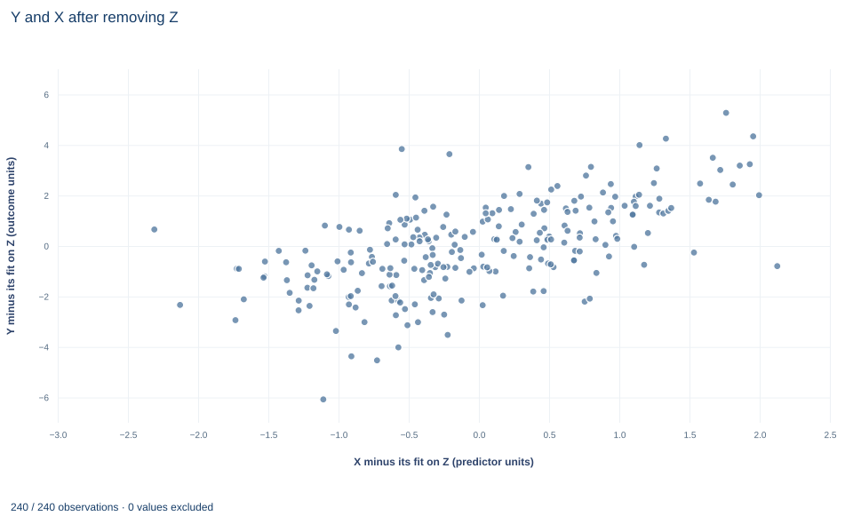

# Lab 01 · The Frisch–Waugh–Lovell Identity

**Partialling out a control: which variation a multiple-regression slope uses**

## Start with the supplied workbook

1. Download [partialling_out.xlsx](partialling_out.xlsx) and the [Python lab](lab.py). The workbook holds the fixed records used throughout this chapter.
2. Import `partialling_out.xlsx` into OpenEconometrics and keep that file name as the dataset name. The `Data` sheet holds one row per synthetic unit: an identifier, the regressor of interest `x`, the control `z` and the outcome `y`. The `Dictionary` sheet describes each column; no cell is blank.
3. Open the complete `lab.py` in a new Python document and run the whole file. It fits the full regression and two auxiliary regressions, then displays the full model's coefficient table, the concept chart (the app shows the chart's first panel; this chart has a single panel, residualized `y` against residualized `x`) and a summary table with both slopes, the HC3 standard error and the row count.

For ordinary Python, keep `lab.py` and the workbook in the same folder and run the script there, or call `from lab import run_lab` and then `run_lab(data_path="/path/to/partialling_out.xlsx")`. To try a transformation, work on a copy of the loaded table so the distributed workbook stays unchanged. The [LaTeX table](table.tex) collects the reported numbers.

A regression of `y` on `x` and `z` reports a coefficient of 1.188 on `x`. The usual gloss is "the association of `x` with `y`, holding `z` constant." Yet `z` is continuous and no two rows share a value of it, so nothing is literally held constant. What comparison does the coefficient make, and which part of the variation in `x` does it use?

The Frisch–Waugh–Lovell (FWL) theorem gives an exact answer. Remove from `y` and from `x` everything that a linear function of `z` with an intercept can predict, then regress what is left of `y` on what is left of `x`. The slope of that residual-on-residual regression *is* the multiple-regression coefficient. Here the two numbers differ only in the sixteenth decimal place, which is floating-point rounding.

The workbook contains **240 original synthetic rows**, each an independent unit, with no missing cells. All columns are in abstract units: `x` is the regressor whose coefficient we study, `z` is an observed control that moves with `x`, and `y` is the outcome. The dictionary calls `x` and `z` "centered," but their sample means are −0.09 and −0.07, so they are only roughly centered. Nothing below depends on centering, because every regression has an intercept.

## 1. State the model and the normal equations

The full regression is

$$
y_i=\beta_0+\beta_x x_i+\beta_z z_i+u_i,\qquad i=1,\dots,240,
$$

where $y_i$ is the outcome, $x_i$ the regressor of interest, $z_i$ the control and $u_i$ the error. Stacked, $y=X\beta+u$ with $X=[\,\mathbf 1,\ x,\ z\,]$, a $240\times 3$ matrix. Least squares minimizes the sum of squared residuals, and the minimizer satisfies the normal equations

$$
X'(y-X\hat\beta)=X'\hat e=0 .
$$

Every column of $X$ is orthogonal to the residuals: $\sum_i\hat e_i=0$, $\sum_i x_i\hat e_i=0$ and $\sum_i z_i\hat e_i=0$. The whole lab follows from these three equations. The question is algebraic, not causal: which sample variation determines $\hat\beta_x$?

## 2. Build the annihilator

Split the columns into $x$ and the block $W=[\,\mathbf 1,\ z\,]$ holding the intercept and the control. Define

$$
P_W=W(W'W)^{-1}W',\qquad M_W=I_n-P_W .
$$

$P_Wy$ is the vector of fitted values from regressing $y$ on $W$, and $M_Wy$ the vector of residuals. $M_W$ is the annihilator: $M_WW=0$. It is symmetric, $M_W'=M_W$, and idempotent, $M_WM_W=M_W$, since residuals from a regression on $W$ have nothing left to remove. Write $\tilde x=M_Wx$ ("x minus its fit on z") and $\tilde y=M_Wy$ ("y minus its fit on z"), each from a regression with an intercept.

## 3. Derive the identity

Write the fitted full regression as $y=W\hat\gamma+x\hat\beta_x+\hat e$, where $\hat\gamma$ holds the intercept and the `z` coefficient. Multiply by $M_W$:

$$
\tilde y=M_WW\hat\gamma+\tilde x\hat\beta_x+M_W\hat e=\tilde x\hat\beta_x+\hat e .
$$

The first term vanishes because $M_WW=0$; the last equals $\hat e$ because the normal equations make $\hat e$ orthogonal to $W$. Premultiply by $\tilde x'$:

$$
\tilde x'\tilde y=\tilde x'\tilde x\,\hat\beta_x+\tilde x'\hat e,
\qquad
\tilde x'\hat e=x'M_W\hat e=x'\hat e=0 .
$$

The cross term is zero by the normal equation for $x$, so

$$
\hat\beta_x=(\tilde x'\tilde x)^{-1}\tilde x'\tilde y=(x'M_Wx)^{-1}x'M_Wy .
$$

The same line shows that the residuals of the regression of $\tilde y$ on $\tilde x$ are exactly the full-model residuals $\hat e$. The identity needs $\tilde x'\tilde x>0$: `x` must not be an exact linear function of the intercept and `z`, which is the full-rank condition seen from one coefficient. It also needs one fixed set of rows. If the regressions silently dropped different rows, the residuals would come from different projections. The lab's fitting helper refuses missing values instead of dropping them, and the workbook has none, so all three regressions use the same 240 rows.

**Pause before running.** Should the full slope and the residualized slope differ? If you expect a gap, what would cause it?

## 4. Run the three regressions

The complete `lab.py` defines `load_data()`, a `fit()` helper (least squares with HC3 covariance) and `coef()`, which looks up one coefficient. The core of the lab is:

```python
raw = load_data()  # reader defined in the complete lab.py
full = fit(raw, ["x", "z"])        # y on 1, x, z
y_on_z = fit(raw, ["z"])           # y on 1, z
x_on_z = fit(raw, ["z"], y="x")    # x on 1, z

def residual(model, column):
    fitted = coef(model, "Intercept").estimate + coef(model, "z").estimate * raw["z"]
    return raw[column] - fitted

y_tilde = residual(y_on_z, "y")
x_tilde = residual(x_on_z, "x")
fwl_slope = (x_tilde * y_tilde).sum() / (x_tilde * x_tilde).sum()
display(full)
print(coef(full, "x").estimate, fwl_slope)
```

The three fitted regressions are:

| Regression | Outcome | Intercept | Coefficient on `x` | Coefficient on `z` | Rows |
|---|---|---:|---:|---:|---:|
| Full | `y` | 2.048 | 1.188 | 0.752 | 240 |
| Outcome on control | `y` | 1.987 | — | 1.414 | 240 |
| Regressor on control | `x` | −0.051 | — | 0.557 | 240 |

and the lab's summary table reads:

| Quantity | Value |
|---|---:|
| Coefficient on `x`, full regression | 1.1882 |
| Slope of $\tilde y$ on $\tilde x$, no intercept | 1.1882 |
| HC3 standard error of the full coefficient | 0.1119 |
| Rows used in every regression | 240 |

The `z` coefficient is 0.752 in the full regression but 1.414 when `z` stands alone, because alone it also carries the part of `y` that goes with `x`. The regressor-on-control slope says that one more unit of `z` goes with 0.557 more `x` on average. That association is why partialling out matters.

## 5. Check the arithmetic by hand

The chart data store the 240 pairs $(\tilde x_i,\tilde y_i)$. From them,

$$
\sum_i\tilde x_i\tilde y_i=218.11,\qquad \sum_i\tilde x_i^2=183.56,\qquad \frac{218.11}{183.56}=1.1882 .
$$

The denominator is the residual sum of squares from the regression of `x` on `z`. That is the precise sense of "holding `z` constant": the coefficient counts only the variation in `x` that `z` cannot linearly predict, paired with the matching residual variation in `y`.

Both residual series average exactly zero, because $W$ contains the column of ones. That is why the final regression needs no intercept; adding one would give an estimate of zero. For the same reason $\tilde x$ is uncorrelated with `z` in the sample.

A common misreading treats "holding `z` constant" as matching. It is a linear adjustment: if `y` depended on `z` through a curve, the curvature would remain in $\tilde y$ and could still be correlated with $\tilde x$.

## 6. Take inference from the full model

The full model reports HC3 covariance with a Student $t$ reference on $n-k=240-3=237$ residual degrees of freedom:

$$
\hat V_{\mathrm{HC3}}=(X'X)^{-1}\Big(\sum_{i=1}^{n}\frac{\hat e_i^{2}}{(1-h_{ii})^{2}}\,\mathbf x_i\mathbf x_i'\Big)(X'X)^{-1},\qquad h_{ii}=\mathbf x_i'(X'X)^{-1}\mathbf x_i ,
$$

where $\mathbf x_i'$ is row $i$ of $X$ and $h_{ii}$ is its leverage. The square root of the `x` element is 0.1119. The $t$ statistic for a zero coefficient is $1.1882/0.1119=10.62$, and the 95% interval, $1.1882\pm t_{0.975,237}\times0.1119$, runs from 0.968 to 1.409 outcome units per unit of `x`.

The slope transfers to the residual regression; the standard error does not. A program fitting $\tilde y$ on $\tilde x$ sees one parameter and reports 239 residual degrees of freedom, although three parameters were estimated from these rows. Its leverage values, $\tilde x_i^2/\sum_j\tilde x_j^2$, omit the leverage that comes from the intercept and `z`. Because the residuals are identical, a covariance formula that uses neither degrees of freedom nor leverage (HC0) agrees exactly between the two fits; HC3 and the classical formula do not. Use FWL to compute and explain the coefficient, and take its uncertainty from the full specification. HC3 itself assumes independent rows with possibly unequal error variances.

## 7. Read the chart



The chart, titled "Y and X after removing Z", is an added-variable plot with one point per row. The horizontal axis is $\tilde x$, "X minus its fit on Z," from about −2.3 to 2.1 predictor units; the vertical axis is $\tilde y$, "Y minus its fit on Z," from about −6.1 to 5.3 outcome units. Both are centered on zero.

No line is drawn, but the least-squares line through the origin of this upward-sloping cloud has slope 1.188, the full-model coefficient. The vertical scatter about that line is exactly the full model's residuals, with a root mean squared error of 1.39 outcome units. The horizontal spread is the only variation in `x` that informs $\hat\beta_x$, and each row's weight in the slope is proportional to its $\tilde x_i$, so points far to the left or right matter most. Such a point lying far from the implied line deserves the influence checks of Lab 05. This is not raw `y` against raw `x`: the variation that `z` predicts has been removed from both axes.

## A case from the literature

The identity began as an answer to a practical question about preparing data. Frisch and Waugh (1933) compared partial time regressions with individual trends: include time as a regressor, or detrend each series first? Lovell (1963) faced the same choice for seasonality. Should a researcher regress seasonally adjusted series on one another, or add seasonal dummy variables to a regression on the unadjusted data? He showed that any sum-preserving seasonal adjustment that is orthogonal and idempotent can be carried out by least-squares regression, and he extended the Frisch–Waugh theorem to compare the two routes. In this lab's notation the seasonal dummies form $W$ and least-squares adjustment applies $M_W$, so adjusting both `y` and `x` by the same procedure gives the dummy-variable coefficient. Lovell also found an inherent tendency for regressions on pre-adjusted data to overstate the significance of the coefficients, and he proposed a correction. Section 6 shows one reason the slope can carry over while its uncertainty does not: a program that sees only the adjusted series does not count the parameters spent on the adjustment. Ding (2021) takes up the theorem's counterpart for standard errors, and Lovell (2008) gives a short proof of the original result. The practical lesson is that partialling out is a computation, not a separate model, and the identity holds only when the adjustment uses the same rows and the same $W$ for both series.

## 8. Decide what the identity supports

The identity computes a multiple-regression coefficient from two simple regressions, which is how software absorbs large sets of controls such as group indicators. It explains precision: the more `z` predicts `x`, the smaller $\sum\tilde x_i^2$ and the noisier $\hat\beta_x$. And it yields a diagnostic chart for outliers and nonlinearity.

It does not establish causality. Partialling out removes only the linear association with included, observed controls; an unobserved confounder stays in $\tilde x$ and $\tilde y$ alike, and the residual regression inherits any bias of the full regression. Choosing $W$ is substantive: partialling out a mediator (affected by `x`) or a collider (affected by `x` and `y`) changes the estimand even though the algebra still holds.

## 9. Write the result in full

A complete statement for this lab reads: "In 240 original synthetic units, the least-squares coefficient on `x` in a regression of `y` on `x` and `z` with an intercept is 1.188 (HC3 standard error 0.112, 237 residual degrees of freedom, 95% interval 0.968 to 1.409). Regressing the residuals of `y` on `z` on the residuals of `x` on `z` reproduces this coefficient to rounding error, so the estimate uses only the part of `x` that `z` does not linearly predict. Uncertainty is taken from the full model. The coefficient is an adjusted association; a causal reading needs a separate argument that `z` blocks every confounding path."

## Student exercises

1. Reverse the roles of the two regressors. Partial the intercept and `x` out of both `y` and `z`, regress the residualized `y` on the residualized `z` without an intercept, and compare the result with the full-model `z` coefficient. Write the annihilator you used.
2. Residualize only one side at a time. (a) Regress raw `y` on $\tilde x$ without an intercept. (b) Regress $\tilde y$ on raw `x` with an intercept. Which reproduces the full coefficient? Prove your answer with the properties of $M_W$, and express the other slope in terms of $\hat\beta_x$ and a fit statistic of the regression of `x` on `z`.
3. Fit the residual regression with `oe.ols(..., intercept=False, covariance="HC3")` and compare its standard error and degrees of freedom with the full model. Repeat both fits with classical covariance (`covariance=None`) and show that the ratio of the two classical standard errors is a simple function of the residual degrees of freedom.
4. Find the $R^2$ of the regression of `x` on `z`. Compute the share of the sample variation in `x` that remains in $\tilde x$ and the factor $1/(1-R^2)$. Explain how this factor enters the variance of $\hat\beta_x$, and what would happen to it if `z` became a near-copy of `x`.
5. Fit the short regression of `y` on `x` alone. Using the full-model coefficients and a regression of `z` on `x`, write the short slope as the full slope plus a correction term, and check the arithmetic to four decimals.
6. Rewrite this sentence so that it matches the analysis: "After residualizing `y` and `x` on `z`, the residual regression shows that `x` causes `y` to rise by 1.19, with a standard error from that regression on 239 degrees of freedom, so `z` is fully controlled for."

## Further reading

- Ding, P. (2021). The Frisch–Waugh–Lovell theorem for standard errors. *Statistics & Probability Letters*, 168, 108945. https://doi.org/10.1016/j.spl.2020.108945
- Frisch, R., and Waugh, F. V. (1933). Partial time regressions as compared with individual trends. *Econometrica*, 1(4), 387. https://doi.org/10.2307/1907330
- Lovell, M. C. (1963). Seasonal adjustment of economic time series and multiple regression analysis. *Journal of the American Statistical Association*, 58(304), 993–1010. https://doi.org/10.1080/01621459.1963.10480682
- Lovell, M. C. (2008). A simple proof of the FWL theorem. *The Journal of Economic Education*, 39(1), 88–91. https://doi.org/10.3200/JECE.39.1.88-91
