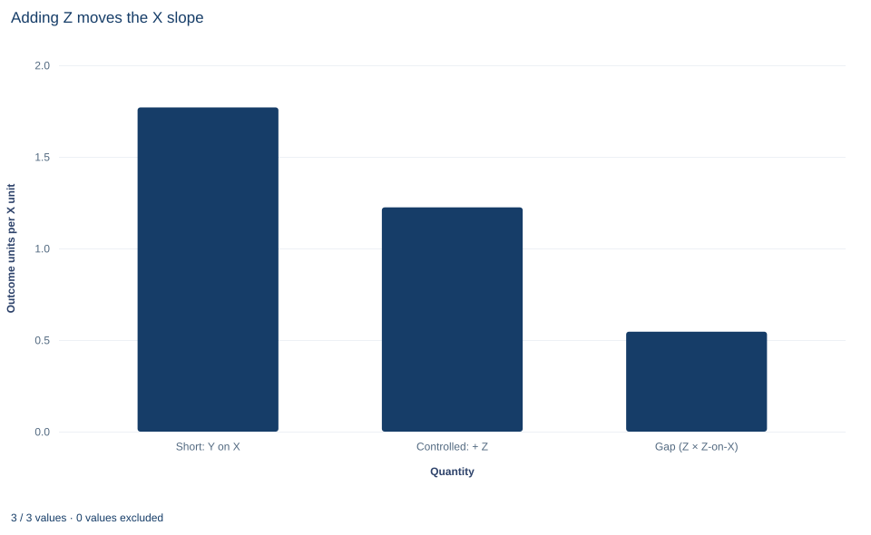

# Lab 02 · An Exact Sample Omitted-Variable Decomposition

**Omitted-variable bias as an exact identity among three least-squares fits**

## Start with the supplied workbook

1. Download [omitted_variable_bias.xlsx](omitted_variable_bias.xlsx) and the [Python lab](lab.py). The workbook holds the fixed records used throughout this chapter.
2. Import `omitted_variable_bias.xlsx` into OpenEconometrics and keep that file name as the dataset name. The `Data` sheet holds one row per synthetic unit: an identifier, the regressor of interest `x`, the control `z` and the outcome `y`. The `Dictionary` sheet describes each column; no cell is blank.
3. Open the complete `lab.py` in a new Python document and run the whole file. It fits the short, full and auxiliary regressions, then displays the full model's coefficient table, the concept chart (the app shows the chart's first panel; this chart has a single panel, a bar chart of the short slope, the controlled slope and their gap) and a summary table with the six quantities of the decomposition.

For ordinary Python, keep `lab.py` and the workbook in the same folder and run the script there, or call `from lab import run_lab` and then `run_lab(data_path="/path/to/omitted_variable_bias.xlsx")`. To try a transformation, work on a copy of the loaded table so the distributed workbook stays unchanged. The [LaTeX table](table.tex) collects the reported numbers.

Regress `y` on `x` alone and the slope is 1.770. Add the control `z` and the slope on `x` falls to 1.224. The coefficient lost 0.546, almost a third of its size. Where did it go? This lab shows that the gap is not a vague "confounding effect" but an exact product of two estimated coefficients: the `z` coefficient in the full regression, 0.736, times the slope of `z` on `x`, 0.742. Their product is 0.546 to the last stored digit.

The familiar omitted-variable bias formula is usually stated for populations, as a probability limit under a model. Its sample counterpart needs no model at all: it is an identity among least-squares fits on one set of rows. Seeing it as an identity clarifies both what the formula proves and what it cannot decide, namely whether `z` belongs in the regression.

The workbook contains **240 original synthetic rows**, each an independent unit, with no missing cells. Columns are in abstract units: `x` is the regressor whose coefficient we study, `z` is an observed control that moves with `x`, and `y` is the outcome. The dictionary calls `x` and `z` "centered," but their sample means are 0.07 and −0.06, so they are only roughly centered; every regression includes an intercept, so nothing depends on it.

## 1. Set up the three regressions

Three least-squares fits on the same 240 rows carry the argument:

$$
\begin{aligned}
\text{short:}\quad & y_i=a+b\,x_i+\varepsilon_i,\\
\text{full:}\quad & y_i=\beta_0+\beta_x x_i+\beta_z z_i+u_i,\\
\text{auxiliary:}\quad & z_i=\pi_0+\pi_x x_i+v_i .
\end{aligned}
$$

$b$ is the slope on `x` when `z` is omitted, $\beta_x$ and $\beta_z$ are the full-regression coefficients, and $\pi_x$ is the slope from a regression of the control on the regressor of interest. The errors $\varepsilon_i$, $u_i$ and $v_i$ are whatever each fit leaves over. Hats denote the least-squares estimates.

## 2. Derive the sample identity

The short-regression slope is a ratio of sample moments:

$$
\hat b=\frac{\sum_i(x_i-\bar x)\,y_i}{\sum_i(x_i-\bar x)^2}.
$$

The fitted full regression holds exactly in the sample: $y_i=\hat\beta_0+\hat\beta_x x_i+\hat\beta_z z_i+\hat e_i$. Substitute it into the numerator. The intercept drops out because $\sum_i(x_i-\bar x)=0$, and the residual term drops out because the full model's normal equations make $\hat e$ orthogonal to both the constant and `x`, so $\sum_i(x_i-\bar x)\hat e_i=0$. What remains is

$$
\hat b=\hat\beta_x+\hat\beta_z\,\frac{\sum_i(x_i-\bar x)\,z_i}{\sum_i(x_i-\bar x)^2}=\hat\beta_x+\hat\beta_z\,\hat\pi_x .
$$

The fraction is the auxiliary slope, the least-squares coefficient from regressing `z` on `x`. With several regressors the same steps give $\hat b_1=\hat\beta_1+\hat\Pi\hat\beta_2$, where $\hat\Pi$ stacks the slopes from regressing each omitted column on the included ones.

The derivation uses no assumption about errors, distributions or causality. It needs three things: the same rows in all three fits, an intercept in each, and enough variation that each regression is defined. If the short regression used different rows from the other two, the substitution would mix two samples and the identity would generally fail.

## 3. Separate the population formula from the sample identity

The population version adds a model. Suppose the full equation is the data-generating process with $E[u\mid x,z]=0$. Then, as the sample grows,

$$
\operatorname{plim}\hat b=\beta_x+\beta_z\,\frac{\operatorname{Cov}(x,z)}{\operatorname{Var}(x)} .
$$

This is a statement about the short estimator's target relative to a structural parameter $\beta_x$, and only then does the gap deserve the word "bias." The short slope differs from $\beta_x$ only if both $\beta_z\neq0$ (the omitted variable matters for `y` given `x`) and $\operatorname{Cov}(x,z)\neq0$ (it moves with `x`). The sample identity is weaker and more general: it describes how two estimates on the same data differ, whether or not either one estimates a causal quantity.

**Pause before running.** Predict the sign of the gap from what you know about `z`.

## 4. Run the decomposition

The complete `lab.py` defines `load_data()`, a `fit()` helper (least squares with HC3 covariance that refuses missing values) and `coef()`, which looks up one coefficient. The core of the lab is:

```python
raw = load_data()  # reader defined in the complete lab.py
short = fit(raw, ["x"])               # y on 1, x
full = fit(raw, ["x", "z"])           # y on 1, x, z
auxiliary = fit(raw, ["x"], y="z")    # z on 1, x
observed_gap = coef(short, "x").estimate - coef(full, "x").estimate
decomposed_gap = coef(full, "z").estimate * coef(auxiliary, "x").estimate
display(full)
print(observed_gap, decomposed_gap)
```

The lab's summary table reads:

| Quantity | Symbol | Value |
|---|---|---:|
| Slope on `x`, short regression | $\hat b$ | 1.7699 |
| Slope on `x`, full regression | $\hat\beta_x$ | 1.2243 |
| Coefficient on `z`, full regression | $\hat\beta_z$ | 0.7358 |
| Slope of `z` on `x`, auxiliary regression | $\hat\pi_x$ | 0.7416 |
| Observed gap, short minus full | $\hat b-\hat\beta_x$ | 0.5457 |
| Decomposed gap | $\hat\beta_z\hat\pi_x$ | 0.5457 |

The slopes on `x` are in outcome units per unit of `x`; $\hat\beta_z$ is in outcome units per unit of `z`, and $\hat\pi_x$ in units of `z` per unit of `x`. The last two rows agree to within $10^{-15}$, and the lab's check requires agreement within $10^{-10}$.

## 5. Read the decomposition

The arithmetic is $0.7358\times0.7416=0.5457$, and $1.2243+0.5457=1.7699$. Both factors are positive. Conditional on `x`, units with more `z` have higher `y`; and units with more `x` tend to have more `z`. When `z` is omitted, the short regression credits `x` with the part of `z`'s association with `y` that travels with `x`. That part is 0.546 outcome units per unit of `x`, or $0.5457/1.7699=31\%$ of the short slope.

Each factor answers a separate question. $\hat\beta_z$ asks how strongly the omitted variable relates to the outcome once `x` is in the model. $\hat\pi_x$ asks how strongly the omitted variable moves with `x`. A large gap needs both. A control that strongly predicts `y` but is unrelated to `x` in the sample would leave the slope on `x` unchanged, though it could still sharpen its precision by reducing residual variance.

## 6. Keep inference conventions straight

Each regression carries its own HC3 covariance with a Student $t$ reference:

| Regression | Coefficient | Estimate | HC3 standard error | 95% interval | Degrees of freedom |
|---|---|---:|---:|---|---:|
| Short | `x` | 1.770 | 0.094 | 1.586 to 1.954 | 238 |
| Full | `x` | 1.224 | 0.101 | 1.025 to 1.424 | 237 |
| Full | `z` | 0.736 | 0.081 | 0.577 to 0.895 | 237 |
| Auxiliary | `x` | 0.742 | 0.057 | 0.629 to 0.854 | 238 |

The degrees of freedom are $n-k$: 240 rows minus two parameters for the short and auxiliary fits, minus three for the full fit. HC3 weights each squared residual by $1/(1-h_{ii})^2$, where $h_{ii}$ is the row's leverage, and assumes independent rows.

The identity holds for point estimates, not for standard errors. The full-model standard error on `x` (0.101) is larger than the short one (0.094) even though adding `z` reduces the residual variance: by the FWL logic of Lab 01, the full slope uses only the part of `x` that `z` does not predict, and that part has less variation.

The gap has no reported standard error. It is a difference of two estimates computed from the same rows, or equivalently a product of estimates from two regressions on the same rows, and those estimates are dependent. Its uncertainty requires their joint covariance, for example by stacking the equations or by resampling rows and recomputing all three fits together. Treating the short and full intervals as independent, or judging the gap by whether two intervals overlap, ignores that dependence.

## 7. Read the chart



The chart, titled "Adding Z moves the X slope", has three bars on a common vertical axis labeled "Outcome units per X unit," running from 0 to 2. The first bar, "Short: Y on X," stands at 1.770. The second, "Controlled: + Z," is the regression of Y on X and Z and stands at 1.224. The third, "Gap (Z × Z-on-X)," stands at 0.546 and is computed as the product $\hat\beta_z\hat\pi_x$, not as a difference.

Read it as an accounting picture: stacking the third bar on the second reproduces the first exactly. The chart shows point estimates only. It has no intervals, so it says nothing about how precisely the gap is estimated, and the heights of the bars are not test statistics. Its message is the identity of Section 2 made visible.

## A case from the literature

Altonji, Elder and Taber (2005) measured the effect of Catholic high school attendance on educational attainment and test scores. Lacking a good instrument for attendance, they built estimation methods on the idea that the amount of selection on observed characteristics is a guide to the amount of selection on unobserved ones. They also proposed an informal check: how large would selection on unobservables have to be, relative to selection on observables, to attribute the whole effect of Catholic school attendance to selection bias? They concluded that Catholic high schools substantially raise the probability of graduating from high school and, more tentatively, of attending college, with little evidence of an effect on test scores. That is the sensitivity question of Section 8: how strong would an omitted factor have to be to erase the estimate? Oster (2019) connected bias explicitly to coefficient stability and showed that movements in $R^2$ must be considered along with movements in the coefficient. Cinelli and Hazlett (2020) extended the omitted-variable bias framework into sensitivity tools that can be computed from standard regression results. Gelbach (2016) used the omitted-variable formula to split a coefficient's movement among several added controls without the sequence sensitivity of adding them one at a time; it builds on the many-control form of the identity in Section 2. The identity is exact, but any statement about unmeasured variables needs an assumption the data cannot check, such as a bound on how strongly the missing variable relates to `x` and `y`.

## 8. Decide what the decomposition supports

The decomposition tells you exactly how much the coefficient on `x` moves when `z` is added, and why: through $\hat\beta_z$ and $\hat\pi_x$. It does not tell you which slope to report. That depends on the causal role of `z`, which the data cannot reveal:

- If `z` is a common cause of `x` and `y` (a confounder), the full regression is the relevant comparison, and the short slope mixes the effect of `x` with that of `z`.
- If `z` is caused by `x` and in turn affects `y` (a mediator), the short slope summarizes the total association, and controlling for `z` changes the question to a direct association.
- If `z` is affected by both `x` and `y` (a collider), controlling for it can create a spurious association.

The identity also supports sensitivity reasoning about variables that are *not* in the data. For a hypothetical omitted variable, the same product shows how large its coefficient and its association with `x` would have to be to move the slope by a given amount. Finally, `z` is assumed to be measured without error. A noisily measured control removes only part of the confounding it stands for, a point that Lab 03 develops for the regressor itself.

## 9. Write the result in full

A complete statement for this lab reads: "In 240 original synthetic units, the least-squares slope of `y` on `x` is 1.770 without the control `z` and 1.224 with it (HC3 standard errors 0.094 and 0.101). The difference of 0.546 equals exactly the product of the full-model `z` coefficient (0.736) and the slope of `z` on `x` (0.742), all fitted on the same rows with intercepts. The decomposition is an identity among the fits; whether the controlled slope is the relevant one depends on whether `z` is a confounder, which the data alone cannot establish."

## Student exercises

1. Omit `x` instead of `z`. Fit the short regression of `y` on `z`, the regression of `x` on `z`, and use the full model to decompose the gap between the short and full `z` coefficients. Check the arithmetic to four decimals.
2. On a copy of the data, create `z10 = 10 * z` and refit the full and auxiliary regressions with `z10` in place of `z`. Predict before running which of the six summary quantities change and by what factor, then confirm.
3. Break the common sample: fit the short regression on the first 120 rows only, keep the full and auxiliary regressions on all 240, and compare the "observed gap" with the product. Then refit all three on the first 120 rows. Explain the difference in terms of the derivation in Section 2.
4. Compute the sample covariance of `x` and `z` and the sample variance of `x`, and confirm that their ratio is the auxiliary slope. Rewrite the decomposed gap using the sample correlation of `x` and `z` and the two standard deviations, and evaluate it.
5. Estimate the uncertainty of the gap by resampling. Draw 500 bootstrap samples of the 240 rows with replacement (fix the random seed), refit all three regressions in each sample, and report the standard deviation of the 500 gaps and a 2.5–97.5 percentile interval. Explain why each resample must refit all three regressions rather than combine separately resampled pieces.
6. Rewrite this sentence so that it matches the analysis: "Controlling for `z` removed the bias in the `x` coefficient, which fell from 1.77 to 1.22, so the true effect of `x` on `y` is 1.22."

## Further reading

- Altonji, J. G., Elder, T. E., and Taber, C. R. (2005). Selection on observed and unobserved variables: Assessing the effectiveness of Catholic schools. *Journal of Political Economy*, 113(1), 151–184. https://doi.org/10.1086/426036
- Cinelli, C., and Hazlett, C. (2020). Making sense of sensitivity: Extending omitted variable bias. *Journal of the Royal Statistical Society Series B: Statistical Methodology*, 82(1), 39–67. https://doi.org/10.1111/rssb.12348
- Gelbach, J. B. (2016). When do covariates matter? And which ones, and how much? *Journal of Labor Economics*, 34(2), 509–543. https://doi.org/10.1086/683668
- Oster, E. (2019). Unobservable selection and coefficient stability: Theory and evidence. *Journal of Business & Economic Statistics*, 37(2), 187–204. https://doi.org/10.1080/07350015.2016.1227711
