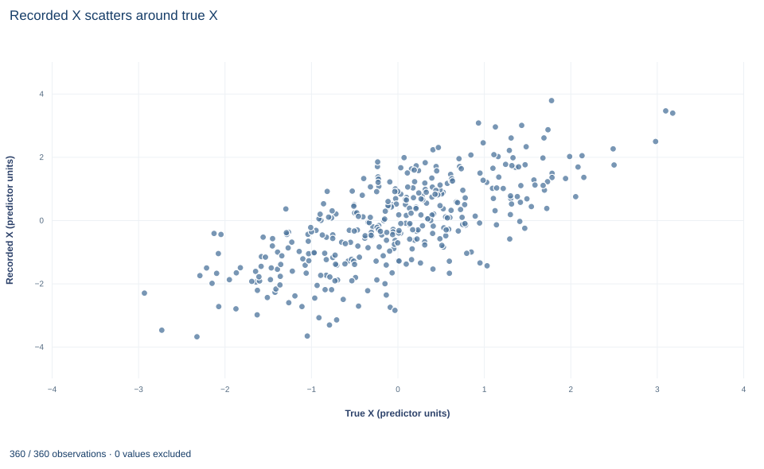

# Lab 03 · Measurement Error and Attenuation

**Classical error in a regressor: why a noisy measure flattens the slope**

## Start with the supplied workbook

1. Download [measurement_error.xlsx](measurement_error.xlsx) and the [Python lab](lab.py). The workbook holds the fixed records used throughout this chapter.
2. Import `measurement_error.xlsx` into OpenEconometrics and keep that file name as the dataset name. The `Data` sheet holds one row per synthetic unit: an identifier, the true regressor `x`, its recorded version `observed_x`, and the outcome `y`. The `Dictionary` sheet describes each column; no cell is blank.
3. Open the complete `lab.py` in a new Python document and run the whole file. It fits the regression of `y` on the true regressor and on the recorded one, then displays the coefficient table for the recorded-regressor model, the concept chart (the app shows the chart's first panel; this chart has a single panel, recorded `x` against true `x`) and a summary table with both slopes, the reliability ratio, the population target and the row count.

For ordinary Python, keep `lab.py` and the workbook in the same folder and run the script there, or call `from lab import run_lab` and then `run_lab(data_path="/path/to/measurement_error.xlsx")`. To try a transformation, work on a copy of the loaded table so the distributed workbook stays unchanged. The [LaTeX table](table.tex) collects the reported numbers.

Regress `y` on the true regressor and the slope is 1.556. Regress the same outcome, on the same rows, on a recorded version of that regressor and the slope drops to 0.824, about half. Nothing went wrong with least squares, and no row was lost. The recorded regressor simply contains noise that has nothing to do with `y`, and that noise dilutes the association.

Classical errors-in-variables theory predicts the size of the shrinkage: the slope is multiplied by the share of the recorded variable's variance that is signal. This lab derives that result, checks it against a finite sample, and explains why the noisy slope here sits above its population target of 0.75.

The workbook contains **360 original synthetic rows**, each an independent unit, with no missing cells. `x` is the true regressor, which a real researcher would not observe; the file reveals it only so that the noisy regression has a benchmark. `observed_x` is `x` plus an independent recording error and is measured in the same predictor units as `x`. `y` is the outcome in outcome units. The dictionary gives the unit of `x` and `observed_x` only as "units."

## 1. Write the outcome and measurement equations

The outcome depends on the true regressor,

$$
y_i=\beta_0+\beta x_i+e_i,
$$

but only a noisy measure is recorded,

$$
w_i=x_i+v_i ,
$$

where $w_i$ is `observed_x` and $v_i$ is the measurement error. The error is **classical** when it has mean zero and is independent of both the true regressor and the outcome error: $E[v_i]=0$ and $v_i$ independent of $(x_i,e_i)$. Every part of that definition matters. Error that grows with $x_i$, that is correlated with $e_i$, or that comes from misclassifying a binary variable is nonclassical, and the result below does not apply to it.

In this synthetic design the true slope is $\beta=1.5$, and the true regressor and the measurement error both have variance one.

## 2. Derive the attenuation factor

The least-squares slope of `y` on the recorded regressor is $\hat b_w=\widehat{\operatorname{Cov}}(w,y)/\widehat{\operatorname{Var}}(w)$. Replace the sample moments by population moments and expand both:

$$
\operatorname{Cov}(w,y)=\operatorname{Cov}(x+v,\ \beta x+e)=\beta\operatorname{Var}(x),
\qquad
\operatorname{Var}(w)=\operatorname{Var}(x)+\operatorname{Var}(v).
$$

The cross terms vanish because $v$ is independent of $x$ and $e$, and $x$ is uncorrelated with $e$. Therefore

$$
\operatorname{plim}\hat b_w=\beta\,\lambda,\qquad \lambda=\frac{\operatorname{Var}(x)}{\operatorname{Var}(x)+\operatorname{Var}(v)}\in(0,1].
$$

$\lambda$ is the **reliability ratio**, the share of the recorded variable's variance that is signal. The noise adds to the denominator but contributes nothing to the numerator, so the slope shrinks toward zero without changing sign. With $\operatorname{Var}(x)=\operatorname{Var}(v)=1$, $\lambda=0.5$ and the probability limit of the noisy slope is $1.5\times0.5=0.75$.

The same result appears as an endogeneity problem. Substituting $x_i=w_i-v_i$ gives $y_i=\beta_0+\beta w_i+(e_i-\beta v_i)$. The composite error contains $-\beta v_i$, and $w_i$ contains $v_i$, so $\operatorname{Cov}(w,\,e-\beta v)=-\beta\operatorname{Var}(v)<0$ for positive $\beta$. The regressor is correlated with the error, and least squares is inconsistent.

The lab's summary calls 0.75 the "population attenuation target." It is the target of the *noisy slope*, $\beta\lambda$, not the attenuation factor itself, which is $\lambda=0.5$.

## 3. Account for the finite sample exactly

One sample need not hit 0.75. Fit the benchmark regression of `y` on true `x`, with slope $\hat b_x$ and residuals $\hat e$. Because that fitted equation holds exactly, $\widehat{\operatorname{Cov}}(w,y)=\hat b_x\widehat{\operatorname{Cov}}(w,x)+\widehat{\operatorname{Cov}}(w,\hat e)$, and dividing by $\widehat{\operatorname{Var}}(w)$ gives

$$
\hat b_w=\hat b_x\,\hat\lambda+\frac{\widehat{\operatorname{Cov}}(v,\hat e)}{\widehat{\operatorname{Var}}(w)},\qquad \hat\lambda=\frac{\widehat{\operatorname{Cov}}(x,w)}{\widehat{\operatorname{Var}}(w)} .
$$

The covariance of $w$ with $\hat e$ equals that of $v$ with $\hat e$, because $\hat e$ is orthogonal to $x$ in the sample. The chart data contain both `x` and `observed_x`, so $\hat\lambda$ can be computed from them: it is 0.5294. Then $1.5559\times0.5294=0.8238$, and the remainder is $0.8236-0.8238=-0.0002$.

So the noisy slope lands at 0.824 rather than 0.75 for two reasons, neither of them a failure of the theory. The benchmark slope is 1.556 rather than 1.5, because the outcome errors in one finite sample are not exactly orthogonal to `x`. And the sample attenuation factor is 0.529 rather than 0.5, because sample variances and covariances are not exactly one and zero. The remainder term, which reflects sample correlation between the recording error and the outcome error, is negligible here.

**Pause before running.** What is the population target for the noisy slope, and would you expect this sample to hit it exactly?

## 4. Run both regressions

The complete `lab.py` defines `load_data()`, a `fit()` helper (least squares with HC3 covariance that refuses missing values) and `coef()`, which looks up one coefficient. The core of the lab is:

```python
raw = load_data()  # reader defined in the complete lab.py
latent = fit(raw, ["x"])               # benchmark: y on the true regressor
observed = fit(raw, ["observed_x"])    # what a researcher could fit
noise = raw.observed_x - raw.x
reliability = raw.x.var() / (raw.x.var() + noise.var())
display(observed)
print(coef(latent, "x").estimate, coef(observed, "observed_x").estimate, reliability)
```

The two fits, both on 360 rows with 358 residual degrees of freedom, are:

| Regressor | Slope | HC3 standard error | 95% interval | $R^2$ |
|---|---:|---:|---|---:|
| True `x` (benchmark) | 1.556 | 0.050 | 1.458 to 1.654 | 0.725 |
| Recorded `observed_x` | 0.824 | 0.060 | 0.706 to 0.941 | 0.368 |

and the lab's summary table reads:

| Quantity | Value |
|---|---:|
| Slope on true `x` | 1.5559 |
| Slope on recorded `observed_x` | 0.8236 |
| Reliability from sample variances, $\widehat{\operatorname{Var}}(x)/[\widehat{\operatorname{Var}}(x)+\widehat{\operatorname{Var}}(v)]$ | 0.5282 |
| Probability limit of the recorded-regressor slope, $\beta\lambda$ | 0.75 |
| Rows | 360 |

The slope ratio is $0.8236/1.5559=0.5293$, close to both 0.5282 and $\hat\lambda=0.5294$. These three sample versions of the reliability differ slightly because the sample covariance between `x` and the error is not exactly zero. The $R^2$ falls from 0.725 to 0.368: the noise in the regressor is unexplained variation in the fit.

## 5. Read the uncertainty correctly

Each model reports HC3 covariance with a Student $t$ reference on $360-2=358$ degrees of freedom. The recorded-regressor interval, 0.706 to 0.941, is narrow, and it excludes both the true slope 1.5 and the benchmark 1.556. That is not a contradiction. The interval describes sampling uncertainty around the recorded-regressor slope's own probability limit, $\beta\lambda$, not around $\beta$. Measurement error is a bias, and a robust covariance matrix corrects variance estimates, not bias. Larger samples make the wrong answer more precise.

One test survives. With a single regressor and classical error, $\beta\lambda=0$ exactly when $\beta=0$, so the $t$ test of a zero slope on the recorded regressor still tests the right null hypothesis, though with less power. Here it gives $t=13.79$ on the recorded regressor against 31.09 on the true one. No such guarantee holds for any other null value, or for coefficients in a regression with several regressors, where error in one variable can bias the others too.

## 6. Read the chart



The chart, titled "Recorded X scatters around true X", plots one point per row, 360 in all. The horizontal axis is the true regressor, "True X (predictor units)," from about −2.9 to 3.2. The vertical axis is the recorded regressor, "Recorded X (predictor units)," from about −3.7 to 3.8. The outcome does not appear.

The vertical distance from each point to the 45-degree line, where recorded equals true, is that row's recording error $v_i$. The cloud is a wide band rather than a thin line: the correlation between true and recorded `x` is 0.713. The recorded axis spans a wider range than the true axis, because recording noise adds variance. That extra spread is the denominator inflation in Section 2: when the regression uses the vertical axis as its regressor, part of its spread is noise that `y` does not follow. Whether the band is centered on the 45-degree line with constant width is exactly what the classical assumptions say about this chart; Exercise 4 asks you to check it.

## A case from the literature

How reliable is a variable that economists use all the time? Bound and Krueger (1991) compared earnings reported in the Current Population Survey with administrative Social Security payroll tax records for the same workers, so the administrative records play the role that `x` plays in this lab. In a cross-section, the ratio of the variance of the signal to the total variance, the $\lambda$ of Section 2, was 0.82 for men and 0.92 for women. In first differences the ratios fell to 0.65 and 0.81. The errors were not classical: they were serially correlated over two years and negatively correlated with true earnings, that is, mean reverting. The authors concluded that longitudinal earnings data may be more reliable than previously believed. Mean reversion matters for the formula in Section 2. When $\operatorname{Cov}(x,v)\neq0$, the attenuation factor is the slope from regressing the true value on the recorded one, $\operatorname{Cov}(x,w)/\operatorname{Var}(w)$, which no longer equals the signal share of the variance. Frost and Thompson (2000) compare methods of estimating a correction factor from repeat measurements and show that the interval for a corrected slope should reflect the imprecision of that factor as well as of the uncorrected slope. Hausman (2001) reviews the classical attenuation result and the different problems raised by mismeasured outcomes. The case makes Section 7 concrete: correcting attenuation needs a validation source, and validation data can also show that the classical assumptions behind the correction do not hold.

## 7. Decide what the evidence supports

The benchmark regression exists only because this file reveals the true regressor. In real data, correcting attenuation needs outside information about $\lambda$: a validation subsample with an accurate measure, repeated measurements of the same quantity, or a second, independently mismeasured indicator used as an instrument. A reliability borrowed from another study is an assumption, not a known constant.

The attenuation result is specific to classical error in a single regressor. Error correlated with the true value (for example, reports that regress toward a typical value), error correlated with the outcome, or misclassification of a binary variable can bias the slope in either direction. With several regressors, the mismeasured coefficient is attenuated by a reliability computed *after* partialling out the other regressors, which is never larger than the raw reliability when those regressors are measured accurately, and the other coefficients can absorb part of the bias. Error in the outcome behaves differently again; Exercise 5 asks you to work out how.

## 8. Write the result in full

A complete statement for this lab reads: "In 360 original synthetic units, the least-squares slope of `y` on the recorded regressor is 0.824 (HC3 standard error 0.060, 358 degrees of freedom), against 1.556 when the true regressor is used. The ratio, 0.529, matches the sample reliability of the recorded measure, as classical measurement-error theory predicts; the population target for the noisy slope is 0.75. The robust interval for the noisy slope reflects sampling variation only and does not correct the attenuation, which requires external information on the measurement's reliability."

## Student exercises

1. Using the workbook, compute $\widehat{\operatorname{Var}}(x)/\widehat{\operatorname{Var}}(w)$ and compare it with the lab's reliability (0.5282) and with $\hat\lambda=0.5294$. Write $\widehat{\operatorname{Var}}(w)$ in terms of the variances of `x` and the error and their covariance, and use that to explain why the three ratios differ.
2. Correct the recorded-regressor slope by dividing it by the population reliability and, separately, by the lab's sample reliability. Compare both with the benchmark slope. What would a researcher without the true regressor need in order to make either correction, and what happens to the standard error when the slope is divided by a constant?
3. Fit the reverse regression of `observed_x` on `y` and invert its slope. Show that the noisy slope and the inverted reverse slope bracket the benchmark slope, and explain why, under classical error in the regressor only, the inverted reverse slope overstates $\beta$.
4. Regress `observed_x` on `x`. State the slope and intercept that classical measurement error implies for this regression, report the estimates with their HC3 intervals and the mean recording error, and judge whether the evidence is consistent with the classical assumptions.
5. On a copy of the data, create `y_noisy = y + (observed_x - x)`, which adds an error unrelated to the true regressor to the outcome. Regress `y_noisy` on the true `x` and compare the slope, its HC3 standard error and $R^2$ with the benchmark. Explain why error in the outcome does not attenuate the slope while error in the regressor does.
6. Rewrite this sentence so that it matches the analysis: "Using the recorded measure, the effect of `x` is 0.82 with a robust 95% interval of 0.71 to 0.94, so we can rule out effects larger than 1."

## Further reading

- Bound, J., and Krueger, A. B. (1991). The extent of measurement error in longitudinal earnings data: Do two wrongs make a right? *Journal of Labor Economics*, 9(1), 1–24. https://doi.org/10.1086/298256
- Frost, C., and Thompson, S. G. (2000). Correcting for regression dilution bias: Comparison of methods for a single predictor variable. *Journal of the Royal Statistical Society Series A: Statistics in Society*, 163(2), 173–189. https://doi.org/10.1111/1467-985X.00164
- Hausman, J. (2001). Mismeasured variables in econometric analysis: Problems from the right and problems from the left. *Journal of Economic Perspectives*, 15(4), 57–67. https://doi.org/10.1257/jep.15.4.57
