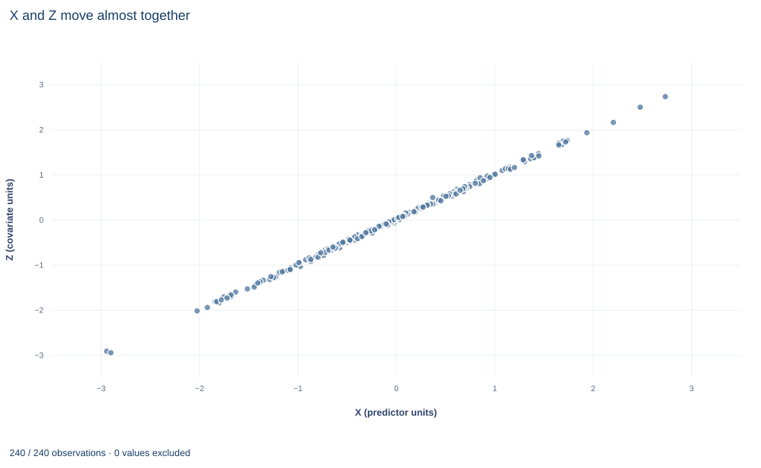

# Lab 04 · Collinearity, Coefficients and Stable Combinations

**Near-collinear regressors: imprecise separate slopes, a precisely estimated sum**

## Start with the supplied workbook

1. Download [collinearity.xlsx](collinearity.xlsx) and the [Python lab](lab.py). The workbook holds the fixed records used throughout this chapter.
2. Import `collinearity.xlsx` into OpenEconometrics and keep that file name as the dataset name. The `Data` sheet holds one row per synthetic unit: an identifier, two nearly identical regressors `x` and `z`, and the outcome `y`. The `Dictionary` sheet describes each column; no cell is blank.
3. Open the complete `lab.py` in a new Python document and run the whole file. It fits one regression of `y` on `x` and `z`, then displays its coefficient table, the concept chart (the app shows the chart's first panel; this chart has a single panel, `z` against `x`) and a summary table with both coefficients, their standard errors, their sum with its standard error, and the correlation of the two regressors.

For ordinary Python, keep `lab.py` and the workbook in the same folder and run the script there, or call `from lab import run_lab` and then `run_lab(data_path="/path/to/collinearity.xlsx")`. To try a transformation, work on a copy of the loaded table so the distributed workbook stays unchanged. The [LaTeX table](table.tex) collects the reported numbers.

A regression of `y` on two regressors returns coefficients of 0.164 and 1.868, each with a robust standard error of about 2.07. Taken one at a time, neither is distinguishable from zero, and their intervals run from about −4 to about 6. Yet the same fitted model estimates their *sum*, 2.032, with a standard error of 0.065, thirty-two times smaller than either separate one. Nothing was refitted; the sum's precision comes from the same covariance matrix.

The reason is in the data. The two regressors have a sample correlation of 0.9996. The sample says a great deal about what happens when both move together and almost nothing about what happens when one moves without the other. This lab shows how that pattern enters the covariance matrix and which questions the data can and cannot answer.

The workbook contains **240 original synthetic rows**, each an independent unit, with no missing cells. All columns are in abstract units. `x` and `z` are two regressors on the same scale, with means close to zero; by design `z` equals `x` plus a small independent perturbation. `y` is the outcome. The dictionary's generic labels ("exposure or predictor X," "observed covariate Z") hide the point of the lab: `z` is a near-copy of `x`.

## 1. Distinguish exact from near collinearity

The model is

$$
y_i=\beta_0+\beta_x x_i+\beta_z z_i+u_i,
$$

with $X=[\,\mathbf 1,\ x,\ z\,]$ and least-squares estimate $\hat\beta=(X'X)^{-1}X'y$. If `z` were an exact linear function of `x`, say $z_i=a+cx_i$ for every row, the columns of $X$ would be linearly dependent, $X'X$ would be singular, and infinitely many coefficient vectors would fit equally well. The separate slopes would not be identified.

Near collinearity is different. Here $X'X$ is invertible, the estimates are unique, and under the usual assumptions they are unbiased. What fails is precision: $X'X$ is close to singular, so its inverse, which scales the covariance matrix, has some very large entries. The condition number of the scaled design, a common measure of how close to singular it is, is 67.3. Collinearity is a property of the regressors in this sample, not a violation of an assumption about the errors.

## 2. See the variance of one coefficient through partialling out

By the Frisch–Waugh–Lovell identity of Lab 01, $\hat\beta_x$ is the slope of `y` on $\tilde x$, the residual from regressing `x` on the intercept and `z`. Under homoskedastic errors with variance $\sigma^2$,

$$
\operatorname{Var}(\hat\beta_x\mid X)=\frac{\sigma^2}{\sum_i\tilde x_i^2}=\frac{\sigma^2}{\mathrm{SST}_x\,(1-R^2_x)},
$$

where $\mathrm{SST}_x=\sum_i(x_i-\bar x)^2$ and $R^2_x$ is the $R^2$ from regressing `x` on the other regressors. With only one other regressor, $R^2_x=r_{xz}^2$, the squared sample correlation. The factor $1/(1-R^2_x)$ is the variance inflation factor. With $r_{xz}=0.9996$, $1-r^2_{xz}$ is less than one-thousandth, so almost all of the variation in `x` is shared with `z`, and only a sliver is left to separate $\beta_x$ from $\beta_z$. The same holds for $\hat\beta_z$ by symmetry.

## 3. Derive why the sum is precise

The variance of any linear combination $c'\hat\beta$ is $c'\hat Vc$. For the sum, $c=(0,1,1)'$, so

$$
\operatorname{Var}(\hat\beta_x+\hat\beta_z)=V_{xx}+V_{zz}+2V_{xz},
$$

where $V_{xx}$ and $V_{zz}$ are the squared standard errors and $V_{xz}$ is the estimated covariance between the two coefficients. With near-collinear regressors that covariance is strongly negative. Raising one coefficient and lowering the other by the same amount barely changes the fitted values, because `x` and `z` are nearly equal in every row. The data cannot tell those coefficient vectors apart, so the estimates move in opposite directions across samples, and the negative covariance cancels most of $V_{xx}+V_{zz}$.

A reparametrization makes this concrete. Write $d_i=z_i-x_i$ and $\theta=\beta_x+\beta_z$. Then

$$
\beta_xx_i+\beta_zz_i=(\beta_x+\beta_z)\,x_i+\beta_z(z_i-x_i)=\theta\,x_i+\beta_z\,d_i .
$$

Regressing `y` on `x` and $d$ gives the same fitted values and residuals as the original regression, with $\theta$ now a single coefficient. From the chart data, `x` has a standard deviation of 0.95 while $d$ has 0.028, and the two are only weakly correlated (0.09). So $\theta$, the coefficient on the well-spread regressor, is precisely estimated; $\beta_z$, the coefficient on the tiny perturbation $d$, is not; and $\hat\beta_x=\hat\theta-\hat\beta_z$ inherits the imprecision. Because HC3 depends only on the residuals, the leverages and the column space of $X$, the reparametrized fit reports the same standard error for $\hat\theta$ as $c'\hat Vc$ does for the sum.

**Pause before running.** Can the two separate standard errors simply be added, or combined as if the estimates were independent, to get the standard error of the sum?

## 4. Run the regression and the combination

The complete `lab.py` defines `load_data()`, a `fit()` helper (least squares with HC3 covariance that refuses missing values) and `coef()`, which looks up one coefficient. The core of the lab is:

```python
raw = load_data()  # reader defined in the complete lab.py
model = fit(raw, ["x", "z"])
combination = oe.lincom(model, {"x": 1.0, "z": 1.0})
display(model)
print(combination["estimate"], combination["std_error"])
```

`oe.lincom` evaluates $c'\hat\beta$ and $\sqrt{c'\hat Vc}$ from the stored covariance matrix. The same number can be computed directly:

```python
import numpy as np

V = np.array(model.covariance_matrix)   # rows and columns: Intercept, x, z
c = np.array([0.0, 1.0, 1.0])
print(np.sqrt(c @ V @ c))
```

The fitted model, with HC3 standard errors and 237 residual degrees of freedom, is:

| Term | Estimate | HC3 standard error | $t$ | 95% interval |
|---|---:|---:|---:|---|
| Intercept | 2.127 | 0.059 | 35.79 | 2.010 to 2.244 |
| `x` | 0.164 | 2.068 | 0.08 | −3.910 to 4.237 |
| `z` | 1.868 | 2.063 | 0.91 | −2.195 to 5.932 |
| `x` + `z` (combination) | 2.032 | 0.065 | 31.47 | 1.905 to 2.159 |

and the lab's summary table reads:

| Quantity | Value |
|---|---:|
| Coefficient on `x` | 0.1636 |
| Coefficient on `z` | 1.8682 |
| HC3 standard error, `x` | 2.0676 |
| HC3 standard error, `z` | 2.0627 |
| Sum of the two coefficients | 2.0318 |
| HC3 standard error of the sum | 0.0646 |
| Sample correlation of `x` and `z` | 0.9996 |

## 5. Read the output

The individual coefficients look unstable and they are: each interval spans roughly eight outcome units per unit of the regressor and contains zero, the other coefficient's estimate and everything in between. Their split, 0.164 for `x` against 1.868 for `z`, is not a finding. Small changes to the data could reverse it.

The sum is a different matter. Its interval, 1.905 to 2.159, is narrow, and its $t$ statistic is 31.47. The model as a whole fits well ($R^2=0.818$), and the HC3 Wald test that both slopes are zero, reported with the model, gives $F=498.96$ on 2 and 237 degrees of freedom. Individually insignificant and jointly overwhelming is the signature of collinearity.

The pause question has a definite answer. Adding the standard errors gives $2.068+2.063=4.13$; treating the estimates as independent gives $\sqrt{2.068^2+2.063^2}=2.92$. Both are far from the correct 0.065, because both ignore $V_{xz}$. Any statement about a combination of coefficients must use the full covariance matrix.

## 6. Keep inference conventions straight

All quantities use HC3 covariance with a Student $t$ reference on $240-3=237$ degrees of freedom. HC3 assumes independent rows and allows unequal error variances; it does nothing to reduce collinearity. Collinearity inflates standard errors honestly: they are large because the sample genuinely contains little information about the separate slopes, not because the formula is wrong.

The useful question is which linear combinations of the coefficients the data inform. Combinations that weight `x` and `z` equally, like the sum, use the common direction in which the data vary widely. Combinations that contrast them, like the difference, use the direction in which the data barely vary. The same reasoning applies to fitted values: a prediction at a point where `x` and `z` are nearly equal is well supported; a prediction at a point where they differ substantially is an extrapolation away from every observed row.

## 7. Read the chart



The chart, titled "X and Z move almost together", plots one point per row, 240 in all. The horizontal axis is "X (predictor units)," from about −2.9 to 2.7; the vertical axis is "Z (covariate units)," from about −3.0 to 2.7. The outcome does not appear.

The points lie on what looks like a single straight line through the origin with slope one. The visible spread *along* the line is the common variation that identifies the sum. The spread *across* the line, the distance of each point from the 45-degree line, is the variation in $d=z-x$ that separates the two coefficients. It is too small to see at this scale: its standard deviation is 0.028 against 0.95 for `x`. Read the chart as a picture of the information in the design: wide along one direction, almost none along the other.

## A case from the literature

Kalnins (2018) examined a pattern that correlated regressors can produce in published work: a pair of coefficients that are large in absolute value, opposite in sign and accompanied by large $t$ statistics. He found 64 recent articles in the *Strategic Management Journal* with such results. Using mathematical analysis and simulation, he showed that when two regressors are correlated through an unobservable common factor, their estimated coefficients tend toward large magnitudes in opposite directions even when the variables' real effects are small and of the same sign, and that variance inflation factors can make such false positives look legitimate. He asks authors to publish complete correlation tables so that readers can check for the pattern. The case concerns exactly the quantity this lab finds poorly determined. Section 3 shows why the coefficients on near-copies move in opposite directions while their sum stays stable, and Section 8 warns that the split between them is what the data barely inform. A variance inflation factor measures lost precision, not whether the model is right. Mason and Perreault (1991) studied when collinearity actually harms regression estimates and concluded that, in many situations typical of published cross-sectional marketing research, fears about collinear predictors are exaggerated; a given level of collinearity has to be judged together with the other factors that affect estimation accuracy. Hoerl and Kennard (1970) proposed ridge regression, which adds small positive quantities to the diagonal of $X'X$ to obtain biased estimates with smaller mean squared error.

## 8. Decide what the evidence supports

The evidence supports a precise statement about the combined coefficient: in this sample, a unit increase in both regressors together is associated with an increase of about 2.03 outcome units in `y`. It does not support any statement about how that total divides between `x` and `z`.

Common responses to collinearity each have a cost. Dropping `z` gives a precise slope on `x`, but it changes the parameter: by the omitted-variable identity of Lab 02, the short slope absorbs part of `z`'s coefficient, and if `z` is a needed control, dropping it introduces bias. Combining the two into an index answers the identified question directly but changes the parameter. Ridge regression and other shrinkage methods trade bias for variance. Collecting data in which the two regressors vary independently is the only way to learn the separate slopes. And high correlation among regressors does not by itself imply endogeneity or any causal problem; it is a statement about information, not about bias.

## 9. Write the result in full

A complete statement for this lab reads: "In 240 original synthetic units, the regressors `x` and `z` have a sample correlation of 0.9996. In a regression of `y` on both, the separate coefficients (0.164 and 1.868) have HC3 standard errors of about 2.07 and cannot be distinguished from zero or from each other. Their sum, 2.032, is precisely estimated (HC3 standard error 0.065, 237 degrees of freedom, 95% interval 1.905 to 2.159) because the two estimates have a strongly negative covariance. The data identify the combined association of the two regressors, not how it divides between them."

## Student exercises

1. Use the three standard errors in the summary table to recover the estimated covariance $V_{xz}$ between the two coefficients, and convert it to a correlation between the estimates. Then confirm the value from `model.covariance_matrix`.
2. Use `oe.lincom` to estimate the difference $\beta_x-\beta_z$, with its standard error and 95% interval. Explain, using the covariance, why the difference is even less precisely estimated than either coefficient alone.
3. Compute the variance inflation factor $1/(1-r_{xz}^2)$. Fit the model with classical covariance (`covariance=None`) and use the factor to compute the standard error that the `x` coefficient would have if `z` were uncorrelated with `x`, holding the residual variance and the variation of `x` fixed.
4. Fit the regression of `y` on `x` alone. Compare its slope and standard error with the sum and its standard error, and use the decomposition from Lab 02 to explain why the two estimates are so close.
5. Use `oe.lincom` with the intercept included to estimate the fitted mean of `y` at $x=z=1$ and at $x=1,\ z=-1$, each with its standard error. Explain the difference in precision with reference to the chart.
6. Rewrite this sentence so that it matches the analysis: "Neither `x` nor `z` is statistically significant, so neither variable affects `y`, and we can drop both from the model."

## Further reading

- Hoerl, A. E., and Kennard, R. W. (1970). Ridge regression: Biased estimation for nonorthogonal problems. *Technometrics*, 12(1), 55–67. https://doi.org/10.1080/00401706.1970.10488634
- Kalnins, A. (2018). Multicollinearity: How common factors cause Type 1 errors in multivariate regression. *Strategic Management Journal*, 39(8), 2362–2385. https://doi.org/10.1002/smj.2783
- Mason, C. H., and Perreault, W. D. (1991). Collinearity, power, and interpretation of multiple regression analysis. *Journal of Marketing Research*, 28(3), 268–280. https://doi.org/10.1177/002224379102800302
