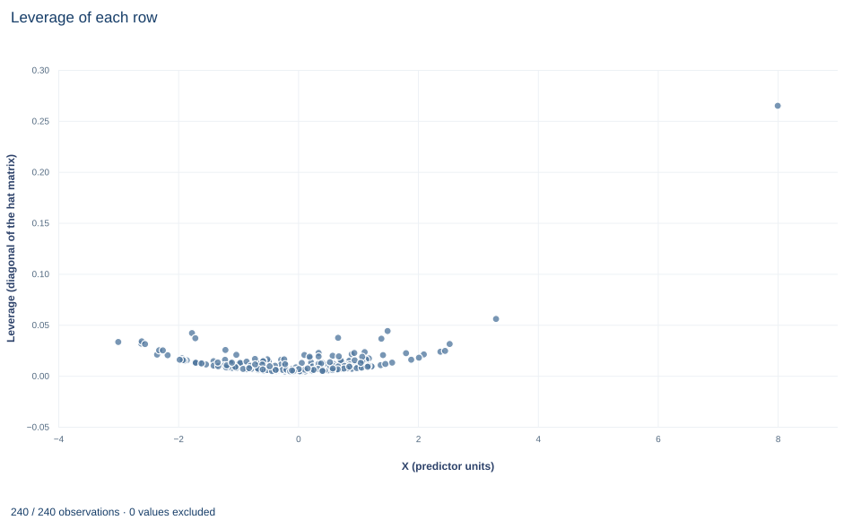

# Lab 05 · Leverage and Leave-One-Out Sensitivity

**Leverage, influence and what HC3 does with one unusual row**

## Start with the supplied workbook

1. Download [leverage_influence.xlsx](leverage_influence.xlsx) and the [Python lab](lab.py). The workbook holds the fixed records used throughout this chapter.
2. Import `leverage_influence.xlsx` into OpenEconometrics and keep that file name as the dataset name. The `Data` sheet holds one row per synthetic unit: an identifier, the regressor of interest `x`, the control `z` and the outcome `y`. Row 1 is a deliberately unusual stress row. The `Dictionary` sheet describes each column; no cell is blank.
3. Open the complete `lab.py` in a new Python document and run the whole file. It fits the regression on all rows and again without row 1, computes every row's leverage, then displays the all-rows coefficient table, the concept chart (the app shows the chart's first panel; this chart has a single panel, each row's leverage against its `x` value) and a summary table with row 1's leverage and residual, the average leverage and the two slopes.

For ordinary Python, keep `lab.py` and the workbook in the same folder and run the script there, or call `from lab import run_lab` and then `run_lab(data_path="/path/to/leverage_influence.xlsx")`. To try a transformation, work on a copy of the loaded table so the distributed workbook stays unchanged. The [LaTeX table](table.tex) collects the reported numbers.

In this file, 239 rows have `x` between about −3.0 and 3.3. Row 1 has `x` equal to 8, with `z` equal to 0 and `y` equal to 22.0. Fit `y` on `x` and `z` with all 240 rows and the slope on `x` is 1.569, with an HC3 standard error of 0.335. Leave out row 1 and the slope is 1.240, with a standard error of 0.079. One row out of 240 moves the slope by a third of a unit and more than quadruples its standard error.

This lab asks why one row can matter so much, how to measure that before and after fitting, and what a robust covariance estimator does with such a row. It treats row 1 as a valid synthetic observation placed to stress the fit, not as a known recording error: the point is to measure sensitivity, not to decide that the row is wrong.

The workbook contains **240 original synthetic rows**, each an independent unit, with no missing cells. All columns are in abstract units: `x` is the regressor whose coefficient we study, `z` is an observed control, and `y` is the outcome. The dictionary's labels are generic and describe `x` and `z` as "centered"; they are only roughly so, and row 1 makes `x` far from symmetric.

## 1. Define leverage through the hat matrix

Least-squares fitted values are a linear function of the outcome:

$$
\hat y=X\hat\beta=X(X'X)^{-1}X'y=Hy,\qquad H=X(X'X)^{-1}X' .
$$

$H$ is called the hat matrix because it "puts the hat on" $y$. Its diagonal element

$$
h_{ii}=\mathbf x_i'(X'X)^{-1}\mathbf x_i
$$

is the **leverage** of row $i$, where $\mathbf x_i'=(1,\ x_i,\ z_i)$ is that row of the design. Since $\hat y_i=\sum_jh_{ij}y_j$, $h_{ii}$ is the weight of a row's own outcome in its own fitted value: $\partial\hat y_i/\partial y_i=h_{ii}$. A row with leverage near one essentially fits itself.

Leverage depends only on the regressors, never on `y`. With an intercept it can be written as $h_{ii}=1/n+\text{(squared Mahalanobis distance of } (x_i,z_i)\text{ from the regressor means)}/(n-1)$, so it measures how far a row sits from the center of the regressor cloud, allowing for the scale and correlation of the regressors. It always lies between $1/n$ and one in a model with an intercept.

## 2. Derive the average leverage

$H$ is symmetric and idempotent, and its trace equals the number of columns of $X$:

$$
\sum_{i=1}^{n}h_{ii}=\operatorname{tr}\!\big(X(X'X)^{-1}X'\big)=\operatorname{tr}\!\big((X'X)^{-1}X'X\big)=\operatorname{tr}(I_k)=k .
$$

The middle step uses $\operatorname{tr}(AB)=\operatorname{tr}(BA)$. With $k=3$ columns (intercept, `x`, `z`) and $n=240$ rows, the leverages sum to 3 and average $3/240=0.0125$. The lab checks this identity numerically. Because the total is fixed, a row with large leverage necessarily takes its share from the others.

**Pause before running.** What is the average leverage here, and how large would row 1's leverage need to be to count as unusual?

## 3. Connect leverage to residuals and influence

Under homoskedastic errors with variance $\sigma^2$, the residual vector is $\hat e=(I-H)u$, so

$$
\operatorname{Var}(\hat e_i)=\sigma^2(1-h_{ii}).
$$

A high-leverage row pulls the fitted surface toward itself, so its residual is mechanically small. The raw residual therefore understates how poorly such a row agrees with the others. Dividing by $1-h_{ii}$ undoes that shrinkage.

**Influence** combines leverage with discrepancy. Deleting row $i$ and refitting changes the coefficient vector by

$$
\hat\beta-\hat\beta_{(i)}=\frac{(X'X)^{-1}\mathbf x_i\,\hat e_i}{1-h_{ii}},
$$

where $\hat\beta_{(i)}$ is the estimate without row $i$. The formula follows from the Sherman–Morrison update of $(X'X)^{-1}$ when one row is removed. A row moves the estimates only if it has both a nonzero residual and a position that the other rows do not pin down. High leverage with a residual near zero leaves the estimates unchanged; a large residual at average leverage moves them only a little.

## 4. Run the full and sensitivity fits

The complete `lab.py` defines `load_data()`, a `fit()` helper (least squares with HC3 covariance that refuses missing values) and `coef()`, which looks up one coefficient. The core of the lab is:

```python
raw = load_data()  # reader defined in the complete lab.py
full = fit(raw, ["x", "z"])
without_row_1 = fit(raw.iloc[1:].reset_index(drop=True), ["x", "z"])

X = torch.tensor(raw[["x", "z"]].to_numpy(), dtype=torch.float64)
X = torch.cat([torch.ones(len(raw), 1, dtype=torch.float64), X], dim=1)
leverage = ((X @ torch.linalg.inv(X.T @ X)) * X).sum(1)   # diagonal of H only
display(full)
print(float(leverage[0]), float(leverage.mean()), float(leverage.sum()))
```

The leverage line computes each $\mathbf x_i'(X'X)^{-1}\mathbf x_i$ without forming the $240\times240$ hat matrix. The two fits are:

| Sample | Rows | Coefficient on `x` | HC3 SE, `x` | 95% interval, `x` | Coefficient on `z` | HC3 SE, `z` | Residual df |
|---|---:|---:|---:|---|---:|---:|---:|
| All rows | 240 | 1.569 | 0.335 | 0.909 to 2.230 | 0.668 | 0.172 | 237 |
| Without row 1 | 239 | 1.240 | 0.079 | 1.085 to 1.396 | 0.828 | 0.065 | 236 |

and the lab's summary table reads:

| Quantity | Value |
|---|---:|
| Leverage of row 1 | 0.2648 |
| Average leverage | 0.0125 |
| Residual of row 1, all-rows fit | 7.428 |
| Residual of row 1 divided by $1-h_{11}$ | 10.103 |
| Coefficient on `x`, all rows | 1.5693 |
| Coefficient on `x`, without row 1 | 1.2404 |
| Change when row 1 is left out | −0.3289 |

## 5. Read the output

Row 1's leverage, 0.265, is $0.2648/0.0125=21$ times the average; by itself it accounts for almost 9% of the total leverage of 3. Its own outcome carries about a quarter of the weight in its own fitted value.

Its residual of 7.43 is large against the all-rows root mean squared error of 1.15, about 6.4 times as large, and yet it understates the row's discrepancy. Dividing by $1-0.2648$ gives 10.10. Because the row pulled the fitted plane toward itself, its raw residual is smaller than its disagreement with the other rows.

Combining both, leaving out row 1 lowers the `x` coefficient by 0.329 and raises the `z` coefficient from 0.668 to 0.828. The change in the `x` coefficient is about one HC3 standard error of the all-rows fit but about four standard errors of the sensitivity fit. The intercept, by contrast, barely moves (2.013 against 1.969): it is the fitted value at `x` and `z` equal to zero, where the other rows are dense.

## 6. See what HC3 does with the row

Both fits report HC3 covariance with a Student $t$ reference on $n-k$ degrees of freedom, 237 and 236:

$$
\hat V_{\mathrm{HC3}}=(X'X)^{-1}\Big(\sum_{i=1}^{n}\frac{\hat e_i^{2}}{(1-h_{ii})^{2}}\,\mathbf x_i\mathbf x_i'\Big)(X'X)^{-1}.
$$

Each squared residual is scaled by $1/(1-h_{ii})^2$. For row 1 the scaled contribution is $10.103^2=102.1$ instead of $7.428^2=55.2$, and it enters with the outer product $\mathbf x_i\mathbf x_i'$ of a row whose `x` value is 8. That is why the all-rows HC3 standard error on `x` is 0.335, more than four times the 0.079 of the sensitivity fit.

HC3 does not delete, downweight or correct the row. The point estimate is the ordinary least-squares estimate with row 1 fully included; only the uncertainty estimate changes. The scaling is a deliberate small-sample choice: HC3 is closely related to the jackknife variance estimator and tends to be conservative when a few rows have high leverage. It still assumes independent rows, and it says nothing about whether row 1 belongs to the population of interest.

## 7. Read the chart



The chart, titled "Leverage of each row", plots one point per row, 240 in all. The horizontal axis is "X (predictor units)," from about −3 to 8; the vertical axis is "Leverage (diagonal of the hat matrix)," from 0 to about 0.27.

The 239 ordinary rows form a shallow U-shaped band near the bottom, with leverage between about 0.004 and 0.056. Leverage is lowest near the center of the `x` values and rises toward both ends, as the distance interpretation in Section 1 predicts. Points at the same `x` differ in height because leverage also depends on `z`. Row 1 sits alone at the far right, at `x` equal to 8 and leverage 0.265, nearly five times the next largest value.

The chart contains no outcome values, so it shows where the design gives rows the *potential* to move the fit, not whether any row actually does. Influence needs the residual too, as in Section 3.

## A case from the literature

Knez and Ready (1997) asked whether a well-known finding in finance survives when the most extreme observations lose their pull. Using a robust regression estimator to study the risk premia on size and book-to-market in cross-sectional regressions, they found that the size premium estimated by Fama and French in 1992 completely disappears when the 1 percent most extreme observations are trimmed each month. They also showed that the negative average of the monthly size coefficients could be entirely explained by the 16 months with the most extreme coefficients, and they argued that further investigation of these results could shed light on the economic forces behind the size effect and on how firms grow. That is the stance of Section 8: a sensitivity fit reports how much a conclusion rests on a few observations, and those observations become something to understand rather than something to delete. Row 1 of this lab matters because it combines a large residual with high leverage. Cook (1977) built an influence measure that combines studentized residuals with the variances of the residuals and fitted values, and Hoaglin and Welsch (1978) show how the hat matrix, together with studentized residuals, identifies exceptional points and simplifies the arithmetic of removing one. Giordano, Meager and Broderick (2026) approximate the most influential small subset of a sample automatically and report that results of several influential economics papers can be overturned by removing less than 1% of the sample.

## 8. Decide what the evidence supports

A sensitivity fit is a report, not a cleaning step. The evidence supports saying that the slope on `x` depends heavily on one row at an `x` value far outside the rest of the data, and that without it the slope is estimated more precisely and lower. It does not show that row 1 is an error. Deleting a row is justified by evidence about the row, such as a documented recording mistake or a unit outside the population of interest, not by its effect on the estimate or its significance. Choosing the sample that gives the preferred answer invalidates the reported uncertainty.

The comparison also says something about functional form. With one row at `x` equal to 8, the all-rows slope relies on the assumption that a straight line extends from the bulk of the data to that distant point. The data contain no other rows to check that assumption. Report both fits, state why row 1 is unusual, and, if it matters for the conclusion, consider designs or estimators that are less sensitive to single rows.

## 9. Write the result in full

A complete statement for this lab reads: "In 240 original synthetic units, a regression of `y` on `x` and `z` gives a slope on `x` of 1.569 (HC3 standard error 0.335, 237 degrees of freedom). One row, at `x` equal to 8, has leverage 0.265, 21 times the average of 0.0125, and a leverage-scaled residual of 10.10. Leaving that row out gives a slope of 1.240 (HC3 standard error 0.079). The row is retained in the main estimate because nothing indicates it is an error; the slope on `x` should be read as sensitive to it."

## Student exercises

1. Using the leverage values, count the rows whose leverage exceeds $2k/n$ and $3k/n$, and list the `row_id` values above the stricter cutoff. Why do such rules of thumb flag some rows even in data with no unusual observation?
2. Use the coefficients of the fit without row 1 to predict `y` for row 1, and compute the prediction error. Compare it with the summary table and prove the equality using the deletion formula in Section 3.
3. On a copy of the data, replace row 1's `y` with the prediction from Exercise 2 and refit with all 240 rows. Report row 1's leverage and the coefficient on `x`. What does the result show about the difference between leverage and influence?
4. Refit the all-rows model with `covariance=None`, `covariance="HC1"` and `covariance="HC3"`, and report the three standard errors on `x`. Explain their ordering with reference to row 1's residual and leverage.
5. Compute Cook's distance, $D_i=\hat e_i^{2}h_{ii}/[k\,s^{2}(1-h_{ii})^{2}]$ with $s$ the all-rows root mean squared error, for every row. Report $D_1$ and the largest value among the other 239 rows.
6. Rewrite this sentence so that it matches the analysis: "Row 1 was an outlier, so we removed it; the slope on `x` is 1.24 with a standard error of 0.08, which is highly significant."

## Further reading

- Cook, R. D. (1977). Detection of influential observation in linear regression. *Technometrics*, 19(1), 15–18. https://doi.org/10.1080/00401706.1977.10489493
- Giordano, R., Meager, R., and Broderick, T. (2026). An automatic finite-sample robustness metric: When can dropping a little data change conclusions? Part I: Definitions and experiments. *Philosophical Transactions of the Royal Society A: Mathematical, Physical and Engineering Sciences*, 384(2321), 20250001. https://doi.org/10.1098/rsta.2025.0001
- Hoaglin, D. C., and Welsch, R. E. (1978). The hat matrix in regression and ANOVA. *The American Statistician*, 32(1), 17–22. https://doi.org/10.1080/00031305.1978.10479237
- Knez, P. J., and Ready, M. J. (1997). On the robustness of size and book-to-market in cross-sectional regressions. *The Journal of Finance*, 52(4), 1355–1382. https://doi.org/10.1111/j.1540-6261.1997.tb01113.x
