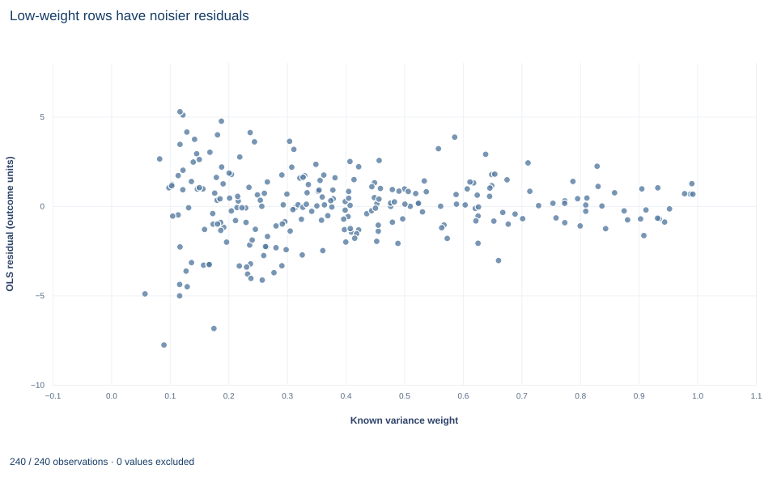

# Lab 06 · Known Variance Weights and WLS

**Weighted least squares when each row's error variance is known**

## Start with the supplied workbook

1. Download [weighted_least_squares.xlsx](weighted_least_squares.xlsx) and the [Python lab](lab.py). The workbook holds the fixed rows used throughout this chapter.
2. Import `weighted_least_squares.xlsx` into OpenEconometrics and keep that file name as the dataset name. The `Data` sheet holds one row per synthetic unit: an outcome, two regressors, and that row's known error variance with its inverse. The `Dictionary` sheet lists each column and its unit; no cell is blank.
3. Open the complete `lab.py` in a new Python document and run the whole file. It fits ordinary and weighted least squares to the same 240 rows and displays the weighted model table, then the concept chart (ordinary residuals plotted against the known weight), then a summary table of the six reported numbers.

For ordinary Python, keep `lab.py` and the workbook in the same folder and run the script there, or call `from lab import run_lab` and then `run_lab(data_path="/path/to/weighted_least_squares.xlsx")`. To change the weights or data, work on a copy of the loaded table so the distributed workbook stays unchanged.

Fit the same linear equation twice, once giving every row equal say and once weighting each row by the inverse of its known error variance. The slope on `x` barely moves: 1.4467 by ordinary least squares (OLS) and 1.4455 by weighted least squares (WLS). The standard errors, however, move in a direction that looks backwards. The classical OLS standard error is 0.1299, while the WLS standard error is 0.1513. If WLS is the efficient estimator here, why does its reported uncertainty look larger?

The two numbers rest on different variance assumptions, and only one of them matches the data. This lab derives WLS, shows that it is OLS on rescaled data, and sorts out which standard errors can be compared. It uses **240 original synthetic rows**, each an independent unit with an outcome measured in abstract outcome units. The [LaTeX table](table.tex) collects the six reported numbers.

## 1. Read the variance column before the outcome

| Column | What it records in this lab | Unit |
|---|---|---|
| `row_id` | Row label, 1 to 240 | Identifier |
| `x` | The regressor of interest; its values lie between about −2.33 and 3.16, centered near zero | Abstract units |
| `z` | A second regressor (control), also centered near zero | Abstract units |
| `y` | The outcome being explained | Outcome units |
| `variance` | The known conditional variance of this row's error, $\sigma_i^2$ | Outcome units squared |
| `weight` | $w_i=1/\sigma_i^2$ | Inverse outcome units squared |

The variance column is the unusual part. It runs from about 1.01 to 17.34, so the weights run from 0.9924 down to 0.0577, a ratio of 17.2. Sort the file by `variance` and a pattern appears at once: rows with `x` near zero are quiet, and rows with `x` far from zero are noisy. The row with the smallest weight has `x` = 3.16, the largest value of `x` in the file.

**Pause before running.** WLS will discount the noisy rows. Which rows are those, and which coefficient do they matter most for?

## 2. The model and the weighted objective

The equation is

$$
y_i=\beta_0+\beta_1x_i+\beta_2z_i+u_i,\qquad E[u_i\mid x_i,z_i]=0,\qquad \operatorname{Var}(u_i\mid x_i,z_i)=\sigma_i^2,
$$

with errors independent across rows. Write $X_i=(1,x_i,z_i)'$ for row $i$'s regressors, $X$ for the $240\times3$ matrix that stacks them, and $W=\operatorname{diag}(w_1,\dots,w_n)$.

OLS minimizes $\sum_i (y_i-X_i'b)^2$, treating every squared residual alike. WLS minimizes

$$
S_W(b)=\sum_{i=1}^{n} w_i\,(y_i-X_i'b)^2 .
$$

Setting the derivative with respect to $b$ to zero gives the weighted normal equations $\sum_i w_iX_i(y_i-X_i'b)=0$, or $X'WX\,b=X'Wy$. When $X'WX$ is invertible,

$$
\hat\beta_W=(X'WX)^{-1}X'Wy .
$$

Two consequences follow directly. First, multiplying every $w_i$ by the same positive constant $c$ multiplies both sides of the normal equations by $c$, so $\hat\beta_W$ is unchanged: only relative weights matter. Second, substituting $y=X\beta+u$ gives $\hat\beta_W=\beta+(X'WX)^{-1}X'Wu$, so WLS is unbiased whenever $E[u\mid X]=0$. OLS, the case $W=I$, is unbiased under the same condition. Both target the same $\beta$; they differ in how much each row's noise can move the estimate.

## 3. WLS is OLS on rescaled rows

Multiply row $i$'s equation by $\sqrt{w_i}=1/\sigma_i$:

$$
\underbrace{\sqrt{w_i}\,y_i}_{y_i^*}=\beta_0\sqrt{w_i}+\beta_1\underbrace{\sqrt{w_i}\,x_i}_{x_i^*}+\beta_2\underbrace{\sqrt{w_i}\,z_i}_{z_i^*}+\underbrace{\sqrt{w_i}\,u_i}_{u_i^*}.
$$

The rescaled error has $\operatorname{Var}(u_i^*\mid X)=w_i\sigma_i^2=1$ for every row, so the transformed regression satisfies the constant-variance assumption, and minimizing $\sum_i (y_i^*-X_i^{*\prime}b)^2$ is algebraically the same problem as minimizing $S_W(b)$.

Notice the intercept. Its regressor was a column of ones; after rescaling it is the column $\sqrt{w_i}$, so the transformed regression has no constant term at all. Regressing $y^*$ on a column of ones plus $x^*$ and $z^*$ is a common slip, and it fits a different model.

The lab checks the identity by solving the rescaled problem directly:

```python
import torch

raw = load_data()  # reader defined in the complete lab.py
root_w = torch.tensor(raw.weight.tolist(), dtype=torch.float64).sqrt()
X = torch.tensor([[1.0, a, b] for a, b in zip(raw.x, raw.z)], dtype=torch.float64)
y = torch.tensor(raw.y.tolist(), dtype=torch.float64)
by_hand = torch.linalg.lstsq(X * root_w[:, None], y * root_w).solution
print([round(v, 4) for v in by_hand.tolist()])
```

It prints the intercept, `x` and `z` coefficients 2.0355, 1.4455 and 0.8162, the same values the weighted fit reports below. The saved check requires agreement to within $10^{-10}$.

## 4. Why inverse-variance weights are the efficient choice

Because the rescaled errors are homoskedastic and uncorrelated, the Gauss–Markov argument applies to the starred regression: OLS on $(y^*,X^*)$, which is WLS with $w_i=1/\sigma_i^2$, has the smallest variance among linear unbiased estimators. Conditional on $X$, the two sampling variances are

$$
\operatorname{Var}(\hat\beta_W\mid X)=(X'\Sigma^{-1}X)^{-1},
\qquad
\operatorname{Var}(\hat\beta_{OLS}\mid X)=(X'X)^{-1}X'\Sigma X\,(X'X)^{-1},
$$

where $\Sigma=\operatorname{diag}(\sigma_1^2,\dots,\sigma_n^2)$. The second minus the first is positive semidefinite. OLS is still unbiased, but it gives a row with variance 17 the same say as a row with variance 1.

Weights that are proportional to $1/\sigma_i^2$, rather than equal to it, give the same coefficients. Weights that are wrong in shape still give an unbiased estimator when $E[u\mid X]=0$; they only lose efficiency, and they make the model-based WLS standard error unreliable.

## 5. Covariance conventions: what each standard error assumes

The two standard errors in the opening paragraph come from different formulas.

**Classical OLS.** The reported covariance is $s^2(X'X)^{-1}$ with $s^2=\text{SSR}/(n-k)=910.01/237=3.84$. It is valid only when every error has the same variance. Here the noise grows with the distance of $x$ from zero, and those distant rows are exactly the ones that pin down the slope on $x$. Averaging their large errors with the small errors of central rows understates the sampling variance of $\hat\beta_1$. The lab keeps this number as a deliberately misspecified comparison.

**WLS with analytic weights.** The weighted fit is declared with `weight_type="aweight"`. The model is $\operatorname{Var}(u_i)=\sigma^2/w_i$ with a common scale $\sigma^2$ estimated from the data. The software first rescales the weights to average one, $\tilde w_i=w_i/\bar w$, then computes $s_W^2=\sum_i\tilde w_i\hat e_i^2/(n-k)=563.33/237=2.38$ and reports $s_W^2(X'\tilde WX)^{-1}$. Because the scale is estimated, multiplying every weight by a constant changes neither the coefficients nor the standard errors. Inference uses a Student $t$ reference with 237 residual degrees of freedom in both fits.

**The comparison that is missing.** To ask whether WLS is more precise than OLS, the OLS standard error must be one that is valid under heteroskedasticity, such as a sandwich (HC) estimator built from the second formula in Section 4. The lab does not report it; Exercise 4 asks you to compute it.

## 6. Run the comparison

The complete file fits both models on all 240 rows. The key calls are:

```python
ordinary = fit(raw, ["x", "z"], covariance="nonrobust")
weighted = fit(raw, ["x", "z"], covariance="nonrobust",
               weights="weight", weight_type="aweight")
display(weighted)
for term in ["Intercept", "x", "z"]:
    print(term, round(coef(ordinary, term).estimate, 4), round(coef(weighted, term).estimate, 4))
```

`fit` wraps `oe.ols` with `missing="raise"`, so a blank cell would stop the run. The two coefficient tables read:

| Term | OLS estimate | OLS classical SE | WLS estimate | WLS SE |
|---|---:|---:|---:|---:|
| Intercept | 1.9564 | 0.1272 | 2.0355 | 0.0996 |
| `x` | 1.4467 | 0.1299 | 1.4455 | 0.1513 |
| `z` | 0.8410 | 0.1197 | 0.8162 | 0.0920 |

Both fits use 240 rows and 237 residual degrees of freedom; the root mean squared error is 1.960 for OLS and 1.542 for WLS (on the normalized-weight scale). The run's summary table repeats the two slopes, their two standard errors and the two extreme weights.

Read the columns in pairs. The `x` slopes differ by 0.0012, under a hundredth of either standard error, as two unbiased estimators of one coefficient should. The standard errors do not move together: WLS reports a smaller one for the intercept and `z`, and a larger one for `x`. That asymmetry is the fingerprint of the misspecified OLS formula. The noise is tied to $x$, so the classical OLS standard error is most distorted for the `x` slope. The `z` regressor is unrelated to the noise, so there the efficiency gain from weighting shows directly. The intercept is the fitted mean at $x=z=0$, where rows are quietest, so it gains too.

## 7. Read the residual chart



The chart, titled "Low-weight rows have noisier residuals," plots one point per row. The horizontal axis is the known weight, from 0.058 to 0.992; the vertical axis is that row's OLS residual in outcome units. The points form a funnel that opens to the left. Among the 51 rows with weight below 0.2, the residuals have a standard deviation of about 3.1; among the 57 rows with weight of 0.6 or more, it is about 1.1. The most negative residual, −7.8, and the most positive, 5.3, both sit at weights near 0.1, and every residual larger than 4 in absolute value belongs to a row with weight below 0.26.

That funnel is what the stated variances predict. A row with weight 0.9924 has error standard deviation $\sqrt{1.0076}\approx1.0$; the row with weight 0.0577 has $\sqrt{17.34}\approx4.2$. The chart uses OLS residuals on purpose: it shows the unequal noise that WLS corrects, not the WLS fit. A funnel that matches the supplied variances is reassuring, not a test that they are exactly right.

## A case from the literature

Meta-analysis is a setting in which each observation's variance comes with the data: every study reports an estimate together with its standard error, and a fixed-effect summary is an inverse-variance weighted average, which is WLS on an intercept alone with weights like this lab's. Stanley and Doucouliagos (2015) challenged both conventional methods, fixed effect and random effects. Using statistical theory and simulations of effect sizes, log odds ratios and regression coefficients, they compared them with an unrestricted weighted least squares estimator. Its estimates and confidence intervals were comparable to random effects when there was no publication or small-sample bias and identical to the fixed-effect results when there was no heterogeneity. With publication selection bias it dominated random effects, and with excess heterogeneity it was clearly superior to the fixed-effect average. The connection to Section 8 is the gap between supplied variances and actual dispersion. Inverse-variance weights are efficient when the supplied variances are the right relative variances; when observations differ for reasons their reported variances do not capture, both the weights and the uncertainty statement need rethinking. A covariance estimator of the kind White (1980) proposed, which does not depend on a formal model of the heteroskedasticity, is then a useful check. Solon, Haider and Wooldridge (2015) make the parallel point for research that estimates causal effects: correcting for heteroskedasticity is one of three distinct motives for weighting, and each sometimes does not apply where practitioners often assume it does.

## 8. What the comparison supports and what it does not

The lab supports three claims. With correct relative variances, WLS is the efficient linear unbiased estimator. WLS equals OLS on rows rescaled by $\sqrt{w_i}$, intercept included. And under this heteroskedasticity a smaller classical OLS standard error is not evidence that OLS is more precise.

It does not support treating real precision weights as known. In applied work the variances are usually estimated, and feasible weighting adds estimation error of its own. If the assumed variance shape is wrong, WLS remains unbiased under $E[u\mid X]=0$ but loses efficiency, and its model-based standard error should be replaced by a heteroskedasticity-robust one. Weighting also does nothing for an omitted variable or a misspecified conditional mean; in that case OLS and WLS estimate different weighted projections, and their gap need not shrink.

Finally, these are analytic precision weights. Frequency weights count identical units and survey weights reflect selection probabilities; each implies a different sample size and covariance formula, so weights must never be relabeled from one type to another.

## 9. Write the result in full

A complete statement for the worked example reads: "In 240 synthetic independent rows with known error variances, weighted least squares with inverse-variance analytic weights (from 0.058 to 0.992) gives a slope on x of 1.446 with a model-based standard error of 0.151 (estimated scale, Student t with 237 degrees of freedom). Ordinary least squares gives a nearly identical slope of 1.447. Its classical standard error of 0.130 assumes constant error variance, which the supplied variances contradict, so it is not a valid measure of OLS precision here."

## Student exercises

1. Using the `x` and `variance` columns, find the exact formula that links each row's variance to its value of `x`. Use it to explain why no weight can exceed one, and count the rows whose weight is less than a quarter of the largest weight.
2. Build the rescaled regression by hand twice: once correctly, with $\sqrt{w_i}$ in place of the intercept and no constant, and once with an ordinary column of ones added to $x^*$ and $z^*$. Report both sets of coefficients and describe what the second regression actually fits.
3. Using the raw weights (not normalized) and the WLS residuals, compute $\sum_i w_i\hat e_i^2/(n-k)$. What value should it be close to if the variance column is exactly right? What standard error for the `x` slope results if you fix $\sigma^2=1$ instead of estimating it?
4. Refit OLS with `covariance="HC3"`. Compare its standard error for the `x` slope with 0.1299 and with 0.1513, say which pair is a fair comparison of precision, and express the efficiency gain as a ratio of variances.
5. On a copy of the data, create a weight with the wrong shape, $1/\sqrt{\text{variance}}$, and refit the weighted model with `covariance="nonrobust"` and with `covariance="HC3"`. Compare the `x` slope and both standard errors with the correct WLS fit and with OLS, and say which of the two new standard errors you would report.
6. Rewrite this sentence so that it is correct: "Weighting raised the standard error of the x slope from 0.130 to 0.151, so WLS made the estimate less precise."

## Further reading

- Aitken, A. C. (1936). On least squares and linear combination of observations. *Proceedings of the Royal Society of Edinburgh*, 55, 42–48. https://doi.org/10.1017/S0370164600014346
- Solon, G., Haider, S. J., and Wooldridge, J. M. (2015). What are we weighting for? *Journal of Human Resources*, 50(2), 301–316. https://doi.org/10.3368/jhr.50.2.301
- Stanley, T. D., and Doucouliagos, H. (2015). Neither fixed nor random: Weighted least squares meta-analysis. *Statistics in Medicine*, 34(13), 2116–2127. https://doi.org/10.1002/sim.6481
- White, H. (1980). A heteroskedasticity-consistent covariance matrix estimator and a direct test for heteroskedasticity. *Econometrica*, 48(4), 817. https://doi.org/10.2307/1912934
