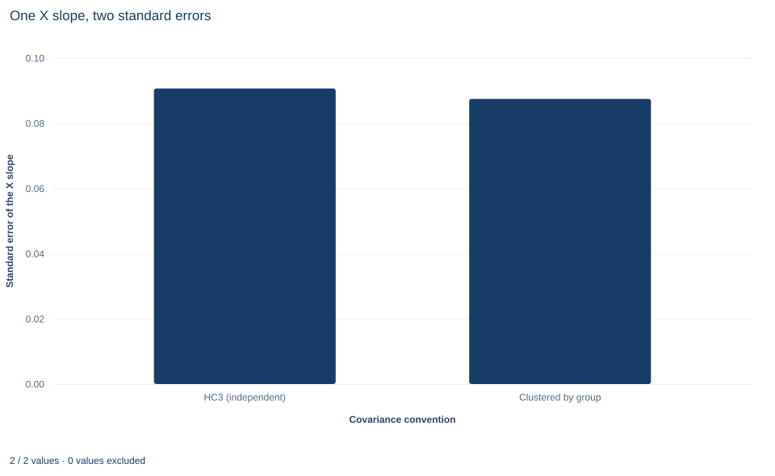

# Lab 07 · Clustered Errors and the Sampling Unit

**Cluster-robust covariance when rows share a group shock**

## Start with the supplied workbook

1. Download [clustered_inference.xlsx](clustered_inference.xlsx) and the [Python lab](lab.py). The workbook holds the fixed rows used throughout this chapter.
2. Import `clustered_inference.xlsx` into OpenEconometrics and keep that file name as the dataset name. The `Data` sheet holds 240 rows arranged in 40 groups of six; the `Dictionary` sheet lists each column and its unit. No cell is blank.
3. Open the complete `lab.py` in a new Python document and run the whole file. It fits one regression with two covariance conventions and displays the cluster-robust model table, then the concept chart (a bar chart of the two standard errors of the `x` slope), then a summary table of the six reported numbers.

For ordinary Python, keep `lab.py` and the workbook in the same folder and run the script there, or call `from lab import run_lab` and then `run_lab(data_path="/path/to/clustered_inference.xlsx")`. To try another grouping, add a column to a copy of the loaded table so the distributed workbook stays unchanged.

A regression on 240 rows reports a slope on `x` of 1.208. Every row, however, belongs to one of 40 groups, and rows in the same group share an unobserved shock. How many independent pieces of information does the sample really contain, and which standard error describes the uncertainty in the slope: one that treats the 240 rows as independent, or one that treats the 40 groups as the independent units?

The lab computes both. The heteroskedasticity-robust HC3 standard error of the `x` slope is 0.0907; the cluster-robust standard error is 0.0875, slightly *smaller*. That surprises many readers, who expect clustering always to widen uncertainty. This lab derives the cluster-robust covariance, shows exactly where it differs from the row-level one, and explains why the shared shock nearly doubles the intercept's standard error while leaving the `x` slope's almost unchanged. The records are **240 original synthetic rows**, outcomes in abstract outcome units. The [LaTeX table](table.tex) collects the six reported numbers.

## 1. Rows, groups and the sampling unit

| Column | What it records in this lab | Unit |
|---|---|---|
| `row_id` | Row label, 1 to 240 | Identifier |
| `x` | The regressor of interest, varying from row to row within each group | Abstract units, centered near zero |
| `z` | A second regressor (control), also varying within groups | Abstract units, centered near zero |
| `y` | The outcome being explained | Outcome units |
| `group` | The cluster each row belongs to, numbered 0 to 39 | Integer label |

Each group contains exactly six rows, stored consecutively: rows 1–6 form group 0, rows 7–12 form group 1, and so on. The groups are independent of one another; rows inside a group are not, because they share a group-level component of the error.

**Pause before running.** If you could obtain one more row, would it be better to add it to an existing group or to start a new one? What is the independent count in this sample?

## 2. The model with a shared group shock

Index rows by group $g=1,\dots,G$ and member $i$. The equation is

$$
y_{ig}=\beta_0+\beta_1x_{ig}+\beta_2z_{ig}+u_{ig},\qquad u_{ig}=a_g+\varepsilon_{ig},
$$

where $a_g$ is a shock common to every row of group $g$ and $\varepsilon_{ig}$ is a row-specific error, independent across rows and of $a_g$. With both parts mean zero given the regressors, OLS is unbiased whatever their variances. What changes is the error covariance: $\operatorname{Cov}(u_{ig},u_{jg})=\operatorname{Var}(a_g)>0$ for two rows of the same group, and zero for rows of different groups. The full error covariance matrix $\Omega$ is block diagonal, with one $6\times6$ block per group.

The point estimate does not depend on $\Omega$. Changing the covariance option changes only standard errors, intervals and tests; the saved check confirms that the `x` slope is identical, to $10^{-12}$, under both conventions.

## 3. From the sandwich to the cluster estimator

Write $X_{ig}=(1,x_{ig},z_{ig})'$ and $\hat e_{ig}$ for the OLS residual. Conditional on the regressors, the OLS sampling variance is the sandwich

$$
\operatorname{Var}(\hat\beta\mid X)=(X'X)^{-1}\Big(\sum_g X_g'\Omega_gX_g\Big)(X'X)^{-1}.
$$

The middle term, the "meat," must be estimated. Define each row's score contribution $X_{ig}\hat e_{ig}$ and each group's score total $S_g=\sum_{i\in g}X_{ig}\hat e_{ig}$. The two estimators differ only in when they square:

$$
\widehat{\text{meat}}_{HC}=\sum_g\sum_{i\in g}(X_{ig}\hat e_{ig})(X_{ig}\hat e_{ig})',
\qquad
\widehat{\text{meat}}_{CL}=\sum_g S_gS_g' .
$$

Expanding $S_gS_g'$ shows the relationship exactly:

$$
S_gS_g'=\sum_{i\in g}(X_{ig}\hat e_{ig})(X_{ig}\hat e_{ig})'+\sum_{i\in g}\sum_{j\in g,\,j\neq i}(X_{ig}\hat e_{ig})(X_{jg}\hat e_{jg})' .
$$

The cluster meat is the row-level meat plus every within-group cross-product. Those cross-products estimate the off-diagonal elements of each $\Omega_g$ that the row-level estimator sets to zero. Cross-products between different groups are omitted because independent groups have zero covariance.

The lab's cluster formula applies the usual finite-sample factor,

$$
\hat V_{CL}=\frac{G}{G-1}\,\frac{n-1}{n-k}\,(X'X)^{-1}\Big(\sum_gS_gS_g'\Big)(X'X)^{-1},
$$

with $G=40$, $n=240$ and $k=3$, so the factor is $\tfrac{40}{39}\cdot\tfrac{239}{237}=1.0343$. The HC3 comparison instead inflates each squared residual by $1/(1-h_{ii})^2$, where $h_{ii}$ is the row's leverage.

## 4. Why the independent count is $G$, not $n$

The cluster meat is a sum of 40 terms, one per group. However many rows each group holds, the estimator averages 40 independent score totals, and its precision is governed by $G$. For that reason the lab uses Student $t$ inference with $G-1=39$ degrees of freedom for the clustered fit, against $n-k=237$ for the HC3 fit. The $t$ distribution with 39 degrees of freedom has slightly heavier tails, so the same standard error yields a slightly wider interval.

Asymptotic arguments for clustered inference let the number of groups grow. Adding a seventh row to an existing group adds information about that group's shock, not a new independent draw of it. A new group adds both.

## 5. Run the comparison

The key calls fit the same regression twice:

```python
raw = load_data()  # reader defined in the complete lab.py
independent = fit(raw, ["x", "z"])  # the lab's default covariance is HC3
clustered = fit(raw, ["x", "z"], covariance="cluster", cluster="group")
display(clustered)
for term in ["Intercept", "x", "z"]:
    print(term, round(coef(clustered, term).estimate, 4),
          round(coef(independent, term).std_error, 4),
          round(coef(clustered, term).std_error, 4))
print(raw.group.nunique(), clustered.inference["df_inference"])
```

The output, arranged as one table:

| Term | Estimate | HC3 SE | Cluster SE | Cluster SE ÷ HC3 SE |
|---|---:|---:|---:|---:|
| Intercept | 1.8302 | 0.0907 | 0.1642 | 1.81 |
| `x` | 1.2080 | 0.0907 | 0.0875 | 0.96 |
| `z` | 0.9006 | 0.0842 | 0.0947 | 1.13 |

Both fits use all 240 rows and 40 groups. The HC3 fit uses 237 degrees of freedom, the clustered fit 39. The summary table at the end of the run repeats the row count, the group count, the `x` slope, its two standard errors and the clustered degrees of freedom.

The cluster meat can be rebuilt in a few lines, which makes the "sum, then square" step concrete:

```python
import torch

X = torch.tensor([[1.0, a, b] for a, b in zip(raw.x, raw.z)], dtype=torch.float64)
y = torch.tensor(raw.y.tolist(), dtype=torch.float64)
bread = torch.linalg.inv(X.T @ X)
e = y - X @ (bread @ X.T @ y)
groups = torch.tensor(raw.group.tolist(), dtype=torch.long)
S = torch.zeros(40, 3, dtype=torch.float64).index_add_(0, groups, X * e[:, None])
n, k, G = 240, 3, 40
V = G / (G - 1) * (n - 1) / (n - k) * bread @ (S.T @ S) @ bread
print([round(v, 4) for v in V.diagonal().sqrt().tolist()])
```

Each row of `S` is one group's score total. The printed standard errors are 0.1642, 0.0875 and 0.0947, the cluster column above.

## 6. Why clustering need not raise every standard error

The ratio column tells the story. For coefficient $j$, partial the other regressors out of regressor $j$ to get $\tilde x_{j,ig}$. The cross-product part of its cluster meat is then $\sum_g\sum_{i\neq i'}\tilde x_{j,ig}\tilde x_{j,i'g}\,\hat e_{ig}\hat e_{i'g}$. Its expected size depends on two things at once: how strongly the errors are correlated within groups, and how strongly the regressor itself is correlated within groups. A common approximation for equal group sizes $T$ is

$$
\frac{\operatorname{Var}_{CL}(\hat\beta_j)}{\operatorname{Var}_{\text{indep}}(\hat\beta_j)}\approx1+(T-1)\,\rho_{x_j}\,\rho_u ,
$$

where $\rho_u$ is the within-group correlation of the errors and $\rho_{x_j}$ that of the regressor.

The intercept's regressor is the constant, identical for every member of a group, so $\rho=1$ and the full error correlation enters. Its standard error rises by a factor of 1.81, a variance ratio of $1.81^2\approx3.3$. The intercept is essentially a mean, and a mean of six rows that share a shock carries much less information than a mean of six independent rows.

The slope on `x` is different. A regressor that varies freely from row to row inside each group tends to have a within-group correlation near zero. Its within-group cross-products then have an expected value near zero, and in a particular sample their sum can fall below zero, which pulls the cluster meat below the row-level meat. Two smaller points matter as well: the cluster estimator averages only 40 group totals, so it is itself noisy, and its finite-sample factor 1.0343 is a different adjustment from HC3's leverage inflation. The result is a cluster standard error for the `x` slope about 3.5% below the HC3 one. The `z` slope, in the same position, lands 13% above, which shows how much chance there is in either direction with 40 clusters.

None of this means the group structure can be ignored. The dependence is real, as the intercept shows, and the cluster estimator is the one that is consistent under it. A cluster standard error is not a conservative inflation of HC3 but a different estimate. It can come out below HC3 in a given sample, and when it does, the clustered result is still the one to report.

## 7. Read the bar chart



The chart, titled "One X slope, two standard errors," has two bars. The horizontal axis names the covariance convention, "HC3 (independent)", which treats rows as independent, and "Clustered by group"; the vertical axis is the standard error of the `x` slope. The bars stand at 0.0907 and 0.0875, nearly the same height, with the clustered bar slightly shorter. Both describe the same estimate, 1.208. The chart makes the counterintuitive comparison visible at a glance; it does not show the intercept, whose standard error nearly doubles under clustering. A reader who saw only this chart might wrongly conclude that the group structure is irrelevant.

## A case from the literature

Moulton (1990) examined a practice common in applied economics: merging aggregate variables, such as characteristics of an industry, occupation or geographical area, onto records for individual units and estimating their effects by multiple regression. The usual methods assume independent disturbances, which is typically not appropriate for data from populations with a grouped structure, and incorrectly using ordinary least squares can give standard errors that are seriously biased downward. His illustration of the danger of spurious regression was a wage regression on individual workers that included aggregate regressors for characteristics of their states. This is the intercept pattern of Section 6 in a coefficient of substantive interest. A state-level regressor is constant within each group, so $\rho_{x_j}=1$ in the approximation $1+(T-1)\rho_{x_j}\rho_u$ and the full within-group error correlation enters, while a regressor that varies within groups, like this lab's `x`, can escape most of it. Liang and Zeger (1986) proposed estimating equations for longitudinal data that give consistent estimates of the regression parameters and of their variance under mild assumptions about dependence over time within each subject. Cameron and Miller (2015) review cluster-robust inference and its complications, including few clusters and multi-way clustering, and Cameron, Gelbach and Miller (2008) find that standard tests can over-reject with five to thirty clusters and that cluster bootstrap-t procedures bring rejection rates back toward the nominal level. As Section 8 says, the cluster level should follow the design and be chosen before the standard errors are seen.

## 8. What the comparison supports and what it does not

The lab supports three claims. Clustering changes standard errors, not coefficients. The cluster meat equals the row-level meat plus within-group score cross-products, and inference rests on the 40 groups, with 39 degrees of freedom. And the direction of the change depends on the regressor: large for a regressor that is constant within groups, small or even negative for one that varies within them.

It does not support choosing between conventions by their results. The cluster level should follow the sampling or assignment design and the plausible dependence, decided before looking at standard errors; picking whichever grouping gives the smallest standard error invalidates the inference. Coarser groupings that nest the true ones remain valid but leave fewer clusters and fewer degrees of freedom. With very few clusters, ordinary cluster asymptotics can be unreliable, and small-cluster corrections or a wild cluster bootstrap become necessary. Forty balanced groups is a moderate number, not a guarantee.

## 9. Write the result in full

A complete statement for the worked example reads: "In 240 synthetic rows forming 40 independent groups of six, the OLS slope on x is 1.208. Its cluster-robust standard error, clustering by group with the G/(G−1)·(n−1)/(n−k) correction and Student t inference on 39 degrees of freedom, is 0.087; the HC3 standard error that treats rows as independent is 0.091. Clustering leaves the slope's precision almost unchanged because x varies within groups, while the intercept's standard error rises from 0.091 to 0.164."

## Student exercises

1. Modify the hand-built block in Section 5 so that every row is its own cluster ($G=n$). Report the three standard errors, identify which heteroskedasticity-robust estimator they equal, and show algebraically why.
2. Compute the within-group correlation of `x`, of `z` and of the OLS residuals, for example from a one-way analysis of variance by `group`. Use the approximation in Section 6 to predict the variance ratio for each coefficient and compare your predictions with the ratios in Section 5.
3. For the `x` slope and the `z` slope, partial out the other regressors and split the cluster meat into the sum of squared row scores and the sum of within-group cross-products. Report each part and the sign of the cross-product sum, and connect the signs to the ratio column.
4. Compute 95% confidence intervals for the `x` slope under both conventions, each with its own reference distribution. Which interval is wider, and why is the gap smaller or larger than the ratio of standard errors suggests?
5. On a copy of the data, cluster once on pairs of adjacent groups (`group // 2`) and once on a grouping that cuts across the true groups, `(row_id - 1) % 40`. Report the intercept and `x` standard errors and the degrees of freedom for each, and explain which grouping is a valid design and why.
6. Rewrite this sentence so that it is correct: "The clustered standard error of the x slope is smaller than the HC3 one, so the group structure does not matter and the 240 rows can be treated as independent."

## Further reading

- Cameron, A. C., Gelbach, J. B., and Miller, D. L. (2008). Bootstrap-based improvements for inference with clustered errors. *Review of Economics and Statistics*, 90(3), 414–427. https://doi.org/10.1162/rest.90.3.414
- Cameron, A. C., and Miller, D. L. (2015). A practitioner's guide to cluster-robust inference. *Journal of Human Resources*, 50(2), 317–372. https://doi.org/10.3368/jhr.50.2.317
- Liang, K.-Y., and Zeger, S. L. (1986). Longitudinal data analysis using generalized linear models. *Biometrika*, 73(1), 13–22. https://doi.org/10.1093/biomet/73.1.13
- Moulton, B. R. (1990). An illustration of a pitfall in estimating the effects of aggregate variables on micro units. *The Review of Economics and Statistics*, 72(2), 334–338. https://doi.org/10.2307/2109724
