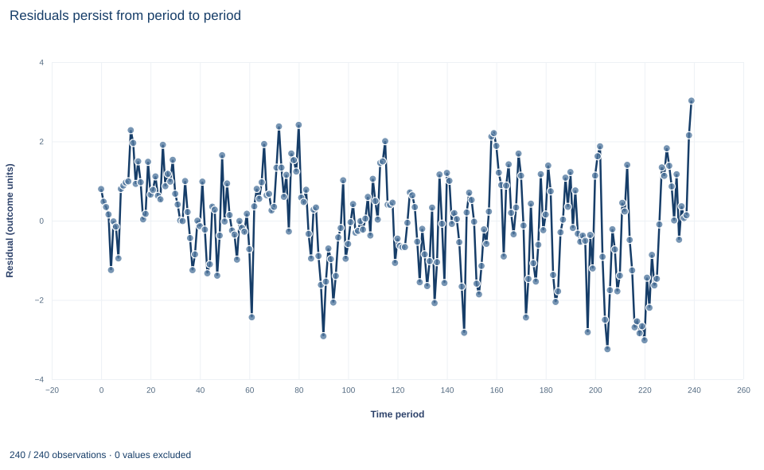

# Lab 08 · Serial Dependence and HAC Covariance

**Heteroskedasticity- and autocorrelation-consistent standard errors for time-ordered data**

## Start with the supplied workbook

1. Download [hac_inference.xlsx](hac_inference.xlsx) and the [Python lab](lab.py). The workbook holds the fixed series used throughout this chapter.
2. Import `hac_inference.xlsx` into OpenEconometrics and keep that file name as the dataset name. The `Data` sheet holds one row per time period, 240 consecutive periods; the `Dictionary` sheet lists each column and its unit. No cell is blank.
3. Open the complete `lab.py` in a new Python document and run the whole file. It fits one regression with two covariance conventions and displays the HAC model table, then the concept chart (the OLS residuals plotted over time), then a summary table of the five reported numbers.

For ordinary Python, keep `lab.py` and the workbook in the same folder and run the script there, or call `from lab import run_lab` and then `run_lab(data_path="/path/to/hac_inference.xlsx")`. To try a different ordering or lag choice, work on a copy of the loaded table so the distributed workbook stays unchanged.

A time-series regression over 240 periods gives a slope on `x` of 1.270. The errors are serially correlated: a shock in one period carries partly into the next. Standard errors that treat the 240 periods as independent ignore that persistence. A heteroskedasticity- and autocorrelation-consistent (HAC) covariance accounts for it by adding the covariances between scores a few periods apart.

The lab reports two standard errors for the same slope: 0.0709 by HC3, which allows heteroskedasticity but no serial correlation, and 0.0614 by a Bartlett HAC estimator with four lags. As in the clustering lab, the dependence-robust number is *smaller* for the slope, while the intercept's standard error rises sharply. This lab derives the HAC estimator, computes it by hand and explains which coefficients serial correlation actually affects. The records are **240 original synthetic periods**, with the outcome in abstract outcome units. The [LaTeX table](table.tex) collects the five reported numbers.

## 1. Rows are periods

| Column | What it records in this lab | Unit |
|---|---|---|
| `row_id` | Row label, 1 to 240 (equal to `time` + 1) | Identifier |
| `x` | The regressor of interest, observed each period | Abstract units, centered near zero |
| `z` | A second regressor (control), observed each period | Abstract units, centered near zero |
| `y` | The outcome being explained | Outcome units |
| `time` | The period, 0 to 239, one step apart with no gaps or repeats | Integer period |

Here, unlike in a cross-section, row order carries information. Two rows are neighbors because they are adjacent periods, and the covariance estimator needs to know which rows are one, two or more periods apart. The lab checks that `time` is unique and advances by exactly one each row, so a lag of four periods is also a gap of four rows.

**Pause before running.** Which coefficient do you expect serially correlated errors to affect most: the intercept or the slope on `x`?

## 2. The model with persistent errors

The equation is

$$
y_t=\beta_0+\beta_1x_t+\beta_2z_t+u_t,\qquad u_t=0.6\,u_{t-1}+\varepsilon_t ,
$$

where $\varepsilon_t$ is an independent shock. The error follows a stable first-order autoregression with coefficient 0.6, and the regressors are independent of the shocks. Because $E[u_t\mid X]=0$ for every period, OLS is unbiased, and the slope is the same whatever covariance is chosen; the saved check confirms that the `x` slope agrees to $10^{-12}$ under both conventions.

The persistence shows in the error correlations. For a stable AR(1) error, $\operatorname{Corr}(u_t,u_{t-\ell})=0.6^{\ell}$: 0.6 one period apart, 0.36 two periods apart, and so on, never exactly zero but fading geometrically.

## 3. The long-run variance of the score

Write $X_t=(1,x_t,z_t)'$ and the score $s_t=X_tu_t$. The OLS error is $\hat\beta-\beta=(X'X)^{-1}\sum_ts_t$, so

$$
\operatorname{Var}(\hat\beta\mid X)=(X'X)^{-1}\operatorname{Var}\Big(\sum_{t}s_t\Big)(X'X)^{-1},
\qquad
\operatorname{Var}\Big(\sum_ts_t\Big)=\sum_t\sum_{t'}E[s_ts_{t'}'] .
$$

If scores in different periods were uncorrelated, only the $t=t'$ terms would survive, giving the heteroskedasticity-robust meat $\sum_t X_tX_t'u_t^2$. With serial correlation the terms with $t\neq t'$ do not vanish. Grouping them by the distance $\ell=|t-t'|$ gives the autocovariances

$$
\Gamma_\ell=\sum_{t=\ell+1}^{n}s_ts_{t-\ell}',\qquad \text{meat}=\Gamma_0+\sum_{\ell\ge1}(\Gamma_\ell+\Gamma_\ell').
$$

Each $\Gamma_\ell$ appears with its transpose because the pair $(t,t-\ell)$ and the pair $(t-\ell,t)$ both occur in the double sum.

## 4. The Bartlett estimator

The infinite sum must be truncated, and the raw truncated sum need not be positive semidefinite. The Bartlett kernel solves both problems by down-weighting distant lags linearly:

$$
\hat S=\hat\Gamma_0+\sum_{\ell=1}^{L}\Big(1-\frac{\ell}{L+1}\Big)(\hat\Gamma_\ell+\hat\Gamma_\ell'),
\qquad
\hat V_{HAC}=\frac{n}{n-k}(X'X)^{-1}\hat S(X'X)^{-1},
$$

where $\hat\Gamma_\ell$ uses OLS residuals in place of $u_t$. With $L=4$ the bandwidth $L+1$ is 5 and the weights on lags 1 through 4 are 0.8, 0.6, 0.4 and 0.2; lag 5 and beyond get zero. The finite-sample factor is $n/(n-k)=240/237=1.0127$, and inference uses a Student $t$ reference with 237 degrees of freedom.

The lag choice is a modeling convention. A small $L$ omits real autocovariance; a large $L$ adds noisy estimates of distant terms. The value must be reported with the result, and different choices are a sensitivity analysis, not a menu from which to choose the most favorable standard error.

## 5. Run the comparison

The key calls fit the same regression twice:

```python
raw = load_data()  # reader defined in the complete lab.py
independent = fit(raw, ["x", "z"])  # the lab's default covariance is HC3
hac = fit(raw, ["x", "z"], covariance="hac", time="time", lags=4, kernel="bartlett")
display(hac)
for term in ["Intercept", "x", "z"]:
    print(term, round(coef(hac, term).estimate, 4),
          round(coef(independent, term).std_error, 4),
          round(coef(hac, term).std_error, 4))
```

The `time` argument tells the estimator which rows are lag pairs. The output, arranged as one table:

| Term | Estimate | HC3 SE | HAC SE (Bartlett, 4 lags) | HAC SE ÷ HC3 SE |
|---|---:|---:|---:|---:|
| Intercept | 1.8213 | 0.0782 | 0.1247 | 1.60 |
| `x` | 1.2699 | 0.0709 | 0.0614 | 0.87 |
| `z` | 0.8518 | 0.0827 | 0.0767 | 0.93 |

Both fits use all 240 periods and 237 residual degrees of freedom. The run's summary table repeats the `x` slope, its two standard errors, the lag count and the number of periods.

The estimator is short enough to write out. Because the rows are already in time order, a lag of $\ell$ periods is a shift of $\ell$ rows:

```python
import torch

X = torch.tensor([[1.0, a, b] for a, b in zip(raw.x, raw.z)], dtype=torch.float64)
y = torch.tensor(raw.y.tolist(), dtype=torch.float64)
bread = torch.linalg.inv(X.T @ X)
s = X * (y - X @ (bread @ X.T @ y))[:, None]  # one score row per period
L = 4
meat = s.T @ s
for lag in range(1, L + 1):
    gamma = s[lag:].T @ s[:-lag]
    meat += (1 - lag / (L + 1)) * (gamma + gamma.T)
n, k = X.shape
V = n / (n - k) * bread @ meat @ bread
print([round(v, 4) for v in V.diagonal().sqrt().tolist()])
```

It prints 0.1247, 0.0614 and 0.0767, the HAC column above.

## 6. Which coefficients serial correlation affects

For coefficient $j$, partial the other regressors out of regressor $j$ to get $\tilde x_{j,t}$; its score is $\tilde x_{j,t}u_t$. When the regressors are independent of the errors, the lag-$\ell$ autocovariance of that score factors into the regressor's own autocovariance times the error's:

$$
E[\tilde x_{j,t}\tilde x_{j,t-\ell}\,u_tu_{t-\ell}]=E[\tilde x_{j,t}\tilde x_{j,t-\ell}]\;E[u_tu_{t-\ell}] .
$$

So the inflation of the HAC variance over the independent one is roughly $1+2\sum_\ell w_\ell\,\rho_{x_j}(\ell)\,\rho_u(\ell)$, with Bartlett weights $w_\ell$ and autocorrelations $\rho$. Serial correlation in the errors matters only to the extent that the regressor is serially correlated too.

The intercept's regressor is the constant, perfectly correlated with itself at every lag. Its score is essentially $u_t$, and the full error persistence enters: the intercept's standard error rises by a factor of 1.60, a variance ratio of about 2.5. The intercept is essentially the mean level of the series, and the mean of a persistent series is much harder to pin down than the mean of independent draws.

A regressor that moves independently from period to period has autocorrelations near zero, so its score autocovariances have an expected value near zero. In one sample their weighted sum can come out negative, which pulls the HAC meat below the contemporaneous one. That is what happens for both slopes here. HC3's leverage inflation also differs from HAC's single factor $n/(n-k)$, which accounts for a small part of the gap. The HAC standard error is not a conservative add-on to HC3; it is a different estimate of a different quantity, and it can be smaller in a given sample. When the errors are serially correlated it remains the estimate to report.

## 7. Read the residual chart



The chart, titled "Residuals persist from period to period," is a line plot of the 240 OLS residuals against the time period, 0 to 239, with the residual in outcome units on the vertical axis. The line does not jump randomly around zero. It drifts in long swings: the residual changes sign only 64 times in 239 steps, where independent errors would change sign about half the time, and the longest stretch on one side of zero lasts 25 periods. Residuals run from about −3.2 to 3.0.

Those swings are what make the intercept hard to estimate: a stretch of positive residuals is a stretch where the level looks high. The chart shows persistence in the errors; it does not show whether `x` is persistent, which is what would matter for the slope's standard error.

## A case from the literature

Bertrand, Duflo and Mullainathan (2004) asked how far to trust standard errors in differences-in-differences studies that use many years of data on serially correlated outcomes. They generated placebo laws at random in state-level data on female wages from the Current Population Survey and estimated each law's "effect" by OLS. Conventional standard errors severely understated the sampling variability: up to 45 percent of the placebo laws appeared significant at the 5 percent level. Corrections that place a specific parametric form on the time-series process did not perform well. A bootstrap that takes the autocorrelation into account worked when the number of states was large enough, two corrections based on asymptotic approximations of the variance-covariance matrix worked for moderate numbers of states, and collapsing the data into a single pre-period and post-period worked even with few states. Section 6 suggests why. A law that switches on and stays on is a regressor whose autocorrelation is close to one, so in the inflation factor $1+2\sum_\ell w_\ell\rho_{x_j}(\ell)\rho_u(\ell)$ the error persistence enters almost in full, as it does for this lab's intercept. Newey and West (1987) gave a simple HAC covariance estimator that is positive semi-definite by construction, Andrews (1991) derived optimal kernels and data-dependent lag truncation, and Lazarus et al. (2018) recommend a larger-than-usual truncation parameter with fixed-$b$ critical values. The lesson carries from their panel to this lab's single series: persistence in both the errors and the regressor is what misleads independent-error standard errors.

## 8. What the comparison supports and what it does not

The lab supports three claims. HAC covariance changes standard errors, not coefficients. The Bartlett estimator adds weighted lagged score cross-products, with weights 0.8, 0.6, 0.4 and 0.2 for four lags, to the contemporaneous meat. And the effect of serially correlated errors on a coefficient's standard error depends on the serial correlation of its own regressor.

It does not make HAC a repair for a wrong model. If the dynamics belong in the mean equation, for example a lagged outcome or lagged regressor, HAC standard errors around a misspecified mean are still around the wrong target. With a lagged outcome as a regressor and serially correlated errors, OLS is inconsistent, and no covariance choice fixes that. A regression of one trending or unit-root series on another can be spurious, and HAC does not turn it into evidence. Very persistent errors need longer bandwidths or different methods, and the lag choice should be stated before results are seen.

## 9. Write the result in full

A complete statement for the worked example reads: "Over 240 synthetic consecutive periods with serially correlated errors, the OLS slope on x is 1.270. Its Bartlett HAC standard error with four lags, the n/(n−k) correction and Student t inference on 237 degrees of freedom is 0.061, against 0.071 by HC3. The slope's precision is not reduced by the error persistence, while the intercept's standard error rises from 0.078 to 0.125 once the lagged score covariances are included."

## Student exercises

1. Compute the first four sample autocorrelations of the OLS residuals and of `x`. Compare the residual autocorrelations with $0.6^{\ell}$ and describe what the autocorrelations of `x` imply for its slope's standard error.
2. Partial `z` and the constant out of `x`, form the slope's score $\tilde x_tu_t$ with residuals, and compute the weighted contribution of each lag 1 to 4 to the HAC meat. Report the signs and the ratio of the full meat to the lag-zero part, and do the same for the intercept.
3. Refit the HAC model with `lags` set to 0, 2, 8, 12 and 20. Tabulate the intercept and `x` standard errors, identify the familiar estimator that `lags=0` reproduces, and describe how each standard error responds to the bandwidth.
4. Using only the AR coefficient 0.6 and the Bartlett weights for four lags, predict the intercept's HAC-to-independent variance ratio. Compare it with the ratio in Section 5, then compute the untruncated long-run factor $(1+0.6)/(1-0.6)$ and say what it implies about four lags.
5. On a copy of the data, shuffle the rows with `sample(frac=1, random_state=8)`, reset `time` to 0–239 in the new order and refit the four-lag HAC model. Report the three standard errors and explain the change in the intercept's.
6. Rewrite this sentence so that it is correct: "The HAC standard error of the x slope is smaller than HC3, so serial correlation makes the estimate more precise and the time order can be ignored."

## Further reading

- Andrews, D. W. K. (1991). Heteroskedasticity and autocorrelation consistent covariance matrix estimation. *Econometrica*, 59(3), 817. https://doi.org/10.2307/2938229
- Bertrand, M., Duflo, E., and Mullainathan, S. (2004). How much should we trust differences-in-differences estimates? *The Quarterly Journal of Economics*, 119(1), 249–275. https://doi.org/10.1162/003355304772839588
- Lazarus, E., Lewis, D. J., Stock, J. H., and Watson, M. W. (2018). HAR inference: Recommendations for practice. *Journal of Business & Economic Statistics*, 36(4), 541–559. https://doi.org/10.1080/07350015.2018.1506926
- Newey, W. K., and West, K. D. (1987). A simple, positive semi-definite, heteroskedasticity and autocorrelation consistent covariance matrix. *Econometrica*, 55(3), 703. https://doi.org/10.2307/1913610
