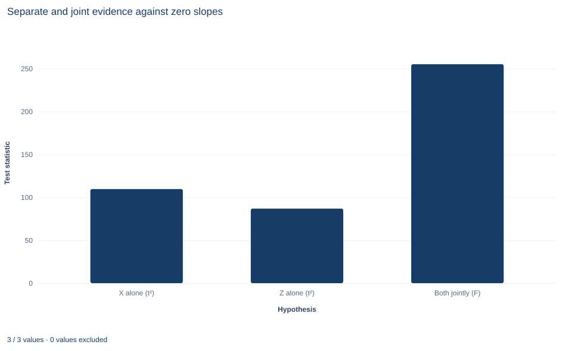

# Lab 09 · Joint Wald Restrictions with Robust Covariance

**Testing several coefficients at once with a Wald statistic**

## Start with the supplied workbook

1. Download [joint_restrictions.xlsx](joint_restrictions.xlsx) and the [Python lab](lab.py). The workbook holds the fixed rows used throughout this chapter.
2. Import `joint_restrictions.xlsx` into OpenEconometrics and keep that file name as the dataset name. The `Data` sheet holds one row per synthetic unit, with an outcome and two regressors; the `Dictionary` sheet lists each column and its unit. No cell is blank.
3. Open the complete `lab.py` in a new Python document and run the whole file. It fits one regression with HC3 standard errors, tests both slopes jointly and displays the model table, then the concept chart (a bar chart of the two single-slope statistics and the joint statistic), then a summary table of the five reported numbers.

For ordinary Python, keep `lab.py` and the workbook in the same folder and run the script there, or call `from lab import run_lab` and then `run_lab(data_path="/path/to/joint_restrictions.xlsx")`. Work on a copy of the loaded table if you change any values, so the distributed workbook stays unchanged.

A regression of `y` on `x` and `z` reports two slopes, each with a $t$ statistic far from zero: 10.47 for `x` and 9.32 for `z`. Does that settle the joint question, whether the two slopes are *both* zero? Not quite. A joint hypothesis is a statement about a point in two dimensions, and whether that point is far from the estimate depends on how the two estimation errors move together. Two separate $t$ tests ignore that.

The lab answers the joint question with a Wald test that uses the full HC3 covariance of the two slopes. The Wald statistic is 510.21 on 2 restrictions, reported as an $F$ statistic of 255.11 with 2 and 237 degrees of freedom. That joint $F$ is larger than either slope's own squared $t$, which the lab's chart shows. This lab derives the statistic, explains the relationship between $W$ and $F$, and shows why joint and separate tests can disagree. The records are **240 original synthetic rows**, each an independent unit, with the outcome in abstract outcome units. The [LaTeX table](table.tex) collects the five reported numbers.

## 1. The variables and the question

| Column | What it records in this lab | Unit |
|---|---|---|
| `row_id` | Row label, 1 to 240 | Identifier |
| `x` | First regressor, centered near zero | Abstract units |
| `z` | Second regressor, centered near zero and positively correlated with `x` | Abstract units |
| `y` | The outcome being explained | Outcome units |

The model is $y_i=\beta_0+\beta_1x_i+\beta_2z_i+u_i$ with $E[u_i\mid x_i,z_i]=0$ and independent rows. The error variance is not assumed constant, so the lab uses HC3 covariance throughout. The joint null, fixed before looking at the output, is

$$
H_0:\ \beta_1=0\ \text{and}\ \beta_2=0 .
$$

It says that neither regressor helps predict `y` once the other is in the model. The intercept is not restricted.

## 2. Writing the null as $R\beta=r$

Any set of $q$ linear restrictions can be written as $R\beta=r$, where $R$ is a $q\times k$ matrix and $r$ a vector of $q$ null values. Here $\beta=(\beta_0,\beta_1,\beta_2)'$, $q=2$ and

$$
R=\begin{pmatrix}0&1&0\\0&0&1\end{pmatrix},\qquad r=\begin{pmatrix}0\\0\end{pmatrix}.
$$

The zeros in the first column of $R$ are what leave the intercept free. The two rows are linearly independent, so the restrictions are not redundant, and both are estimable because $x$ and $z$ are not collinear.

## 3. The Wald statistic

Under the null, $R\hat\beta-r=R(\hat\beta-\beta)$, which is approximately normal with mean zero and covariance $RVR'$, where $V$ is the covariance of $\hat\beta$. A quadratic form of a mean-zero normal vector in the inverse of its own covariance is chi-squared with as many degrees of freedom as the vector has elements. Replacing $V$ with its estimate $\hat V$ gives

$$
W=(R\hat\beta-r)'\big(R\hat VR'\big)^{-1}(R\hat\beta-r)\ \overset{a}{\sim}\ \chi^2_q .
$$

$R\hat VR'$ is just the $2\times2$ block of $\hat V$ for the two slopes. The inverse rescales the deviations so that a large value means "far from the null, in standard-error units, taking the correlation into account."

Under $t$ and $F$ inference the same quadratic form is divided by the number of restrictions and compared with an $F(q,\,n-k)$ distribution:

$$
F=\frac{W}{q}=\frac{510.21}{2}=255.11,\qquad \text{reference } F(2,237).
$$

With homoskedastic normal errors and the classical covariance, this $F$ is exact. With HC3 covariance it is an approximation that uses the $F$ reference for its slightly heavier tails. The convention matters for reporting: a $\chi^2$ statistic must be paired with a $\chi^2$ $p$ value, and an $F$ statistic with an $F$ $p$ value.

**Pause before running.** If the two slope estimates were uncorrelated, how would $W$ relate to the two separate $t$ statistics?

## 4. Why two $t$ tests are not a joint test

With $q=2$, inverting the $2\times2$ covariance gives an explicit formula. Write $t_1$ and $t_2$ for the two slope $t$ statistics and $\rho$ for the correlation between the two slope estimates:

$$
W=\frac{t_1^2+t_2^2-2\rho\,t_1t_2}{1-\rho^2}.
$$

If $\rho=0$, $W$ is the sum of the two squared $t$ statistics. If $\rho\neq0$, the cross term and the denominator change it, sometimes a great deal.

In this sample the estimated covariance of the two slopes is $-0.006236$, and their variances are $0.013926$ and $0.007361$, so

$$
\rho=\frac{-0.006236}{\sqrt{0.013926\times0.007361}}=-0.616 .
$$

The estimates are negatively correlated because the regressors are positively correlated. When `x` and `z` move together, the data cannot easily tell which one is responsible for a change in `y`. An error that pushes one slope up tends to push the other down. What the data pin down well is their sum: the variance of $\hat\beta_1+\hat\beta_2$ is $0.013926+0.007361-2(0.006236)=0.008815$, a standard error of 0.0939, against $\sqrt{0.013926+0.007361}=0.146$ if the two estimates were uncorrelated.

Both estimates here are positive, so the deviation from the null points mostly along the well-measured "sum" direction. Measured with the correct covariance, the point $(0,0)$ is therefore even farther from the estimate than either $t$ statistic suggests. A large positive $t_1t_2$ times a negative $\rho$ makes the numerator larger, and $1-\rho^2=0.62$ makes the denominator smaller.

## 5. Ellipses and rectangles

Every Wald test has a geometric twin. The set of null values $(b_1,b_2)$ that the joint test does not reject at 5% is an ellipse centered on $(\hat\beta_1,\hat\beta_2)$, tilted along the direction of the correlation. With $\rho<0$ it is long in the "one up, one down" direction and narrow in the "both up" direction.

Two separate 95% intervals instead define a rectangle. The ellipse and the rectangle are different shapes, so they disagree in both directions. A null value can lie inside the rectangle but outside the ellipse, where each separate test fails to reject and the joint test rejects. It can also lie outside the rectangle but inside the ellipse, where each separate test rejects and the joint test does not. Exercises 3 and 4 find one of each in this sample. Neither shape is wrong; they answer different questions.

## 6. Run the test

The key calls fit the model and test both slopes:

```python
raw = load_data()  # reader defined in the complete lab.py
model = fit(raw, ["x", "z"])  # HC3 covariance, the lab's default
joint = oe.test(model, ["x", "z"])
display(model)
print(joint["statistic"], joint["df_num"], joint["df_denom"], joint["p_value"])
```

The quadratic form can be rebuilt from the slope block of the covariance matrix:

```python
import torch

b = torch.tensor([coef(model, "x").estimate, coef(model, "z").estimate], dtype=torch.float64)
V = torch.tensor(model.covariance_matrix, dtype=torch.float64)[1:, 1:]
W = float(b @ torch.linalg.solve(V, b))
print(round(W, 3), round(W / 2, 3))
```

It prints 510.212 and 255.106. The saved check requires $F=W/2$ to within $10^{-9}$. The output reads:

| Term | Estimate | HC3 SE | $t$ |
|---|---:|---:|---:|
| Intercept | 2.007 | 0.080 | 25.14 |
| `x` | 1.236 | 0.118 | 10.47 |
| `z` | 0.800 | 0.086 | 9.32 |

| Joint test of both slopes | Value |
|---|---:|
| Wald statistic $W$ | 510.21 |
| $F=W/q$ | 255.11 |
| Restrictions $q$ | 2 |
| Denominator degrees of freedom | 237 |
| $p$ value, $F(2,237)$ | $8.0\times10^{-60}$ |

The summary table at the end of the run lists the same five joint-test numbers. Report a $p$ value this small as "below $10^{-10}$" or similar. Its exact digits describe the far tail of an approximating distribution, not anything a reader can use.

## 7. Read the bar chart



The chart, titled "Separate and joint evidence against zero slopes," has three bars. The horizontal axis names the hypothesis; the vertical axis is the test statistic. The first two bars, "X alone (t²)" and "Z alone (t²)", are the squared $t$ statistics for each slope on its own (109.6 and 86.9); a squared $t$ is the $F(1,237)$ statistic for that single restriction. The third bar, "Both jointly (F)," stands at 255.1, well above both.

A joint statistic is not bounded by its parts. The joint bar is tall because of the negative correlation between the estimates described in Section 4. Comparing bar heights also needs care, because the third bar has a different reference distribution, $F(2,237)$, from the first two. The chart shows the size of each statistic; it does not by itself show which differences matter.

## A case from the literature

Young (2019) re-examined 53 experimental papers from the journals of the American Economic Association, testing the null hypothesis of no treatment effects by randomization inference, which takes its reference distribution from the random assignment itself rather than from a large-sample approximation. For individual treatment effects, randomization tests found 13% to 22% fewer significant results than the authors' own methods. For joint tests of the multiple treatment effects reported together in tables, the gap was larger: 33% to 49% fewer significant results than conventional tests. Bootstrap and jackknife methods supported the randomization results. The case bears on two points in this lab. First, a joint test asks a different question from the separate tests, and the two can disagree, as Sections 4 and 5 show. Second, a Wald statistic is only as reliable as the covariance estimate it inverts and the reference distribution it is compared with, and Young's largest discrepancies were in joint tests. The covariance estimator matters: White (1980) proposed a covariance estimator that remains consistent under heteroskedasticity, and Long and Ervin (2000) found by simulation that its asymptotic version, HC0, often gives incorrect inferences when $N\le250$, while HC3 works well even with 25 observations. Wald (1943) developed large-sample tests of hypotheses concerning several parameters. The joint test in this lab is far from any margin, with $F=255$ on 240 independent rows, but a joint rejection near 5% in a small sample, or one with high-leverage rows, deserves a second method.

## 8. What the test supports and what it does not

The test supports one claim: the hypothesis that both slopes are zero is decisively rejected under HC3 inference. It says that at least one of the restricted directions differs from zero.

It does not say that each slope is nonzero; that is a different question, answered by the separate tests or by a different joint hypothesis. It says nothing about causal effects, since the slopes describe a conditional mean among correlated regressors. It does not say how large the slopes are, which needs the estimates and intervals. And it depends on the covariance: a classical covariance would give a different $W$, and with clustered or serially correlated data the joint test must use the matching covariance from Labs 07 and 08. Finally, a joint null chosen after seeing which combination rejects is no longer a test at its nominal level.

## 9. Write the result in full

A complete statement for the worked example reads: "In 240 synthetic independent rows, OLS of y on x and z gives slopes of 1.236 (HC3 standard error 0.118) and 0.800 (0.086). The joint hypothesis that both slopes are zero is rejected: the HC3 Wald statistic is 510.2 on 2 restrictions, F = 255.1 with 2 and 237 degrees of freedom, p < 10⁻¹⁰. The slope estimates are negatively correlated (ρ = −0.62), so the joint statistic exceeds either squared t statistic."

## Student exercises

1. Compute the $\chi^2_2$ $p$ value of $W=510.21$ and the $F(2,237)$ $p$ value of $F=255.11$, and the 5% critical value of each distribution. Explain why the two $p$ values differ by many orders of magnitude, and which statistic belongs with which reference distribution.
2. Reproduce $W$ from $t_1$, $t_2$ and $\rho$ with the formula in Section 4. Then compute the $W$ and $F$ that the same two $t$ statistics would give if $\rho$ were zero, and explain the difference.
3. Test the joint null $\beta_1=1$ and $\beta_2=1$ with `model.test(["x", "z"], value=[1, 1])`, and test each restriction separately with a $t$ test. Report all three $p$ values and explain the pattern with the ellipse and the rectangle.
4. Repeat Exercise 3 for the null $\beta_1=1.05$ and $\beta_2=0.65$. Which way do the separate and joint tests disagree this time?
5. Refit with `covariance="nonrobust"` and recompute the joint $F$ for both slopes. Compare it with the HC3 value and with $(R^2/q)/[(1-R^2)/(n-k)]$ computed from the model's $R^2$, and explain which of the two Wald statistics has an $R^2$ interpretation.
6. Rewrite this sentence so that it is correct: "The joint test rejects with F = 255, so both x and z have nonzero effects on y."

## Further reading

- Long, J. S., and Ervin, L. H. (2000). Using heteroscedasticity consistent standard errors in the linear regression model. *The American Statistician*, 54(3), 217–224. https://doi.org/10.1080/00031305.2000.10474549
- Wald, A. (1943). Tests of statistical hypotheses concerning several parameters when the number of observations is large. *Transactions of the American Mathematical Society*, 54(3), 426–482. https://doi.org/10.1090/S0002-9947-1943-0012401-3
- White, H. (1980). A heteroskedasticity-consistent covariance matrix estimator and a direct test for heteroskedasticity. *Econometrica*, 48(4), 817. https://doi.org/10.2307/1912934
- Young, A. (2019). Channeling Fisher: Randomization tests and the statistical insignificance of seemingly significant experimental results. *The Quarterly Journal of Economics*, 134(2), 557–598. https://doi.org/10.1093/qje/qjy029
