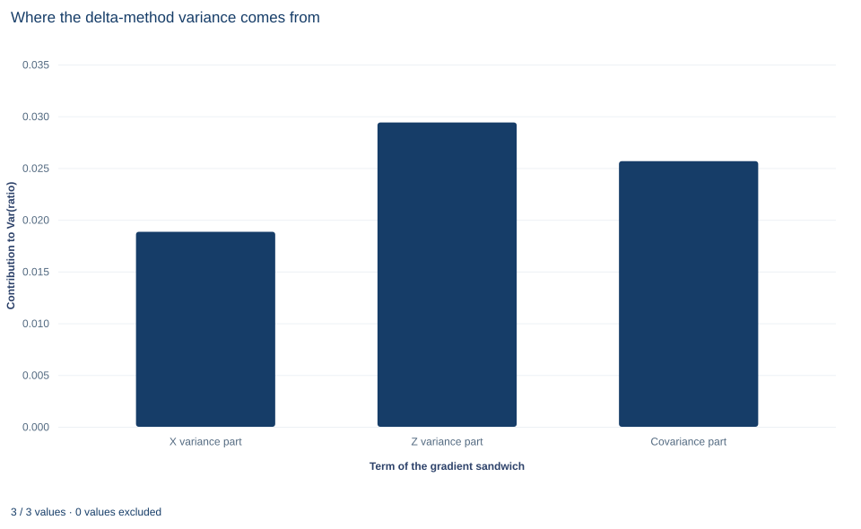

# Lab 10 · Delta-Method Inference for a Coefficient Ratio

**Propagating uncertainty through a nonlinear function of coefficients**

## Start with the supplied workbook

1. Download [nonlinear_delta.xlsx](nonlinear_delta.xlsx) and the [Python lab](lab.py). The workbook holds the fixed rows used throughout this chapter.
2. Import `nonlinear_delta.xlsx` into OpenEconometrics and keep that file name as the dataset name. The `Data` sheet holds one row per synthetic unit, with an outcome and two regressors; the `Dictionary` sheet lists each column and its unit. No cell is blank.
3. Open the complete `lab.py` in a new Python document and run the whole file. It fits one regression with HC3 standard errors, computes the ratio of the two slopes by the delta method and displays the model table, then the concept chart (a bar chart of the three terms that make up the ratio's variance), then a summary table of the six reported numbers.

For ordinary Python, keep `lab.py` and the workbook in the same folder and run the script there, or call `from lab import run_lab` and then `run_lab(data_path="/path/to/nonlinear_delta.xlsx")`. Work on a copy of the loaded table if you change any values, so the distributed workbook stays unchanged.

A regression of `y` on `x` and `z` gives slopes of 1.3536 and 0.7800. A natural follow-up question compares them: how many units of `z` have the same association with `y` as one unit of `x`? The answer is the ratio of the slopes, 1.7355. But how uncertain is that ratio? Each slope has its own standard error, yet neither standard error, nor any simple combination of the two, is the standard error of their ratio.

The delta method answers the question by linearizing the ratio around the estimates and passing the full coefficient covariance through that linear approximation. The lab finds a standard error of 0.2719 and a 95% interval from 1.200 to 2.271. More than a third of the ratio's variance comes from the covariance between the two slope estimates, a term that is easy to forget. The records are **240 original synthetic rows**, each an independent unit, with the outcome in abstract outcome units. The [LaTeX table](table.tex) collects the six reported numbers.

## 1. The variables and the quantity of interest

| Column | What it records in this lab | Unit |
|---|---|---|
| `row_id` | Row label, 1 to 240 | Identifier |
| `x` | First regressor, centered near zero | x units (abstract) |
| `z` | Second regressor, centered near zero and positively correlated with `x` | z units (abstract) |
| `y` | The outcome being explained | Outcome units |

The model is $y_i=\beta_0+\beta_1x_i+\beta_2z_i+u_i$ with $E[u_i\mid x_i,z_i]=0$, independent rows, and HC3 covariance because the error variance is not assumed constant. The quantity of interest is

$$
\theta=g(\beta)=\frac{\beta_1}{\beta_2}.
$$

Check its units. $\beta_1$ is outcome units per x unit and $\beta_2$ is outcome units per z unit, so $\theta$ is z units per x unit: the change in `z` that is associated with the same change in `y` as a one-unit change in `x`, holding the other regressor fixed. The ratio is meaningful only when both slopes are measured on stated scales. Rescaling `x` or `z` rescales $\theta$.

**Pause before running.** Write down the derivative of $\beta_1/\beta_2$ with respect to the denominator $\beta_2$. What is its sign at the estimates?

## 2. The plug-in estimate

The estimate replaces each coefficient with its OLS estimate:

$$
\hat\theta=\frac{\hat\beta_1}{\hat\beta_2}=\frac{1.3536}{0.7800}=1.7355 .
$$

Because $g$ is continuous wherever $\beta_2\neq0$, $\hat\theta$ is consistent for $\theta$ when the slopes are. It is not unbiased: the expectation of a ratio is not the ratio of expectations, and a denominator that can come out small makes the ratio's sampling distribution skewed. The delta method describes the ratio's behavior near the estimate, where a straight-line approximation is good.

## 3. Deriving the delta-method variance

A first-order Taylor expansion of $g$ around the true $\beta$ gives

$$
g(\hat\beta)\approx g(\beta)+\nabla g(\beta)'(\hat\beta-\beta).
$$

The right side is a linear combination of $\hat\beta$, so its variance follows from the ordinary rule for linear combinations:

$$
\operatorname{Var}\big(g(\hat\beta)\big)\approx\nabla g'\,V\,\nabla g,
\qquad
\nabla g=\Big(\frac{\partial g}{\partial\beta_0},\frac{\partial g}{\partial\beta_1},\frac{\partial g}{\partial\beta_2}\Big)'=\Big(0,\ \frac{1}{\beta_2},\ -\frac{\beta_1}{\beta_2^2}\Big)' .
$$

The intercept gets a zero derivative because the ratio does not involve it. In practice the gradient and $V$ are evaluated at the estimates. Writing out the quadratic form for the two slopes shows three pieces:

$$
\widehat{\operatorname{Var}}(\hat\theta)=\underbrace{\frac{1}{\hat\beta_2^2}\hat V_{11}}_{\text{x variance part}}+\underbrace{\frac{\hat\beta_1^2}{\hat\beta_2^4}\hat V_{22}}_{\text{z variance part}}+\underbrace{2\cdot\frac{1}{\hat\beta_2}\cdot\Big(-\frac{\hat\beta_1}{\hat\beta_2^2}\Big)\hat V_{12}}_{\text{covariance part}} .
$$

The method assumes that $\hat\beta$ is approximately normal around $\beta$, that $g$ is differentiable at $\beta$, and that $g$ is close to linear over the range where $\hat\beta$ is likely to fall. The last condition is the one that fails when $\beta_2$ is near zero.

## 4. A worked calculation

At the estimates, the two nonzero gradient elements are

$$
\frac{1}{0.7800}=1.2821,\qquad -\frac{1.3536}{0.7800^2}=-2.2252 .
$$

The HC3 covariance gives $\hat V_{11}=0.011461$, $\hat V_{22}=0.005938$ and $\hat V_{12}=-0.004498$. The three pieces are

| Term | Calculation | Value |
|---|---|---:|
| x variance part | $1.2821^2\times0.011461$ | 0.01884 |
| z variance part | $2.2252^2\times0.005938$ | 0.02940 |
| covariance part | $2\times1.2821\times(-2.2252)\times(-0.004498)$ | 0.02567 |
| Total | | 0.07391 |

The standard error is $\sqrt{0.07391}=0.2719$. With the Student $t$ critical value for 237 degrees of freedom, about 1.970, the interval is $1.7355\pm1.970\times0.2719$, or $[1.200,\ 2.271]$.

## 5. Why the covariance term matters, and why its sign is positive

The covariance part is 0.02567 out of 0.07391, about 35% of the variance. It is positive even though the slope covariance is negative. The two slope estimates have correlation $-0.004498/\sqrt{0.011461\times0.005938}=-0.545$: because `x` and `z` move together, an error that raises $\hat\beta_1$ tends to lower $\hat\beta_2$. The ratio rises when its numerator rises *and* when its denominator falls, so those two errors push the ratio in the same direction. In the formula, a positive derivative times a negative derivative times a negative covariance gives a positive term.

This is also why the separate standard errors cannot simply be combined. Dividing 0.1071 by 0.0771 gives a number with the wrong units and no connection to the ratio's sampling variation. Even a combination of relative errors that ignores the covariance omits more than a third of the variance here. Only the full covariance matrix, passed through the gradient, gives the first-order answer.

## 6. Run the calculation

The key calls fit the model and pass the ratio to the nonlinear-combination routine:

```python
raw = load_data()  # reader defined in the complete lab.py
model = fit(raw, ["x", "z"])  # HC3 covariance, the lab's default
ratio = oe.nlcom(model, lambda b: b["x"] / b["z"])
display(model)
print({key: round(ratio[key], 4) for key in ["estimate", "std_error", "ci_low", "ci_high"]})
```

`oe.nlcom` differentiates the supplied function automatically at the stored coefficients and uses the stored covariance; it does not refit the model or reread the data. The same standard error follows from the gradient written out by hand:

```python
import torch

bx, bz = coef(model, "x").estimate, coef(model, "z").estimate
grad = torch.tensor([0.0, 1 / bz, -bx / bz**2], dtype=torch.float64)
V = torch.tensor(model.covariance_matrix, dtype=torch.float64)
print(round(float(grad @ V @ grad) ** 0.5, 4))
```

It prints 0.2719; the saved check requires agreement to within $10^{-10}$. The model and ratio output read:

| Quantity | Estimate | HC3 or delta SE | 95% interval |
|---|---:|---:|---|
| Intercept | 1.954 | 0.081 | [1.794, 2.113] |
| `x` slope (outcome units per x unit) | 1.354 | 0.107 | [1.143, 1.565] |
| `z` slope (outcome units per z unit) | 0.780 | 0.077 | [0.628, 0.932] |
| Ratio $\hat\beta_1/\hat\beta_2$ (z units per x unit) | 1.736 | 0.272 | [1.200, 2.271] |

The run's summary table repeats the two slopes, the ratio, its delta standard error and the two interval endpoints. Read the ratio row as a statement about z units per x unit, and note that its standard error is relatively larger than either slope's: about 16% of the estimate, against 8% and 10% for the two slopes.

## 7. Read the bar chart



The chart, titled "Where the delta-method variance comes from," has three bars, labeled on the horizontal axis as "X variance part," "Z variance part" and "Covariance part." The vertical axis is each term's contribution to the variance of the ratio. The bars stand at 0.0188, 0.0294 and 0.0257, and they add up to the delta variance, 0.0739.

Two features stand out. The `z` part is the largest even though $\hat V_{22}$ is the smaller of the two variances, because the denominator's derivative is large: dividing by a slope of 0.78 magnifies its uncertainty. And the covariance bar is positive and nearly as tall as the others. A chart with only the first two bars would understate the ratio's variance by about a third.

## A case from the literature

Willingness-to-pay measures from choice studies raise this lab's question directly, because each is a ratio of estimated coefficients, typically an attribute's coefficient divided by the coefficient on cost. Hole (2007) compared four ways of building confidence intervals for such measures, the delta, Fieller, Krinsky–Robb and bootstrap methods, using a number of simulated datasets. In most scenarios all four were reasonably accurate and gave similar results. The delta method was the most accurate when the data were well conditioned, while the bootstrap was more robust to noisy data and to misspecification of the model. In an application to willingness to pay for a shorter wait for a general practitioner appointment, all the methods produced fairly similar intervals. That matches Section 8: here the denominator's $t$ statistic is 10.1, the well-conditioned case in which a delta interval is on firm ground. Fieller (1954) treated interval estimation for the root of an equation in estimated coefficients, of which a ratio is the simplest case. Hirschberg and Lye (2010) give a common geometric representation of the delta and Fieller intervals and find that how closely the two agree depends not only on each estimate's own statistics but also on the agreement of the sign of their estimated correlation with the ratio of the estimates, the covariance term that Section 5 emphasizes. Oehlert (1992) reviews the delta method and the conditions under which its approximate moments are accurate.

## 8. What the delta interval supports and what it does not

The calculation supports a first-order statement: near the estimates, the ratio is 1.74 z units per x unit with standard error 0.27. Here the approximation is on reasonably firm ground. The denominator's $t$ statistic is 10.12, so the `z` slope is far from zero relative to its uncertainty, and $g$ is close to linear over the plausible range of $\hat\beta_2$.

It does not guarantee accurate coverage in general. When the denominator's estimate is within a few standard errors of zero, the ratio's distribution becomes highly skewed, can have no finite moments, and a symmetric delta interval can badly misstate the uncertainty. The delta interval also depends on how the function is written: the same question asked as $\beta_2/\beta_1$ or $\log(\beta_1/\beta_2)$ gives intervals that do not map exactly onto this one. Test inversion (the Fieller approach), a log-scale interval or a bootstrap are common checks. Finally, a ratio of conditional slopes is a descriptive comparison within this model; it does not become a causal trade-off because it is computed from regression coefficients.

## 9. Write the result in full

A complete statement for the worked example reads: "In 240 synthetic independent rows, OLS of y on x and z gives slopes of 1.354 (HC3 standard error 0.107) and 0.780 (0.077). Their ratio is 1.736 z units per x unit. The delta-method standard error, using the full HC3 covariance including the covariance between the slopes, is 0.272, and the 95% interval with Student t critical values on 237 degrees of freedom is 1.200 to 2.271. The z slope is far from zero (t = 10.1), so the first-order approximation is reasonable here."

## Student exercises

1. Recompute the delta standard error twice: once dropping the covariance part, and once with the sign of $\hat V_{12}$ reversed. Report both and explain, in terms of how errors in the two slopes move together, why each differs from 0.2719.
2. Use `oe.nlcom` to compute the estimate, delta standard error and 95% interval for the inverse ratio $\beta_2/\beta_1$. Compare that interval with the reciprocals of the endpoints of $[1.200,\ 2.271]$ and explain why the two do not coincide.
3. Compute a delta-method interval for $\log(\beta_1/\beta_2)$ (use `torch.log` inside the function) and exponentiate its endpoints. Compare the result with the symmetric interval: which side is longer, and why?
4. Construct the Fieller interval: the set of values $\theta_0$ for which a $t$ test of $\beta_1-\theta_0\beta_2=0$ does not reject at 5%. Write the condition as a quadratic inequality in $\theta_0$, solve it with the lab's estimates and covariance, and compare the interval with the delta and log-scale intervals.
5. Test the hypothesis that the ratio equals one in two ways: with the delta-method $t$ statistic $(\hat\theta-1)/SE$, and with the linear restriction $\beta_1-\beta_2=0$ using `model.lincom({"x": 1, "z": -1})`. Report both $p$ values and explain why two ways of writing the same null give different answers.
6. Rewrite this sentence so that it is correct: "The ratio is 1.74, so x is 1.74 times as effective as z, and its standard error is 0.107/0.077 = 1.39."

## Further reading

- Fieller, E. C. (1954). Some problems in interval estimation. *Journal of the Royal Statistical Society Series B: Statistical Methodology*, 16(2), 175–185. https://doi.org/10.1111/j.2517-6161.1954.tb00159.x
- Hirschberg, J., and Lye, J. (2010). A geometric comparison of the delta and Fieller confidence intervals. *The American Statistician*, 64(3), 234–241. https://doi.org/10.1198/tast.2010.08130
- Hole, A. R. (2007). A comparison of approaches to estimating confidence intervals for willingness to pay measures. *Health Economics*, 16(8), 827–840. https://doi.org/10.1002/hec.1197
- Oehlert, G. W. (1992). A note on the delta method. *The American Statistician*, 46(1), 27–29. https://doi.org/10.1080/00031305.1992.10475842
