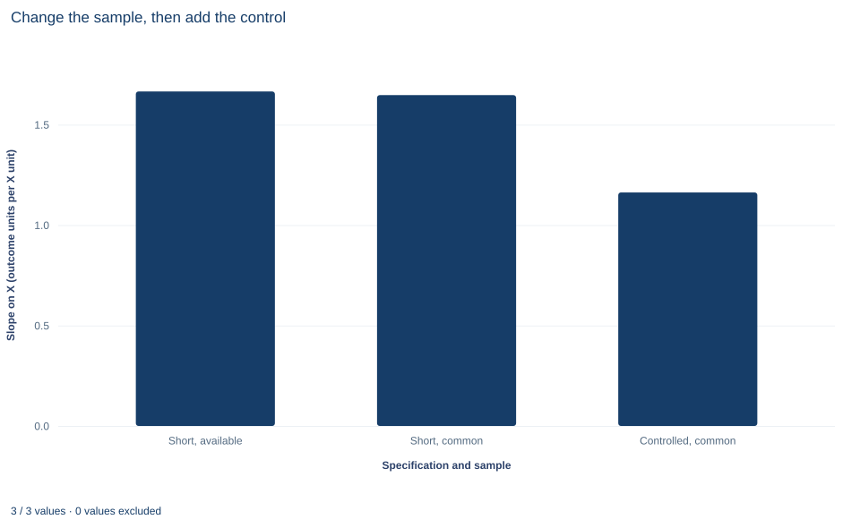

# Lab 11 · Specification Changes and Common Samples

**Separating a change of sample from a change of specification when a coefficient moves**

## Start with the supplied workbook

1. Download [common_sample.xlsx](common_sample.xlsx) and the [Python lab](lab.py). The workbook holds the fixed records used throughout this chapter.
2. Import `common_sample.xlsx` into OpenEconometrics and keep that file name as the dataset name. The `Data` sheet has 240 rows with the columns `row_id`, `x`, `z` and `y`; the `Dictionary` sheet lists each column and its blank cells.
3. Open the complete `lab.py` in a new Python document and run the whole file. It fits three regressions and displays, in order, the coefficient table of the controlled regression (Y on X and Z over the complete rows), the concept chart comparing the three X slopes, and a summary table of row counts, slopes and the two components of the change.

For ordinary Python, keep `lab.py` and the workbook in the same folder and run the script there, or call `from lab import run_lab` and then `run_lab(data_path="/path/to/common_sample.xlsx")`. Leave the three blank cells in `z` blank. If you want to try a different treatment of them, work on a copy of the loaded table.

A regression of Y on X reports a slope of 1.665. Add the control Z and the slope falls to 1.163. The tempting summary is "controlling for Z lowers the X coefficient by about 0.50." Before writing that sentence, check the row counts. Z has three blank cells, so software that drops incomplete rows fits the second regression on 237 records, not 240. The two numbers differ in two ways at once: the specification changed, and so did the sample.

This lab separates those two changes exactly. It uses **240 original synthetic records**, each an independent unit, with no grouping or time order. The [LaTeX table](table.tex) collects the reported numbers.

| Column | What it records | Scale | Blank cells |
|---|---|---|---:|
| `row_id` | Record label, 1 to 240 | Identifier | 0 |
| `x` | The regressor whose coefficient we follow | Abstract synthetic scale ("X units") | 0 |
| `z` | The candidate control added in the second specification | Abstract synthetic scale | 3 |
| `y` | The outcome | Outcome units | 0 |

The dictionary calls `x` and `z` "centered units"; both sit near zero but nothing here depends on centering, so read them as synthetic measures without a named unit. Slopes are in outcome units per X unit.

## 1. Name the samples and the specifications

Two row sets matter. The **available sample** $A$ contains every row with `y` and `x` recorded: all 240. The **common sample** $C$ contains every row with `y`, `x` and `z` recorded: 237. Two specifications matter as well:

$$
\text{short: } y_i=\alpha+\beta x_i+e_i,
\qquad
\text{long: } y_i=\alpha+\beta x_i+\gamma z_i+u_i .
$$

Crossing them gives three estimable regressions. Write $b_{SA}$ for the short-model X slope on $A$, $b_{SC}$ for the short-model slope on $C$, and $b_{LC}$ for the long-model slope on $C$. A fourth combination, the long model on $A$, cannot be estimated, because Z is unknown on three of its rows.

## 2. Telescope the total change

The comparison an analyst usually reports is $b_{SA}-b_{LC}$. Adding and subtracting $b_{SC}$ splits it into two pieces:

$$
b_{SA}-b_{LC}
=\underbrace{\left(b_{SA}-b_{SC}\right)}_{\text{sample component}}
+\underbrace{\left(b_{SC}-b_{LC}\right)}_{\text{control component}} .
$$

As algebra this holds for any three numbers. Its content lies in what each bracket holds fixed. The sample component keeps the short specification and changes only the rows, from 240 to 237. The control component keeps the 237 complete rows and changes only the specification, by adding Z. Each bracket answers one question, and together they reconcile to the reported comparison.

The order of the steps is forced by the data. With a complete control one could instead pass through the long model on $A$, and that path would generally split the total differently. Here that model does not exist, so the common-sample short fit is the only bridge.

## 3. Derive the control component

On a fixed sample, the control component has a closed form. Fit the long model on $C$ and write

$$
y_i=\hat a+b_{LC}\,x_i+\hat\gamma\,z_i+\hat u_i ,
$$

where the residuals $\hat u_i$ are orthogonal to the constant, to $x$ and to $z$ over $C$. Now regress both sides on a constant and $x$, using the same rows. Least squares is linear in the dependent variable, so the X slope of the left side, $b_{SC}$, equals the sum of the X slopes of the right-hand pieces. The constant contributes nothing, $b_{LC}x_i$ contributes $b_{LC}$, and $\hat u_i$ contributes zero because it is orthogonal to $x$. The remaining piece $\hat\gamma z_i$ contributes $\hat\gamma\hat\delta$, where $\hat\delta$ is the slope from regressing $z$ on a constant and $x$ in $C$. Hence

$$
b_{SC}-b_{LC}=\hat\gamma\,\hat\delta .
$$

This is the omitted-variable formula in its sample form. It is exact only because both regressions use the same rows: the short regression on $A$ includes three rows on which $z$, and therefore the long-model residual, is undefined. That is the algebraic reason for fixing a common sample before attributing a coefficient change to a control.

In this lab $\hat\gamma=0.775$ and the control component is positive, so $\hat\delta$ must be positive: X and Z move together in the complete rows, and part of what the short regression attributed to X belongs to Z.

## 4. Understand the sample component

The OLS slope is $\sum (x_i-\bar x)(y_i-\bar y)/\sum (x_i-\bar x)^2$. Removing rows changes the numerator, the denominator and both means; the direction of the change depends on where the removed rows sit relative to the fitted line.

The sample component is therefore a sensitivity to a change of rows, not a measure of bias from missingness. Deleting any three rows would move the slope by some amount. The generation mechanism computed Y before setting those Z cells missing, and the lab never replaces a missing control with zero; the complete-case rule is explicit.

**Pause before running.** How many rows does the control remove, and which of the three regressions still use them?

## 5. Fit the three regressions

`load_data()` and the helper `fit()` are defined in the complete `lab.py`. The helper calls `oe.ols` with HC3 covariance and `missing="raise"`, so a blank cell that reached a model would stop the run rather than vanish silently. The samples are therefore formed by name before any fit:

```python
raw = load_data()
available = raw.dropna(subset=["y", "x"]).reset_index(drop=True)
common = raw.dropna(subset=["y", "x", "z"]).reset_index(drop=True)
short_available = fit(available, ["x"])
short_common = fit(common, ["x"])
controlled = fit(common, ["x", "z"])
display(controlled)
```

The decomposition is then three subtractions:

```python
slope = {name: coef(model, "x").estimate for name, model in [
    ("short, available", short_available),
    ("short, common", short_common),
    ("controlled, common", controlled),
]}
sample_component = slope["short, available"] - slope["short, common"]
control_component = slope["short, common"] - slope["controlled, common"]
print(round(sample_component, 4), round(control_component, 4))
```

The three fits give:

| Regression | Rows | Residual df | X slope | HC3 standard error |
|---|---:|---:|---:|---:|
| Short, available rows | 240 | 238 | 1.665 | 0.146 |
| Short, common rows | 237 | 235 | 1.647 | 0.147 |
| Controlled, common rows | 237 | 234 | 1.163 | 0.151 |

In the controlled regression the Z coefficient is 0.775 with HC3 standard error 0.085. The components are:

| Step | What changes | Change in X slope |
|---|---|---:|
| Sample component | Rows, 240 → 237 (short model) | 0.0181 |
| Control component | Add Z (237 rows) | 0.4846 |
| Total | Both | 0.5027 |

Start with the Rows column: only the first regression uses all 240 records. Then read the components against the total. About 96% of the half-unit drop comes from adding Z on a fixed sample; the change of rows accounts for 0.018 outcome units per X unit. The lab checks that the components add to the total to within $10^{-12}$.

## 6. Covariance and inference conventions

Each model uses the HC3 heteroskedasticity-robust covariance and Student $t$ reference distributions with $n-k$ residual degrees of freedom: 238, 235 and 234. Each standard error describes the sampling variability of one coefficient within its own model.

None of them measures the uncertainty of a component. The three slopes come from overlapping rows and are strongly dependent, so combining their standard errors as if they were independent gives no valid standard error for a difference. The decomposition is a point-estimate identity with no inference of its own. The sample component is about one-eighth of the short-model standard error, which conveys its scale, but that ratio is not a test statistic.

Whether Z belongs in the model is a separate question with its own test. In the controlled regression the HC3 $t$ statistic for Z is 9.09 on 234 degrees of freedom. That tests $\gamma=0$ within the long model; it does not test the decomposition.

## 7. Read the chart



The chart, titled "Change the sample, then add the control," has one bar per regression. The horizontal axis names the specification and sample ("Short, available", "Short, common" and "Controlled, common", the three rows of the table above); the vertical axis gives the slope on X in outcome units per X unit and starts at zero, so bar heights can be compared directly. The first two bars are almost the same height, at 1.665 and 1.647. The third is clearly lower, at 1.163. The step from the first bar to the second is the sample component; the step from the second to the third is the control component.

The bars are point estimates without intervals. Read the chart as a picture of the identity in Section 2, not as evidence about which specification is correct.

## A case from the literature

Altonji et al. (2005) asked whether attending a Catholic high school improves educational attainment and test scores. Lacking a good instrument, they treated the amount of selection on observed variables as a guide to the amount of selection on unobserved ones, and asked how large selection on unobservables would have to be, relative to selection on observables, to attribute the whole estimated effect to selection bias. They concluded that Catholic high schools substantially raise the probability of graduating from high school and, more tentatively, of attending college, with little evidence of an effect on test scores.

Arguments of this kind read the movement of a coefficient, as controls are added, as information about bias. Gelbach (2016) shows that when added covariates are intercorrelated, adding them one after another makes each one's apparent contribution depend on the order, and he builds a decomposition from the omitted-variables formula, the same formula as Section 3. Such comparisons are clean only when both coefficients are estimated on the same observations. When a control has blank cells, complete-case software quietly changes the rows as well, and part of the movement is the sample component isolated in this lab. Whether the complete rows represent the excluded ones is a separate question. Little (1992) reviews alternatives to complete-case analysis, with attention to data that are not missing completely at random, and Jones (1996) finds that missing-indicator methods can be badly biased, while complete-case analysis is free of bias in many situations but wastes information.

## 8. Decide what the evidence supports

The decomposition partitions an observed coefficient movement. It does not estimate the bias that missing controls would cause in a population. If whether Z is recorded depends on the outcome or on the X–Y relation, the complete-case estimate can differ from the one that complete records would give, and no arithmetic on the observed rows can reveal that. A missingness assumption is required before the controlled slope is read as describing all 240 units.

The control component also does not say whether Z should be controlled for. If Z confounds the X–Y relation, the controlled slope is closer to the quantity of interest; if Z lies on the path from X to Y, controlling for it removes part of the effect being studied. That judgment comes from the design, not from the size of the component.

A small sample component is a property of these data. With more missing controls, or missingness concentrated among unusual rows, the change of rows can dominate.

## 9. State the finding in full

A complete statement for the worked example reads: "In 240 synthetic records, the HC3 slope of Y on X is 1.665 when all rows with Y and X are used. Three rows lack Z. On the 237 complete rows the same short regression gives 1.647, and adding Z gives 1.163 (HC3 standard error 0.151, 234 degrees of freedom). Of the total change of 0.503 outcome units per X unit, 0.018 reflects the change of sample and 0.485 the addition of Z on a fixed sample. The split is arithmetic; it does not establish that the complete rows represent the three excluded ones."

## Student exercises

1. Identify the three rows the control removes and report their `x` and `y` values. Using each row's residual from the short regression on all 240 rows and its distance from the mean of `x`, explain why removing them lowers the short slope rather than raising it.
2. Regress `z` on `x` (with an intercept) over the 237 complete rows. Multiply the slope by the Z coefficient from the controlled regression and compare the product with the control component. Then explain why the same product cannot reconcile $b_{SA}$ with $b_{LC}$.
3. Drop rows with `row_id` 1, 2 and 3 instead of the three rows with blank Z, and refit the short model. Compare the resulting "sample component" with 0.0181 in size and sign, and explain what this says about interpreting the sample component as bias.
4. On a copy of the data, replace the three blank Z cells with zero and fit the controlled regression on all 240 rows. Report the X slope and explain why this number answers a different question from the controlled slope above.
5. Compute the change in $R^2$ from adding Z on the common rows, and the change you would report by comparing the controlled $R^2$ with the short-model $R^2$ on all 240 rows. Explain why the second comparison mixes two changes, referring to the total sum of squares in each model.
6. Rewrite the sentence "Controlling for Z cuts the effect of X by 30%" so that it names the samples, the covariance convention, the two components and what the decomposition does not establish.

## Further reading

- Altonji, J. G., Elder, T. E., and Taber, C. R. (2005). Selection on observed and unobserved variables: Assessing the effectiveness of Catholic schools. *Journal of Political Economy*, 113(1), 151–184. https://doi.org/10.1086/426036
- Gelbach, J. B. (2016). When do covariates matter? And which ones, and how much? *Journal of Labor Economics*, 34(2), 509–543. https://doi.org/10.1086/683668
- Jones, M. P. (1996). Indicator and stratification methods for missing explanatory variables in multiple linear regression. *Journal of the American Statistical Association*, 91(433), 222–230. https://doi.org/10.1080/01621459.1996.10476680
- Little, R. J. A. (1992). Regression with missing *X*'s: A review. *Journal of the American Statistical Association*, 87(420), 1227–1237. https://doi.org/10.1080/01621459.1992.10476282
