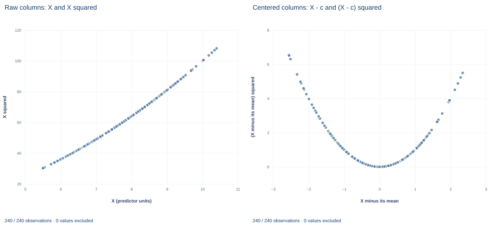

# Lab 12 · Centering a Polynomial without Changing Its Fit

**Reparameterizing a quadratic: which coefficients move, which stay and why**

## Start with the supplied workbook

1. Download [polynomial_centering.xlsx](polynomial_centering.xlsx) and the [Python lab](lab.py). The workbook holds the fixed records used throughout this chapter.
2. Import `polynomial_centering.xlsx` into OpenEconometrics and keep that file name as the dataset name. The `Data` sheet has 240 rows with the columns `row_id`, `x`, `z` and `y` and no blank cells; the `Dictionary` sheet lists the columns.
3. Open the complete `lab.py` in a new Python document and run the whole file. It fits the same quadratic twice, once in raw X and once in X minus its mean, and displays, in order, the coefficient table of the centered fit, the concept chart (in the app, its first panel only: the raw X column against X squared), and a summary table with the centering value, both linear coefficients, the slope at the mean, the quadratic coefficient and the largest gap between the two sets of fitted values.

For ordinary Python, keep `lab.py` and the workbook in the same folder and run the script there, or call `from lab import run_lab` and then `run_lab(data_path="/path/to/polynomial_centering.xlsx")`. Build centered or squared columns on a copy of the loaded table rather than in the workbook.

A quadratic regression of Y on X, X squared and a control Z reports a linear coefficient of 0.282 with a $t$ statistic of 0.40. Subtract the mean of X, 8.055, before squaring and refit: the linear coefficient becomes −0.131 with $t=-1.79$. The data, the model and every fitted value are the same. So which number is "the effect of X"? Neither, on its own. In a quadratic the linear coefficient is the slope at the point where the regressor equals zero, and centering moves that point.

The lab uses **240 original synthetic records**, each an independent unit. The [LaTeX table](table.tex) collects the reported numbers.

| Column | What it records | Scale | Blank cells |
|---|---|---|---:|
| `row_id` | Record label, 1 to 240 | Identifier | 0 |
| `x` | The regressor entering the polynomial; raw, not centered | Abstract synthetic scale ("X units"), observed from about 5.5 to 10.4 | 0 |
| `z` | A control entering linearly | Abstract synthetic scale, values around zero | 0 |
| `y` | The outcome | Outcome units | 0 |

`x` is the raw regressor: its mean is 8.055, so the column is not centered. Centering is the operation this lab performs on it.

**Pause before running.** When X is replaced by X minus a constant, which coefficients should change and which should not?

## 1. Write one model two ways

The raw and centered parameterizations are

$$
y_i=b_0+b_1x_i+b_2x_i^2+b_zz_i+u_i
\qquad\text{and}\qquad
y_i=a_0+a_1(x_i-c)+a_2(x_i-c)^2+a_zz_i+u_i ,
$$

where $c$ is a fixed number; here it is the sample mean of `x`. Expand the second form: $(x_i-c)^2=x_i^2-2cx_i+c^2$. Matching the coefficients on $x_i^2$, on $x_i$ and on $z_i$ gives

$$
a_2=b_2,\qquad a_1=b_1+2c\,b_2,\qquad a_z=b_z ,
$$

and the constant terms absorb everything left over, so the intercept shifts too. The quadratic and control coefficients are unchanged. The linear coefficient and the intercept change.

## 2. Show that the fit cannot change

Write the raw design matrix as $X=[\,1,\;x,\;x^2,\;z\,]$. Each centered column is a linear combination of raw columns: $x-c=x-c\cdot1$ and $(x-c)^2=x^2-2c\,x+c^2\cdot1$. So the centered design is $XT$ for an upper-triangular matrix $T$ with ones on the diagonal, which is invertible. The two designs span the same column space, and least squares projects $y$ onto that space:

$$
P_{XT}=XT\,(T^\top X^\top XT)^{-1}T^\top X^\top=X(X^\top X)^{-1}X^\top=P_X .
$$

Fitted values $P_Xy$ and residuals are therefore identical, and so are $R^2$ and the residual sum of squares. The lab reports a largest absolute fitted-value gap of $1.8\times10^{-15}$, which is floating-point rounding.

The argument needs every column on the right of those expansions. Drop the intercept and $c^2\cdot1$ has nowhere to go; drop the linear term and $-2c\,x$ has nowhere to go. In either case the column spaces differ and the identity fails.

## 3. Read each linear coefficient as a slope at a point

The fitted slope of the conditional mean with respect to X is

$$
\frac{\partial\,\hat y}{\partial x}=b_1+2b_2\,x .
$$

At $x=0$ it equals $b_1$; at $x=c$ it equals $a_1$. The raw linear coefficient, 0.282, is the slope at X = 0, a point far below the observed range of about 5.5 to 10.4. It is an extrapolation of the fitted parabola, not a description of the data. The centered coefficient is the slope at the mean of X:

$$
a_1=0.28155+2\times8.05467\times(-0.0256374)=0.28155-0.41300=-0.13145 .
$$

The lab computes this from the raw fit and confirms that it equals the centered linear coefficient to within $10^{-9}$.

## 4. Follow the covariance through the change

Stack the coefficients as $b$ and $a$. Section 1 shows $a=Ab$ for a fixed invertible matrix $A$, so for any covariance estimate that respects the reparameterization, $\widehat{V}(\hat a)=A\,\widehat{V}(\hat b)\,A^\top$.

HC3 has this property. Its residuals are the same in both fits, and the leverages $h_{ii}$ are diagonal elements of the projection matrix, which Section 2 showed is unchanged. Hence the centered HC3 covariance is exactly $A$ times the raw HC3 covariance times $A^\top$. The quadratic and Z coefficients keep their standard errors, while the linear coefficient's standard error changes because it now refers to a different point on the curve.

The raw linear coefficient has an HC3 standard error of 0.697; the centered one, 0.0735. The difference does not mean centering created precision. A slope at X = 0, far outside the data, is poorly determined; a slope at the center of the data is well determined. Both standard errors are correct for the quantities they describe.

## 5. See what centering does to collinearity

Over the range 5.5 to 10.4, X and X squared rise together almost in a straight line, so the raw columns are close to collinear. After centering, $(x-c)^2$ is large at both ends of the range and small in the middle, so it is much less linearly related to $x-c$. The scaled condition number of the design falls from 26.4 to 1.96.

That improvement is numerical. It changes which questions the individual coefficients answer and makes them easier to compute accurately, but it adds no information: the fitted curve, its uncertainty at any given X, and every joint test of the X terms are the same in both parameterizations.

## 6. Run the two fits

`load_data()` and the helpers `fit()` and `coef()` are defined in the complete `lab.py`; `fit` calls `oe.ols` with HC3 covariance. The two fits are:

```python
raw = load_data()
center = raw.x.mean()
raw_data = raw.assign(x2=raw.x ** 2)
centered_data = raw.assign(xc=raw.x - center, xc2=(raw.x - center) ** 2)
raw_poly = fit(raw_data, ["x", "x2", "z"])
centered_poly = fit(centered_data, ["xc", "xc2", "z"])
display(centered_poly)
```

The slope identity and the fitted-value check take two more lines:

```python
b = {row.term: row.estimate for row in raw_poly.coefficients}
slope_at_mean = b["x"] + 2 * b["x2"] * center
largest_gap = max(abs(r["fitted"] - s["fitted"])
                  for r, s in zip(raw_poly.predictions, centered_poly.predictions))
print(round(center, 4), round(slope_at_mean, 4), largest_gap)
```

The two coefficient tables, side by side:

| Term | Raw estimate | Raw HC3 SE | Centered estimate | Centered HC3 SE |
|---|---:|---:|---:|---:|
| Intercept | 5.842 | 2.753 | 6.447 | 0.078 |
| Linear term ($x$ or $x-c$) | 0.2815 | 0.6970 | −0.1315 | 0.0735 |
| Quadratic term | −0.0256 | 0.0439 | −0.0256 | 0.0439 |
| `z` | 0.815 | 0.067 | 0.815 | 0.067 |

Both fits use 240 rows with 236 residual degrees of freedom and have $R^2=0.501$. Read the table row by row against Section 1: the last two rows agree exactly, the linear row differs as $a_1=b_1+2cb_2$ predicts, and the intercept row differs by the leftover constant. The centered linear slope has $t=-1.79$ ($p=0.075$); the quadratic coefficient has $t=-0.58$ in both fits.

## 7. Read the chart



The chart plots regressor columns, not outcomes. The left panel, "Raw columns: X and X squared," puts X (from about 5.5 to 10.4) on the horizontal axis and X squared (from about 30 to 108) on the vertical axis. The 240 points lie on a gently bending curve that is almost a straight line: the raw linear and squared columns carry nearly the same information. The right panel, "Centered columns: X - c and (X - c) squared," puts X minus its mean (about −2.6 to 2.3) against its square (0 to about 6.6). The points trace a U-shape with its lowest point at zero, so the squared column now varies in a way the linear column cannot mimic. In the app only the left panel appears.

## A case from the literature

Murphy and Welch (1990) examined the human capital earnings function, in which earnings are a quadratic in potential experience, and which they call probably the most widely accepted empirical specification in economics. They found that it approximates the relation between earnings and experience poorly: it understates earnings growth early in a career by about 30 to 50 percent and overstates growth in mid-career by 20 to 50 percent, while simple alternative specifications fit the data.

Their criticism is about slopes at particular points of the regressor, the language of Section 3. In a quadratic the slope at any value of X is $b_1+2b_2x$, so one curvature coefficient fixes the pattern of slopes over the whole range; if the data bend differently, the slopes are wrong somewhere even when the fitted levels look close. Centering cannot repair this, because it leaves the fitted function unchanged and only moves the point that the linear coefficient describes. Peixoto (1990) proves the general result behind Section 2: the estimation space of a polynomial regression is invariant under coding transformations of the variables, of which centering is one, if and only if the model keeps all of its lower-order terms. Bradley and Srivastava (1979) confirm that centering removes nonessential ill-conditioning among the powers of a regressor, and Dalal and Zickar (2012) explain that centering changes the lower-order coefficients but neither the highest-order coefficient nor the fit. Centering is a choice of reporting point, not a different model.

## 8. Decide what the evidence supports

Centering changes the reporting point of the linear coefficient and the conditioning of the design. It does not change the fitted function, the residuals, $R^2$, the quadratic coefficient or the control coefficient. It also does not make the curvature better determined: the quadratic coefficient is imprecise in both fits, so the data say little about how the slope changes across the range of X.

Dropping the quadratic term after centering is a different model, not a simplification of this one. Nor does centering justify extrapolation: the fitted parabola describes X between about 5.5 and 10.4, and the raw linear coefficient is already an extrapolation to X = 0. The centering value is a reporting choice. The mean is convenient, but a median or a policy-relevant value is equally valid if it is stated.

## 9. State the finding in full

A complete statement for the worked example reads: "In 240 synthetic records, a quadratic in X with a linear control Z gives a fitted slope of −0.131 outcome units per X unit at the sample mean X = 8.05 (HC3 standard error 0.074, 236 degrees of freedom). The raw-parameterization linear coefficient, 0.282, is the slope at X = 0, outside the observed range of 5.5 to 10.4. Centering leaves the fitted values unchanged (largest difference $1.8\times10^{-15}$) and the quadratic coefficient at −0.026 (standard error 0.044)."

## Student exercises

1. Use the raw coefficients to compute the fitted slope at X = 7 and at X = 9. Then refit the quadratic with X centered at 9 and confirm that its linear coefficient equals your slope at 9. Compare its standard error with the standard error at the mean and explain the difference.
2. Derive the relation between the centered intercept $a_0$ and the raw coefficients $b_0$, $b_1$ and $b_2$. Verify it numerically with the two intercepts in Section 6.
3. Write $\operatorname{Var}(\hat a_1)$ in terms of the elements of the raw covariance matrix. Compute it from `raw_poly.covariance_matrix` and compare its square root with the centered standard error.
4. Test the joint null that the linear and quadratic coefficients are both zero, once in each parameterization, using the HC3 covariance blocks. Report the Wald statistic and explain why the two results must agree.
5. Fit both parameterizations without an intercept (`oe.ols(..., intercept=False)`). Compare the residual sums of squares and the largest fitted-value gap, and identify the step of the argument in Section 2 that fails.
6. Rewrite the sentence "The linear term of X is insignificant (t = 0.40), so X has no effect on Y at typical values" so that it names the point at which the slope is evaluated, its standard error and the parameterization.

## Further reading

- Bradley, R. A., and Srivastava, S. S. (1979). Correlation in polynomial regression. *The American Statistician*, 33(1), 11–14. https://doi.org/10.1080/00031305.1979.10482644
- Dalal, D. K., and Zickar, M. J. (2012). Some common myths about centering predictor variables in moderated multiple regression and polynomial regression. *Organizational Research Methods*, 15(3), 339–362. https://doi.org/10.1177/1094428111430540
- Murphy, K. M., and Welch, F. (1990). Empirical age-earnings profiles. *Journal of Labor Economics*, 8(2), 202–229. https://doi.org/10.1086/298220
- Peixoto, J. L. (1990). A property of well-formulated polynomial regression models. *The American Statistician*, 44(1), 26–30. https://doi.org/10.1080/00031305.1990.10475687
