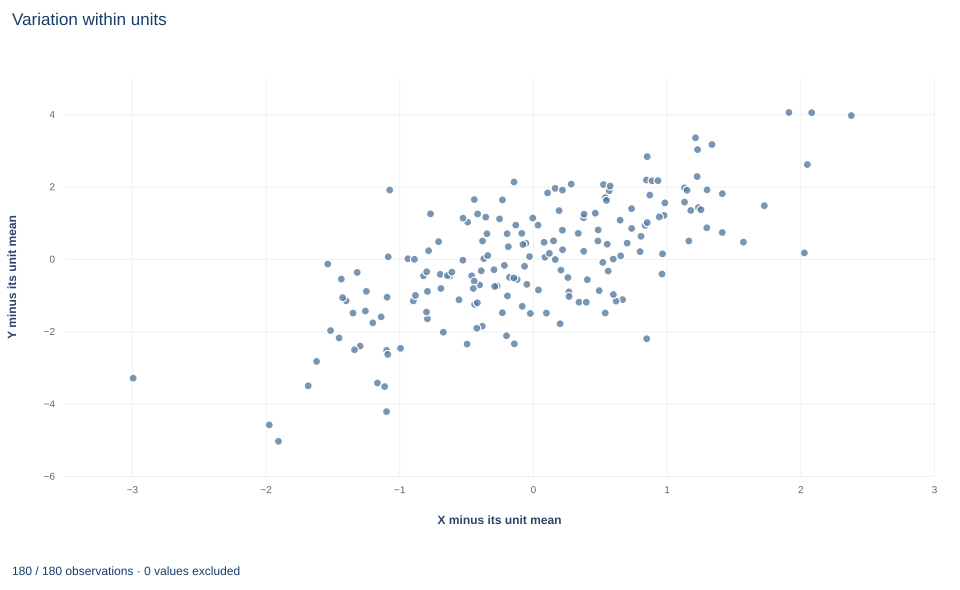

# Lab 13 · Fixed Effects as Dummies and Within Variation

**Two routes to the fixed-effects slope, and the clustered inference that goes with it**

## Start with the supplied workbook

1. Download [fixed_effects_algebra.xlsx](fixed_effects_algebra.xlsx) and the [Python lab](lab.py). The workbook holds the fixed panel used throughout this chapter.
2. Import `fixed_effects_algebra.xlsx` into OpenEconometrics and keep that file name as the dataset name. The `Data` sheet has 180 rows with the columns `row_id`, `x`, `z`, `y`, `unit` and `time` and no blank cells; the `Dictionary` sheet lists the columns.
3. Open the complete `lab.py` in a new Python document and run the whole file. It displays, in order, the coefficient table of the dummy-variable regression (X, Z, an intercept and 29 unit dummies, with unit-clustered standard errors), the concept chart of within-unit deviations, and a summary table with the unit and period counts, the slope from each route, the clustered standard error and its degrees of freedom.

For ordinary Python, keep `lab.py` and the workbook in the same folder and run the script there, or call `from lab import run_lab` and then `run_lab(data_path="/path/to/fixed_effects_algebra.xlsx")`. Build dummies and demeaned columns on a copy of the loaded table.

Thirty units are each observed in six periods. Every unit has its own persistent level of Y, and in this synthetic design those levels are correlated with X. A pooled regression of Y on X would therefore compare high-level units with low-level units and credit the difference to X. Fixed effects give each unit its own intercept, so the X coefficient is learned only from how X and Y move together within a unit over time.

There are two standard ways to compute that coefficient: include a dummy for each unit, or subtract each unit's means and regress the deviations. This lab does both and gets 1.28195 both times. The questions are why the two routes must agree, which variation identifies the slope, and which standard error belongs with it.

The panel has **180 original synthetic unit-period records**: 30 units, each observed in periods 0 to 5, with no gaps and no blank cells. The [LaTeX table](table.tex) collects the reported numbers.

| Column | What it records | Scale | Blank cells |
|---|---|---|---:|
| `row_id` | Record label, 1 to 180 | Identifier | 0 |
| `unit` | Panel unit, coded 0 to 29 | Identifier (category) | 0 |
| `time` | Period within the unit, 0 to 5 | Integer period | 0 |
| `x` | The time-varying regressor whose coefficient we follow | Abstract synthetic scale ("X units") | 0 |
| `z` | A second time-varying regressor | Abstract synthetic scale | 0 |
| `y` | The outcome | Outcome units | 0 |

The dictionary calls `x` and `z` "centered units"; nothing in the lab depends on their location, so read them as synthetic measures without a named unit.

## 1. Write the model with unit intercepts

For unit $i=1,\dots,30$ and period $t$,

$$
y_{it}=\alpha_i+\beta_x x_{it}+\beta_z z_{it}+u_{it}.
$$

The unit effect $\alpha_i$ collects everything about unit $i$ that does not change over the six periods, whether or not it is measured. It may be correlated with $x_{it}$; that is the reason for including it. The identifying assumption is **strict exogeneity**: given $\alpha_i$, the error $u_{it}$ is uncorrelated with the regressors in every period of the same unit, past and future. The synthetic shocks satisfy it by construction.

## 2. Route one: unit dummies

Thirty indicator columns, one per unit, sum to a column of ones, which is the intercept. Including the intercept and all thirty would make the design rank-deficient, so the lab omits unit 0's dummy. The intercept is then unit 0's level, and each dummy coefficient is that unit's level minus unit 0's. The regression has $K=32$ coefficients: intercept, X, Z and 29 dummies, leaving $180-32=148$ residual degrees of freedom.

## 3. Route two: demean within units

Let $D$ be the $180\times30$ matrix of unit indicators; the intercept and 29 dummies span the same space. The annihilator $M_D=I-D(D^\top D)^{-1}D^\top$ replaces each value with its deviation from its unit's mean: $(M_Dv)_{it}=v_{it}-\bar v_i$. By the Frisch–Waugh–Lovell theorem, the X and Z coefficients from the dummy regression equal those from regressing $M_Dy$ on $M_Dx$ and $M_Dz$:

$$
\tilde y_{it}=\beta_x\tilde x_{it}+\beta_z\tilde z_{it}+\tilde u_{it},
\qquad \tilde v_{it}=v_{it}-\bar v_i .
$$

Demeaning removes $\alpha_i$ because $\alpha_i-\bar\alpha_i=0$. No intercept is needed, since every demeaned column has mean zero within each unit. The result holds in balanced and unbalanced panels alike, for ordinary unweighted least squares.

The demeaned equation shows what identifies $\beta_x$: deviations of X from each unit's own mean. Level differences between units contribute nothing. A unit whose X never changed would add no information about the slope, however different its level.

## 4. Choose the covariance for panel data

Errors for the same unit can be correlated across periods, and demeaning adds correlation of its own, because every deviation within a unit shares the same subtracted mean. The lab therefore clusters by unit. The cluster-robust (CR1) estimator is

$$
\widehat V=c\,(X^\top X)^{-1}\Big(\sum_{g=1}^{G}X_g^\top\hat u_g\hat u_g^\top X_g\Big)(X^\top X)^{-1},
\qquad
c=\frac{G}{G-1}\cdot\frac{N-1}{N-K},
$$

where $X_g$ and $\hat u_g$ are unit $g$'s six rows. With $G=30$, $N=180$ and $K=32$, the factor is $c=\tfrac{30}{29}\cdot\tfrac{179}{148}=1.2512$, and $t$ statistics use $G-1=29$ degrees of freedom. The effective sample size for inference is the number of units, not the number of rows.

The value of $K$ matters. Software that regresses already-demeaned data does not know that 30 unit means were estimated first, so it counts too few parameters, uses a smaller factor and understates the standard error. The dummy route keeps the count honest.

The unit dummies need a warning of their own. Residuals sum to zero within every unit, so the cluster scores of the intercept and every dummy are identically zero. The 32-by-32 cluster covariance in this lab has rank 2: it carries information about the two slopes only. Do not read the dummy standard errors as tests of differences between units.

**Pause before running.** Why must one unit dummy be omitted, and how many independent clusters support the inference?

## 5. Fit both routes

`load_data()` and the helpers `fit()` and `coef()` are defined in the complete `lab.py`. The dummy route builds 29 indicator columns and passes them to `oe.ols` with unit-clustered covariance:

```python
raw = load_data()
data = raw.copy()
dummies = []
for unit in sorted(raw.unit.unique())[1:]:
    name = "unit_" + str(unit)
    data[name] = (raw.unit == unit).astype(float)
    dummies.append(name)
model = fit(data, ["x", "z"] + dummies, covariance="cluster", cluster="unit")
display(model)
```

The within route subtracts unit means and solves least squares without an intercept:

```python
within = raw[["y", "x", "z"]] - raw.groupby("unit")[["y", "x", "z"]].transform("mean")
X = torch.tensor(within[["x", "z"]].values, dtype=torch.float64)
Y = torch.tensor(within.y.tolist(), dtype=torch.float64)
within_slopes = torch.linalg.lstsq(X, Y).solution
print(round(float(within_slopes[0]), 5), round(coef(model, "x").estimate, 5))
```

The slope rows of the dummy regression read:

| Term | Estimate | Cluster SE | $t$ (29 df) | 95% interval |
|---|---:|---:|---:|---:|
| `x` | 1.282 | 0.088 | 14.56 | 1.102 to 1.462 |
| `z` | 0.872 | 0.074 | 11.79 | 0.721 to 1.023 |

The intercept, 1.689, is unit 0's level. The summary table reports 30 units, 6 periods, a within slope of 1.28195 and a dummy slope of 1.28195; the lab checks that they agree to within $10^{-9}$. Read the X row in outcome units per X unit: within a unit, a period in which X is one unit above that unit's average has fitted Y about 1.28 units above its average, holding Z's deviation fixed. The regression $R^2$ of 0.901 counts the unit intercepts as explained variation, so it overstates how much of the within-unit variation X and Z account for.

## 6. Read the chart



The chart, titled "Variation within units," plots each of the 180 records once. The horizontal axis is X minus its unit mean, from about −3.0 to 2.4; the vertical axis is Y minus its unit mean, from about −5.0 to 4.0. Each unit's six points have deviations that sum to zero on both axes, so every unit is centered on the origin and no unit's level remains visible. The upward-sloping cloud is exactly the variation the fixed-effects slope uses. Z has not been removed from these deviations, so a line drawn through the cloud need not have slope 1.282 exactly.

## A case from the literature

Bertrand et al. (2004) asked how much to trust the standard errors of difference-in-differences estimates, which typically use many years of data on serially correlated outcomes. They generated placebo laws at random in state-level data on female wages from the Current Population Survey and estimated each law's "effect" by OLS with conventional standard errors. Those standard errors severely understated the estimators' variability: up to 45 percent of the placebo laws appeared significant at the 5 percent level. In simulations, corrections that impose a parametric time-series process performed poorly, while corrections based on an asymptotic approximation to the covariance matrix worked well with moderate numbers of states.

The lab's panel shares the features behind that problem: unit intercepts, several periods per unit and errors that may be correlated within a unit over time. Clustering by unit, with inference based on the 30 units rather than the 180 rows, is the response such results motivate. Stock and Watson (2008) add that the usual heteroskedasticity-robust covariance is inconsistent for the fixed-effects estimator when the number of periods is fixed and greater than two, even with serially uncorrelated errors, and Arellano (1987) addresses how to compute robust standard errors for within-groups estimators. The comparison of dummies with demeaning is old: extending the Frisch–Waugh theorem, Lovell (1963) compared regressions on data adjusted in advance with regressions that include dummy variables, and noted that pre-adjusted data tend to overstate the significance of the coefficients, the counting problem of Section 4.

## 7. Decide what the evidence supports

Fixed effects remove time-invariant unit components, measured or not. They do not remove confounders that change over time within a unit, and they do not remove shocks common to all units in a period unless period effects are added. A regressor that never changes within a unit cannot be estimated separately from the unit intercepts.

Strict exogeneity is a real restriction. If a shock to Y in one period changes X in later periods, the within transformation mixes past and future errors into every deviation and the slope is biased even with fixed effects. Measurement error in X is also more damaging after demeaning, which removes the stable signal and keeps the noise.

Finally, 30 clusters is a moderate number. Cluster-robust inference is justified by the number of clusters growing, so the $t$ reference with 29 degrees of freedom is an approximation, not an exact result.

## 8. State the finding in full

A complete statement for the worked example reads: "In a balanced synthetic panel of 30 units observed over 6 periods (180 records), the unit fixed-effects slope of Y on X, holding Z fixed, is 1.282 outcome units per X unit. Unit dummies and within-unit demeaning give the same estimate. The standard error clustered by unit is 0.088, with 29 degrees of freedom, giving a 95% interval of 1.102 to 1.462. The estimate uses within-unit variation only and assumes strict exogeneity; it does not address time-varying confounding."

## Student exercises

1. Recover the intercepts of units 0 and 1 from the within route as $\hat\alpha_i=\bar y_i-\hat\beta_x\bar x_i-\hat\beta_z\bar z_i$, and compare them with the intercept and with the intercept plus the `unit_1` coefficient from the dummy regression.
2. Fit the pooled regression of `y` on `x` and `z` without unit dummies, clustered by unit. Compare its X slope with 1.282 and explain the direction of the difference using the relation between each unit's mean of `x` and its recovered intercept.
3. Fit `fit(within, ["x", "z"], covariance="cluster", cluster="unit")` on the demeaned frame. Compare its X slope and standard error with the dummy regression, compute the CR1 factor it uses, and explain the ratio of the two standard errors.
4. Add each unit's mean of `x` as an extra regressor to the dummy regression. Report what the software does, what happens to the X slope and how the new coefficient should be read.
5. Add period dummies for periods 1 to 5 to the dummy regression. Report the X slope and its clustered standard error, and state which source of variation the period dummies remove.
6. Rewrite the sentence "Fixed effects remove all confounding, so X causes a 1.28 increase in Y (p < 0.001)" so that it names the variation used, the inference convention and the assumptions.

## Further reading

- Arellano, M. (1987). Practitioners' corner: Computing robust standard errors for within-groups estimators. *Oxford Bulletin of Economics and Statistics*, 49(4), 431–434. https://doi.org/10.1111/j.1468-0084.1987.mp49004006.x
- Bertrand, M., Duflo, E., and Mullainathan, S. (2004). How much should we trust differences-in-differences estimates? *The Quarterly Journal of Economics*, 119(1), 249–275. https://doi.org/10.1162/003355304772839588
- Lovell, M. C. (1963). Seasonal adjustment of economic time series and multiple regression analysis. *Journal of the American Statistical Association*, 58(304), 993–1010. https://doi.org/10.1080/01621459.1963.10480682
- Stock, J. H., and Watson, M. W. (2008). Heteroskedasticity-robust standard errors for fixed effects panel data regression. *Econometrica*, 76(1), 155–174. https://doi.org/10.1111/j.0012-9682.2008.00821.x
