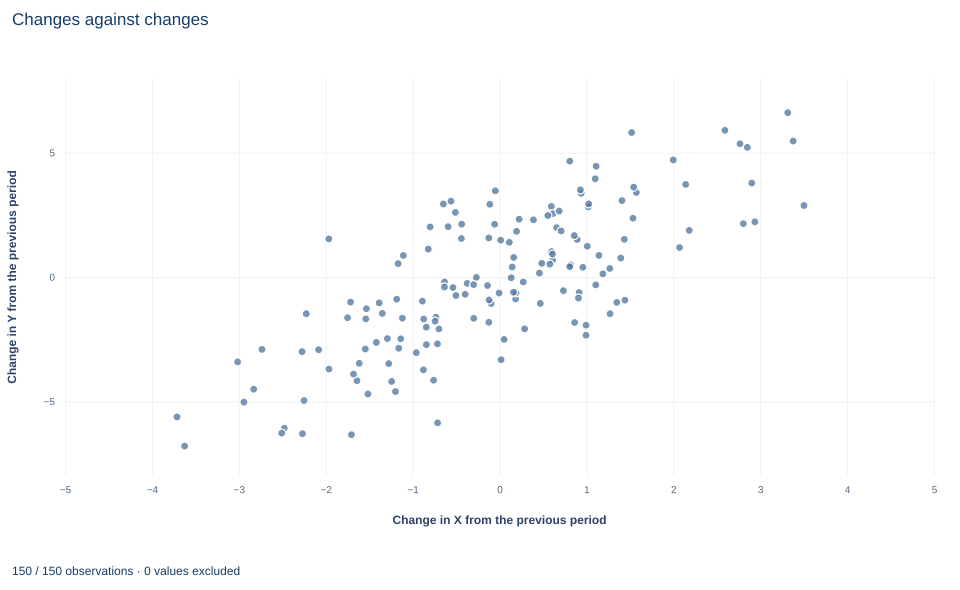

# Lab 14 · First Differences and Their Error Structure

**What differencing removes, how to build the changes, and the dependence it creates**

## Start with the supplied workbook

1. Download [first_differences.xlsx](first_differences.xlsx) and the [Python lab](lab.py). The workbook holds the fixed panel used throughout this chapter.
2. Import `first_differences.xlsx` into OpenEconometrics and keep that file name as the dataset name. The `Data` sheet has 180 rows with the columns `row_id`, `x`, `z`, `y`, `unit` and `time` and no blank cells; the `Dictionary` sheet lists the columns.
3. Open the complete `lab.py` in a new Python document and run the whole file. It displays, in order, the coefficient table of the first-difference regression (changes in Y on changes in X and Z, with an intercept and unit-clustered standard errors), the concept chart of changes against changes, and a summary table with the row counts before and after differencing, the number of units, the X slope, its clustered standard error and the mean change in Y.

For ordinary Python, keep `lab.py` and the workbook in the same folder and run the script there, or call `from lab import run_lab` and then `run_lab(data_path="/path/to/first_differences.xlsx")`. Build differenced columns on a copy of the loaded table.

Each of 30 units has a persistent level of Y that may move with X. Lab 13 removed that level by subtracting each unit's mean. Here we subtract the previous period's value instead: the unit's level appears in both periods and cancels from the change. Regressing the change in Y on the changes in X and Z gives an X slope of 1.387, estimated from 150 changes.

Two things need care. The first is bookkeeping: changes must be formed within a unit, in time order, and each unit loses a period. The second is the error structure. Changes built from independent level errors are not independent of one another, and the standard error has to allow for that.

The panel has **180 original synthetic unit-period records**: 30 units observed in periods 0 to 5, with no gaps and no blank cells. It is a separate synthetic panel from Lab 13's, so the two labs' estimates are not directly comparable. The [LaTeX table](table.tex) collects the reported numbers.

| Column | What it records | Scale | Blank cells |
|---|---|---|---:|
| `row_id` | Record label, 1 to 180 | Identifier | 0 |
| `unit` | Panel unit, coded 0 to 29 | Identifier (category) | 0 |
| `time` | Period within the unit, 0 to 5, consecutive | Integer period | 0 |
| `x` | The time-varying regressor whose coefficient we follow | Abstract synthetic scale ("X units") | 0 |
| `z` | A second time-varying regressor | Abstract synthetic scale | 0 |
| `y` | The outcome | Outcome units | 0 |

The dictionary calls `x` and `z` "centered units"; nothing in the lab depends on their location, so read them as synthetic measures without a named unit.

## 1. Difference the unit effect away

Start from the levels model

$$
y_{it}=\alpha_i+\beta_x x_{it}+\beta_z z_{it}+u_{it},
$$

where $\alpha_i$ is unit $i$'s time-invariant level. Subtract the same equation one period earlier:

$$
\Delta y_{it}=\delta+\beta_x\,\Delta x_{it}+\beta_z\,\Delta z_{it}+\Delta u_{it},
\qquad t=1,\dots,5 ,
$$

with $\Delta v_{it}=v_{it}-v_{i,t-1}$. The unit effect cancels because $\alpha_i-\alpha_i=0$. The intercept $\delta$ is not part of the levels model; including it allows a common average change per period, which in levels corresponds to a linear time trend shared by all units.

OLS on the differenced equation is consistent if $\Delta u_{it}$ is uncorrelated with $\Delta x_{it}$ and $\Delta z_{it}$. Because each change involves two periods, a natural sufficient condition is that the errors in periods $t$ and $t-1$ are unrelated to the regressors in both periods. Strict exogeneity within units, as in Lab 13, implies it.

## 2. Build the changes correctly

Three rules govern the construction:

- **Sort** by unit and then by time, so that "previous row" means "previous period."
- **Group** by unit before differencing, so that no unit's first period is differenced against the previous unit's last period.
- **Drop** the first period of each unit, whose change is undefined.

Each of the 30 units contributes 5 changes, so 180 level rows become 150 changes. The lab checks both that exactly one row per unit is lost and that every remaining change has a period of at least 1. The periods here are consecutive. With a calendar gap, a change spanning two periods would mix one-period and two-period changes, and the analyst would need to decide whether they share an interpretation.

**Pause before running.** How many rows does differencing remove, and what would go wrong if the data were differenced without grouping by unit?

## 3. Derive the error structure

Suppose the level errors $u_{it}$ are independent over time with variance $\sigma_u^2$. Then

$$
\operatorname{Var}(\Delta u_{it})=2\sigma_u^2,
\qquad
\operatorname{Cov}(\Delta u_{it},\Delta u_{i,t-1})
=\operatorname{Cov}(u_{it}-u_{i,t-1},\;u_{i,t-1}-u_{i,t-2})=-\sigma_u^2 .
$$

Adjacent changes share the middle level error with opposite signs, so their correlation is $-1/2$. Changes two or more periods apart share nothing and are uncorrelated. The five changes of a unit therefore form a dependent sequence even when the level errors are independent. The reverse case also matters: if the level errors follow a random walk, the changes are independent and first differences is the natural estimator.

Treating the 150 changes as 150 independent observations ignores this dependence. Clustering by unit allows any pattern of correlation among a unit's five changes and requires only that units be independent of one another.

## 4. Set the covariance convention

The lab uses the CR1 cluster-robust covariance with unit clusters. With $G=30$ clusters, $N=150$ changes and $K=3$ coefficients, the small-sample factor is

$$
c=\frac{G}{G-1}\cdot\frac{N-1}{N-K}=\frac{30}{29}\cdot\frac{149}{147}=1.0486 ,
$$

and $t$ statistics use $G-1=29$ degrees of freedom. As in Lab 13, the inferential sample size is the number of units.

## 5. Run the first-difference regression

`load_data()` and the helpers `fit()` and `coef()` are defined in the complete `lab.py`. The construction follows the three rules in order:

```python
raw = load_data()
ordered = raw.sort_values(["unit", "time"])
changes = ordered.copy()
changes[["y", "x", "z"]] = ordered.groupby("unit")[["y", "x", "z"]].diff()
changes = changes.dropna(subset=["y", "x", "z"]).reset_index(drop=True)
model = fit(changes, ["x", "z"], covariance="cluster", cluster="unit")
display(model)
```

A one-line check confirms the bookkeeping:

```python
print(len(raw), len(changes), changes.unit.nunique(), int(changes.time.min()))
```

It prints 180 level rows, 150 changes, 30 units and a first remaining period of 1. The regression output, with the columns still named `x` and `z` although they now hold changes, reads:

| Term | Estimate | Cluster SE | $t$ (29 df) | 95% interval |
|---|---:|---:|---:|---:|
| Change in `x` | 1.387 | 0.078 | 17.88 | 1.228 to 1.546 |
| Change in `z` | 0.976 | 0.095 | 10.28 | 0.782 to 1.171 |
| Intercept (common change) | −0.0070 | 0.0532 | −0.13 | −0.116 to 0.102 |

Read the X row in outcome units per X unit: a period in which X rises by one unit more has a fitted change in Y about 1.39 units larger, holding the change in Z fixed. The intercept is close to zero, so there is little evidence of a common drift. The summary table also reports a mean change in Y of −0.157. That is not the intercept: OLS with an intercept passes through the means, so $\hat\delta=\overline{\Delta y}-\hat\beta_x\overline{\Delta x}-\hat\beta_z\overline{\Delta z}$, and the average changes in X and Z are not zero.

## 6. Compare first differences with within estimation

Both estimators remove $\alpha_i$, but they use the within variation differently. With two periods they coincide: first differences without an intercept equals the unit fixed-effects estimator, and with an intercept it equals fixed effects with a period dummy. With six periods the two transformations weight the changes differently and generally give different estimates. Both are consistent under strict exogeneity. Within estimation is more efficient when the level errors are independent over time; first differences is more efficient when they follow a random walk. A large gap between the two can also signal a failure of strict exogeneity, because the estimators respond differently to it.

## 7. Read the chart



The chart, titled "Changes against changes," plots one point per change: 30 units times 5 periods. The horizontal axis is the change in X from the previous period, from about −3.7 to 3.5; the vertical axis is the change in Y, from about −6.8 to 6.6. The cloud slopes clearly upward, and this is the variation the X coefficient uses. Changes in Z have not been removed, so a line through the cloud need not have slope 1.387 exactly. The chart cannot show the dependence derived in Section 3: neighboring points from the same unit share a level error, even though they look like separate observations.

## A case from the literature

Freeman (1984) asked how measurement error affects longitudinal estimates of union effects, which rest on workers who change union status. He found that much of the gap between cross-section and longitudinal estimates comes from random error in recording who changes union status. With modest measurement errors and a moderate share of workers changing status, both of the sizes observed, that error biases longitudinal estimates of union effects downward by substantial amounts. Longitudinal analysis still confirmed significant union effects on wage and nonwage outcomes, with smaller estimates than the cross-section analysis of the same data, and he argued that under reasonable conditions the two sets of estimates bound the true effect.

That is the warning of Section 8 in an applied setting. Differencing removes the persistent unit component, but a change in X carries information only when true changes are large relative to recording error. When few units truly change and some recorded changes are errors, the differenced regressor is mostly noise and the slope is pulled toward zero. Griliches and Hausman (1986) treat errors in variables in panel data more generally. The error structure derived in Section 3 also matters for inference: Born and Breitung (2016) propose and compare tests for serial correlation in fixed-effects panel models with a small number of periods, and Exercise 3 takes an informal look at the same question. The lab cannot show the measurement problem itself, because its synthetic data hold a single recorded version of each regressor.

## 8. Decide what the evidence supports

Differencing removes time-invariant unit components. It does not remove confounders that change over time, and it can make measurement error worse: when X is persistent, its true changes are small relative to its measurement noise, so the changes carry proportionally more noise than the levels did.

The estimate depends on regular, consecutive periods; irregular spacing or gaps would change what each difference measures. With more than two periods, the first-difference estimate is not the same number as the within estimate, and the choice between them is a statement about the error process, not a formality.

## 9. State the finding in full

A complete statement for the worked example reads: "In a balanced synthetic panel of 30 units over 6 consecutive periods, first differences leave 150 within-unit changes. Regressing the change in Y on the changes in X and Z gives an X slope of 1.387 outcome units per X unit, with a standard error of 0.078 clustered by unit (29 degrees of freedom; 95% interval 1.228 to 1.546). The common drift is estimated at −0.007 (standard error 0.053). The estimate removes time-invariant unit levels and assumes errors in adjacent periods are unrelated to the regressors in those periods."

## Student exercises

1. Difference the sorted data without grouping by unit (a plain `.diff()` on the three columns). Count the rows that remain, count how many changes straddle two units, refit the clustered regression and compare its X slope with 1.387.
2. Fit the unit fixed-effects regression with dummies on the same workbook, clustered by unit. Compare its X slope and standard error with the first-difference results, and explain which estimator you would prefer under independent level errors and under random-walk level errors.
3. Take the residuals of the first-difference regression (each entry of `model.predictions` has a `residual`). Compute the correlation between each residual and the previous residual of the same unit. Compare it with the value Section 3 predicts and say what it suggests about the level errors.
4. Refit the first-difference regression with HC3 covariance instead of clustering. Compare the standard errors of the X and Z coefficients and explain which convention fits the error structure.
5. Keep only periods 4 and 5. Show that first differences without an intercept reproduces the unit fixed-effects slope, and that first differences with an intercept reproduces fixed effects with a period-5 dummy. Explain why the equivalence fails with six periods.
6. Rewrite the sentence "Using 150 independent changes, X has a highly significant effect of 1.39 on Y" so that it names the panel structure, the covariance convention and the assumptions behind the estimate.

## Further reading

- Born, B., and Breitung, J. (2016). Testing for serial correlation in fixed-effects panel data models. *Econometric Reviews*, 35(7), 1290–1316. https://doi.org/10.1080/07474938.2014.976524
- Freeman, R. B. (1984). Longitudinal analyses of the effects of trade unions. *Journal of Labor Economics*, 2(1), 1–26. https://doi.org/10.1086/298021
- Griliches, Z., and Hausman, J. A. (1986). Errors in variables in panel data. *Journal of Econometrics*, 31(1), 93–118. https://doi.org/10.1016/0304-4076(86)90058-8
