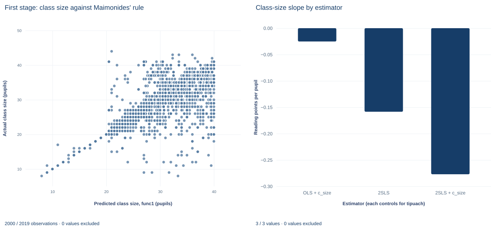

# Lab 15 · Instrumental Variables and the Projection Formula

**Two-stage least squares from the moment condition to the standard error**

## Start with the supplied workbook

1. Download [maimonides_classes.xlsx](maimonides_classes.xlsx) and the [Python lab](lab.py). The workbook holds the published class records used throughout this chapter.
2. Import `maimonides_classes.xlsx` into OpenEconometrics and keep that file name as the dataset name. The `Data` sheet has 2,019 rows with the columns `schlcode`, `classid`, `c_size`, `tipuach`, `classize`, `func1`, `avgverb` and `avgmath`; one class has no math score and no other cell is blank. The `Dictionary` sheet lists the columns and gives the source, licence and sample rules.
3. Open the complete `lab.py` in a new Python document and run the whole file. It fits ordinary least squares, the first stage and two-stage least squares, with classical and school-clustered covariance, and displays, in order, the classical 2SLS coefficient table with its diagnostic tests, the concept chart (in the app, its first panel only: actual against predicted class size), and a summary table of the slopes, standard errors and first-stage strength.

For ordinary Python, keep `lab.py` and the workbook in the same folder and run the script there, or call `from lab import run_lab` and then `run_lab(data_path="/path/to/maimonides_classes.xlsx")`. Work on a copy of the loaded table if you add fitted or residual columns.

Do smaller classes raise achievement? Among 2,019 fifth-grade classes in Israeli Jewish public schools, tested in June 1991, OLS of the class's average reading score on class size, the school's percent disadvantaged and fifth-grade enrolment gives a slope of −0.025 points per pupil, close to zero. Class size is not assigned at random, though. Schools with many disadvantaged pupils can receive funds for extra classes, and schools choose how to split a grade. Angrist and Lavy (1999) used a rule that does assign it partly by arithmetic: Maimonides' maximum of 40 pupils per class. A grade of 40 forms one class of 40; a grade of 41 must be split into two classes of about 20. Using the rule's predicted class size as an instrument, two-stage least squares gives −0.277 points per pupil, more than ten times the OLS slope.

Nothing in the output alone says which number describes the effect of class size. That depends on two assumptions: actual class size is correlated with the error in the outcome equation, so OLS is inconsistent; and the rule moves class size while being unrelated to that error once enrolment and disadvantage are held fixed. This lab derives the 2SLS estimator from its moment conditions, computes it twice (with `oe.ivregress` and with an explicit projection), shows which residual belongs in its standard error, and compares the result with the published table. The [LaTeX table](table.tex) collects the reported numbers.

## Data source and licence

- **Data:** Angrist, J. D., and Lavy, V. (2009). *Replication data for: Using Maimonides' Rule to Estimate the Effect of Class Size on Student Achievement* (Version 1.0) [Dataset]. Harvard Dataverse. https://doi.org/10.7910/DVN/XRSUJU
- **Article:** Angrist, J. D., and Lavy, V. (1999). Using Maimonides' rule to estimate the effect of class size on scholastic achievement. *The Quarterly Journal of Economics*, 114(2), 533–575. https://doi.org/10.1162/003355399556061
- **Licence:** CC0 1.0 Universal, https://creativecommons.org/publicdomain/zero/1.0/. No permission or attribution is required; the source is cited anyway.
- **Preparation:** the fifth-grade file `final5` is prepared exactly as in the depositors' program for Table IV, `AngristLavy_Table4.do`: 100 is subtracted from the two average scores where they exceed 100, a class's average score is set to missing when no pupil took that test, and the sample keeps classes with 2 to 44 pupils in schools with more than five fifth graders, with the program's school-type restrictions (`c_leom` = 1, `c_pik` < 3) and a reading score. `func1` is computed as in the program. Scores are written as the shortest decimals that reproduce the stored values, and the columns not used here are left out. The result matches the paper's Table I: 2,019 classes in 1,002 schools, with mean class size 29.9 and mean reading score 74.4.

| Column | What it records | Role | Scale | Blank cells |
|---|---|---|---|---:|
| `schlcode` | School code | Cluster: classes in a school share it | Identifier | 0 |
| `classid` | Class number within the school | Identifier | Identifier | 0 |
| `c_size` | September fifth-grade enrolment in the school | Exogenous control: enters both stages | Pupils | 0 |
| `tipuach` | Percent of the school's pupils from disadvantaged backgrounds | Exogenous control: enters both stages | Percent | 0 |
| `classize` | Number of pupils in the class in the spring | Endogenous regressor | Pupils | 0 |
| `func1` | Maimonides' predicted class size from enrolment | Excluded instrument: enters the first stage only | Pupils | 0 |
| `avgverb` | Class average composite reading score | Dependent variable | Score points, 1–100 | 0 |
| `avgmath` | Class average composite math score | Used in Exercise 5 | Score points, 1–100 | 1 |

The lab never renames these columns. `lab.py` names their roles once, in `ROLES`, and the same mapping is stored as `roles` in the dataset's metadata.

## 1. State the structural equation and the problem

The equation of interest is

$$
y_i=\beta_0+\beta_d\,d_i+\beta_e\,e_i+\beta_x\,x_i+u_i ,
$$

where $y_i$ is `avgverb`, $d_i$ is `tipuach`, $e_i$ is enrolment `c_size` and $x_i$ is `classize` for class $i$. If $x_i$ is correlated with $u_i$ after accounting for the controls, OLS converges to $\beta_x+\operatorname{Cov}(\tilde x_i,u_i)/\operatorname{Var}(\tilde x_i)$, where $\tilde x_i$ is class size net of the controls and the intercept. The second term does not shrink with more data. Angrist and Lavy report that without any control, larger classes have *higher* reading scores, and that most of that association disappears once the percent disadvantaged is controlled. They note that schools with a high disadvantage index can receive funds to add classes. Any remaining link between class size and unmeasured features of a school, its pupils or its principal's choices stays in $\tilde x_i$.

Maimonides' rule supplies variation in class size that comes from arithmetic. With enrolment $e$, the rule's predicted class size is

$$
f(e)=\frac{e}{\operatorname{int}\!\left((e-1)/40\right)+1},
$$

the enrolment divided by the number of classes needed to keep each at 40 or fewer. It rises with enrolment up to 40, falls to 20.5 at 41, rises again to 40 at 80, falls to about 27 at 81, and so on. `func1` stores $f(c\_size)$, and the lab checks it against this formula.

## 2. Write the moment conditions

Collect the exogenous variables in $Z_i=(1,\;d_i,\;e_i,\;f_i)^\top$ and the regressors in $X_i=(1,\;d_i,\;e_i,\;x_i)^\top$. The instrument assumption is

$$
E\!\left[Z_i\,(y_i-X_i^\top\beta)\right]=0 ,
$$

four equations in four unknowns. The intercept, `tipuach` and `c_size` appear in both vectors: they are exogenous, so they instrument themselves. Only class size needs an outside instrument, and `func1` supplies it. The sample analogue $Z^\top(y-Xb)=0$ solves to

$$
\hat\beta_{IV}=(Z^\top X)^{-1}Z^\top y ,
$$

provided $Z^\top X$ is invertible. That is the **relevance** condition: after enrolment and disadvantage are accounted for, the rule must still predict actual class size. The **exclusion** condition, $E[f_iu_i]=0$, says the rule affects reading scores only through class size once enrolment and disadvantage are held fixed. Relevance can be checked in the data; exclusion cannot. Enrolment matters here: the rule is a nonlinear function of enrolment, and enrolment may itself be related to scores, through town size for example. The instrument's identifying variation is its jumps at 41, 81 and 121, net of a linear enrolment trend.

## 3. Rewrite the estimator as a projection

Let $P_Z=Z(Z^\top Z)^{-1}Z^\top$ project onto the instrument columns. The 2SLS estimator is

$$
\hat\beta_{IV}=(X^\top P_ZX)^{-1}X^\top P_Zy .
$$

$P_ZX$ replaces each regressor with its fitted value from a regression on $Z$. The intercept and the two controls lie in the space of $Z$, so they come back unchanged; the class-size column becomes the first-stage fitted value $\hat x_i$. Because $P_Z$ is symmetric and idempotent, $X^\top P_ZX=\hat X^\top\hat X=X^\top\hat X$, so 2SLS is OLS of $y$ on $\hat X$. With one excluded instrument for one endogenous regressor, the model is exactly identified and this formula reduces to $(Z^\top X)^{-1}Z^\top y$ from Section 2.

The lab computes $\hat X$ by least squares of $X$ on $Z$, never forming the $2{,}019\times2{,}019$ matrix $P_Z$, and then solves $(X^\top\hat X)\,b=\hat X^\top y$.

## 4. Use the structural residual in the covariance

Under homoskedastic, independent structural errors, the classical 2SLS covariance is

$$
\widehat V(\hat\beta_{IV})=\hat\sigma^2\,(X^\top P_ZX)^{-1},
\qquad
\hat\sigma^2=\frac{1}{N-K}\sum_{i=1}^{N}\left(y_i-X_i^\top\hat\beta_{IV}\right)^2 ,
$$

with $N=2{,}019$ and $K=4$. The residual uses the **observed** $x_i$, not $\hat x_i$: it estimates the structural error $u_i$. The lab's main call sets `covariance="unadjusted"` and `small=True`, which gives the $N-K$ divisor and Student $t$ inference on 2,015 degrees of freedom.

Running the second stage by hand as OLS of $y$ on the controls and $\hat x$ reproduces the coefficients exactly, but its residuals are $y_i-\hat X_i^\top\hat\beta$, which contain $\hat\beta_x(x_i-\hat x_i)$ in addition to the structural error. Its $\hat\sigma^2$, and so its standard errors, are wrong. The native result records the correct definition in its inference metadata.

The classical formula also assumes independent errors, and these are not 2,019 independent units. Classes in the same school share a principal, a neighbourhood and an enrolment, and the instrument varies only between schools. The lab therefore also fits the model with `cluster="schlcode"`, the cluster sandwich over 1,002 schools,

$$
\widehat V_{CR}=\frac{G}{G-1}\frac{N-1}{N-K}\,(\hat X^\top\hat X)^{-1}\Big(\sum_{g=1}^{G}\hat X_g^\top\hat u_g\hat u_g^\top\hat X_g\Big)(\hat X^\top\hat X)^{-1},
$$

with $G=1{,}002$ and $t$ inference on $G-1=1{,}001$ degrees of freedom. The coefficients are identical; only the covariance changes.

**Pause before running.** What instruments `tipuach` and `c_size`, and how many excluded instruments does one endogenous regressor need?

## 5. Fit the regressions

`load_data()` and the helpers `fit()` and `coef()` are defined in the complete `lab.py`. All fits use the same 2,019 classes:

```python
raw = load_data()
data = raw[["schlcode", "tipuach", "c_size", "classize", "func1", "avgverb"]]
iv = oe.ivregress(data=data, y="avgverb", x=["tipuach", "c_size"], endog=["classize"],
                  instruments=["func1"], covariance="unadjusted", small=True, missing="raise")
iv_cluster = oe.ivregress(data=data, y="avgverb", x=["tipuach", "c_size"], endog=["classize"],
                          instruments=["func1"], cluster="schlcode", small=True, missing="raise")
ols = fit(data, ["tipuach", "c_size", "classize"], y="avgverb", covariance="nonrobust")
first = fit(data, ["tipuach", "c_size", "func1"], y="classize", covariance="nonrobust")
display(iv)
```

The projection formula, written out with Torch:

```python
ones = torch.ones(len(data), 1, dtype=torch.float64)
X = torch.cat([ones, torch.tensor(data[["tipuach", "c_size", "classize"]].values, dtype=torch.float64)], dim=1)
Z = torch.cat([ones, torch.tensor(data[["tipuach", "c_size", "func1"]].values, dtype=torch.float64)], dim=1)
Y = torch.tensor(data.avgverb.tolist(), dtype=torch.float64)
X_hat = Z @ torch.linalg.lstsq(Z, X).solution
b = torch.linalg.solve(X.T @ X_hat, X_hat.T @ Y)
print(round(float(b[3]), 5), round(coef(iv, "classize").estimate, 5))
```

Both routes give −0.27702; the lab checks agreement to within $10^{-9}$. The estimates, with classical and school-clustered standard errors:

| Coefficient | OLS (classical) | 2SLS (classical) | 2SLS (clustered by school) |
|---|---:|---:|---:|
| `classize` | −0.025 (0.027) | −0.277 (0.055) | −0.277 (0.076) |
| `tipuach` | −0.351 (0.011) | −0.369 (0.012) | −0.369 (0.016) |
| `c_size` | −0.002 (0.005) | 0.022 (0.007) | 0.022 (0.009) |
| Intercept | 80.23 (0.75) | 86.15 (1.36) | 86.15 (1.79) |

In the first stage, the coefficient on `func1` is 0.542: one more pupil of predicted class size adds about half a pupil to actual class size, holding enrolment and disadvantage fixed. Its classical standard error is 0.021 and its clustered standard error 0.037. The first-stage F statistic for the excluded instrument is 669.9 with classical covariance (the Cragg–Donald statistic in the 2SLS output) and 217.9 clustered by school (the Kleibergen–Paap statistic in the clustered output). Both are far above the levels at which weak-instrument problems arise.

Read the first stage before the second. Then compare the class-size rows: the IV slope is much more negative than OLS, and its standard error is two to three times the OLS one, the price of using only the part of class-size variation that the rule explains. Clustering by school raises the 2SLS standard error from 0.055 to 0.076, and the clustered 95% interval runs from −0.426 to −0.128. The classical 2SLS output also reports two tests of class size's exogeneity, Durbin $\chi^2=29.1$ and Wu–Hausman $F=29.4$ on 1 and 2,014 degrees of freedom; the clustered output gives a robust score test of 13.7. All reject at usual levels, and all take the instrument's validity as given. Hausman (1978) built such specification tests, including an instrumental-variable test, by comparing an efficient estimator with a consistent but inefficient one. The overidentification test is empty: with exactly one excluded instrument there are no overidentifying restrictions to test.

**Compare with the published table.** Table IV of Angrist and Lavy (1999) reports, for reading with percent disadvantaged and enrolment as controls, a class-size coefficient of −0.275 with standard error 0.066, percent disadvantaged −0.369 and enrolment 0.022, from 2,019 classes. The rebuild reproduces the two control coefficients, the first-stage slope (0.542 in their Table III) and, with percent disadvantaged as the only control, the class-size coefficient of −0.158. Its class-size coefficient with enrolment, −0.277, differs from the published −0.275 by 0.002. The deposit's readme states that its programs are Stata translations of the original SAS programs; the lab follows the deposited program and reports the gap rather than adjusting the data to remove it. The published standard errors use a Moulton (1990) correction for within-school correlation, which is why 0.066 lies between the classical 0.055 and the clustered 0.076.

## 6. Read the chart



The figure has two panels; in the app only the first appears. The left panel, "First stage: class size against Maimonides' rule," plots actual class size (8 to 44 pupils) against `func1` (8 to 40). The chart library draws 2,000 of the 2,019 classes, chosen evenly, and says so in its footnote. Below a predicted size of about 20, the points lie close to a line: these are small schools with one fifth-grade class, so predicted and actual size both equal the enrolment, apart from changes between September and spring. Above it the cloud is wide but rises clearly. Schools sometimes open an extra class before the rule forces one, and actual size is more than half a pupil below the prediction in 37% of classes, against 25% above it. That picture is relevance. The controls are not held fixed in this scatter, so its slope need not equal 0.542.

The right panel, "Class-size slope by estimator," shows three bars on an axis of reading points per pupil: OLS with both controls at −0.025, 2SLS with percent disadvantaged as the only control at −0.158, and 2SLS with enrolment added at −0.277. Every model controls for `tipuach`. The two 2SLS bars differ only in whether enrolment is held fixed, which shows how much the estimate depends on that control. Nothing in either panel can show exclusion; no plot of observed variables can.

## A case from the literature

The original study is the worked example of this lab. Angrist and Lavy (1999) describe how Maimonides' maximum class size of 40 induces a nonlinear and nonmonotonic relationship between grade enrolment and class size in Israeli public schools, use the rule to construct instrumental-variables estimates, and present the strategy as an application of the regression-discontinuity design. Their estimates showed that reducing class size induces a significant and substantial increase in test scores for fourth and fifth graders, although not for third graders.

The design's assumptions have been tested since. Angrist, Lavy, Leder-Luis and Shany (2019) used the rule as an instrument in large Israeli samples from 2002–2011. In contrast with the 1999 study, the newer estimates show no evidence of class-size effects. The new data also reveal enrolment manipulation near the Maimonides cutoffs; a modified rule that imputes enrolment from birthdays circumvents the manipulation and still gives precisely estimated zeros, and the authors conclude that the manipulation appears innocuous. Urquiola and Verhoogen (2009) studied class-size caps in Chile's liberalized education market, where schools at the cap adjust prices or enrolments to avoid adding a classroom. That behaviour generates discontinuities in the relationship between enrolment and household characteristics, violating the assumptions behind regression-discontinuity designs. Both studies show how an instrument built from a rule can fail if the people subject to the rule respond to it.

Moulton (1990) explains why Section 4 clusters the standard errors: when data come from populations with grouped structure, assuming independent disturbances can make OLS standard errors seriously biased downward. Imbens and Angrist (1994) clarify what an IV estimate means when effects differ: under a condition on how the instrument relates to treatment, it identifies a local average treatment effect for the units whose treatment the instrument changes. Here those are classes whose size responds to the rule. Lab 16 turns to a different design, quarter of birth as an instrument for schooling, to show what goes wrong when the first stage is weak.

## 7. Decide what the evidence supports

Exclusion is an assumption about how the rule reaches reading scores, not something the first stage proves. It is made conditional on a linear enrolment control and the percent disadvantaged, and the estimate depends on that specification: with percent disadvantaged as the only control the slope is −0.158, with enrolment added −0.277. A strong first stage shrinks the damage from a small violation but does not remove it, and exactly identified IV offers no overidentification test.

Inference should respect the grouping. With 1,002 schools, the clustered standard error, 0.076, is the honest one; the classical 0.055 treats classes in the same school as independent. The estimate describes 1991 fifth graders in Israeli Jewish public schools and the classes whose size the rule moved. The later Israeli data in Angrist et al. (2019) show no such effect, so the 1991 estimate should not be read as a permanent property of class size. Finally, the outcome is a class average, so the estimate concerns average reading scores of classes, not the distribution of scores among pupils.

## 8. State the finding in full

A complete statement for the worked example reads: "In 2,019 fifth-grade classes in 1,002 Israeli Jewish public schools tested in 1991, OLS of the class's average reading score on class size, the school's percent disadvantaged and enrolment gives a class-size slope of −0.025. Using Maimonides' predicted class size as the excluded instrument, with percent disadvantaged and a linear enrolment control instrumenting themselves, 2SLS gives −0.277 reading points per pupil (standard error 0.076 clustered by school, $t$ inference on 1,001 degrees of freedom; 95% interval −0.426 to −0.128). The first stage is strong (clustered F = 218). Ten fewer pupils per class would raise the class average by about 2.8 points, about a third of the standard deviation of class averages. The estimate relies on the untestable assumption that the rule affects scores only through class size once enrolment and disadvantage are held fixed, and it reproduces Angrist and Lavy's published estimate of −0.275 to within 0.002."

## Student exercises

1. Regress `avgverb` on `tipuach`, `c_size` and `func1` (the reduced form). Divide its `func1` coefficient by the first-stage `func1` coefficient and compare the ratio with the 2SLS slope. Explain why the ratio works only in the exactly identified case.
2. Run the second stage by hand: add the first-stage fitted values of `classize` to a copy of the data and regress `avgverb` on `tipuach`, `c_size` and the fitted values with classical covariance. Compare the coefficient and standard error with the classical 2SLS output, and explain the ratio of the two standard errors.
3. Show that the classical first-stage F statistic for the excluded instrument equals the square of its first-stage $t$ statistic, and that the clustered F equals the square of the clustered $t$. State what these numbers tell you about relevance and what they cannot tell you about exclusion.
4. Suppose the rule also had a direct effect $\gamma$ on reading scores. Derive the probability limit of the IV slope in terms of $\beta_x$, $\gamma$ and the first-stage coefficient, and compute the shift that $\gamma=0.05$ would cause with this first stage.
5. Repeat the 2SLS fit, classical and clustered by school, with `avgmath` as the outcome. Which class must be dropped, and why? Compare the class-size coefficient with Angrist and Lavy's published math estimate of −0.230 (standard error 0.092).
6. Rewrite the sentence "IV proves that small classes raise test scores by 0.28 points per pupil" so that it states the estimator, the instrument, the controls, the covariance convention, the population and the assumptions on which the claim rests.

## Further reading

- Angrist, J. D., and Lavy, V. (1999). Using Maimonides' rule to estimate the effect of class size on scholastic achievement. *The Quarterly Journal of Economics*, 114(2), 533–575. https://doi.org/10.1162/003355399556061
- Angrist, J. D., Lavy, V., Leder-Luis, J., and Shany, A. (2019). Maimonides' rule redux. *American Economic Review: Insights*, 1(3), 309–324. https://doi.org/10.1257/aeri.20180120
- Hausman, J. A. (1978). Specification tests in econometrics. *Econometrica*, 46(6), 1251. https://doi.org/10.2307/1913827
- Imbens, G. W., and Angrist, J. D. (1994). Identification and estimation of local average treatment effects. *Econometrica*, 62(2), 467. https://doi.org/10.2307/2951620
- Moulton, B. R. (1990). An illustration of a pitfall in estimating the effects of aggregate variables on micro units. *The Review of Economics and Statistics*, 72(2), 334. https://doi.org/10.2307/2109724
- Urquiola, M., and Verhoogen, E. (2009). Class-size caps, sorting, and the regression-discontinuity design. *American Economic Review*, 99(1), 179–215. https://doi.org/10.1257/aer.99.1.179
