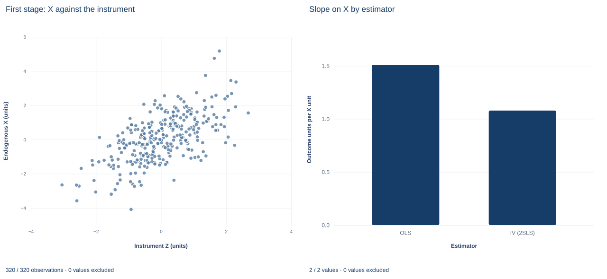

# Lab 15 · Instrumental Variables and the Projection Formula

**Two-stage least squares from the moment condition to the standard error**

## Start with the supplied workbook

1. Download [iv_moment_condition.xlsx](iv_moment_condition.xlsx) and the [Python lab](lab.py). The workbook holds the fixed records used throughout this chapter.
2. Import `iv_moment_condition.xlsx` into OpenEconometrics and keep that file name as the dataset name. The `Data` sheet has 320 rows with the columns `row_id`, `x`, `z`, `control` and `y` and no blank cells; the `Dictionary` sheet lists the columns and their roles.
3. Open the complete `lab.py` in a new Python document and run the whole file. It fits ordinary least squares, the first stage and two-stage least squares, and displays, in order, the 2SLS coefficient table with its diagnostic tests, the concept chart (in the app, its first panel only: the first-stage scatter of X against the instrument), and a summary table with the OLS and IV slopes on X, the IV standard error, the first-stage instrument slope and the IV slope recomputed from the projection formula.

For ordinary Python, keep `lab.py` and the workbook in the same folder and run the script there, or call `from lab import run_lab` and then `run_lab(data_path="/path/to/iv_moment_condition.xlsx")`. Work on a copy of the loaded table if you add fitted or residual columns.

Regress Y on X and a control, and the X slope is 1.510. Use Z as an instrument for X, and two-stage least squares gives 1.079. The gap of 0.43 is several times either standard error. Nothing in the output alone says which number describes the structural relation. That depends on two assumptions: X is correlated with the error in the outcome equation, so OLS is inconsistent; and Z moves X while being unrelated to that error.

This lab derives the 2SLS estimator from its moment conditions, computes it twice (with `oe.ivregress` and with an explicit projection), and shows which residual belongs in its standard error. It uses **320 original synthetic records**, each an independent unit. The [LaTeX table](table.tex) collects the reported numbers.

| Column | What it records | Role | Scale | Blank cells |
|---|---|---|---|---:|
| `row_id` | Record label, 1 to 320 | Identifier | Identifier | 0 |
| `x` | The regressor of interest | Endogenous: shares a disturbance with Y | Abstract synthetic scale ("X units") | 0 |
| `z` | A variable that shifts X | Excluded instrument: enters the first stage only | Abstract synthetic scale | 0 |
| `control` | A second regressor | Exogenous: enters both stages | Abstract synthetic scale | 0 |
| `y` | The outcome | Dependent variable | Outcome units | 0 |

## 1. State the structural equation and the problem

The equation of interest is

$$
y_i=\beta_0+\beta_c\,c_i+\beta_x\,x_i+u_i ,
$$

where $c_i$ is `control`. If $x_i$ is correlated with $u_i$ after accounting for the control, OLS converges to $\beta_x+\operatorname{Cov}(\tilde x_i,u_i)/\operatorname{Var}(\tilde x_i)$, where $\tilde x_i$ is X net of the control and the intercept. The second term does not shrink with more data. In this synthetic design X and Y share a disturbance, so OLS is inconsistent here by construction.

## 2. Write the moment conditions

Collect the exogenous variables in $Z_i=(1,\;c_i,\;z_i)^\top$ and the regressors in $X_i=(1,\;c_i,\;x_i)^\top$. The instrument assumption is

$$
E\!\left[Z_i\,(y_i-X_i^\top\beta)\right]=0 ,
$$

three equations in three unknowns. The intercept and the control appear in both vectors: they are exogenous, so they instrument themselves. Only $x_i$ needs an outside instrument, and $z_i$ supplies it. The sample analogue $Z^\top(y-Xb)=0$ solves to

$$
\hat\beta_{IV}=(Z^\top X)^{-1}Z^\top y ,
$$

provided $Z^\top X$ is invertible. That is the **relevance** condition: after the control is accounted for, $z$ must still predict $x$. The **exclusion** condition, $E[z_iu_i]=0$, says Z affects Y only through X once the control is held fixed. Relevance can be checked in the data; exclusion cannot.

## 3. Rewrite the estimator as a projection

Let $P_Z=Z(Z^\top Z)^{-1}Z^\top$ project onto the instrument columns. The 2SLS estimator is

$$
\hat\beta_{IV}=(X^\top P_ZX)^{-1}X^\top P_Zy .
$$

$P_ZX$ replaces each regressor with its fitted value from a regression on $Z$. The intercept and control lie in the space of $Z$, so they come back unchanged; the column $x$ becomes the first-stage fitted value $\hat x_i$. Because $P_Z$ is symmetric and idempotent, $X^\top P_ZX=\hat X^\top\hat X=X^\top\hat X$, so 2SLS is OLS of $y$ on $\hat X$. With one excluded instrument for one endogenous regressor, the model is exactly identified and this formula reduces to $(Z^\top X)^{-1}Z^\top y$ from Section 2.

The lab computes $\hat X$ by least squares of $X$ on $Z$, never forming the $320\times320$ matrix $P_Z$, and then solves $(X^\top\hat X)\,b=\hat X^\top y$.

## 4. Use the structural residual in the covariance

Under homoskedastic structural errors, the classical 2SLS covariance is

$$
\widehat V(\hat\beta_{IV})=\hat\sigma^2\,(X^\top P_ZX)^{-1},
\qquad
\hat\sigma^2=\frac{1}{N-K}\sum_{i=1}^{N}\left(y_i-X_i^\top\hat\beta_{IV}\right)^2 ,
$$

with $N=320$ and $K=3$. The residual uses the **observed** $x_i$, not $\hat x_i$: it estimates the structural error $u_i$. The lab's call sets `covariance="unadjusted"` and `small=True`, which gives the $N-K$ divisor and Student $t$ inference on 317 degrees of freedom.

Running the second stage by hand as OLS of $y$ on the control and $\hat x$ reproduces the coefficients exactly, but its residuals are $y_i-\hat X_i^\top\hat\beta$, which contain $\hat\beta_x(x_i-\hat x_i)$ in addition to the structural error. Its $\hat\sigma^2$, and so its standard errors, are wrong. The native result records the correct definition in its inference metadata.

**Pause before running.** What instruments the control, and how many excluded instruments does one endogenous regressor need?

## 5. Fit the three regressions

`load_data()` and the helpers `fit()` and `coef()` are defined in the complete `lab.py`; here `fit` is used with classical covariance. The three fits use the same 320 rows:

```python
raw = load_data()
iv = oe.ivregress(data=raw, y="y", x=["control"], endog=["x"], instruments=["z"],
                  covariance="unadjusted", small=True, missing="raise")
ols = fit(raw, ["control", "x"], covariance="nonrobust")
first = fit(raw, ["control", "z"], y="x", covariance="nonrobust")
display(iv)
```

The projection formula, written out with Torch:

```python
ones = torch.ones(len(raw), 1, dtype=torch.float64)
X = torch.cat([ones, torch.tensor(raw[["control", "x"]].values, dtype=torch.float64)], dim=1)
Z = torch.cat([ones, torch.tensor(raw[["control", "z"]].values, dtype=torch.float64)], dim=1)
Y = torch.tensor(raw.y.tolist(), dtype=torch.float64)
X_hat = Z @ torch.linalg.lstsq(Z, X).solution
b = torch.linalg.solve(X.T @ X_hat, X_hat.T @ Y)
print(round(float(b[2]), 5), round(coef(iv, "x").estimate, 5))
```

Both routes give 1.07921; the lab checks agreement to within $10^{-9}$. The estimates, with classical standard errors:

| Coefficient | OLS | 2SLS |
|---|---:|---:|
| `x` | 1.510 (0.048) | 1.079 (0.081) |
| `control` | 0.576 (0.066) | 0.787 (0.080) |
| Intercept | 1.940 (0.061) | 1.953 (0.069) |

In the first stage, the coefficient on `z` is 0.847 with standard error 0.053, and the first-stage F statistic for the excluded instrument is 251.4; Z accounts for 44% of the variation in X that the control leaves unexplained (partial $R^2=0.442$).

Read the first stage before the second. A strong first stage makes the 2SLS approximation trustworthy and the standard error modest. Then compare the X rows: the IV slope is lower, and its standard error is about 1.7 times the OLS one, the price of using only the part of X's variation that Z explains. The 2SLS output also reports two tests of X's exogeneity, Durbin $\chi^2=64.8$ and Wu–Hausman $F=80.3$ on 1 and 316 degrees of freedom, both rejecting at any usual level. Both tests take the instrument's validity as given. The overidentification test is empty: with exactly one excluded instrument there are no overidentifying restrictions to test.

## 6. Read the chart



The figure has two panels; in the app only the first appears. The left panel, "First stage: X against the instrument," plots the 320 records with Z on the horizontal axis (about −3.0 to 2.7) and X on the vertical axis (about −4.1 to 5.2). The cloud rises clearly but with wide scatter: Z shifts X, yet most of X's variation comes from elsewhere. That picture is relevance. The control is not held fixed in this scatter, so its slope need not equal 0.847 exactly.

The right panel, "Slope on X by estimator," shows two bars on an axis of outcome units per X unit starting at zero: OLS at 1.510 and IV (2SLS) at 1.079. Nothing in either panel can show exclusion; no plot of observed variables can.

## A case from the literature

Angrist and Krueger (1991) asked whether compulsory school attendance affects schooling and earnings. They established that season of birth is related to educational attainment through school start-age policy and compulsory attendance laws: people born early in the year start school older and can leave after completing less schooling than those born near the end of the year. Roughly 25 percent of potential dropouts remain in school because of the laws. Using quarter of birth as an instrument for education in an earnings equation, they found an IV estimate of the return to education close to the OLS estimate, suggesting little bias in conventional estimates.

The study maps onto Section 2. Education is the endogenous regressor and quarter of birth the excluded instrument. Relevance is the documented link between birth season and schooling; exclusion, that birth quarter affects earnings only through schooling, is an assumption no first stage can confirm. Imbens and Angrist (1994) clarify what such an estimate means when effects differ: an instrument together with a condition on how it relates to participation status identifies a local average treatment effect for those whose status the instrument can change, and the standard IV estimator converges to a weighted average of such effects. Hausman (1978) built specification tests, including an instrumental-variable test, by comparing an efficient estimator with a consistent but inefficient one, the logic behind the exogeneity tests in Section 5. Sargan (1958) derived the asymptotic error variance of coefficients estimated by instrumental variables. Lab 16 returns to this study.

## 7. Decide what the evidence supports

Exclusion is an assumption about how Z reaches Y, not something the first stage proves. A strong first stage shrinks the damage from a small violation but does not remove it. Exactly identified IV offers no overidentification test, and even an overidentified model tests only whether instruments agree, not whether they are all valid.

The classical covariance assumes homoskedastic structural errors; heteroskedasticity-robust 2SLS covariance is the alternative when that is doubtful. With weak instruments, which these data do not have, 2SLS is biased toward OLS and the usual $t$ intervals can badly undercover. If the effect of X differs across units, IV recovers, under additional conditions, a weighted average of effects for the units whose X responds to Z, not necessarily the average effect for everyone.

## 8. State the finding in full

A complete statement for the worked example reads: "In 320 synthetic records, OLS of Y on X and a control gives an X slope of 1.510. Using Z as the excluded instrument for X, with the control instrumenting itself, 2SLS gives 1.079 outcome units per X unit (classical standard error 0.081, $t$ inference on 317 degrees of freedom). The first stage is strong (F = 251, partial $R^2$ = 0.44). The estimate relies on the untestable assumption that Z affects Y only through X once the control is held fixed."

## Student exercises

1. Regress `y` on `control` and `z` (the reduced form). Divide its `z` coefficient by the first-stage `z` coefficient and compare the ratio with the 2SLS slope. Explain why the ratio works only in the exactly identified case.
2. Run the second stage by hand: add the first-stage fitted values of `x` to a copy of the data and regress `y` on `control` and the fitted values with classical covariance. Compare the coefficient and standard error with the 2SLS output, and explain the ratio of the two standard errors.
3. Show that the first-stage F statistic for the excluded instrument equals the square of its first-stage $t$ statistic. State what this number tells you about relevance and what it cannot tell you about exclusion.
4. Suppose Z also had a direct effect $\gamma$ on Y. Derive the probability limit of the IV slope in terms of $\beta_x$, $\gamma$ and the first-stage coefficient, and compute the shift that $\gamma=0.1$ would cause with this first stage.
5. Refit the 2SLS model with `covariance="robust"`. Compare the standard error of the X slope with the classical one and say when the robust version should be reported.
6. Rewrite the sentence "IV proves that OLS is biased, and the true causal effect of X is 1.08" so that it states the estimator, the instrument, the covariance convention and the assumptions on which the claim rests.

## Further reading

- Angrist, J. D., and Krueger, A. B. (1991). Does compulsory school attendance affect schooling and earnings? *The Quarterly Journal of Economics*, 106(4), 979–1014. https://doi.org/10.2307/2937954
- Hausman, J. A. (1978). Specification tests in econometrics. *Econometrica*, 46(6), 1251. https://doi.org/10.2307/1913827
- Imbens, G. W., and Angrist, J. D. (1994). Identification and estimation of local average treatment effects. *Econometrica*, 62(2), 467. https://doi.org/10.2307/2951620
- Sargan, J. D. (1958). The estimation of economic relationships using instrumental variables. *Econometrica*, 26(3), 393. https://doi.org/10.2307/1907619
