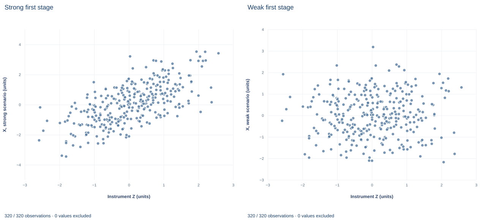

# Lab 16 · Weak Relevance and IV Sensitivity

**Weak first stages, the 2SLS denominator and conventional IV inference**

## Start with the supplied workbook

1. Download [weak_instruments.xlsx](weak_instruments.xlsx) and the [Python lab](lab.py). The workbook holds the fixed synthetic units used throughout this chapter.
2. Import `weak_instruments.xlsx` into OpenEconometrics and keep that file name as the dataset name. The `Data` sheet holds one row per unit; the `Dictionary` sheet lists each column and confirms that no cell is blank.
3. Open the complete `lab.py` in a new Python document and run the whole file. It fits two-stage least squares (2SLS) in a strong and a weak scenario and displays, in order, the coefficient table of the weak-scenario 2SLS model, a scatter of the strong first stage (the app shows only this first chart panel), and a six-row summary table of first-stage F statistics, IV slopes and standard errors.

For ordinary Python, keep `lab.py` and the workbook in the same folder and run the script there, or call `from lab import run_lab` and then `run_lab(data_path="/path/to/weak_instruments.xlsx")`. The weak scenario is built in code from stored columns, so leave the workbook unchanged and experiment on a copy of the loaded table. The [LaTeX table](table.tex) collects the six summary values, and the [figure](figure.svg) shows both first-stage panels.

An instrument must be excluded from the outcome equation and uncorrelated with its disturbance (validity), and it must move the endogenous exposure (relevance). Relevance is usually stated as yes or no: the first-stage coefficient is zero or it is not. In a finite sample, an instrument with a small but nonzero coefficient can behave almost like an irrelevant one.

This lab uses **320 original synthetic units** in abstract units, with no missing cells. The same units, the same valid instrument and the same structural disturbance are analyzed twice. With a strong first stage (F = 289.97), 2SLS puts the exposure slope at 1.254 with standard error 0.075. With a weak one (F = 2.11), the estimate becomes 1.830 with standard error 0.757. Neither validity nor the causal slope changed. Why does the estimate move so far, and why should its conventional interval not be taken at face value?

## 1. Two scenarios built from the same disturbances

The workbook was generated from

$$
x^{s}_i=0.9z_i+0.4c_i+v_i,\qquad
x^{w}_i=0.08z_i+0.4c_i+v_i,\qquad
y^{k}_i=2+1.2x^{k}_i+0.6c_i+u_i,
$$

for scenario $k\in\{s,w\}$ (strong, weak). Here $z_i$ is the excluded instrument, $c_i$ an exogenous control in both equations, $v_i$ the first-stage disturbance and $u_i$ the structural disturbance. The exposure is endogenous because $v_i$ is correlated with $u_i$.

| Column | What it records | Role |
|---|---|---|
| `row_id` | Unit label, 1 to 320 | Identifier only |
| `x` | Exposure under the strong first stage, $x^s$ | Strong scenario |
| `weak_x` | Exposure under the weak first stage, $x^w$ | Weak scenario |
| `z` | Excluded instrument | Both scenarios |
| `control` | Exogenous control $c$ | Both scenarios, both stages |
| `y` | Outcome generated with the strong exposure, $y^s$ | Strong scenario; source of the weak outcome |

The dictionary's "Outcome" for `y` means the strong-scenario outcome; no weak-scenario outcome is stored. The lab builds it as $y^w=y-1.2x+1.2\,x^w$, so $y^w-1.2x^w=y^s-1.2x^s$ for every unit, which the lab checks to within $10^{-12}$. The intercept, the control's effect, the slope 1.2 and every $u_i$ are shared; only the instrument's pull on the exposure differs.

## 2. The just-identified IV estimator

Let $\tilde z_i$ be the residual from regressing $z$ on an intercept and $c$. By the Frisch–Waugh–Lovell theorem, the 2SLS slope with one endogenous regressor and one excluded instrument is

$$
\hat\beta_{IV}=\frac{\sum_i\tilde z_i y_i}{\sum_i\tilde z_i x_i}=\frac{\hat\gamma}{\hat\pi},
\qquad
\hat\pi=\frac{\sum_i\tilde z_i x_i}{\sum_i\tilde z_i^{2}},
\qquad
\hat\gamma=\frac{\sum_i\tilde z_i y_i}{\sum_i\tilde z_i^{2}}.
$$

$\hat\pi$ is the first-stage coefficient on $z$ (exposure on intercept, control and instrument) and $\hat\gamma$ the reduced-form coefficient (outcome on the same three). Consistency needs $E[\tilde z_i u_i]=0$ (validity and exclusion) and $\pi\neq0$ (relevance). Both scenarios satisfy both conditions by construction.

## 3. Measure first-stage strength

With one excluded instrument, the first-stage F statistic for $H_0:\pi=0$ is the squared t statistic of $z$. The lab uses the classical covariance $s^2(X'X)^{-1}$, $s^2=\text{RSS}/(n-3)$, with 317 residual degrees of freedom:

```python
raw = load_data()  # reader defined in the complete lab.py
weak = raw.assign(x=raw.weak_x, y=raw.y - 1.2 * raw.x + 1.2 * raw.weak_x)
first_strong = fit(raw, ["control", "z"], y="x", covariance="nonrobust")
first_weak = fit(weak, ["control", "z"], y="x", covariance="nonrobust")
for label, model in [("strong", first_strong), ("weak", first_weak)]:
    row = coef(model, "z")
    print(label, round(row.estimate, 4), round(row.std_error, 4), round(row.statistic, 3), round(row.statistic**2, 2))
```

| Scenario | Coefficient on Z, $\hat\pi$ | Standard error | t statistic | First-stage F | 95% interval for $\pi$ |
|---|---:|---:|---:|---:|---|
| Strong | 0.8966 | 0.0527 | 17.03 | 289.97 | 0.793 to 1.000 |
| Weak | 0.0766 | 0.0527 | 1.454 | 2.11 | −0.027 to 0.180 |

The strong first stage pins $\pi$ down. The weak interval includes zero, so at the 5% level these data cannot reject irrelevance, although the coefficient is nonzero by construction. The two rows share a standard error, and the control coefficient (0.368) is identical in both fits; Exercise 1 asks why.

F measures first-stage signal relative to noise, which governs how 2SLS behaves in finite samples. Fixed cutoffs for F are calibrated to particular bias or size tolerances under homoskedastic errors; they are diagnostics, not guarantees.

**Pause before running.** Predict the direction in which the weak-scenario slope will move, and whether its standard error will grow by more or less than the ratio of first-stage slopes, 0.8966/0.0766 = 11.71.

## 4. Estimate both scenarios with conventional inference

```python
iv_strong = oe.ivregress(data=raw, y="y", x=["control"], endog=["x"], instruments=["z"],
                         covariance="unadjusted", small=True, missing="raise")
iv_weak = oe.ivregress(data=weak, y="y", x=["control"], endog=["x"], instruments=["z"],
                       covariance="unadjusted", small=True, missing="raise")
display(iv_weak)
```

With `covariance="unadjusted"` and `small=True`, the covariance is $\hat\sigma^2(\hat X'\hat X)^{-1}$, where $\hat X$ holds the intercept, the control and the fitted exposure $\hat x$, and $\hat\sigma^2=\text{RSS}/(N-K)$ with $N=320$, $K=3$. The residuals use the observed exposure, $e_i=y_i-\hat b_0-\hat b_c c_i-\hat\beta x_i$, not $\hat x$. Intervals use the t distribution with 317 degrees of freedom (critical value 1.967). For the slope the variance simplifies to $\hat\sigma^2/(\hat\pi^2\sum_i\tilde z_i^2)$, so the standard error is inversely proportional to the first-stage slope.

| Quantity | Strong scenario | Weak scenario |
|---|---:|---:|
| Exposure slope $\hat\beta_{IV}$ | 1.254 | 1.830 |
| Classical standard error | 0.0752 | 0.757 |
| 95% t interval | 1.106 to 1.402 | 0.340 to 3.319 |
| Control coefficient (standard error) | 0.552 (0.070) | 0.340 (0.279) |
| Units used | 320 | 320 |

The standard error grows by 0.757/0.0752 = 10.07, a little less than 11.71. Since $\sum\tilde z_i^2$ is shared, $\hat\sigma$ must be smaller in the weak fit by 10.07/11.71 = 0.86: the distorted slope absorbs part of the disturbance, so the residuals look less noisy than they should.

The weak interval happens to contain 1.2, which can look reassuring. It should not. It is centered on a distorted estimate, its width uses a distorted $\hat\sigma$, and the normal approximation behind 95% coverage fails when $\hat\pi$ is small relative to its standard error. The control coefficient, estimated jointly with the poorly identified slope, drops from 0.552 to 0.340 and its standard error quadruples.

## 5. Why the weak estimate moved: the error identity

Substitute $y_i=2+\beta x_i+0.6c_i+u_i$ into the numerator of $\hat\beta_{IV}$. Because $\tilde z$ is orthogonal to the intercept and to $c$,

$$
\hat\beta_{IV}-\beta=\frac{\sum_i\tilde z_i u_i}{\sum_i\tilde z_i x_i}=\frac{\hat\delta}{\hat\pi},
\qquad
\hat\delta=\frac{\sum_i\tilde z_i u_i}{\sum_i\tilde z_i^{2}}.
$$

$\hat\delta$ is the sample coefficient of the structural disturbance on the instrument. Validity makes its population value zero, but in a finite sample it is mean-zero noise whose spread shrinks like $1/\sqrt n$. The estimation error is that noise divided by the first-stage slope. Here $\hat\delta$ is the same number in both scenarios, because $y-1.2x$ is identical; regress $y-1.2x$ on the control and the instrument to obtain it:

```python
structural = raw.assign(s=raw.y - 1.2 * raw.x)  # identical in the weak scenario
delta = coef(fit(structural, ["control", "z"], y="s", covariance="nonrobust"), "z").estimate
for label, iv, first in [("strong", iv_strong, first_strong), ("weak", iv_weak, first_weak)]:
    error = coef(iv, "x").estimate - 1.2
    print(label, round(error, 4), round(error * coef(first, "z").estimate, 4), round(delta, 4))
```

| Scenario | Estimation error $\hat\beta_{IV}-1.2$ | Error × $\hat\pi$ | $\hat\delta$ |
|---|---:|---:|---:|
| Strong | 0.0538 | 0.0482 | 0.0482 |
| Weak | 0.6298 | 0.0482 | 0.0482 |

The same disturbances produce an error of 0.054 with the strong instrument and 0.630 with the weak one, exactly 11.71 times larger. That identity is the core of the weak-instrument problem.

Two consequences follow. First, $\hat\pi$ is estimated too; its sampling error comes from $v$, which is correlated with $u$, so numerator and denominator errors move together, and with a weak instrument this pulls 2SLS toward OLS. Second, $\hat\pi$ can land arbitrarily close to zero, so the just-identified estimator has very thick tails.

The same regression gives a test whose size does not depend on instrument strength. To test $H_0:\beta=b_0$, regress $y-b_0x$ on the control and the instrument and test the instrument's coefficient. Under the null, $y-b_0x=2+0.6c+u$, so a valid instrument has no explanatory power however weak it is. The $b_0$ values not rejected form an Anderson–Rubin confidence set, which the lab does not compute; Exercise 5 does.

## 6. Read the figure



Both panels are scatters of the same 320 units against instrument Z (about −2.6 to 2.6). "Strong first stage" plots the strong-scenario exposure (about −3.4 to 3.5); the cloud rises clearly from lower left to upper right. "Weak first stage" plots the weak-scenario exposure (about −2.2 to 3.2); the cloud is close to flat. The app displays only the first panel.

Each weak-panel point is its strong-panel partner shifted vertically by a fixed multiple of its own Z value, so the scatter around the trend is the same in both. The panels do not partial out the control, so the visible slope is a simple-regression slope, not exactly $\hat\pi$. Validity concerns $u$, which is not plotted, so the picture cannot speak to it.

## A case from the literature

Bound et al. (1995) drew attention to two problems with instruments that explain little of the variation in the endogenous regressor. Even a weak relation between such instruments and the structural error can produce large inconsistencies; in finite samples IV estimates are biased in the same direction as OLS, with the bias approaching that of OLS as the first-stage $R^2$ goes to zero. They reexamined Angrist and Krueger's Census wage equations, which used quarter of birth as an instrument for schooling, and found evidence that despite huge samples the IV estimates may suffer from finite-sample bias and may be inconsistent. They recommended reporting the partial $R^2$ and the F statistic of the excluded instruments.

Section 5 shows both problems. The estimation error is the instrument–disturbance association divided by the first-stage slope, so a small slope magnifies any association, whether sampling noise or a violation of validity, and the correlated first-stage error pulls 2SLS toward OLS. Staiger and Stock (1997) model the first stage as local to zero and find that two-stage least squares can be badly biased even in large samples. Nelson and Startz (1990) derive the exact small-sample distribution in a special case: its first two moments are infinite, its central tendency can lie closer to the least-squares value than to the true one, and the normal approximation is poor when the instrument is weakly correlated with the regressor. Anderson and Rubin (1949), whose names the confidence set in Exercise 5 carries, obtained confidence regions from small-sample theory.

## 7. What the evidence supports

With a valid instrument, weak relevance alone can move the 2SLS estimate far from the structural slope and inflate its standard error, and the first-stage F flags the problem. The weak-scenario estimate does not reflect a larger effect, and the reported t intervals are not weak-instrument-robust. A high F says nothing about validity. One draw of disturbances is not a sampling distribution, so these errors illustrate the mechanism rather than measure average bias or coverage. The classical covariance assumes homoskedastic, independent errors; other error structures need matching first-stage diagnostics and standard errors.

## 8. Write the result in full

"In 320 synthetic units with an instrument valid by construction, the strong first stage (F = 289.97, one excluded instrument, classical covariance) yields a 2SLS exposure slope of 1.254 with standard error 0.075 and 95% t interval 1.106 to 1.402. Weakening only the first-stage coefficient, with the structural slope and disturbance fixed, lowers F to 2.11 and moves the slope to 1.830 (standard error 0.757). Because the weak first stage cannot reject irrelevance, that estimate's conventional interval is only a diagnostic; inference there requires a weak-instrument-robust procedure."

## Student exercises

1. On a copy of the data, show that `weak_x - x` is an exact multiple of `z` and find the multiplier. Use it to explain why the two first-stage fits share residuals, the standard error on Z and the control coefficient, and why the weak F equals the strong F times the squared ratio of first-stage slopes.
2. Fit the reduced form (outcome on control and Z) in each scenario. Show that the reduced-form slope divided by the first-stage slope reproduces each IV slope, and explain the difference between the two reduced-form slopes from the way the weak outcome is built.
3. Using $\hat\delta$ from Section 5, compute the weak-scenario IV slope these disturbances would give if the first-stage slope were half of 0.0766. Then find the first-stage slope at which the estimation error would equal the structural slope itself.
4. Fit OLS of the outcome on the exposure and the control in each scenario. Compare each OLS slope with its 2SLS counterpart and explain the pattern.
5. Build an Anderson–Rubin confidence set by test inversion: for each $b_0$ from −5 to 8 in steps of 0.01, regress $y-b_0x$ on the control and Z with classical covariance, and keep $b_0$ when the two-sided p value for Z exceeds 0.05. Do this for both scenarios and compare each set with the t interval in Section 4.
6. Rewrite so it matches the evidence: "Because the instrument is valid, the weak-scenario estimate of 1.83 with a 95% interval from 0.34 to 3.32 shows a significantly positive effect, larger than in the strong design."

## Further reading

- Anderson, T. W., and Rubin, H. (1949). Estimation of the parameters of a single equation in a complete system of stochastic equations. *The Annals of Mathematical Statistics*, 20(1), 46–63. https://doi.org/10.1214/aoms/1177730090
- Bound, J., Jaeger, D. A., and Baker, R. M. (1995). Problems with instrumental variables estimation when the correlation between the instruments and the endogenous explanatory variable is weak. *Journal of the American Statistical Association*, 90(430), 443–450. https://doi.org/10.1080/01621459.1995.10476536
- Nelson, C. R., and Startz, R. (1990). Some further results on the exact small sample properties of the instrumental variable estimator. *Econometrica*, 58(4), 967–976. https://doi.org/10.2307/2938359
- Staiger, D., and Stock, J. H. (1997). Instrumental variables regression with weak instruments. *Econometrica*, 65(3), 557. https://doi.org/10.2307/2171753
