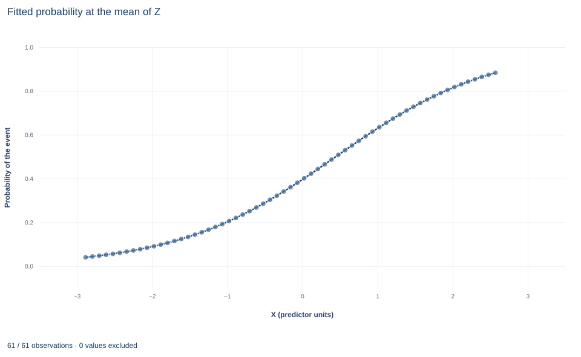

# Lab 17 · Logit Probabilities, Odds and Marginal Effects

**Three scales of a binary-choice coefficient: log odds, odds ratios and average marginal effects**

## Start with the supplied workbook

1. Download [logit_marginal_effects.xlsx](logit_marginal_effects.xlsx) and the [Python lab](lab.py). The workbook holds the fixed synthetic units used throughout this chapter.
2. Import `logit_marginal_effects.xlsx` into OpenEconometrics and keep that file name as the dataset name. The `Data` sheet holds one row per unit; the `Dictionary` sheet lists each column and its coding, and confirms that no cell is blank.
3. Open the complete `lab.py` in a new Python document and run the whole file. It fits a binary logit and displays, in order, the model's coefficient table, the fitted probability curve against X with Z held at its sample mean (the chart's only panel), and a six-row summary table with the row count, the observed and average predicted event rates, the X coefficient, its odds ratio and the average marginal effect.

For ordinary Python, keep `lab.py` and the workbook in the same folder and run the script there, or call `from lab import run_lab` and then `run_lab(data_path="/path/to/logit_marginal_effects.xlsx")`. Leave the workbook unchanged and work on a copy of the loaded table for any exercise. The [LaTeX table](table.tex) collects the summary values, and the [figure](figure.svg) shows the probability curve.

A logit reports an X coefficient of 0.952. A reader wants to know how much one more unit of X raises the chance of the event. The coefficient cannot answer that directly. It is a change in log odds; exponentiated, it multiplies the odds by 2.59; and its implied change in probability depends on where a unit starts. Averaged over the sample, the probability response is 0.190 per unit of X. All three numbers describe one fitted model. This lab derives each scale, shows why they differ and identifies which one answers which question.

The data are **400 original synthetic units**, each with two continuous predictors and a binary outcome; 163 units experience the event. Predictors are in abstract units, and no cell is missing.

## 1. The records

| Column | What it records | Coding |
|---|---|---|
| `row_id` | Unit label, 1 to 400 | Identifier only |
| `x` | Predictor whose effect on the event probability is the lab's question | Abstract units, observed from −2.88 to 2.57 |
| `z` | Second predictor, held fixed when the X effect is interpreted | Abstract units |
| `y` | Whether the event occurred | 0 = no event, 1 = event |

The dictionary calls both predictors "centered units." Their sample means are close to zero but not exactly zero (−0.042 for `x`, −0.054 for `z`), so treat them as roughly centered rather than demeaned. That matters below: the curve in the figure holds Z at its sample mean, not at zero.

## 2. The model on three scales

The logit specifies the event probability as

$$
p_i=\Pr(y_i=1\mid x_i,z_i)=\Lambda(\eta_i),\qquad
\eta_i=\beta_0+\beta_x x_i+\beta_z z_i,\qquad
\Lambda(a)=\frac{1}{1+e^{-a}}.
$$

$\eta_i$ is the linear index and $\Lambda$ the logistic distribution function. One way to motivate it is a latent variable $y_i^*=\eta_i+\varepsilon_i$ with $\varepsilon_i$ standard logistic and $y_i=1$ when $y_i^*>0$. Inverting $\Lambda$ gives

$$
\ln\frac{p_i}{1-p_i}=\eta_i .
$$

So $\beta_x$ is the change in **log odds** per unit of X, holding Z fixed, and that change is the same everywhere. Exponentiating, $e^{\beta_x}$ is the **odds ratio**: each unit of X multiplies the odds $p/(1-p)$ by the same factor. The **probability** response is not constant, because $\Lambda$ is nonlinear.

## 3. Maximum likelihood and the score identity

With independent units, the log likelihood is

$$
\ell(\beta)=\sum_i\big[y_i\ln p_i+(1-y_i)\ln(1-p_i)\big].
$$

Because $\Lambda'(a)=\Lambda(a)[1-\Lambda(a)]$, each term's derivative simplifies, and the first-order conditions are

$$
\frac{\partial\ell}{\partial\beta}=\sum_i(y_i-\hat p_i)\,w_i=0,\qquad w_i=(1,x_i,z_i)'.
$$

The intercept's component says $\sum_i y_i=\sum_i\hat p_i$: the average fitted probability equals the observed event rate exactly, at the solution. The other components say the residuals $y_i-\hat p_i$ are uncorrelated with each predictor in the sample. This is the lab's numerical identity, and it holds only because the model includes an intercept.

## 4. Fit the model and read the coefficients

```python
raw = load_data()  # reader defined in the complete lab.py
model = oe.logit(data=raw, y="y", x=["x", "z"], covariance="nonrobust", missing="raise")
display(model)
print("Odds ratio for X:", round(math.exp(coef(model, "x").estimate), 4))
```

| Term | Log-odds coefficient | Standard error | z statistic | 95% interval |
|---|---:|---:|---:|---|
| Intercept | −0.454 | 0.114 | −3.99 | −0.678 to −0.231 |
| X | 0.952 | 0.141 | 6.77 | 0.676 to 1.227 |
| Z | −0.571 | 0.124 | −4.60 | −0.815 to −0.328 |

All 400 units are used. The odds ratio for X is 2.59: each unit of X multiplies the odds of the event by about 2.59, holding Z fixed.

The `nonrobust` covariance is the inverse of the information matrix, $\big(\sum_i\hat p_i(1-\hat p_i)w_iw_i'\big)^{-1}$; for the logit, observed and expected information coincide. Inference is asymptotic: z statistics against the standard normal, with intervals $\hat\beta\pm1.96\,\widehat{SE}$ and no degrees-of-freedom correction. These standard errors assume the logit model is correctly specified; if not, the estimates converge to a pseudo-true value and a sandwich covariance would be the safer convention.

## 5. From log odds to probabilities

Differentiate $p_i=\Lambda(\eta_i)$ with respect to $x_i$:

$$
\frac{\partial p_i}{\partial x_i}=\beta_x\,p_i(1-p_i).
$$

The factor $p_i(1-p_i)$ is largest, 0.25, at $p_i=0.5$, so no unit's derivative can exceed $\beta_x/4=0.238$. At $p_i=0.1$ or $0.9$ the factor is 0.09 and the derivative is only 0.086. The same log-odds coefficient therefore implies large probability responses for units near the middle of the curve and small ones near either end.

The derivative is a local slope. A full one-unit change in X moves along the curve, so the discrete change $\Lambda(\eta_i+\beta_x)-\Lambda(\eta_i)$ differs from the derivative, and more so where the curve bends sharply.

**Pause before running.** Before computing the average marginal effect, predict whether it will be close to $\beta_x/4$ or well below it, given that the observed event rate is 0.4075.

## 6. Average the unit-level derivatives

The average marginal effect (AME) averages the derivative over the sample, each unit at its own X and Z:

$$
\widehat{AME}_x=\frac1n\sum_i\hat\beta_x\,\hat p_i(1-\hat p_i).
$$

```python
b0, bx, bz = (coef(model, term).estimate for term in ["Intercept", "x", "z"])
eta = b0 + bx * raw.x + bz * raw.z
p = eta.map(lambda a: 1 / (1 + math.exp(-a)))
print(round(raw.y.mean(), 4), round(p.mean(), 4), round(float((raw.y - p).sum()), 8))
ame = float((bx * p * (1 - p)).mean())
print(round(ame, 4), round(bx / 4, 4))
```

| Quantity | Value | Scale |
|---|---:|---|
| Observed event rate | 0.4075 | Share of units |
| Average fitted probability | 0.4075 | Share of units |
| Sum of residuals $y_i-\hat p_i$ | 0 to optimizer tolerance | Events |
| Average marginal effect of X | 0.190 | Probability per unit of X |
| Upper bound $\beta_x/4$ | 0.238 | Probability per unit of X |

The first two rows confirm the score identity; the lab requires the residual sum to be below $10^{-6}$. The AME is 0.190 probability units, or 19.0 percentage points, per unit of X. Dividing by $\hat\beta_x$ gives the sample average of $\hat p_i(1-\hat p_i)$, 0.1901/0.9519 = 0.200, a little below the 0.25 maximum.

The AME is not the derivative evaluated at average predictors. Because $\Lambda$ is nonlinear, the average of $p(1-p)$ across units differs from $p(1-p)$ at the mean index, so the two summaries generally disagree (Exercise 3). The lab reports the AME as a point estimate only. It is a nonlinear function of all three coefficients, so its standard error needs the delta method or resampling (Exercise 5); reusing the coefficient's standard error would be wrong.

## 7. Read the figure



The single panel plots the fitted probability on a 61-point grid of X from −2.88 to 2.57, the observed range, with Z fixed at its sample mean. The curve is the familiar S shape: it rises from 0.040 at the left edge to 0.883 at the right, crossing 0.5 between X = 0.39 and X = 0.48 on the grid. The slope is steepest at that crossing and flattens toward both ends, which is the factor $p(1-p)$ made visible.

Read the curve as one slice through the fitted model, not as the data. The AME averages slopes at each unit's own X and Z, so it is not the slope at any one point on this curve. A different fixed value of Z would shift the curve sideways without changing its shape, which is why statements about probability changes always need a reference point.

## A case from the literature

Schulman et al. (1999) asked whether a patient's race and sex affect physicians' recommendations for cardiac catheterization. In a computerized survey, 720 primary care physicians each viewed a recorded interview in which an actor portrayed a patient, then recommended care. A multivariate logistic regression, controlling for the physician's estimate of the probability of coronary artery disease and other patient characteristics, gave odds ratios of 0.60 for women relative to men and 0.60 for black relative to white patients. The authors concluded that race and sex independently influence how physicians manage chest pain. The study was widely reported, and Schwartz et al. (1999) argued soon afterwards that the results had been overstated in that coverage and examined what went wrong in communicating them.

Section 8 of this lab shows one way an odds ratio invites overstatement. An odds ratio of 0.60 multiplies the odds by 0.60; it does not make the event 40 percent less likely, and when the event is common the proportional change in probability is smaller. Davies et al. (1998) show that reading an odds ratio as a relative risk always overstates the effect, increasingly so as the baseline risk rises and the odds ratio departs from one, although serious divergence needs large effects in groups at high initial risk. Long and Mustillo (2021) develop comparisons for logit models based on predicted probabilities and marginal effects on probabilities, the natural metric of the outcome. The lab reports the average marginal effect for the same reason.

## 8. What the evidence supports

The fit describes how the event probability varies with X, holding Z, in 400 synthetic units generated so that the logit holds. The odds ratio is not a risk ratio: multiplying the odds by 2.59 multiplies the probability by much less when the event is common. A percentage-point AME is not causal without an identification argument for X, and its uncertainty must be computed separately. The ML standard errors assume independent units and a correctly specified link; perfect or near-perfect separation would make the estimates unreliable, which does not happen here.

## 9. Write the result in full

"In 400 synthetic units, of which 163 experience the event, a logit of the event on X and Z gives an X coefficient of 0.952 log-odds units (ML standard error 0.141, 95% normal interval 0.676 to 1.227). Holding Z fixed, one more unit of X multiplies the odds of the event by 2.59. Averaged over the sample, the fitted probability rises by 0.190, or 19.0 percentage points, per unit of X; this average marginal effect is reported without a standard error."

## Student exercises

1. Compute a 95% interval for the odds ratio of X from the coefficient interval. Explain why it is not symmetric around 2.59 and why "odds ratio ± 1.96 standard errors of the coefficient" would be wrong.
2. For a unit with fitted probability 0.05 and another with 0.50, compute each unit's probability after a one-unit increase in X, holding Z. Report the change and the probability ratio for each, and explain why the odds ratio is not a risk ratio.
3. Compute the marginal effect of X at the sample means of X and Z. Compare it with the AME and explain the difference using the shape of $p(1-p)$.
4. Compute the average discrete change in fitted probability when every unit's X rises by one. Compare it with the AME and say when the two would diverge more.
5. Use the delta method with `model.covariance_matrix` to compute a standard error and a 95% normal interval for the AME. Write out the gradient of the AME with respect to $(\beta_0,\beta_x,\beta_z)$ first.
6. Rewrite this sentence so it uses the right scale: "Each extra unit of X makes the event 2.59 times as likely, an increase of 95%."

## Further reading

- Davies, H. T. O., Crombie, I. K., and Tavakoli, M. (1998). When can odds ratios mislead? *BMJ*, 316(7136), 989–991. https://doi.org/10.1136/bmj.316.7136.989
- Long, J. S., and Mustillo, S. A. (2021). Using predictions and marginal effects to compare groups in regression models for binary outcomes. *Sociological Methods & Research*, 50(3), 1284–1320. https://doi.org/10.1177/0049124118799374
- Schulman, K. A., Berlin, J. A., Harless, W., Kerner, J. F., Sistrunk, S., Gersh, B. J., Dubé, R., Taleghani, C. K., Burke, J. E., Williams, S., Eisenberg, J. M., Ayers, W., and Escarce, J. J. (1999). The effect of race and sex on physicians' recommendations for cardiac catheterization. *New England Journal of Medicine*, 340(8), 618–626. https://doi.org/10.1056/NEJM199902253400806
- Schwartz, L. M., Woloshin, S., and Welch, H. G. (1999). Misunderstandings about the effects of race and sex on physicians' referrals for cardiac catheterization. *New England Journal of Medicine*, 341(4), 279–283. https://doi.org/10.1056/NEJM199907223410411
