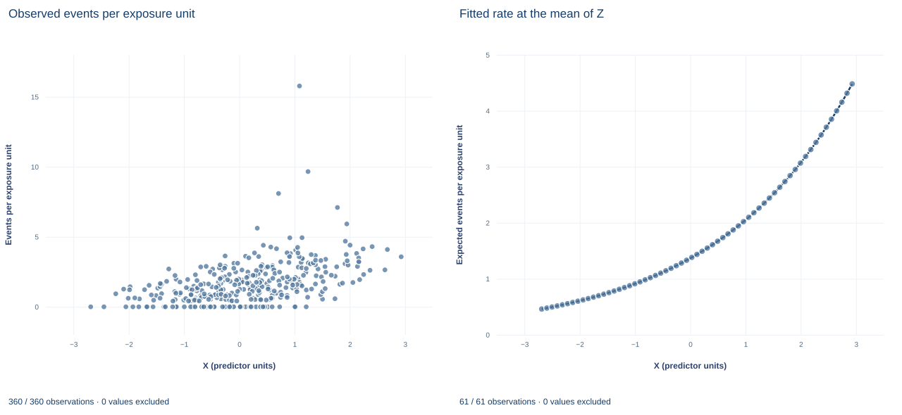

# Lab 18 · Poisson Rates with an Exposure Offset

**Count models for rates: the log link, the exposure offset and rate ratios**

## Start with the supplied workbook

1. Download [poisson_exposure.xlsx](poisson_exposure.xlsx) and the [Python lab](lab.py). The workbook holds the fixed synthetic units used throughout this chapter.
2. Import `poisson_exposure.xlsx` into OpenEconometrics and keep that file name as the dataset name. The `Data` sheet holds one row per unit, with its event count and the exposure over which events were counted; the `Dictionary` sheet lists each column and confirms that no cell is blank.
3. Open the complete `lab.py` in a new Python document and run the whole file. It fits a Poisson regression with a log-exposure offset and displays, in order, the model's coefficient table, a scatter of each unit's observed events per exposure unit against X (the app shows only this first chart panel), and a seven-row summary table of counts, exposure, the crude rate, the X rate ratio and the fitted event total.

For ordinary Python, keep `lab.py` and the workbook in the same folder and run the script there, or call `from lab import run_lab` and then `run_lab(data_path="/path/to/poisson_exposure.xlsx")`. Leave the workbook unchanged and work on a copy of the loaded table for any exercise. The [LaTeX table](table.tex) collects the summary values, and the [figure](figure.svg) shows both chart panels.

Units observed for longer, or with more at risk, have more opportunity to produce events. A raw count therefore mixes two things: how fast events occur and how long we watched. The question in this lab is how fast events occur, and how that rate varies with a predictor X once the opportunity for events is accounted for.

The data are **360 original synthetic units** with 871 events over a total exposure of 541.96 exposure units, a crude rate of 1.607 events per exposure unit. Exposures range from 0.50 to 2.49, and 62 units record no event. A Poisson model with an exposure offset estimates that one more unit of X multiplies the expected event rate by 1.4995, holding Z fixed. This lab derives that number, its covariance and the identity that makes fitted and observed totals agree.

## 1. The records

| Column | What it records | Coding |
|---|---|---|
| `row_id` | Unit label, 1 to 360 | Identifier only |
| `x` | Predictor whose association with the event rate is the lab's question | Abstract units |
| `z` | Second predictor, held fixed when the X association is interpreted | Abstract units |
| `y` | Number of events observed for the unit | Nonnegative integer, 0 to 10 |
| `exposure` | Length of observation or amount at risk over which `y` was counted | Positive, abstract exposure units |

Two dictionary labels need care. `x` is called "Exposure or predictor X," but in this lab "exposure" means the `exposure` column; `x` is an ordinary predictor. Both `x` and `z` are described as "centered units," yet `x` has mean 0.129, so it is not centered; `z` has mean 0.005.

## 2. A model for rates, fitted to counts

Write $e_i$ for exposure and $\lambda_i$ for the unit's event rate per exposure unit. The model is

$$
y_i\mid x_i,z_i,e_i\sim\text{Poisson}(\mu_i),\qquad
\mu_i=e_i\lambda_i,\qquad
\ln\lambda_i=\beta_0+\beta_xx_i+\beta_zz_i .
$$

Taking logs of the mean gives $\ln\mu_i=\ln e_i+\beta_0+\beta_xx_i+\beta_zz_i$. The term $\ln e_i$ is an **offset**: a regressor whose coefficient is fixed at one rather than estimated. That restriction encodes the assumption that, at fixed X and Z, expected events are proportional to exposure.

Rate ratios follow directly. For two units with the same Z, X values one apart and any exposures,

$$
\frac{\mu_1/e_1}{\mu_0/e_0}=\frac{\lambda_1}{\lambda_0}=e^{\beta_x}.
$$

Dividing by exposure removes it, so $e^{\beta_x}$ compares rates, not counts. The outcome stays a count: modeling $y_i/e_i$ directly would discard the information that a rate measured over a long exposure is more precise than one measured over a short exposure.

**Pause before running.** For a unit with fixed X and Z, what happens to its expected count, and to its expected rate, when its exposure doubles?

## 3. Maximum likelihood and the score identity

The log likelihood is

$$
\ell(\beta)=\sum_i\big[y_i\ln\mu_i-\mu_i-\ln y_i!\big],\qquad \mu_i=e_i\exp(w_i'\beta),\quad w_i=(1,x_i,z_i)'.
$$

Because $\partial\mu_i/\partial\beta=\mu_iw_i$, the first-order conditions are

$$
\sum_i(y_i-\hat\mu_i)\,w_i=0 .
$$

The intercept's component gives $\sum_i\hat\mu_i=\sum_iy_i$: fitted events add up to the 871 observed events. Dividing both sides by total exposure, the fitted overall rate equals the crude rate, 871/541.96 = 1.607. That is the lab's numerical identity, and it holds only because the model includes an intercept and the log link is canonical for the Poisson family.

The second derivative is $-\sum_i\mu_iw_iw_i'$, which involves no $y_i$, so observed and expected information coincide. The model-based covariance is $\big(\sum_i\hat\mu_iw_iw_i'\big)^{-1}$ with the dispersion fixed at one, and inference uses the standard normal.

## 4. Fit the model and read the coefficients

```python
raw = load_data()  # reader defined in the complete lab.py
model = oe.glm(data=raw, y="y", x=["x", "z"], family="poisson", link="log",
               exposure="exposure", covariance="nonrobust", missing="raise")
display(model)
```

The `exposure="exposure"` argument adds $\ln e_i$ as the offset; there is no estimated coefficient on it.

| Term | Coefficient (log rate) | Standard error | z statistic | 95% interval |
|---|---:|---:|---:|---|
| Intercept | 0.314 | 0.039 | 7.98 | 0.237 to 0.391 |
| X | 0.405 | 0.034 | 11.93 | 0.339 to 0.472 |
| Z | −0.171 | 0.032 | −5.34 | −0.234 to −0.108 |

All 360 units are used. The X coefficient is a change in the log rate per unit of X, so $e^{0.4051}=1.4995$: one more unit of X multiplies the expected rate by about 1.50, a 50% increase, holding Z fixed. The intercept is the log rate at X = 0 and Z = 0, so $e^{0.3137}=1.37$ events per exposure unit there. That differs from the crude rate 1.607, which averages over the sample's mix of X and Z.

## 5. Check the identity and the variance assumption

```python
b0, bx, bz = (coef(model, term).estimate for term in ["Intercept", "x", "z"])
mu = raw.exposure * (b0 + bx * raw.x + bz * raw.z).map(math.exp)
print(int(raw.y.sum()), round(float(mu.sum()), 4), round(float(raw.y.sum() / raw.exposure.sum()), 4))
print(round(math.exp(bx), 4), round(model.metrics["dispersion_pearson"], 3))
```

| Quantity | Value | Unit |
|---|---:|---|
| Observed events | 871 | Events |
| Sum of fitted events $\sum\hat\mu_i$ | 871.0 | Events |
| Crude rate | 1.6071 | Events per exposure unit |
| X rate ratio $e^{\hat\beta_x}$ | 1.4995 | Multiplier per unit of X |
| Pearson dispersion $\sum(y_i-\hat\mu_i)^2/\hat\mu_i\,/\,357$ | 1.083 | Ratio, 1 under the Poisson variance |

The fitted total matches the observed total; the lab requires agreement to within $10^{-6}$ events. The Pearson dispersion compares squared residuals with the Poisson variance $\mu_i$, on 357 residual degrees of freedom. A value near one is what the Poisson assumption $\text{Var}(y_i)=\mu_i$ predicts. Clear overdispersion, a value well above one, would make the model-based standard errors too small, by roughly the square root of the dispersion if the variance were proportional to the mean.

The coefficients themselves do not depend on that variance assumption. The score equations are moment conditions that hold whenever the conditional mean $e_i\exp(w_i'\beta)$ is correct, so Poisson regression is consistent for $\beta$ even when counts are not Poisson. What the variance assumption buys is the standard error; a sandwich covariance keeps valid inference without it (Exercise 5).

## 6. Read the figure



The first panel, "Observed events per exposure unit," is a scatter of $y_i/e_i$ against X for all 360 units, the only panel the app displays. Rates run from 0, where the 62 zero-count units sit on the horizontal axis, up to 15.78, a unit with 8 events over an exposure of 0.51. The spread is uneven for a reason: the variance of an observed rate is $\lambda_i/e_i$, so units with short exposures scatter much more widely than units with long ones. That is why the model fits counts with an offset rather than treating these ratios as equally reliable outcomes.

The second panel, "Fitted rate at the mean of Z," plots $\exp(\hat\beta_0+\hat\beta_x x+\hat\beta_z\bar z)$ on a 61-point grid across the observed X range, −2.69 to 2.93. The curve is exponential, rising from 0.460 to 4.482 expected events per exposure unit, a factor of 9.74, which is $e^{0.4051\times5.62}$ across the 5.62-unit range. On a log vertical axis it would be a straight line; on this linear axis each unit of X adds more events than the last, while the ratio per unit stays at 1.4995.

## A case from the literature

Frome (1983) considered models in which the rate at which events occur is a regression function of predictor variables, estimated by iteratively reweighted least squares; for Poisson-distributed events this is equivalent to maximum likelihood by the method of scoring. He discussed applications to epidemiologic follow-up studies with data organized in a life-table format, and illustrated the method with lung cancer death rates among British physicians who were regular cigarette smokers, using a nonlinear model derived from the multistage theory of carcinogenesis.

That is this lab's question in real data. In follow-up studies, deaths are counts, but the quantity of interest is a death rate, because groups are followed for different amounts of time. Frome's illustration is nonlinear in its parameters; the lab's log-linear rate model with an offset is the simplest member of the family. Nelder and Wedderburn (1972) showed that iterative weighted linear regression gives maximum likelihood estimates for a class of generalized linear models that includes the Poisson. Gourieroux et al. (1984) show that, for Poisson models with specification errors, pseudo maximum likelihood gives consistent and asymptotically normal estimators without specifying the distribution of the disturbances, which underlies the statement that the rate ratio does not depend on the Poisson variance. Cameron and Trivedi (1986) compare estimators and tests for count data under uncertainty about the data-generating process, beginning with the Poisson case, and apply them to the number of doctor consultations; the Pearson dispersion check here is a first step of that kind.

## 7. What the evidence supports

The model estimates how the event rate varies with X, holding Z, in synthetic units generated so that a Poisson rate model holds. The crude rate 1.607 is a pooled descriptive rate, not a covariate-adjusted comparison. A rate ratio is a multiplicative comparison of rates and says nothing about absolute differences in events without a baseline rate and an exposure. The offset assumes that expected events are proportional to exposure and that exposure is measured without error; neither can be tested by the offset model itself. The association is not causal without an identification argument. Overdispersion, excess zeros or dependence between units would each require a different covariance or count model.

## 8. Write the result in full

"In 360 synthetic units with 871 events over 541.96 exposure units (crude rate 1.607 per exposure unit), a Poisson regression of event counts on X and Z with a log-exposure offset gives an X coefficient of 0.405 on the log-rate scale (model-based standard error 0.034, 95% normal interval 0.339 to 0.472). Holding Z fixed, one more unit of X multiplies the expected event rate by 1.50. Fitted events sum to the observed 871, and the Pearson dispersion of 1.08 gives no sign of overdispersion."

## Student exercises

1. Compute a 95% interval for the X rate ratio and for the rate ratio comparing units two X units apart. State both as percentage changes in the rate.
2. On a copy of the data, multiply every exposure by 2 and refit. Report which coefficients change and by how much, and explain the result using the offset algebra in Section 2. What happens to the fitted counts?
3. Replace the offset with `log_exposure`, the natural log of exposure, as an ordinary regressor with an estimated coefficient. Test whether its coefficient equals one and explain what a value below one would mean for the proportionality assumption.
4. Fit the same Poisson model without any exposure term. Compare the X coefficient and the sum of fitted events with the offset model, and explain when leaving out exposure would bias the X coefficient.
5. Refit the offset model with `covariance="robust"`. Compare each standard error with the model-based one and explain whether the change agrees with the Pearson dispersion in Section 5.
6. Rewrite this sentence so it matches the model: "Units with one more unit of X have 50% more events."

## Further reading

- Cameron, A. C., and Trivedi, P. K. (1986). Econometric models based on count data. Comparisons and applications of some estimators and tests. *Journal of Applied Econometrics*, 1(1), 29–53. https://doi.org/10.1002/jae.3950010104
- Frome, E. L. (1983). The analysis of rates using Poisson regression models. *Biometrics*, 39(3), 665. https://doi.org/10.2307/2531094
- Gourieroux, C., Monfort, A., and Trognon, A. (1984). Pseudo maximum likelihood methods: Applications to Poisson models. *Econometrica*, 52(3), 701–720. https://doi.org/10.2307/1913472
- Nelder, J. A., and Wedderburn, R. W. M. (1972). Generalized linear models. *Journal of the Royal Statistical Society. Series A (General)*, 135(3), 370. https://doi.org/10.2307/2344614
