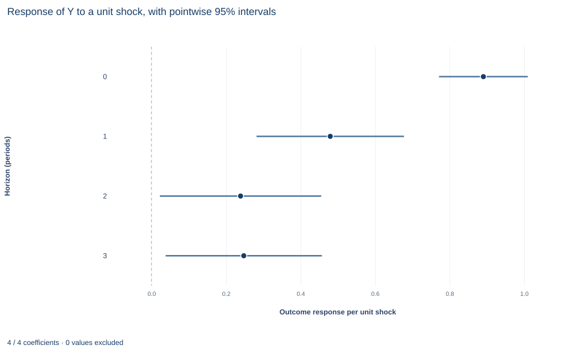

# Lab 19 · Local Projections over Several Horizons

**Impulse responses by horizon-specific regression, with HAC inference for overlapping errors**

## Start with the supplied workbook

1. Download [local_projections.xlsx](local_projections.xlsx) and the [Python lab](lab.py). The workbook holds one fixed synthetic time series used throughout this chapter.
2. Import `local_projections.xlsx` into OpenEconometrics and keep that file name as the dataset name. The `Data` sheet holds one row per period, in time order; the `Dictionary` sheet lists each column and confirms that no cell is blank.
3. Open the complete `lab.py` in a new Python document and run the whole file. It fits one regression per horizon, from 0 to 3 periods ahead, and displays, in order, the coefficient table of the horizon-2 projection, a chart of the estimated response at each of the four horizons with its pointwise 95% interval (the same chart in the app and in the saved figure), and an eight-row summary table of the four responses, the horizon-2 HAC standard error, the first and last row counts and the horizon-2 mechanism response.

For ordinary Python, keep `lab.py` and the workbook in the same folder and run the script there, or call `from lab import run_lab` and then `run_lab(data_path="/path/to/local_projections.xlsx")`. Keep the rows in time order, leave the workbook unchanged and work on a copy of the loaded table for any exercise. The [LaTeX table](table.tex) collects the summary values, and the [figure](figure.svg) shows the response path.

A shock hits an outcome today. How much of it is still visible one, two or three periods later? An impulse response answers that question, and a local projection estimates it directly: for each horizon $h$, regress the outcome $h$ periods ahead on today's shock. The four regressions here give responses of 0.891, 0.480, 0.239 and 0.248 at horizons 0 to 3.

The data are **260 original synthetic periods** of a single series, indexed 0 to 259 with no gaps. Each row is a period, not an independent unit, so the errors of the projections are correlated over time and inference must account for that. This lab derives what each projection estimates, why its errors are serially correlated, how the HAC covariance handles that, and why four pointwise intervals are not a joint band.

## 1. The records

| Column | What it records | Coding |
|---|---|---|
| `row_id` | Row label, 1 to 260 | Identifier only |
| `time` | Period index, 0 to 259, one step apart | Integer period |
| `x` | The shock in period $t$ | Abstract shock units |
| `z` | The previous period's outcome, $y_{t-1}$ | Outcome units; 0 in the first row |
| `y` | The outcome in period $t$ | Outcome units |

The dictionary's "Exposure or predictor X" is the shock whose propagation the lab traces; its "centered units" is approximate, since `x` has mean −0.072. Each `z` value equals the previous row's `y` exactly. The first row has no previous period, and its `z` of zero is a placeholder rather than an observed lag, so every projection drops that row.

## 2. What a projection estimates

The series was generated by

$$
y_t=0.5\,y_{t-1}+0.8\,x_t+e_t ,
$$

with the shock $x_t$ independent across periods and of the outcome disturbance $e_t$. Substituting the equation into itself $h$ times gives

$$
y_{t+h}=0.5^{h+1}y_{t-1}+0.8(0.5)^h x_t+v_{t,h},
\qquad
v_{t,h}=\sum_{j=1}^{h}0.5^{h-j}\,0.8\,x_{t+j}+\sum_{j=0}^{h}0.5^{h-j}e_{t+j}.
$$

The local projection at horizon $h$ is the regression

$$
y_{t+h}=a_h+\theta_hx_t+\gamma_hy_{t-1}+v_{t,h}.
$$

Its shock coefficient targets the impulse response $\theta_h=0.8(0.5)^h$: 0.8, 0.4, 0.2 and 0.1 at horizons 0 to 3. OLS is consistent at every horizon because $v_{t,h}$ contains only shocks and disturbances dated after $t-1$, and future shocks are independent of $x_t$ and $y_{t-1}$. The lagged outcome enters as a control for the state of the series before the shock.

A projection estimates each horizon's coefficient directly, rather than fitting a dynamic model once and iterating it forward; Exercise 2 compares the two.

## 3. The sample at each horizon

To build horizon $h$, lead the outcome by $h$ rows within the ordered series, drop the first row (its lag is a placeholder) and drop the last $h$ rows, which have no outcome $h$ periods ahead. With $T=260$ periods,

$$
n_h=T-1-h:\quad n_0=259,\; n_1=258,\; n_2=257,\; n_3=256.
$$

The lab checks this accounting, losing exactly one tail row per extra horizon. Because the samples differ slightly, the four responses are not estimated on identical periods; report the horizon-specific row counts along with the estimates.

## 4. Why the errors are serially correlated

Write $v_{t,h}$ and $v_{t+k,h}$ for two projection errors $k$ periods apart. For $k\le h$ they share the shocks and disturbances dated between $t+k$ and $t+h$, so they are correlated; for $k>h$ they share nothing. The projection error is a moving average of order $h$, by construction, even though the underlying shocks are independent. At horizon 0 there is no overlap, and the error is just $e_t$.

Ordinary or heteroskedasticity-robust standard errors ignore that overlap. The lab uses a heteroskedasticity- and autocorrelation-consistent (HAC) covariance with the Bartlett kernel and four lags:

$$
\hat V=c\,(W'W)^{-1}\Big[\hat\Gamma_0+\sum_{j=1}^{4}\Big(1-\frac{j}{5}\Big)\big(\hat\Gamma_j+\hat\Gamma_j'\big)\Big](W'W)^{-1},
\qquad
\hat\Gamma_j=\sum_t\hat v_t\hat v_{t-j}\,w_tw_{t-j}'.
$$

Here $w_t=(1,x_t,y_{t-1})'$, and the weights on lags 1 to 4 are 0.8, 0.6, 0.4 and 0.2. The factor $c=n/(n-3)$ is a small-sample correction, 259/256 = 1.0117 at horizon 0, and inference uses the t distribution with $n-3$ degrees of freedom. Four lags cover the overlap at every horizon studied, since the longest is 3. The Bartlett weights keep $\hat V$ positive semidefinite, but they also downweight true autocovariances, so the lag choice should be reported and checked (Exercise 3).

**Pause before running.** Predict whether the HAC standard error of the horizon-2 response will be larger or smaller than a heteroskedasticity-robust one, and whether standard errors will grow or shrink as the horizon lengthens.

## 5. Run one projection

```python
raw = load_data()  # reader defined in the complete lab.py
horizon = 2
data = raw.assign(lead_y=raw.y.shift(-horizon)).iloc[1:]
data = data.dropna(subset=["lead_y"]).reset_index(drop=True)
model = fit(data, ["x", "z"], y="lead_y", covariance="hac", time="time", lags=4, kernel="bartlett")
display(model)
```

The `time` argument tells the HAC estimator how the rows are ordered in time. The horizon-2 projection uses 257 rows. Its shock coefficient is 0.239 with HAC standard error 0.110, so its t statistic is 2.18 and its 95% interval runs from 0.023 to 0.456, which contains the mechanism response 0.2. The coefficient on the lagged outcome is 0.130 (standard error 0.066).

## 6. Trace the whole path

```python
for h in range(4):
    lead = raw.assign(lead_y=raw.y.shift(-h)).iloc[1:].dropna(subset=["lead_y"]).reset_index(drop=True)
    m = fit(lead, ["x", "z"], y="lead_y", covariance="hac", time="time", lags=4, kernel="bartlett")
    row = coef(m, "x")
    print(h, m.nobs, round(row.estimate, 3), round(row.std_error, 3), round(row.ci_low, 3), round(row.ci_high, 3), 0.8 * 0.5**h)
```

| Horizon (periods) | Rows | Estimated response $\hat\theta_h$ | HAC standard error | Pointwise 95% interval | Mechanism response |
|---:|---:|---:|---:|---|---:|
| 0 | 259 | 0.891 | 0.060 | 0.772 to 1.010 | 0.8 |
| 1 | 258 | 0.480 | 0.100 | 0.282 to 0.678 | 0.4 |
| 2 | 257 | 0.239 | 0.110 | 0.023 to 0.456 | 0.2 |
| 3 | 256 | 0.248 | 0.106 | 0.038 to 0.457 | 0.1 |

Read down the columns. The estimates fall sharply over the first two horizons and then level off, while the mechanism keeps halving. Each interval contains its own mechanism value. The standard error grows from 0.060 to about 0.11, because the projection error accumulates more future shocks and disturbances as $h$ rises. The horizon-3 estimate sits above horizon 2, a gap of 0.009 that is tiny relative to either standard error; it is noise, not evidence of a second rise.

## 7. Read the figure



Each row is one horizon, 0 to 3 periods, and the horizontal axis is the outcome response per unit of shock; the dashed vertical line marks zero. The dot is the estimated response and the bar its 95% interval from the HAC covariance. The estimates drop from 0.891 at impact to 0.480 and 0.239, then flatten at 0.248. The interval is narrow at impact (0.772 to 1.010) and much wider from horizon 1 onward (0.282 to 0.678), and at horizons 2 and 3 its lower end almost reaches zero (0.023 and 0.038).

Read the intervals one horizon at a time. Each is a separate 95% interval from a separate regression, so together they form a pointwise band. They do not form a region that contains the whole response path with 95% probability.

## A case from the literature

Jordà et al. (2013) asked how financial crises and the build-up of credit shape the modern business cycle, using data on 14 advanced countries from 1870 to 2008. Relative to typical recessions, recessions with financial crises were costlier, and more credit-intensive expansions tended to be followed by deeper recessions and slower recoveries, with or without a crisis. To study how past credit accumulation affects output, investment, lending, interest rates and inflation, they used local projection methods that condition on a broad set of macroeconomic controls.

The method is the one Jordà (2005) introduced: estimate a regression at each horizon of interest instead of extrapolating to distant horizons from one fitted dynamic system, so that responses come from standard regression software and flexible or nonlinear specifications are easy to accommodate. The price is the one this lab works through. Projection errors at nearby dates overlap at every horizon beyond zero, so inference needs a heteroskedasticity- and autocorrelation-consistent covariance; Newey and West (1987) gave a simple estimator that is positive semi-definite by construction. A row of pointwise intervals also says nothing about the whole path at once. Montiel Olea and Plagborg-Møller (2019) compare simultaneous bands for impulse responses and find the sup-t band narrower than Bonferroni and projection bands, which bears on Exercise 5. Unlike the lab's shock, which is exogenous by construction, credit growth in historical data is observed rather than assigned, so the credibility of such responses rests on the controls and the design.

## 8. What the evidence supports

The projections support a reported response path for this synthetic series: a large impact response that decays over the next two periods, with growing uncertainty. They rely on the shock being exogenous by construction. An observed variable in real data is not automatically a shock; responses to an endogenous policy variable need a separate identification strategy, such as an external instrument. The intervals are pointwise. Claims about the whole path, for example that every horizon differs from zero, need a simultaneous band built from the joint covariance of the four estimates, or a conservative adjustment (Exercise 5). The HAC convention, lag length, horizon range and sample rule should be reported, since each affects the numbers.

## 9. Write the result in full

"In 260 synthetic periods, local projections of the outcome at horizons 0 to 3 on the current shock and the lagged outcome give responses of 0.891, 0.480, 0.239 and 0.248 per unit shock, using 259 down to 256 periods. Standard errors are Bartlett HAC with four lags and a small-sample correction; the horizon-2 response is 0.239 (standard error 0.110, pointwise 95% interval 0.023 to 0.456), consistent with the mechanism value 0.2. The intervals are pointwise, not a joint band for the path."

## Student exercises

1. Report the coefficient on `z` in each of the four projections and compare it with the coefficient on $y_{t-1}$ implied by the substitution in Section 2. Explain why it shrinks with the horizon.
2. Use the horizon-0 regression to build the iterated response $\hat\theta_0\hat\gamma_0^{\,h}$ for $h=1,2,3$. Compare it with the projection estimates and the mechanism values, and explain when you would prefer each approach.
3. Refit the horizon-2 projection with `covariance="nonrobust"`, then HAC with 0, 8 and 12 lags. Report the shock coefficient's standard error each time and explain the pattern.
4. Refit the horizon-2 projection without the lagged outcome. Compare the response and its standard error with Section 5 and explain why the estimate stays consistent while precision changes.
5. Build a Bonferroni band for the four horizons by using two-sided t critical values at level 0.05/4 for each horizon. Report the band and check whether each horizon still excludes zero and whether the band contains the mechanism path.
6. Rewrite this claim so it matches the evidence: "The response rises again at horizon 3, so the effect is hump-shaped, and all four horizons are significant at 5%, which proves the shock has a persistent effect."

## Further reading

- Jordà, Ò. (2005). Estimation and inference of impulse responses by local projections. *American Economic Review*, 95(1), 161–182. https://doi.org/10.1257/0002828053828518
- Jordà, Ò., Schularick, M., and Taylor, A. M. (2013). When credit bites back. *Journal of Money, Credit and Banking*, 45(s2), 3–28. https://doi.org/10.1111/jmcb.12069
- Montiel Olea, J. L., and Plagborg-Møller, M. (2019). Simultaneous confidence bands: Theory, implementation, and an application to SVARs. *Journal of Applied Econometrics*, 34(1), 1–17. https://doi.org/10.1002/jae.2656
- Newey, W. K., and West, K. D. (1987). A simple, positive semi-definite, heteroskedasticity and autocorrelation consistent covariance matrix. *Econometrica*, 55(3), 703. https://doi.org/10.2307/1913610
