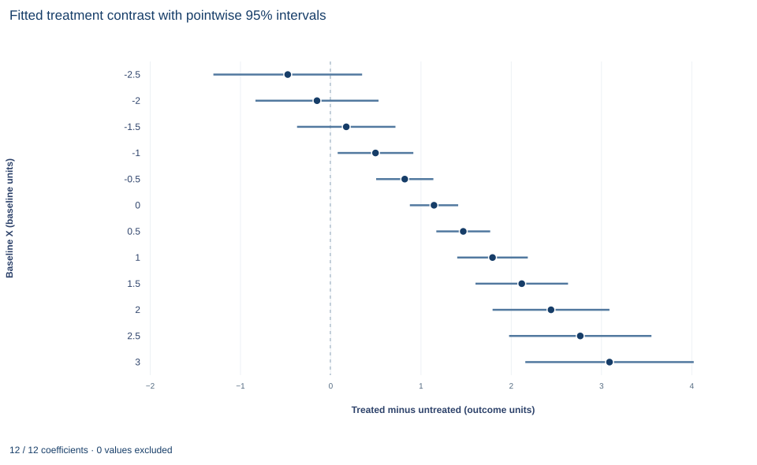

# Lab 20 · A Reproducible Treatment-Effect Report

**Estimands, covariate adjustment and effect heterogeneity in a randomized comparison**

## Start with the supplied workbook

1. Download [specification_report.xlsx](specification_report.xlsx) and the [Python lab](lab.py). The workbook holds the fixed synthetic units used throughout this chapter.
2. Import `specification_report.xlsx` into OpenEconometrics and keep that file name as the dataset name. The `Data` sheet holds one row per unit; the `Dictionary` sheet lists each column and confirms that no cell is blank.
3. Open the complete `lab.py` in a new Python document and run the whole file. It fits three specifications of the same treatment comparison and displays, in order, the coefficient table of the interaction model, a chart of the fitted treatment contrast at half-unit steps of baseline X with pointwise 95% intervals (the same chart in the app and in the saved figure), and an eleven-row summary table of unit counts, the treatment estimates from all three specifications, the interaction slope, the sample-average contrast with its standard error and interval, and the mean of baseline X.

For ordinary Python, keep `lab.py` and the workbook in the same folder and run the script there, or call `from lab import run_lab` and then `run_lab(data_path="/path/to/specification_report.xlsx")`. Leave the workbook unchanged and work on a copy of the loaded table for any exercise. The [LaTeX table](table.tex) collects the summary values, and the [figure](figure.svg) shows the contrast and its intervals.

A randomized experiment can still produce several "treatment effects." In this lab a difference in means gives 1.139, a regression adjusting for two baseline covariates gives 1.180, and a model that lets the effect vary with baseline X reports a treatment coefficient of 1.149. Averaging that model's fitted contrasts over the sample gives 1.179. None of these is an arithmetic mistake. They answer different questions or answer the same question with different precision, and a reproducible report has to say which is which.

The data are **300 original synthetic units**, of which 156 were randomly assigned to treatment, with no missing cells. Outcomes and covariates are in abstract units. This lab defines the estimand, derives what each specification's coefficient estimates, and shows how the sample-average contrast and its standard error are built from the full coefficient covariance.

## 1. The records

| Column | What it records | Coding |
|---|---|---|
| `row_id` | Unit label, 1 to 300 | Identifier only |
| `x` | Baseline covariate measured before assignment; the effect is allowed to vary with it | Baseline units, mean 0.048 |
| `z` | Second baseline covariate, entered additively | Baseline units |
| `y` | Outcome measured after assignment | Outcome units |
| `treat` | Randomized assignment | 1 = treated (156 units), 0 = control (144) |
| `interaction` | Treatment times baseline X, `treat * x` | Equals `x` for treated units, 0 for controls |

`interaction` is the product of `treat` and the raw `x`, whose mean is 0.048, not zero; the lab checks that `interaction` equals `treat * x` exactly. This matters in Section 5, because the treatment coefficient in the interaction model is the contrast at X = 0, and X = 0 is not the mean of X.

## 2. The estimand

Let $Y_i(1)$ and $Y_i(0)$ be unit $i$'s outcomes with and without treatment. The sample average treatment effect is

$$
\tau_{S}=\frac1n\sum_{i=1}^{n}\big[Y_i(1)-Y_i(0)\big].
$$

Only one potential outcome is observed per unit. Randomization makes assignment independent of the potential outcomes and of the baseline covariates, so the treated and control groups are exchangeable and the difference in their mean outcomes is unbiased for $\tau_S$. Covariates measured before assignment cannot be affected by it, which is why adjusting for them cannot introduce bias in the way adjusting for a post-treatment variable could.

## 3. Three specifications and what each coefficient means

$$
\begin{aligned}
\text{Unadjusted:}\quad & y_i=\alpha+\tau D_i+u_i,\\
\text{Adjusted:}\quad & y_i=\alpha+\tau D_i+\beta_xx_i+\beta_zz_i+u_i,\\
\text{Interaction:}\quad & y_i=\beta_0+\tau D_i+\beta_xx_i+\beta_zz_i+\delta\,D_ix_i+u_i .
\end{aligned}
$$

$D_i$ is `treat`. In the unadjusted model, $\hat\tau$ is exactly $\bar y_1-\bar y_0$, the difference in group means. In the adjusted model, $\hat\tau$ is a common treatment coefficient; adjustment removes the part of the outcome explained by X and Z, which reduces residual variance and corrects for chance imbalance in the covariates between arms. In the interaction model, the fitted contrast for a unit with baseline $x$ is

$$
\hat y_i(D=1)-\hat y_i(D=0)=\hat\tau+\hat\delta x_i ,
$$

so $\hat\tau$ is the contrast at $x=0$ and $\hat\delta$ is the change in the contrast per unit of X.

All three use HC3 standard errors, $(W'W)^{-1}\big[\sum_i\hat u_i^2(1-h_{ii})^{-2}w_iw_i'\big](W'W)^{-1}$ with $h_{ii}$ the leverage, and t reference distributions with $n-k$ degrees of freedom.

## 4. Fit the specification table

```python
raw = load_data()  # reader defined in the complete lab.py
specs = {"unadjusted": ["treat"], "adjusted": ["treat", "x", "z"],
         "interaction": ["treat", "x", "z", "interaction"]}
models = {name: fit(raw, terms) for name, terms in specs.items()}  # HC3 by default
for name, m in models.items():
    row = coef(m, "treat")
    print(name, m.nobs, round(row.estimate, 3), round(row.std_error, 3), round(row.ci_low, 3), round(row.ci_high, 3))
```

| Specification | Units | Treatment coefficient | HC3 standard error | 95% interval | What the coefficient estimates |
|---|---:|---:|---:|---|---|
| Unadjusted | 300 | 1.139 | 0.168 | 0.809 to 1.470 | Difference in mean outcomes |
| Adjusted for X and Z | 300 | 1.180 | 0.141 | 0.903 to 1.456 | Common effect, holding X and Z |
| With treatment × X | 300 | 1.149 | 0.136 | 0.881 to 1.416 | Contrast at X = 0 |

Every specification uses the same 300 units, which the lab checks; a specification table that silently changes the sample confounds specification with sample. Adjustment moves the estimate by 0.04 and lowers its standard error from 0.168 to 0.141, the precision gain that baseline covariates buy in a randomized design. The interaction model's treatment row has a different target, so its 1.149 should not be read as a third estimate of the same quantity. In that model the interaction coefficient is 0.648 (standard error 0.155): the fitted contrast rises by 0.648 outcome units per unit of baseline X.

**Pause before running.** What does the treatment coefficient in the interaction model describe, and how far from it would you expect the sample-average contrast to be, given the mean of X?

## 5. From the interaction model to the sample-average contrast

Average the unit-level contrasts over the 300 units. Because the contrast is linear in $x_i$,

$$
\frac1n\sum_i(\hat\tau+\hat\delta x_i)=\hat\tau+\hat\delta\,\bar x=1.1486+0.6482\times0.04765=1.1795 .
$$

This is a linear combination $a'\hat\beta$ with $a$ equal to 1 on `treat`, $\bar x$ on `interaction` and 0 elsewhere. Its variance uses the full HC3 covariance, including the covariance between $\hat\tau$ and $\hat\delta$:

$$
\widehat{\text{Var}}(\hat\tau+\hat\delta\bar x)=\hat V_{\tau\tau}+\bar x^{2}\hat V_{\delta\delta}+2\bar x\hat V_{\tau\delta}
=0.018502+0.000054-0.000140=0.018416,
$$

so the standard error is 0.1357. Dropping the covariance term would overstate it slightly here; with a covariate far from zero, the cross term can dominate.

```python
model = models["interaction"]
average = oe.lincom(model, {"treat": 1.0, "interaction": float(raw.x.mean())})
display(model)
print("Sample-average fitted contrast:", average)
```

| Quantity | Value |
|---|---:|
| Sample-average fitted contrast | 1.179 |
| HC3 standard error | 0.136 |
| 95% t interval (295 degrees of freedom) | 0.912 to 1.447 |

This standard error treats $\bar x$ as a fixed feature of the observed design. It describes uncertainty about the average effect for these 300 units' baseline distribution, not for a population whose mean of X would itself be estimated (Exercise 5).

## 6. Check the identity

```python
tau, delta = coef(model, "treat").estimate, coef(model, "interaction").estimate
unit_contrast = tau + delta * raw.x
print(round(float(unit_contrast.mean()), 4), round(average["estimate"], 4), round(float(raw.x.mean()), 4))
print(float(max(abs(raw.interaction - raw.treat * raw.x))))
```

The first line prints 1.1795 twice and the baseline mean 0.0476: averaging each unit's fitted contrast gives exactly the linear combination, which the lab checks to within $10^{-12}$. The second line prints 0.0, confirming that `interaction` is built from the uncentered X. The gap between the treatment coefficient and the average contrast, 1.1795 − 1.1486 = 0.0309, is exactly $\hat\delta\bar x$.

## 7. Read the figure



Each row is one value of baseline X, in half-unit steps from −2.5 to 3.0 inside the observed range of −2.66 to 3.20. The dot is the fitted contrast $\hat\tau+\hat\delta x$ and the bar its pointwise 95% interval from the HC3 covariance; the dashed vertical line marks zero. The contrast rises by 0.324 per half unit, from −0.472 at X = −2.5 to 3.093 at X = 3.0, and passes zero at $x=-\hat\tau/\hat\delta\approx-1.77$. The intervals are narrowest near X = 0 (0.881 to 1.416, about 0.53 wide) and widen toward both ends, to about 1.65 at X = −2.5 and 1.87 at X = 3.0. From X = −1.0 upward the whole interval lies above zero; at −1.5 and below it includes zero.

The fitted contrast is a linear modification, not a set of observed subgroup effects. Its ends rest on few units, and its slope is only as credible as the linear form of the interaction. The sample-average contrast, 1.179, is the fitted contrast at the mean of X, 0.048, not at zero.

## A case from the literature

Casey et al. (2012) evaluated a community-driven development program in Sierra Leone that imposed participation requirements for marginalized groups, including women, to make local institutions more democratic and egalitarian. The program was randomly assigned. Because institutional performance needs many indicators, the authors faced a temptation to cherry-pick estimates, and they used a preanalysis plan to bind their hands against data mining. They found positive short-run effects on local public goods and economic outcomes but no evidence of sustained effects on collective action, decision making or the involvement of marginalized groups. They also showed that, without the plan, they could have produced two divergent and equally erroneous interpretations of the program's effects on institutions.

That is the discipline of Section 8 at scale: fix the estimand and the specifications before seeing results, and report all of them. The potential-outcomes setup of Section 2 goes back to an essay by Neyman, published in translation as Splawa-Neyman et al. (1990), in which only one of each plot's potential yields is observed and Neyman derived the variance of the difference between two treatment means. Lin (2013) reexamines Freedman's (2008) critique of regression adjustment and shows that in large samples its problems are minor or easily fixed: adjustment with a full set of treatment–covariate interactions cannot hurt asymptotic precision, and sandwich standard errors give asymptotically valid intervals. The lab interacts treatment with X only. Lin still names transparency and the danger of specification search as the strongest reasons to prefer unadjusted estimates.

## 8. What a reproducible report retains

A report that others can check states the estimand before the estimates: here, the sample average effect of randomized assignment. It lists every declared specification with its sample, regressors and covariance convention, as in Section 4, rather than only the one with the smallest p value; specifications should be fixed before results are seen. It keeps the full coefficient covariance, since derived quantities such as the average contrast need it, and it records the interval convention and degrees of freedom.

The evidence supports a precise estimate of the average effect for these synthetic units and a fitted linear modification by X. It does not establish an effect in any real population: generalization needs a target population and a sampling argument. The modification is descriptive heterogeneity along one prespecified covariate; searching many covariates for interactions would need multiplicity control.

## 9. Write the result in full

"Of 300 synthetic units, 156 were randomly assigned to treatment. The difference in mean outcomes is 1.139 (HC3 standard error 0.168); adjusting for baseline X and Z gives 1.180 (0.141). Allowing the effect to vary linearly with baseline X, the fitted contrast rises by 0.648 per unit of X, and its average over the sample's baseline distribution is 1.179 (HC3 standard error 0.136, 95% interval 0.912 to 1.447), conditional on the observed covariates. All specifications use the same 300 units."

## Student exercises

1. Show that the unadjusted treatment coefficient equals $\bar y_1-\bar y_0$. Then verify that its HC3 standard error equals $\sqrt{s_1^2/(n_1-1)+s_0^2/(n_0-1)}$, where $s_g^2$ is the outcome variance in arm $g$, and compare it with $\sqrt{s_1^2/n_1+s_0^2/n_0}$.
2. Compute the means of X and Z in each arm. Verify that the unadjusted estimate equals the adjusted estimate plus $\hat\beta_x(\bar x_1-\bar x_0)+\hat\beta_z(\bar z_1-\bar z_0)$, using the adjusted model's coefficients, and explain why this holds exactly.
3. On a copy of the data, build `treat * (x - x.mean())` and refit the interaction model with it in place of `interaction`. Compare the new treatment coefficient and its standard error with Section 5, and explain the result.
4. Use `oe.lincom` on the interaction model to compute the fitted contrast and its 95% interval at X = −1 and at X = 1. Explain why both intervals are wider than the one at the mean of X.
5. Treat $\bar x$ as an estimate of a population mean. Add $\hat\delta^2s_x^2/n$ to the variance from Section 5, where $s_x$ is the sample standard deviation of X, and report the resulting standard error. State which estimand each standard error refers to.
6. Rewrite this sentence so it matches the model: "The treatment effect is 1.149 and grows by 0.648 per unit of the centered baseline, so the average effect is 1.149."

## Further reading

- Casey, K., Glennerster, R., and Miguel, E. (2012). Reshaping institutions: Evidence on aid impacts using a preanalysis plan. *The Quarterly Journal of Economics*, 127(4), 1755–1812. https://doi.org/10.1093/qje/qje027
- Freedman, D. A. (2008). On regression adjustments to experimental data. *Advances in Applied Mathematics*, 40(2), 180–193. https://doi.org/10.1016/j.aam.2006.12.003
- Lin, W. (2013). Agnostic notes on regression adjustments to experimental data: Reexamining Freedman's critique. *The Annals of Applied Statistics*, 7(1), 295–318. https://doi.org/10.1214/12-AOAS583
- Splawa-Neyman, J., Dabrowska, D. M., and Speed, T. P. (1990). On the application of probability theory to agricultural experiments. Essay on principles. Section 9. *Statistical Science*, 5(4), 465–472. https://doi.org/10.1214/ss/1177012031
