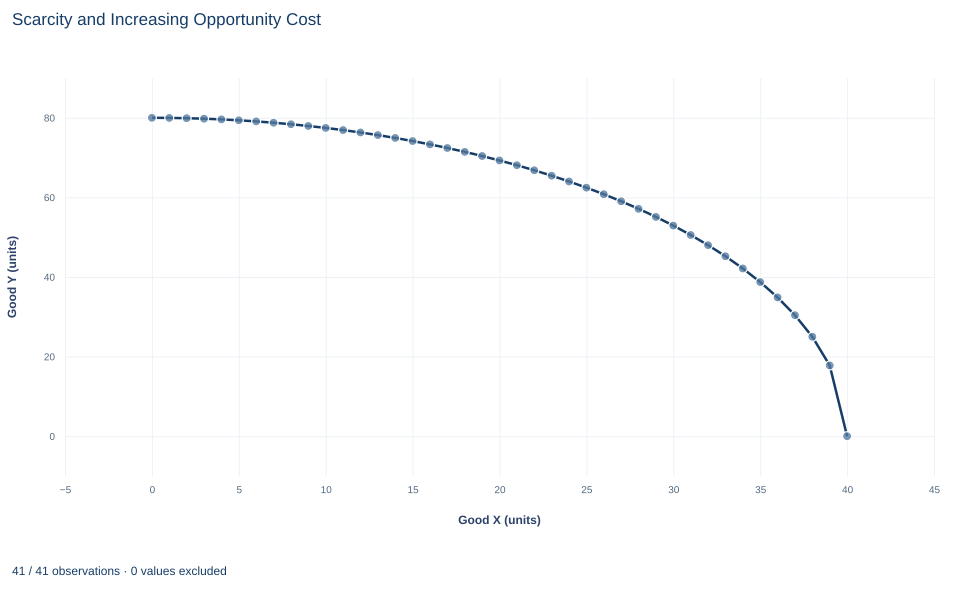

# Lab 01 · Scarcity and Increasing Opportunity Cost

**The production possibilities frontier and the rising cost of producing more of one good**

## Start with the supplied workbook

1. Download [production_frontier.xlsx](production_frontier.xlsx) and the [Python lab](lab.py). The workbook holds the 41 production plans used throughout this chapter.
2. Import `production_frontier.xlsx` into OpenEconometrics and keep that file name as the dataset name. The `Data` sheet holds one row per production plan on the frontier; the `Dictionary` sheet explains the two columns and their units. No cell is blank.
3. Open the complete `lab.py` in a new Python document and run the whole file. It reads the imported dataset, checks that every row lies on the frontier, and displays a table of the five reported quantities, a line chart of the frontier and the same numbers again as the exported table.

For ordinary Python, keep `lab.py` and the workbook in the same folder and run the script there, or call `from lab import run_lab` and then `run_lab(data_path="/path/to/production_frontier.xlsx")`. If you want to try another point or another frontier, work on a copy of the loaded table so the distributed workbook stays unchanged.

An economy has a fixed stock of workers, land and machines, and it can use them to make two goods, X and Y. If it puts everything into Y, it gets 80 units of Y; if it puts everything into X, it gets 40 units of X. Between those extremes lies a menu of efficient plans. This lab asks how much Y the economy must give up for each extra unit of X, and why that sacrifice grows as the economy produces more X.

The frontier's own numbers show the pattern. Moving from no X to 24 units of X lowers the largest feasible output of Y from 80 to 64, a loss of 16 units of Y. Producing the remaining 16 units of X, from 24 to 40, lowers Y from 64 to 0, a loss of 64 units. The second stretch adds fewer units of X but costs four times as much Y.

The workbook contains **41 original synthetic production plans**, one for each whole number of units of X from 0 to 40. They are points computed from a stipulated frontier equation, not measurements of a real economy. The [LaTeX table](table.tex) collects the reported numbers.

## 1. Read one row as a production plan

Each row of `Data` is one production plan on the frontier.

| Column | What it records | Unit |
|---|---|---|
| `x` | Output of good X in the plan, from 0 to 40 in steps of one | units of X |
| `y` | The largest output of good Y the economy can produce alongside that amount of X | units of Y |

The word "largest" matters: `y` is the most Y the fixed resources can deliver once `x` units of X are made, which places the row **on** the frontier rather than below it.

The frontier divides all conceivable plans into three groups. A plan below it is feasible but inefficient: some resources are idle or badly used, so the economy could have more of one good without less of the other. A plan above it cannot be produced with the stated resources and technology. Only plans on the frontier are efficient, and moving between them reallocates resources rather than creating any.

## 2. Write down the frontier

The frontier in this lab is a quarter of an ellipse:

$$
x^2+\left(\frac{y}{2}\right)^2=1600,\qquad x\ge 0,\ y\ge 0.
$$

Here $x$ is the output of X and $y$ the output of Y. Solving for $y$ gives the largest feasible Y as a function of X:

$$
y=2\sqrt{1600-x^2}.
$$

Check the two ends and the lab's chosen plan. At $x=0$, $y=2\sqrt{1600}=2\times40=80$, the Y intercept. At $x=40$, $1600-40^2=0$, so $y=0$, the X intercept. At $x=24$, $1600-24^2=1600-576=1024$, $\sqrt{1024}=32$, and $y=2\times32=64$.

The complete file checks the defining equation on all 41 rows and confirms that `y` falls from each row to the next. A frontier must slope down: with every resource already in use, more X is possible only with less Y.

## 3. Measure opportunity cost as a slope

The **opportunity cost** of X is the amount of Y given up to obtain one more unit of X. On a frontier it is the size of the slope, measured in units of Y per unit of X:

$$
OC_X=-\frac{\Delta y}{\Delta x}.
$$

The minus sign turns a downward slope into a positive cost. Over a finite move, this ratio is the **average** opportunity cost of the units of X produced in that interval. The two stretches from the introduction give

$$
\frac{80-64}{24-0}=\frac{16}{24}\approx0.67
\qquad\text{and}\qquad
\frac{64-0}{40-24}=\frac{64}{16}=4
$$

units of Y per unit of X. With the same resources and the same technology, each unit of X on the second stretch costs six times as much Y as each unit on the first.

A straight line joining the two intercepts would have slope $-80/40=-2$ everywhere. It averages over the whole frontier, so it overstates the cost of the first units of X and understates the cost of the last ones. A straight-line frontier would describe resources that are all equally suited to both goods; this economy's resources are not.

## 4. Find the marginal opportunity cost

**Pause before running.** Will one more unit of X cost the same amount of Y at $x=5$ as at $x=35$? Decide before you read on, and say why.

The **marginal** opportunity cost is the slope for a very small move: the derivative. Differentiate $y=2(1600-x^2)^{1/2}$ with the chain rule:

$$
\frac{dy}{dx}=2\cdot\frac12\,(1600-x^2)^{-1/2}\cdot(-2x)=-\frac{2x}{\sqrt{1600-x^2}},
\qquad
OC_X=\frac{2x}{\sqrt{1600-x^2}}.
$$

At $x=24$ the denominator is $\sqrt{1024}=32$, so $OC_X=48/32=1.5$ units of Y per unit of X. Economists also call this rate the marginal rate of transformation.

The same number follows without solving for $y$. Differentiating both sides of $x^2+(y/2)^2=1600$ gives $2x\,dx+\tfrac{y}{2}\,dy=0$, so $-dy/dx=4x/y$. At the plan $(24, 64)$ that is $96/64=1.5$ again. The two routes agree because they describe the same curve.

The formula shows why the cost rises. At $x=0$ the numerator is zero: the first unit of X costs almost no Y, because the economy can move the resources that are best at making X and worst at making Y. As $x$ approaches 40, the denominator shrinks toward zero and the cost grows without bound: the last units of X require resources that are very good at Y and poor at X. Increasing opportunity cost is the frontier's bowed-out shape expressed as a number. At exactly $x=40$ the formula divides by zero, so the derivative is evaluated only at interior plans.

## 5. Run the calculation

The complete file loads the workbook with `load_data()`, picks the row with 24 units of X and evaluates the derivative formula there. The core of that step, with the second derivative route added as a check, is:

```python
import math
import openecon as oe

raw = load_data()  # reader defined in the complete lab.py
point = raw.loc[raw.x == 24].iloc[0]
cost_from_formula = 2 * point.x / math.sqrt(1600 - point.x**2)
cost_from_identity = 4 * point.x / point.y
largest_gap = (raw.x**2 + (raw.y / 2) ** 2 - 1600).abs().max()
print(point.y, cost_from_formula, cost_from_identity, largest_gap)
```

It prints a Y output of 64, the same cost of 1.5 from both routes, and a largest departure from the frontier equation that is zero up to floating-point rounding. The reported table comes from the lab's `analyze` function:

```python
summary, table, panels, checks, _ = analyze(raw)
display(table)
print(checks)
```

The table reads:

| Quantity | Value | Unit |
|---|---:|---|
| Chosen output of X | 24 | units of X |
| Largest feasible Y at that X | 64 | units of Y |
| Marginal opportunity cost of X | 1.5 | units of Y per unit of X |
| X intercept (all resources in X) | 40 | units of X |
| Y intercept (all resources in Y) | 80 | units of Y |

The first two rows locate the plan. The third says that, starting from that plan, a small increase in X costs Y at a rate of 1.5 units of Y per unit of X; a move of a tenth of a unit of X costs about 0.15 units of Y. The last two rows give the frontier's ends, which the lab reads as the largest `x` and the largest `y` in the workbook. Both checks print `True`: every row satisfies the frontier equation, and `y` falls at every step.

The rate of 1.5 is local. It is not the cost of the next whole unit of X, and it is not the cost of the 24 units of X already produced, which was 16 units of Y in total.

## 6. Read the frontier chart



The chart joins the 41 plans, with output of X on the horizontal axis and the largest feasible output of Y on the vertical axis. The curve starts at 80 units of Y, where it is almost flat, passes through the plan $(24, 64)$, and falls ever more steeply to zero at 40 units of X. It is bowed outward, away from the origin.

The steepness of the curve at any point is the marginal opportunity cost there. Near the left edge, a step to the right barely lowers the curve; at the right edge, the final step from 39 to 40 units of X drops it by almost 18 units of Y. Points under the curve are feasible but inefficient plans; points beyond it are infeasible.

Read the axis scales before judging steepness: the vertical axis runs to 80 and the horizontal axis to 40. Stretching either axis would change how steep the curve looks without changing any opportunity cost.

## A case from the literature

Polasky et al. (2005) faced this lab's question with land in place of an abstract stock of resources. They built a spatially explicit model of a landscape whose physical, biological and economic features were based on conditions in the Willamette Basin in Oregon, with three possible land uses: managed forestry, agriculture and biological reserve. A biological model predicted the probability that each species persists under a given pattern of land use, and an economic model predicted the value of commodity production. The authors then searched for efficient patterns, those in which the conservation outcome cannot be improved without lowering the value of commodity production. That set of plans is a production frontier with conservation on one axis and commodity value on the other.

They found that a large fraction of the conservation objectives could be reached at little cost to economic returns with careful planning. In this lab's terms, the first gains in conservation had a low opportunity cost. They also found much less conflict between the two goals than a reserve-site approach suggests, which shows that the measured trade-off depends on how the technology is modeled. On the theory side, Melvin (1971) derives the frontier directly from the isoquants of the two goods, and Dalal (2006) gives weaker sufficient conditions for the frontier to be concave, the bowed-out shape behind rising opportunity cost. As in this lab, an efficient frontier says what is possible, not which plan to choose, and the lab's ellipse remains a stipulated shape.

## 7. Decide what the frontier supports

The frontier describes what the economy **can** produce with fixed resources and technology. It does not say which plan the economy **should** produce. Choosing between $(24, 64)$ and any other efficient plan requires preferences, prices or social values, and the workbook contains none of them. Calling the plan at $x=24$ "optimal" would be a claim the frontier cannot support.

Keep two kinds of change apart. A **movement along** the frontier reallocates the same resources and trades Y for X at the rates computed above. An **outward shift** needs more resources or better technology and enlarges the set of feasible plans.

The model rests on stated assumptions: technology and resources are fixed, goods are divisible, output cannot be negative, and the economy uses all its resources efficiently. The ellipse is a stipulated teaching shape. A different technology would give the frontier a different curvature, and the opportunity cost at a given X depends on that curvature, so the value 1.5 belongs to this frontier only.

## 8. Write the result in full

A complete statement for the worked example reads: "On the stipulated frontier $x^2+(y/2)^2=1600$, the economy can produce at most 40 units of X or 80 units of Y. At the efficient plan with 24 units of X, the largest feasible output of Y is 64 units, and the marginal opportunity cost of X is 1.5 units of Y per unit of X. The cost of X rises along the frontier: the first 24 units of X cost 16 units of Y in total, while the remaining 16 units cost 64."

The statement names the frontier, the plan, the units of the cost and whether each cost is marginal or average, and it does not claim that the plan is the best one.

## Student exercises

1. Use the workbook rows to compute the opportunity cost of moving from 23 to 24 units of X and from 24 to 25 units of X. Compare both with the marginal cost of 1.5 at $x=24$, and explain why one step costs less and the other more than the derivative.
2. Evaluate the marginal opportunity cost formula at $x=10$, $x=32$ and $x=39$. Describe how the cost changes and connect the pattern to the resources being moved into X.
3. Classify each plan as efficient, feasible but inefficient, or infeasible: $(0, 0)$, $(20, 50)$ and $(30, 60)$. Show the calculation for each.
4. Find the plan on the frontier where the marginal opportunity cost equals 2, the slope of the straight line between the intercepts. Give both coordinates and say on which side of that plan the frontier is flatter than the line.
5. A new technology shifts the whole frontier outward. Explain why this enlarges the set of feasible plans but does not, by itself, show that people are better off. Name the extra information you would need.
6. Rewrite the sentence "Producing X costs 1.5 Y" so that it names the plan, says whether the cost is marginal or average, and gives the units.

## Further reading

- Dalal, A. J. (2006). The production possibility frontier as a maximum value function: Concavity and non-increasing returns to scale. *Review of International Economics*, 14(5), 958–967. https://doi.org/10.1111/j.1467-9396.2006.00610.x
- Melvin, J. R. (1971). On the derivation of the production possibility curve. *Economica*, 38(151), 287–294. https://doi.org/10.2307/2552844
- Polasky, S., Nelson, E., Lonsdorf, E., Fackler, P., and Starfield, A. (2005). Conserving species in a working landscape: Land use with biological and economic objectives. *Ecological Applications*, 15(4), 1387–1401. https://doi.org/10.1890/03-5423
