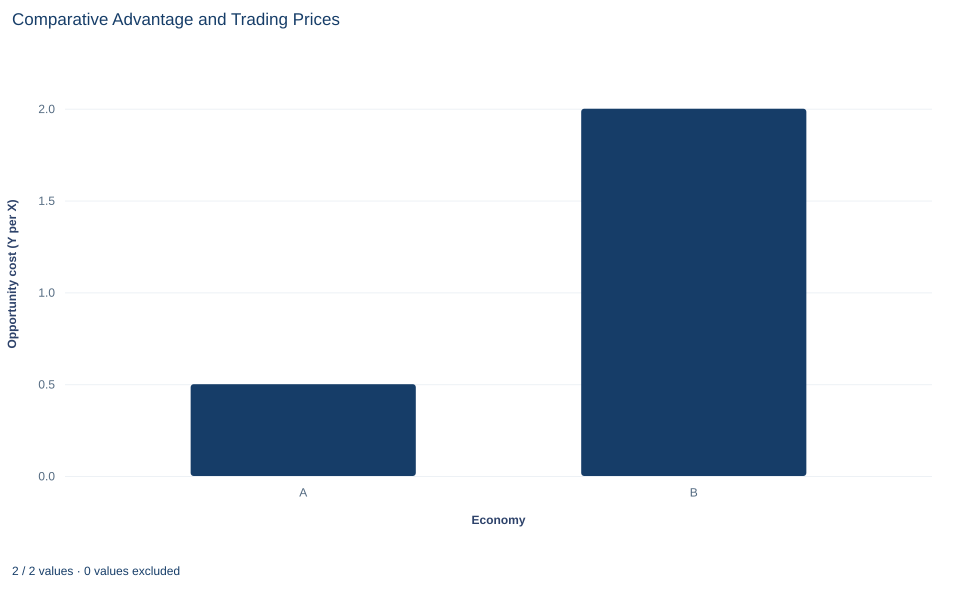

# Lab 02 · Comparative Advantage and Trading Prices

**Opportunity cost, specialization and the prices at which both sides gain from trade**

## Start with the supplied workbook

1. Download [comparative_advantage.xlsx](comparative_advantage.xlsx) and the [Python lab](lab.py). The workbook holds the two model economies used throughout this chapter.
2. Import `comparative_advantage.xlsx` into OpenEconometrics and keep that file name as the dataset name. The `Data` sheet holds one row per economy, A and B, with the labor each needs per unit of each good and the hours it has; the `Dictionary` sheet explains each column and its unit. No cell is blank.
3. Open the complete `lab.py` in a new Python document and run the whole file. It reads the imported dataset, checks that the trading price lies between the two opportunity costs and that specialization uses exactly the available hours, and displays a table of the seven reported quantities, a bar chart of the two opportunity costs and the same numbers again as the exported table.

For ordinary Python, keep `lab.py` and the workbook in the same folder and run the script there, or call `from lab import run_lab` and then `run_lab(data_path="/path/to/comparative_advantage.xlsx")`. If you want to try other labor requirements, work on a copy of the loaded table so the distributed workbook stays unchanged.

Two economies, A and B, each have 120 hours of labor and can make two goods, X and Y. A needs 2 hours for a unit of X and 4 hours for a unit of Y; B needs 6 hours for a unit of X and 3 hours for a unit of Y. Suppose A makes only X, B makes only Y, and they exchange goods at 1 unit of Y per unit of X. Does each economy end up with something it could not have made alone? And why does the answer depend on that price?

The answer turns on opportunity cost rather than on hours: making a unit of X costs A half a unit of Y and costs B two units of Y, and the price of 1 lies between those costs.

The workbook contains **two original synthetic economies**, labeled A and B, with labor measured in hours. They form a stipulated model, not a description of real countries. The [LaTeX table](table.tex) collects the reported numbers.

## 1. Read the two rows

Each row of `Data` describes one model economy.

| Column | What it records | Unit | A | B |
|---|---|---|---:|---:|
| `economy` | Label of the model economy | A or B | A | B |
| `labor_x` | Hours of labor needed to make one unit of X | hours per unit of X | 2 | 6 |
| `labor_y` | Hours of labor needed to make one unit of Y | hours per unit of Y | 4 | 3 |
| `hours` | Labor available to the economy | hours | 120 | 120 |

These are **unit labor requirements**: a lower number means higher productivity. Labor is the only input, and the requirements are constant, so the tenth unit of a good takes as many hours as the first.

Write $a_X^j$ and $a_Y^j$ for economy $j$'s requirements and $H^j$ for its hours. Producing $x$ units of X and $y$ units of Y is possible when the hours needed do not exceed the hours available:

$$
a_X^j\,x+a_Y^j\,y\le H^j:\qquad 2x+4y\le120\ \ (\text{A}),\qquad 6x+3y\le120\ \ (\text{B}).
$$

Setting one good to zero gives the intercepts. A can make at most $120/2=60$ units of X or $120/4=30$ units of Y; B can make at most $120/6=20$ units of X or $120/3=40$ units of Y. Because the requirements are constant, both frontiers are straight lines, unlike the bowed frontier of Lab 01.

## 2. Convert hours into opportunity cost

**Absolute advantage** compares the hours two economies need for the same good. For X, A needs 2 hours and B needs 6, so A has the absolute advantage in X. For Y, B needs 3 hours and A needs 4, so B has the absolute advantage in Y. That comparison does not decide who should make what. The decision depends on what each economy gives up when it makes a good, which compares the two goods within one economy.

**Pause before running.** Using only the hours in the table, which economy gives up less Y to make one more unit of X?

One unit of X absorbs $a_X^j$ hours. Those same hours could instead make $a_X^j/a_Y^j$ units of Y. That is the **opportunity cost** of X in economy $j$:

$$
OC_X^j=\frac{a_X^j}{a_Y^j},\qquad
\frac{\text{hours per unit of X}}{\text{hours per unit of Y}}=\text{units of Y per unit of X}.
$$

The hours cancel, so the cost is measured in the other good. For A, $OC_X^A=2/4=0.5$ units of Y per unit of X. For B, $OC_X^B=6/3=2$ units of Y per unit of X. A gives up less Y to make a unit of X, so A has the **comparative advantage** in X.

The cost does not depend on how many hours an economy has. The opportunity cost of Y is defined in the same way, as the X given up per unit of Y.

## 3. Specialize along comparative advantage

Under specialization, A puts all 120 hours into X and makes $120/2=60$ units; B puts all 120 hours into Y and makes $120/3=40$ units. The lab checks that these plans use exactly the available hours: $2\times60=120$ and $3\times40=120$.

A one-unit move shows why the direction matters. Suppose A makes one more unit of X and B makes one fewer. World output of X is unchanged. A gives up 0.5 units of Y to make its extra X, while B frees 6 hours that make 2 units of Y. World output of Y rises by $2-0.5=1.5$ units. Each unit of X production moved from the high-cost to the low-cost economy adds the difference between their opportunity costs to world output.

## 4. Find the prices at which both gain

Once specialized, A has only X and B only Y. They trade at a price $p$, measured in units of Y per unit of X. For A, exporting one unit of X brings $p$ units of Y. Shifting the same 2 hours into Y at home would give only 0.5 units of Y. Trade is better for A when $p>0.5$, and A's gain per exported unit is $p-0.5$.

For B, importing one unit of X costs $p$ units of Y. Making that X at home would cost 2 units of Y. Trade is better for B when $p<2$, and B's saving per imported unit is $2-p$.

Both sides gain only when the price lies strictly between the two opportunity costs:

$$
OC_X^A<p<OC_X^B\qquad\Longleftrightarrow\qquad 0.5<p<2.
$$

At $p=1$, A gains $1-0.5=0.5$ units of Y per unit of X exported, and B saves $2-1=1$ unit of Y per unit of X imported. Together these add to the 1.5 units of Y created by moving one unit of X production to A; the price only divides that gain. At a price equal to either endpoint, one economy gains nothing.

## 5. Check a proposed shipment

A price inside the range is necessary but not sufficient: the trade volume must also be feasible. Suppose A ships $T$ units of X and receives $pT$ units of Y. A consumes $(60-T,\ pT)$ and B consumes $(T,\ 40-pT)$. The shipment is possible only if $T\le60$ and $pT\le40$.

Then compare each bundle with what the economy could make alone. On its own frontier, A could pair $60-T$ units of X with $[120-2(60-T)]/4=T/2$ units of Y, so trade leaves A with $(p-0.5)\,T$ more Y. For B, every unit of X made at home costs 2 units of Y, so producing $T$ units would leave $40-2T$ units of Y; trade leaves $40-pT$, which is $(2-p)\,T$ more. Beyond $T=20$, B could not make that much X at all.

## 6. Run the calculation

The complete file reads both rows, divides the labor requirements and evaluates the stipulated price. The core steps are:

```python
import openecon as oe

raw = load_data()  # reader defined in the complete lab.py
cost_of_x = raw.labor_x / raw.labor_y
display(oe.DataFrame({"economy": raw.economy, "Y_given_up_per_X": cost_of_x}))

summary, table, panels, checks, _ = analyze(raw)
display(table)
print(checks)
```

The first display lists 0.5 for A and 2 for B. The reported table reads:

| Quantity | Value | Unit |
|---|---:|---|
| A's opportunity cost of X | 0.5 | units of Y per unit of X |
| B's opportunity cost of X | 2 | units of Y per unit of X |
| Trading price | 1 | units of Y per unit of X |
| A's output when specialized in X | 60 | units of X |
| B's output when specialized in Y | 40 | units of Y |
| A's gain per unit of X exported | 0.5 | units of Y per unit of X |
| B's saving per unit of X imported | 1 | units of Y per unit of X |

The first two rows set the pattern of specialization. The trading price is set in `lab.py`, not derived from the workbook; the model says only that it must lie between 0.5 and 2. The last two rows are the differences between the price and each economy's own cost. Both checks come out true: the price lies inside the range, and each specialized plan uses exactly 120 hours.

## 7. Read the bar chart



The chart has one bar per economy for the opportunity cost of X, in units of Y per unit of X. A's bar reaches 0.5 and B's reaches 2, four times as high; the shorter bar marks the comparative advantage in X.

The trading price is not drawn. Picture a horizontal line at 1: any line that passes between the two bar tops is a price at which both economies gain, and its distance from each top is that economy's gain per unit traded. The chart shows costs only, not quantities, trade volume or total gains.

## A case from the literature

Comparative advantage is hard to test because its prediction concerns prices in autarky, which are rarely observed once a country trades. Bernhofen and Brown (2004) used Japan's sudden and complete opening to international trade in the 1860s. They argued from historical evidence that the Japanese economy of the time fitted the key assumptions of the neoclassical trade model, and they combined detailed product-level autarky prices with trade flows. Deardorff (1980) had shown that in a world of many goods the law of comparative advantage holds as an average across goods, a correlation between trade and autarky prices, even though it can fail good by good. The prediction Bernhofen and Brown tested is that Japan's trade, valued at its autarky prices, has a negative value. They found a negative value in every year from 1868 to 1875, as the theory predicts.

A follow-up study asked how much real income would have had to rise in Japan's last autarky years, 1851–1853, to buy the bundle that trade would have allowed, and put upper bounds on the gains of about 8 to 9 percent of GDP (Bernhofen and Brown, 2005). Costinot and Donaldson (2012) took another route, using data on the productivity of 17 crops on 1.6 million parcels of land in 55 countries. These studies work with many goods, observed prices and real output. The lab keeps two goods, one input and stipulated hours, which is why its answer can be stated as a single range of trading prices.

## 8. Decide what the model supports

Opportunity costs determine the **range** of mutually beneficial prices, not the price itself. Where the price settles inside that range depends on demand in both economies, which the workbook does not describe. The price of 1 is a stipulated example; another price inside the range would divide the same gains differently.

The conclusion also rests on the model's assumptions: labor is the only input, unit requirements are constant, labor cannot move between economies, trade is costless and each economy has 120 hours. Transport costs would narrow the range of beneficial prices. Several inputs, rising costs and adjustment costs for workers who change industries could change the size or pattern of the gains, and some groups within an economy can lose even when the economy as a whole gains. A and B are model economies, not actual countries.

## 9. Write the result in full

A complete statement for the worked example reads: "In a two-economy labor model with 120 hours each, A needs 2 hours per unit of X and 4 per unit of Y, while B needs 6 and 3. A's opportunity cost of X is 0.5 units of Y and B's is 2, so A has the comparative advantage in X and B in Y. Specialized, A makes 60 units of X and B makes 40 units of Y. At a stipulated price of 1 unit of Y per unit of X, which lies between the two opportunity costs, A gains 0.5 units of Y for each unit of X it exports and B saves 1 unit of Y for each unit it imports, compared with producing for itself."

The statement gives the technologies, costs, outputs and price before any gain, and it labels the price as stipulated.

## Student exercises

1. Compute each economy's opportunity cost of Y, in units of X per unit of Y. Which economy has the comparative advantage in Y? How is each number related to that economy's opportunity cost of X, and what does that relation imply about having a comparative advantage in both goods?
2. Without trade, suppose each economy splits its 120 hours equally between X and Y. Compute each economy's output and world output of each good, and compare them with world output under specialization.
3. Evaluate the exchange of 20 units of X for 20 units of Y. Give each economy's consumption bundle, compare it with what the economy could produce alone, and state each economy's gain in units of Y.
4. For each price of 0.4, 1.5 and 2.5 units of Y per unit of X, say whether both economies would agree to trade. If one would refuse, say which one and what it would do instead. At 1.5, how is the gain per unit of X traded divided?
5. On a copy of the data, change B's labor per unit of Y from 3 to 5 hours and run `analyze` on the copy. Who now has the absolute advantage in each good? Recompute the opportunity costs. Does the pattern of comparative advantage change, and does a price of 1 still benefit both economies?
6. Rewrite the sentence "A is better at producing X, so A should export X" so that it distinguishes absolute from comparative advantage and states the opportunity costs with their units.

## Further reading

- Bernhofen, D. M., and Brown, J. C. (2004). A direct test of the theory of comparative advantage: The case of Japan. *Journal of Political Economy*, 112(1), 48–67. https://doi.org/10.1086/379944
- Bernhofen, D. M., and Brown, J. C. (2005). An empirical assessment of the comparative advantage gains from trade: Evidence from Japan. *American Economic Review*, 95(1), 208–225. https://doi.org/10.1257/0002828053828491
- Costinot, A., and Donaldson, D. (2012). Ricardo's theory of comparative advantage: Old idea, new evidence. *American Economic Review*, 102(3), 453–458. https://doi.org/10.1257/aer.102.3.453
- Deardorff, A. V. (1980). The general validity of the law of comparative advantage. *Journal of Political Economy*, 88(5), 941–957. https://doi.org/10.1086/260915
