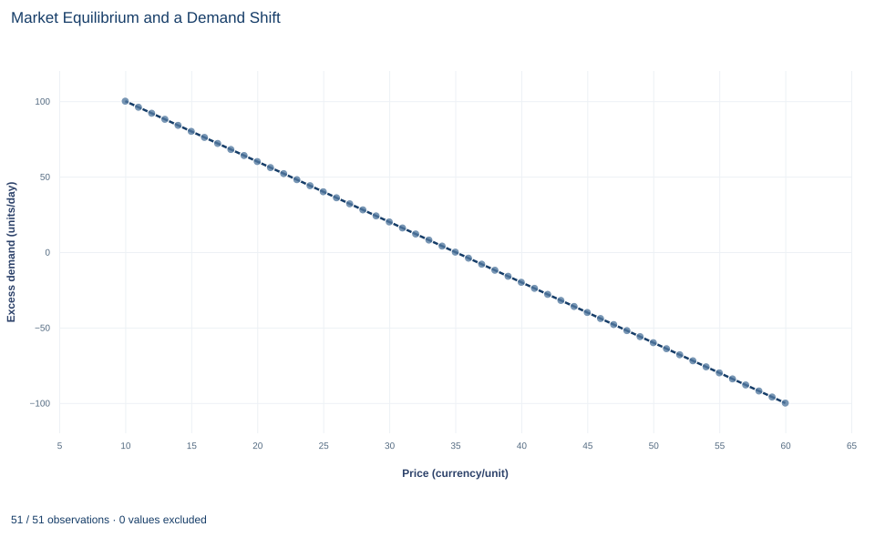

# Lab 03 · Market Equilibrium and a Demand Shift

**Market clearing, excess demand and the difference between shifting a curve and moving along it**

## Start with the supplied workbook

1. Download [market_equilibrium.xlsx](market_equilibrium.xlsx) and the [Python lab](lab.py). The workbook holds the 51 price scenarios used throughout this chapter.
2. Import `market_equilibrium.xlsx` into OpenEconometrics and keep that file name as the dataset name. The `Data` sheet holds one row per price, with the quantity buyers want and the quantity sellers offer at that price; the `Dictionary` sheet explains each column and its unit. No cell is blank.
3. Open the complete `lab.py` in a new Python document and run the whole file. It reads the imported dataset, recovers the two schedules, solves the market before and after a demand shift, and displays a table of the five reported quantities, a line chart of excess demand against price and the same numbers again as the exported table.

For ordinary Python, keep `lab.py` and the workbook in the same folder and run the script there, or call `from lab import run_lab` and then `run_lab(data_path="/path/to/market_equilibrium.xlsx")`. If you want to try other schedules, work on a copy of the loaded table so the distributed workbook stays unchanged.

At a price of 30 currency units, buyers in this market want 60 units a day, but sellers offer only 40. At a price of 40, the gap reverses: sellers offer 60 units and buyers want 40. Somewhere between lies a price at which the two plans match. This lab finds that price and then asks what happens when buyers want 20 more units at every price. A tempting answer is that the quantity sold rises by 20. It does not, and the reason is the difference between shifting a curve and moving along one.

The workbook contains **51 original synthetic price scenarios**, one for each whole-number price from 10 to 60 currency units, with quantities in units per day. They are points on two stipulated schedules, not records of actual trades. The [LaTeX table](table.tex) collects the reported numbers.

## 1. Read one row as a price scenario

Each row of `Data` answers a "what if" question: if the price were this, how much would buyers want and how much would sellers offer?

| Column | What it records | Unit |
|---|---|---|
| `price` | A price that might prevail in the market, from 10 to 60 in steps of one | currency per unit |
| `demand` | Quantity buyers would want to purchase at that price | units per day |
| `supply` | Quantity sellers would want to offer at that price | units per day |

At most prices the two plans cannot both be carried out: either buyers want more than is offered or sellers offer more than is wanted. Only one row describes plans that agree, and only that row describes what a clearing market actually trades. The price range keeps both quantities nonnegative: at a price of 10 sellers offer nothing, and at 60 buyers want nothing.

## 2. Recover the two schedules

Consecutive rows change by constant amounts. Each one-unit rise in price lowers the quantity demanded by 2 units per day and raises the quantity supplied by 2 units per day, so both schedules are straight lines:

$$
Q_D=a-2P,\qquad Q_S=c+2P.
$$

Here $P$ is the price in currency per unit, $Q_D$ and $Q_S$ are quantities in units per day, and each slope of 2 is measured in units per day per currency unit. The first row, with $P=10$, $Q_D=100$ and $Q_S=0$, gives the intercepts: $a=100+2\times10=120$ and $c=0-2\times10=-20$. So

$$
Q_D=120-2P,\qquad Q_S=-20+2P.
$$

Demand slopes down because buyers want less of the good when it costs more. Supply slopes up because a higher price makes it worthwhile to produce and sell more. The demand intercept, 120, is the quantity buyers would want at a zero price. The supply intercept, −20, is not a real quantity; it places the point where supply reaches zero at a price of 10.

**Pause before running.** Use the two equations to solve for the price at which the market clears and the quantity traded there.

## 3. Solve for the market-clearing price

A market **equilibrium** is a price at which the quantity demanded equals the quantity supplied:

$$
120-2P=-20+2P\quad\Longrightarrow\quad 140=4P\quad\Longrightarrow\quad P^*=35.
$$

Substituting back, $Q^*=120-2\times35=50$ units per day, and the supply side gives the same $-20+2\times35=50$. The workbook row with a price of 35 shows demand and supply both equal to 50.

Why does the market come to rest there? Define **excess demand** as the gap between the two plans:

$$
Z(P)=Q_D-Q_S=(120-2P)-(-20+2P)=140-4P.
$$

At a price of 30, $Z=140-120=20$: buyers want 20 more units a day than sellers offer. That shortage leaves some buyers unserved, and they are willing to pay more, so the price tends to rise. Above 35, excess demand is negative, there is a surplus, and sellers who cannot sell their output tend to cut the price. Each one-unit change in price changes excess demand by 4 units per day, 2 from buyers and 2 from sellers. Only at 35 is there no pressure in either direction.

## 4. Shift demand and solve again

Keep two kinds of change apart. A **movement along** the demand curve happens when the good's own price changes and nothing else does; lowering the price from 35 to 30 raises the quantity demanded from 50 to 60 along the same curve. A **shift** of the demand curve happens when something other than the own price changes, such as income, tastes or the price of a related good, so that buyers want a different quantity at every price.

The lab raises the demand intercept by 20, so buyers want 20 more units per day at every price, while the supply schedule stays fixed:

$$
Q_D^{new}=140-2P,\qquad 140-2P=-20+2P\quad\Longrightarrow\quad 160=4P\quad\Longrightarrow\quad P^{new}=40.
$$

The new quantity is $140-2\times40=60$ units per day, and supply gives the same $-20+2\times40=60$. The shift raises the equilibrium price by 5 and the equilibrium quantity by 10.

## 5. See why quantity rises by 10, not 20

Start at the old price of 35. After the shift, buyers want $140-70=70$ units, while sellers still offer 50. Excess demand at the old price is now 20 units per day, the full size of the shift.

The price rises to close that gap. Each currency unit of price closes 4 units of excess demand, so the gap of 20 closes after a rise of $20/4=5$, at the new price of 40. That rise does two things at once. It moves buyers back along the **new** demand curve by $2\times5=10$ units, from 70 to 60. It moves sellers up along the **unchanged** supply curve by $2\times5=10$ units, from 50 to 60. Of the 20-unit shift, 10 units are choked off by the higher price and 10 units appear as extra quantity traded.

The even split comes from the equal slopes. With a steeper or flatter supply curve, the same shift would divide differently between price and quantity. Adding 20 directly to the old equilibrium quantity ignores the price change and confuses a shift of demand with the quantity actually bought.

## 6. Run the calculation

The complete file recovers the intercepts from the first row and solves the clearing condition. The core steps are:

```python
import openecon as oe

raw = load_data()  # reader defined in the complete lab.py
demand_intercept = raw.demand.iloc[0] + 2 * raw.price.iloc[0]
supply_intercept = raw.supply.iloc[0] - 2 * raw.price.iloc[0]
price = (demand_intercept - supply_intercept) / 4
quantity = demand_intercept - 2 * price
display(oe.DataFrame({"price": [price], "quantity": [quantity]}))
display(raw.loc[raw.price == price])
```

It recovers intercepts of 120 and −20, solves for a price of 35 and a quantity of 50, and shows the workbook row at that price, where demand and supply are both 50. The reported table comes from the lab's `analyze` function:

```python
summary, table, panels, checks, _ = analyze(raw)
display(table)
print(checks)
```

The table reads:

| Quantity | Value | Unit |
|---|---:|---|
| Equilibrium price | 35 | currency per unit |
| Equilibrium quantity | 50 | units per day |
| Price after the demand shift | 40 | currency per unit |
| Quantity after the demand shift | 60 | units per day |
| Excess demand at a price of 30 | 20 | units per day |

The first two rows describe the original market. The next two describe the market after buyers want 20 more units at every price, with supply held fixed; the size of the shift is set in `lab.py`, and the shifted schedule is not part of the workbook. The last row measures the shortage that a price of 30 would create in the original market. Both checks come out true: the market clears at 35, and the shift raises both price and quantity.

## 7. Read the excess-demand chart



The chart plots excess demand, $Q_D-Q_S$, for each of the 51 prices. It is a straight line that falls from +100 units per day at a price of 10, where buyers want 100 units and sellers offer none, to −100 at a price of 60, where the reverse holds. It crosses zero at 35, the clearing price. Its slope is −4 units per day per currency unit.

Points above zero are shortages and points below zero are surpluses. The chart shows only the original market. After the demand shift, every point would lie 20 units higher, and the zero crossing would move to the right, to 40. The chart shows the gap between the two plans, not the plans themselves, so the quantity traded cannot be read from it.

## A case from the literature

Angrist, Graddy and Imbens (2000) faced the problem this lab sets aside. When price is set where supply meets demand, each observed pair of price and quantity is an equilibrium. Working (1927) had already argued that a curve fitted to such pairs need not be a demand curve: whether it looks more like demand or supply depends on which of the two varies more. The standard remedy is an instrument, a variable that shifts one curve but not the other.

Angrist, Graddy and Imbens estimated the demand for fresh whiting at the Fulton fish market in New York, using weather conditions at sea as the instrument, a shifter of supply rather than demand. They also showed that when demand is neither linear nor additive in its error, the usual linear instrumental variables estimator recovers a weighted average of the slope of demand, not one fixed slope. This lab runs the same logic the other way. Its shift moves demand while supply stays fixed, so the two equilibria lie on the supply schedule, and the move from one to the other traces a stretch of supply. Because both schedules are stipulated, the lab needs no instrument; real data rarely allow that. The questions of adjustment that a static crossing leaves open have their own literature, from the link between comparative statics and the stability of equilibrium in Samuelson (1941) to the experimental study of competitive market behavior in Smith (1962).

## 8. Decide what the model supports

The model says where this market comes to rest, not how quickly it gets there or what happens on the way. A static crossing describes neither the speed of adjustment nor how goods are rationed during a shortage, through queues, waiting lists or favored customers. The schedules are stipulated, so they carry no estimation error and no uncertainty.

The conclusions rest on the model's assumptions: one homogeneous and divisible good, buyers and sellers who take the price as given, a single market observed at one time, and a supply schedule that stays fixed while demand shifts. In real data the problem is harder. Observed pairs of price and quantity are equilibrium outcomes, and those pairs alone would not reveal the separate slopes of demand and supply.

## 9. Write the result in full

A complete statement for the worked example reads: "In a stipulated market with demand $Q_D=120-2P$ and supply $Q_S=-20+2P$, the market clears at a price of 35 currency units, with 50 units traded per day; at a price of 30 there would be a shortage of 20 units per day. When buyers want 20 more units per day at every price and supply is unchanged, the equilibrium price rises to 40 and the quantity traded to 60 units per day. Quantity rises by 10 rather than 20 because the higher price moves buyers back along the new demand curve."

The statement gives both schedules, names the shift and what is held fixed, and reports prices and quantities with their units.

## Student exercises

1. Use the workbook row for a price of 45 to compute excess demand, and check it with $Z(P)=140-4P$. Is there a shortage or a surplus, and in which direction would the price tend to move?
2. Return to the original demand curve and suppose instead that sellers offer 20 more units at every price, so supply becomes $Q_S=2P$. Solve for the new equilibrium price and quantity, and compare the direction of the price change with the demand shift.
3. Suppose supply were fixed at 50 units per day whatever the price. Apply the same demand shift, from $120-2P$ to $140-2P$. How do the equilibrium price and quantity change, and how is the 20-unit shift now divided?
4. A colleague who sees only the two equilibria, $(P, Q)=(35, 50)$ and $(40, 60)$, draws a straight line through them and calls it the demand curve. Compute that line's slope and explain what it actually traces out.
5. Suppose buyers want 20 more units at every price and, at the same time, sellers offer 20 more units at every price. Solve for the new equilibrium price and quantity, and explain why the quantity now changes by the full 20 units.
6. Rewrite the sentence "Demand rose by 20 units, so sales rose by 20 units" so that it distinguishes a shift of demand from a change in the quantity demanded and gives the units.

## Further reading

- Angrist, J. D., Graddy, K., and Imbens, G. W. (2000). The interpretation of instrumental variables estimators in simultaneous equations models with an application to the demand for fish. *Review of Economic Studies*, 67(3), 499–527. https://doi.org/10.1111/1467-937x.00141
- Samuelson, P. A. (1941). The stability of equilibrium: Comparative statics and dynamics. *Econometrica*, 9(2), 97. https://doi.org/10.2307/1906872
- Smith, V. L. (1962). An experimental study of competitive market behavior. *Journal of Political Economy*, 70(2), 111–137. https://doi.org/10.1086/258609
- Working, E. J. (1927). What do statistical "demand curves" show? *The Quarterly Journal of Economics*, 41(2), 212. https://doi.org/10.2307/1883501
