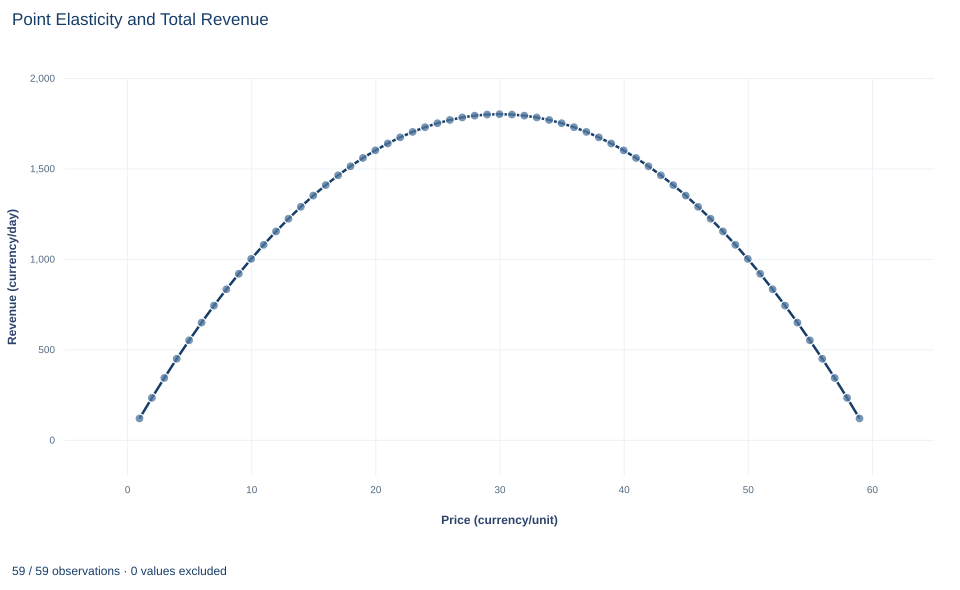

# Lab 04 · Point Elasticity and Total Revenue

**Price elasticity along a straight-line demand curve and what it says about revenue**

## Start with the supplied workbook

1. Download [elasticity_revenue.xlsx](elasticity_revenue.xlsx) and the [Python lab](lab.py). The workbook holds the 59 points on the demand schedule used throughout this chapter.
2. Import `elasticity_revenue.xlsx` into OpenEconometrics and keep that file name as the dataset name. The `Data` sheet holds one row per price, with the quantity demanded at that price; the `Dictionary` sheet explains the two columns and their units. No cell is blank.
3. Open the complete `lab.py` in a new Python document and run the whole file. It reads the imported dataset, computes revenue at every price, evaluates the elasticity at a price of 20, finds the revenue-maximizing price, and displays a table of the six reported quantities, a line chart of revenue against price and the same numbers again as the exported table.

For ordinary Python, keep `lab.py` and the workbook in the same folder and run the script there, or call `from lab import run_lab` and then `run_lab(data_path="/path/to/elasticity_revenue.xlsx")`. If you want to try another schedule, work on a copy of the loaded table so the distributed workbook stays unchanged.

A seller charges 20 currency units per unit and sells 80 units a day, for revenue of 1,600 currency units a day. Should it raise the price? A higher price brings in more on each unit still sold but drives some buyers away. Which effect wins does not depend on the slope of demand, which is the same everywhere on this schedule. It depends on the **price elasticity of demand**, which changes from point to point.

The schedule shows how much that matters. Revenue peaks at a price of 30, at 1,800 currency units a day. A price of 40 brings in the same 1,600 currency units as a price of 20, while selling only half as many units.

The workbook contains **59 original synthetic points on a demand schedule**, one for each whole-number price from 1 to 59 currency units, with quantities in units per day. They are computed from a stipulated demand equation, not recorded sales. The [LaTeX table](table.tex) collects the reported numbers.

## 1. Read the demand schedule

Each row of `Data` is one point on the demand schedule.

| Column | What it records | Unit |
|---|---|---|
| `price` | The good's own price, from 1 to 59 in steps of one | currency per unit |
| `quantity` | The quantity buyers demand per day at that price | units per day |

The `Dictionary` describes `quantity` only by its formula, "Demand 120−2P". The column is the quantity demanded at each price on the schedule

$$
Q=120-2P,
$$

where $P$ is the price in currency per unit and $Q$ the quantity in units per day. Each one-unit rise in price lowers the quantity demanded by 2 units per day, wherever it starts. Demand would be 120 units at a zero price and would reach zero at a price of 60, the choke price. The grid stops at 1 and 59, so every row has a positive price and a positive quantity. Everything else that affects demand, such as income and the prices of other goods, is held fixed.

## 2. From slope to elasticity

The slope $dQ/dP=-2$ is measured in units per day per currency unit, so its size depends on the units chosen for price and quantity. It also ignores where the change starts. Losing 2 units a day is a small change when buyers take 118 units and a large one when they take 4.

The **price elasticity of demand** compares proportional changes instead:

$$
\varepsilon=\frac{dQ/Q}{dP/P}=\frac{dQ}{dP}\cdot\frac{P}{Q}.
$$

It is the percentage change in quantity demanded per one percent change in price, for a very small change. The units of price and of quantity cancel, so $\varepsilon$ is a pure number.

**Pause before running.** This demand curve has the same slope everywhere. Does it have the same elasticity everywhere?

On this schedule, substituting $dQ/dP=-2$ and $Q=120-2P$ gives

$$
\varepsilon(P)=-\frac{2P}{120-2P}=-\frac{P}{60-P}.
$$

At $P=20$, $Q=80$ and $\varepsilon=-40/80=-0.5$. Near that price, a 1% price increase lowers the quantity demanded by about 0.5%. Demand there is **inelastic**, because $|\varepsilon|<1$. At $P=30$, $Q=60$ and $\varepsilon=-60/60=-1$, called **unit elastic**. The constant slope multiplies a ratio $P/Q$ that rises along the line: near a zero price the elasticity approaches 0, and as the price approaches 60 the quantity approaches zero and $|\varepsilon|$ grows without bound. Prices below 30 lie on the inelastic part of the line and prices above 30 on the elastic part, where $|\varepsilon|>1$.

## 3. Connect elasticity to revenue

Revenue is price times quantity:

$$
R(P)=P\,Q(P)=P(120-2P)=120P-2P^2 \quad\text{currency units per day}.
$$

Differentiate with the product rule:

$$
\frac{dR}{dP}=Q+P\,\frac{dQ}{dP}=Q\left(1+\frac{P}{Q}\frac{dQ}{dP}\right)=Q\,(1+\varepsilon).
$$

The two terms in the middle expression have plain meanings. $Q$ is the gain from charging one more currency unit on every unit still sold. $P\,dQ/dP$ is the loss from the units no longer sold, each of which would have paid $P$. Factoring out $Q$ shows that the sign of the revenue change depends only on the elasticity. When demand is inelastic, $1+\varepsilon>0$ and a small price rise increases revenue. When demand is elastic, $1+\varepsilon<0$ and it decreases revenue. At unit elasticity, revenue does not change.

At $P=20$ the gain on units still sold is 80 and the loss from lost units is $20\times2=40$, so revenue rises at 40 currency units per day per currency unit of price. The factored form agrees, $80\times(1-0.5)=40$, and so does the direct derivative, $120-4\times20=40$.

## 4. Find the revenue-maximizing price

Revenue is highest where its derivative is zero:

$$
\frac{dR}{dP}=120-4P=0\quad\Longrightarrow\quad P=30,\qquad Q=60,\qquad R=30\times60=1800.
$$

The second derivative is $-4$, so this is a maximum. It is also the unit-elastic point found in Section 2, as the factored form requires: $dR/dP=Q(1+\varepsilon)=0$ with $Q>0$ only when $\varepsilon=-1$.

The complete file finds the price by picking the workbook row with the highest revenue and then checks that $120-4P=0$ holds there. Because the grid includes 30 exactly, the row search and the calculus give the same answer.

## 5. Keep a local rate local

A derivative is a rate for small moves. At $P=20$, $dR/dP=40$ suggests that each extra currency unit of price adds 40 currency units of revenue a day. Applied mechanically to a rise from 20 to 40, that would predict revenue higher by $20\times40=800$. In fact revenue at 40 is 1,600, exactly what it was at 20. Revenue climbs to the peak at 30 and falls back, because $dR/dP$ itself falls by 4 for every currency unit of price.

The elasticity of −0.5 is local in the same way: it describes responses near a price of 20, not across the whole schedule. For a large price change, compute revenue at both prices directly.

## 6. Run the calculation

The complete file adds revenue to every row, evaluates the elasticity at 20 and locates the revenue peak. The first step, extended to show the elasticity in every row, is:

```python
import openecon as oe

raw = load_data()  # reader defined in the complete lab.py
schedule = raw.assign(
    revenue=raw.price * raw.quantity,
    elasticity=-2 * raw.price / raw.quantity,
)
display(schedule.loc[schedule.price.isin([20, 30])])
```

It shows the rows at prices of 20 and 30: quantities of 80 and 60, revenue of 1,600 and 1,800, and elasticities of −0.5 and −1. The reported table comes from the lab's `analyze` function:

```python
summary, table, panels, checks, _ = analyze(raw)
display(table)
print(checks)
```

The table reads:

| Quantity | Value | Unit |
|---|---:|---|
| Evaluation price | 20 | currency per unit |
| Quantity demanded at that price | 80 | units per day |
| Point elasticity of demand | −0.5 | none (a ratio of percentages) |
| Revenue at that price | 1,600 | currency per day |
| Revenue-maximizing price | 30 | currency per unit |
| Maximum revenue | 1,800 | currency per day |

The first four rows describe one point on the schedule; the elasticity there uses the quantity at that point, 80, not an average over the schedule. The last two rows locate the revenue peak. Both checks come out true: the first-order condition holds at the chosen price, and the elasticity equals −0.5.

## 7. Read the revenue chart



The chart plots revenue against price for the 59 points. It is a symmetric hill. Revenue rises from 118 currency units a day at a price of 1 to the peak of 1,800 at 30, then falls back to 118 at 59. Prices equally far from 30 give the same revenue, which is why 20 and 40 both give 1,600.

The slope of the hill at any price is $dR/dP=Q(1+\varepsilon)$. On the left half demand is inelastic and the hill rises; on the right half it is elastic and the hill falls; at the flat top demand is unit elastic. The chart shows revenue only. The demand line itself is not drawn, and nothing in the chart reflects production costs.

## A case from the literature

Hughes, Knittel and Sperling (2008) estimated the quantity this lab computes, the price elasticity of demand, for gasoline in the United States. They compared two periods of similarly high prices, 1975 to 1980 and 2001 to 2006. Short-run price elasticities ranged from −0.21 to −0.34 in the first period but only from −0.034 to −0.077 in the second. Short-run income elasticities ranged from 0.21 to 0.75 and, estimated with the same models, did not differ significantly between the periods.

Read with this lab's rule, every one of those price elasticities lies between −1 and 0, so short-run demand was inelastic: near the observed prices, a small price rise would raise total spending on gasoline. The study also shows two limits of the lab's schedule. The elasticity is estimated from data and varies across models, rather than being read off a stipulated line. And it changed over time, so a value measured in one period need not hold in another.

DellaVigna and Gentzkow (2019) take a seller's view. Their demand estimates for U.S. food, drugstore and mass-merchandise chains show substantial variation in price elasticities across a chain's stores, yet most chains charge nearly uniform prices, which by their benchmark costs the median chain about 16 million dollars of annual profit. Their benchmark is optimal pricing for profit, not revenue, which is the distinction drawn in section 8. For changes too large for a point elasticity, Allen (1934) discusses the concept of arc elasticity.

## 8. Decide what the schedule supports

The elasticity at a price of 20 describes small changes near 20. It does not predict the effect of a large price change, which must be computed from the schedule itself.

Revenue is not profit. Revenue maximization ignores what it costs to produce the units sold, so the price of 30 is the profit-maximizing price only if the marginal cost of output is zero. The calculation is not a general recommendation about what a seller should charge.

The schedule is stipulated: a straight line with no estimation error, holding income, other prices and tastes fixed. Real demand must be estimated, need not be linear, and can shift while a seller experiments with prices. On a demand curve of another shape, the elasticity would change along the curve in a different way.

## 9. Write the result in full

A complete statement for the worked example reads: "On the stipulated demand schedule $Q=120-2P$, buyers demand 80 units per day at a price of 20 currency units, revenue is 1,600 currency units per day, and the point elasticity of demand is −0.5. Because demand is inelastic there, a small price increase raises revenue, at a rate of 40 currency units per day for each currency unit of price. Revenue is highest, at 1,800 currency units per day, at a price of 30, where demand is unit elastic. This is the revenue-maximizing price, not the profit-maximizing one, because costs are not part of the calculation."

The statement names the schedule, the point, the units and the local nature of the elasticity, and it separates revenue from profit.

## Student exercises

1. Compute the point elasticity at prices of 10, 40 and 50. Classify demand at each price as elastic or inelastic, and use $dR/dP=Q(1+\varepsilon)$ to say whether a small price increase raises or lowers revenue there.
2. Use the workbook to compute the exact change in revenue when the price rises from 20 to 21 and from 40 to 41. Compare each change with $dR/dP$ at the starting price and explain why they differ.
3. Find the price at which the point elasticity equals −3. Give the quantity, the revenue and $dR/dP$ at that price, and locate the point on the revenue chart.
4. Compute the midpoint (arc) elasticity between prices of 20 and 40, using the average of the two prices and the average of the two quantities as the bases. Compare it with the point elasticities at the two ends, and relate your answer to what happens to revenue between those prices.
5. Suppose each unit costs the seller 10 currency units to produce. Find the profit-maximizing price, the quantity sold and the daily profit, and compare them with the revenue-maximizing price.
6. Rewrite the sentence "Demand has an elasticity of −0.5, so the seller should raise the price as far as possible" so that it says where the elasticity applies, what happens to revenue at higher prices and what the calculation leaves out.

## Further reading

- Allen, R. G. D. (1934). The concept of arc elasticity of demand: I. *The Review of Economic Studies*, 1(3), 226–229. https://doi.org/10.2307/2967486
- DellaVigna, S., and Gentzkow, M. (2019). Uniform pricing in U.S. retail chains. *The Quarterly Journal of Economics*, 134(4), 2011–2084. https://doi.org/10.1093/qje/qjz019
- Hughes, J. E., Knittel, C. R., and Sperling, D. (2008). Evidence of a shift in the short-run price elasticity of gasoline demand. *The Energy Journal*, 29(1), 113–134. https://doi.org/10.5547/issn0195-6574-ej-vol29-no1-9
