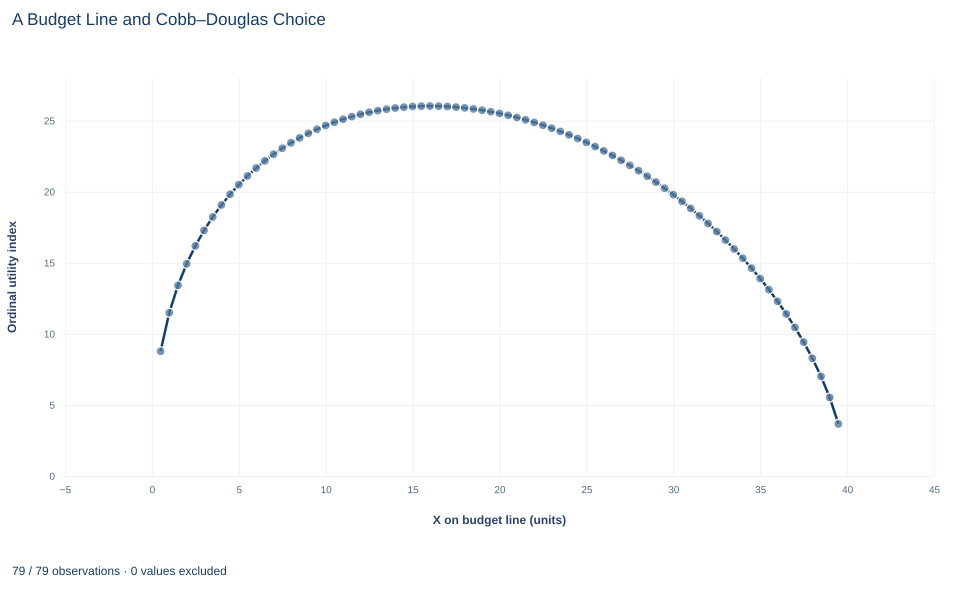

# Lab 05 · A Budget Line and Cobb–Douglas Choice

**Budget constraints, ordinal utility and the tangency condition for the best affordable bundle**

## Start with the supplied workbook

1. Download [consumer_choice.xlsx](consumer_choice.xlsx) and the [Python lab](lab.py). The workbook holds the 79 bundles on one budget line used throughout this chapter.
2. Import `consumer_choice.xlsx` into OpenEconometrics and keep that file name as the dataset name. The `Data` sheet holds one row per candidate bundle on the budget line, together with the income, prices and preference weight that define the problem; the `Dictionary` sheet explains each column and its unit. No cell is blank.
3. Open the complete `lab.py` in a new Python document and run the whole file. It reads the imported dataset, solves the consumer's problem from the income, prices and weight in the first row, checks that the chosen bundle spends the whole budget and meets the tangency condition, and displays a table of the seven reported quantities, a line chart of the utility index along the budget line and the same numbers again as the exported table.

For ordinary Python, keep `lab.py` and the workbook in the same folder and run the script there, or call `from lab import run_lab` and then `run_lab(data_path="/path/to/consumer_choice.xlsx")`. If you want to try other prices or another weight, work on a copy of the loaded table so the distributed workbook stays unchanged.

A consumer has 120 currency units to spend on two goods. Good X costs 3 currency units per unit and good Y costs 2. She could buy 40 units of X and no Y, 60 units of Y and no X, or any mix on the straight line between. Which mix does she choose?

With preferences described by a Cobb–Douglas utility index that puts a weight of 0.4 on X, the answer is 16 units of X and 36 units of Y. She spends 48 currency units on X and 72 on Y, exactly 40% and 60% of her income. This lab derives that bundle step by step and explains why the condition that picks it out holds at the best affordable choice.

The workbook contains **79 original synthetic candidate bundles**, all on the same budget line, with X running from 0.5 to 39.5 units in steps of 0.5. They are computed from a stipulated budget, not recorded purchases. The [LaTeX table](table.tex) collects the reported numbers.

## 1. Read one row as a candidate bundle

Each row of `Data` is one bundle the consumer could buy with her whole budget.

| Column | What it records | Unit | Values in the workbook |
|---|---|---|---|
| `x` | Units of X in the bundle | units of X | 0.5 to 39.5 in steps of 0.5 |
| `y` | Units of Y that spend the rest of the budget, given `x` | units of Y | 59.25 down to 0.75 |
| `income` | Budget available | currency | 120 in every row |
| `px` | Price of X | currency per unit of X | 3 in every row |
| `py` | Price of Y | currency per unit of Y | 2 in every row |
| `alpha` | Weight on X in the utility index | fraction | 0.4 in every row |

The last four columns repeat one value in all 79 rows; together they define the problem. The `Dictionary` describes `y` as "Affordable Y consumption". More precisely, it is the **largest** affordable amount of Y once `x` is chosen, the amount that uses up the budget; any smaller amount would also be affordable. The two end bundles, all X or all Y, are not in the grid.

## 2. Draw the budget line

A bundle is affordable when its cost does not exceed income. The budget line collects the bundles that cost exactly the whole income:

$$
p_x\,x+p_y\,y=m:\qquad 3x+2y=120.
$$

Here $p_x$ and $p_y$ are the prices in currency per unit, $m$ is income in currency, and $x$ and $y$ are quantities. Bundles below the line are affordable but leave money unspent; bundles above it cost more than 120. Solving for $y$ gives the workbook's second column:

$$
y=\frac{m-p_x\,x}{p_y}=60-1.5x.
$$

The intercepts are $120/3=40$ units of X and $120/2=60$ units of Y. The slope, $-p_x/p_y=-1.5$ units of Y per unit of X, is the market's rate of exchange: giving up one unit of X frees 3 currency units, which buy 1.5 units of Y. The row with $x=16$ shows $y=60-24=36$.

## 3. Describe preferences and the marginal rate of substitution

The consumer ranks bundles with the **Cobb–Douglas** utility index

$$
U(x,y)=x^{\alpha}\,y^{1-\alpha},\qquad \alpha=0.4.
$$

More of either good raises $U$. Bundles with equal $U$ form an indifference curve, and these preferences favor balanced bundles over extreme ones. The index is **ordinal**: it says only which of two bundles ranks higher. Any increasing transformation of $U$ ranks every pair of bundles the same way and therefore leads to the same choice.

Her willingness to trade one good for the other comes from the **marginal utilities**, the partial derivatives of $U$:

$$
MU_x=\alpha\,x^{\alpha-1}y^{1-\alpha}=\frac{\alpha\,U}{x},\qquad
MU_y=(1-\alpha)\,x^{\alpha}y^{-\alpha}=\frac{(1-\alpha)\,U}{y}.
$$

Their ratio is the **marginal rate of substitution**:

$$
MRS=\frac{MU_x}{MU_y}=\frac{\alpha}{1-\alpha}\cdot\frac{y}{x}.
$$

The MRS is measured in units of Y per unit of X. It is the amount of Y she would give up for one more unit of X while staying equally well off. As she moves toward bundles with more X and less Y, $y/x$ falls and so does the MRS: the more X she already has, the less Y she will give up for another unit.

## 4. See why the best bundle meets a tangency condition

**Pause before running.** How much of the 120 currency units do you expect her to spend on X?

At any bundle on the budget line, compare her rate, the MRS, with the market's rate, $p_x/p_y=1.5$. Suppose her MRS is higher than 1.5. Then she would give up more than 1.5 units of Y for one more unit of X, but the market asks only 1.5. Buying a little more X and a little less Y makes her better off, so she should move along the line toward more X. If her MRS is below 1.5, the same argument says she should move toward less X. Only where the two rates are equal can no small move along the budget line make her better off:

$$
\frac{\alpha}{1-\alpha}\cdot\frac{y}{x}=\frac{p_x}{p_y}
\qquad\Longleftrightarrow\qquad
\frac{MU_x}{p_x}=\frac{MU_y}{p_y}.
$$

The second form says the last currency unit spent on X adds as much utility as the last currency unit spent on Y. Geometrically, the indifference curve through the best bundle just touches the budget line there. With positive prices and income and $0<\alpha<1$, the solution lies strictly inside the line: as $x$ approaches zero the MRS grows without bound, and as $y$ approaches zero it falls to zero, so neither end of the line can be best.

## 5. Solve for the bundle

Rearrange the tangency condition to express spending on Y in terms of spending on X:

$$
p_y\,y=\frac{1-\alpha}{\alpha}\,p_x\,x.
$$

Substitute into the budget line:

$$
p_x\,x+\frac{1-\alpha}{\alpha}\,p_x\,x=m
\quad\Longrightarrow\quad
\frac{p_x\,x}{\alpha}=m
\quad\Longrightarrow\quad
x^*=\frac{\alpha\,m}{p_x},\qquad y^*=\frac{(1-\alpha)\,m}{p_y}.
$$

With the workbook's values, $x^*=0.4\times120/3=16$ units of X and $y^*=0.6\times120/2=36$ units of Y. Spending is $3\times16=48$ currency units on X and $2\times36=72$ on Y, which adds to 120. The spending shares, 0.4 and 0.6, equal $\alpha$ and $1-\alpha$. That is a defining property of Cobb–Douglas preferences: the share of income spent on each good does not depend on prices or income.

At the bundle, $MRS=(0.4/0.6)\times(36/16)=(2/3)\times2.25=1.5$, equal to the price ratio $3/2$.

## 6. Run the calculation

The complete file reads the problem's income, prices and weight from the first row and applies the two demand formulas. The core step is:

```python
import openecon as oe

raw = load_data()  # reader defined in the complete lab.py
budget = raw.iloc[0]
x = budget.alpha * budget.income / budget.px
y = (1 - budget.alpha) * budget.income / budget.py
display(oe.DataFrame({"optimal_x": [x], "optimal_y": [y]}))
```

It returns 16 units of X and 36 units of Y. As a separate check, evaluate the index at all 79 workbook bundles and find the highest, then collect the lab's reported table:

```python
grid = raw.assign(utility=raw.x**raw.alpha * raw.y ** (1 - raw.alpha))
best_row = grid.loc[grid.utility.idxmax()]
print(best_row.x, best_row.y, round(best_row.utility, 4))

summary, table, panels, checks, _ = analyze(raw)
display(table)
print(checks)
```

The grid's best row is the bundle with 16 units of X and 36 units of Y, with an index of 26.0273. The table reads:

| Quantity | Value | Unit |
|---|---:|---|
| Optimal X | 16 | units of X |
| Optimal Y | 36 | units of Y |
| Utility index at the optimum | 26.03 | none (ordinal index) |
| Spending on X | 48 | currency |
| Spending on Y | 72 | currency |
| Marginal rate of substitution at the optimum | 1.5 | units of Y per unit of X |
| Price ratio $p_x/p_y$ | 1.5 | units of Y per unit of X |

The first two rows are the chosen bundle and the next two show how the budget is divided. The last two rows are the two sides of the tangency condition. The full-precision MRS is stored as 1.5000000000000002, a floating-point rounding in the sixteenth digit, so the lab's check compares the two sides with a small tolerance. Both checks come out true: the bundle spends exactly 120, and the MRS equals the price ratio.

The grid search agrees with the formula only because 16 happens to lie on the grid, which runs in steps of 0.5. A coarser grid could miss the optimum; the formula does not depend on the grid.

## 7. Read the utility chart



The chart plots the utility index for the 79 bundles against the amount of X. Moving right means more X and less Y, always along the same budget line. The curve rises steeply from 8.77 at 0.5 units of X, flattens, peaks at 26.03 at 16 units of X and then falls, reaching 3.66 at 39.5 units.

To the left of the peak, the MRS exceeds 1.5 and moving right raises the index; to the right, the MRS is below 1.5 and moving right lowers it. The top is flat: one unit of X either side of 16 changes the index by less than 0.04, as the tangency condition implies.

This is not the usual indifference-curve diagram. The horizontal axis tracks X along the budget line, and the vertical axis is ordinal. Only the location of the peak carries meaning. An increasing transformation of the index would change every height and the curve's shape but leave the peak at 16.

## A case from the literature

This lab assumes a utility index and derives the choice. Fisman, Kariv and Markovits (2007) worked from the other end. In a laboratory version of the dictator game, subjects chose from budget sets drawn graphically over pairs of payoffs, one for themselves and one for another person. Because every decision is a choice from a budget set, the data can first be tested for consistency with utility maximization and then used to recover each subject's preferences for giving: the trade-off between their own payoff and the other person's. Two further experiments extended the design. Budget sets over three people separated preferences for giving from trade-offs between the payoffs of others, and step-shaped sets helped distinguish choices compatible with well-behaved preferences from those compatible only with preferences that are not well behaved.

The contrast with this lab is the direction of inference. Here the weight of 0.4 on X is stipulated, and constant spending shares follow from the Cobb–Douglas form. In the experiment, preferences are unknown and are estimated from choices. The lab's reading of 26.03 as an index rests on an older idea. Hicks and Allen (1934) built their reconsideration of value theory on Pareto's point that utility cannot be measured, only described by a scale of preferences. Samuelson (1938) observed that the theory of his day defined the consumer's equilibrium by the equality of price ratios and indifference slopes, the tangency condition of section 4, and questioned whether those slopes could be known.

## 8. Decide what the model supports

The tangency condition identifies the best bundle only when the solution is interior and preferences are smooth and favor balanced bundles. With other preferences, such as goods that are perfect substitutes, or with limits on how much of a good can be bought, the best bundle can lie at an end of the budget line, where the MRS need not equal the price ratio.

The constant spending shares are a property of the Cobb–Douglas form, assumed rather than learned. The lab does not estimate anyone's preferences; it works out the consequences of a stipulated index. The model also assumes divisible goods, fixed prices that do not depend on how much she buys, and no saving or borrowing, so the whole income is spent. The index level of 26.03 ranks this consumer's bundles and nothing more.

## 9. Write the result in full

A complete statement for the worked example reads: "A consumer with 120 currency units, facing prices of 3 for X and 2 for Y, with Cobb–Douglas preferences that put a weight of 0.4 on X, chooses 16 units of X and 36 units of Y. She spends 48 currency units, 40% of income, on X and 72, 60% of income, on Y. At that bundle her marginal rate of substitution, 1.5 units of Y per unit of X, equals the price ratio, so no other affordable bundle ranks higher."

The statement gives the budget, the prices and the preference assumption before the bundle, reports spending in currency and as shares, and names the condition that makes the bundle best.

## Student exercises

1. Find the bundle on the budget line with 20 units of X. Compute its marginal rate of substitution, compare it with the price ratio, and say in which direction along the budget line she should move and why.
2. The price of X falls from 3 to 2, with income and the price of Y unchanged. Compute the new optimal bundle and the spending on each good. Which quantities change and which do not?
3. Income and both prices double. What happens to the budget line and to the optimal bundle? Explain.
4. Replace $U$ with $V=\ln U=0.4\ln x+0.6\ln y$. Derive the MRS from $V$, find the bundle that maximizes $V$ on the budget line, and compute $V$ there. What does comparing that value with 26.03 say about the meaning of a utility level?
5. Suppose instead that she treats the goods as perfect substitutes, with $U=x+y$. Which affordable bundle maximizes $U$ at these prices and this income? Explain why the tangency condition fails.
6. Rewrite the sentence "At her best bundle she gets 26 utils, so she is better off than a neighbor who gets 20 utils" so that it describes what the index can and cannot show.

## Further reading

- Fisman, R., Kariv, S., and Markovits, D. (2007). Individual preferences for giving. *American Economic Review*, 97(5), 1858–1876. https://doi.org/10.1257/aer.97.5.1858
- Hicks, J. R., and Allen, R. G. D. (1934). A reconsideration of the theory of value. Part I. *Economica*, 1(1), 52. https://doi.org/10.2307/2548574
- Samuelson, P. A. (1938). A note on the pure theory of consumer's behaviour. *Economica*, 5(17), 61. https://doi.org/10.2307/2548836
