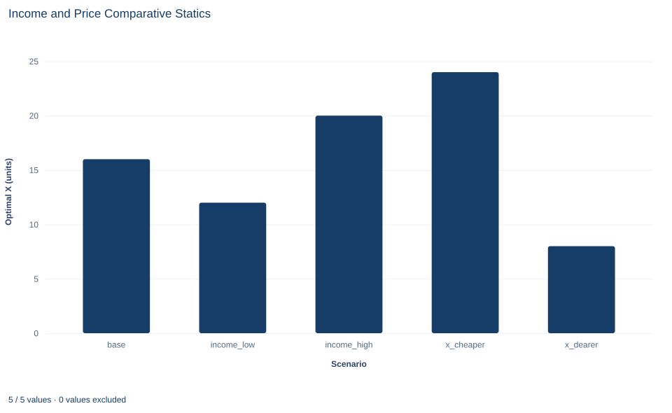

# Lab 06 · Income and Price Comparative Statics

**How optimal demand responds to a change in income or in one price**

## Start with the supplied workbook

1. Download [demand_comparative_statics.xlsx](demand_comparative_statics.xlsx) and the [Python lab](lab.py). The workbook holds the five budget scenarios used throughout this chapter.
2. Import `demand_comparative_statics.xlsx` into OpenEconometrics and keep that file name as the dataset name. The `Data` sheet holds one row per scenario; the `Dictionary` sheet explains each column and its unit.
3. Open the complete `lab.py` in a new Python document and run the whole file. It reads the imported scenarios and displays a table of eight reported quantities, a bar chart of the optimal amount of good X in each scenario, and a final table that repeats the reported quantities.

For ordinary Python, keep `lab.py` and the workbook in the same folder and run the script there, or call `from lab import run_lab` and then `run_lab(data_path="/path/to/demand_comparative_statics.xlsx")`. The workbook has no blank cells. To try another scenario, add it to a copy of the loaded table so the distributed workbook stays unchanged.

A consumer has 120 currency units to spend on two goods. Good X costs 3 per unit and good Y costs 2. If the budget rises to 150, does the consumer buy more of both goods, and in what proportion? If instead the price of X doubles to 6 while the budget stays at 120, how far does X fall, and does the purchase of Y move at all?

These are questions of **comparative statics**: solve for the best choice, change one parameter, solve again and compare the two resting points.

The workbook contains **five synthetic budget scenarios** for one hypothetical consumer, in a hypothetical currency. Each row stipulates an income, two prices and a preference parameter; the lab computes the choice the model implies. No real purchases are recorded. The [LaTeX table](table.tex) collects the reported numbers.

## 1. Read the scenarios

| Column | What it records | Unit |
|---|---|---|
| `scenario` | Label naming which parameter differs from the base row | text |
| `income` | Budget $m$ available for the two goods | currency |
| `px` | Price $p_x$ of good X | currency per unit of X |
| `py` | Price $p_y$ of good Y | currency per unit of Y |
| `alpha` | Preference weight $\alpha$ on good X in the utility function | pure number between 0 and 1 |

The dictionary calls `alpha` the "X share." That is true at the optimum, as Section 2 shows, but $\alpha$ is a parameter of preferences rather than a measured spending share. It equals 0.4 in every row.

Compared with `base` (income 120, $p_x=3$, $p_y=2$), each other row changes exactly one number. `income_low` and `income_high` set income to 90 and 150, a 25% fall and a 25% rise. `x_cheaper` and `x_dearer` set the price of X to 2 and 6. The price of Y stays at 2 throughout, so each difference from the base choice is due to the one parameter that moved.

## 2. Derive demand from preferences

The consumer ranks bundles with the Cobb–Douglas utility function

$$
U(x,y)=x^{\alpha}y^{1-\alpha}
$$

and maximizes $U$ subject to the budget $p_x x+p_y y=m$. Utility rises in both goods, so the whole budget is spent. At an interior optimum the **marginal rate of substitution** equals the price ratio:

$$
MRS=\frac{\partial U/\partial x}{\partial U/\partial y}=\frac{\alpha}{1-\alpha}\cdot\frac{y}{x}=\frac{p_x}{p_y}.
$$

The MRS is how many units of Y the consumer would give up for one more unit of X; the price ratio is how many units of Y the market charges for it. If the MRS were larger, shifting spending from Y to X would raise utility, so the bundle could not be optimal; the reverse argument rules out a smaller MRS.

Rearrange the tangency condition to $p_y y=\frac{1-\alpha}{\alpha}p_x x$, substitute into the budget and solve:

$$
x^*=\frac{\alpha m}{p_x},\qquad y^*=\frac{(1-\alpha)m}{p_y}.
$$

The numerator $\alpha m$ is currency spent on X; dividing by currency per unit of X leaves units of X. Whatever the prices, the consumer spends the fraction $\alpha$ of income on X and $1-\alpha$ on Y.

For the base row, $x^*=0.4\times120/3=16$ and $y^*=0.6\times120/2=36$. The budget is exhausted, $3\times16+2\times36=48+72=120$, and the tangency holds, $(0.4/0.6)\times(36/16)=1.5=3/2$.

**Pause before running.** Using only the two demand formulas, predict X and Y in `income_high` and in `x_dearer`.

## 3. Change income, hold prices fixed

The budget line meets the X axis at $m/p_x$ and the Y axis at $m/p_y$; its slope, $-p_x/p_y$, does not involve $m$. In `base` the intercepts are 40 units of X and 60 of Y and the slope is $-1.5$. A change in income slides the line in parallel.

Holding prices fixed, X demand traces a straight line through the origin as income varies:

$$
x^*(m)=\frac{\alpha}{p_x}\,m .
$$

This is the **Engel curve** for X. Its slope $\alpha/p_x$ is the extra X bought per extra currency unit of income. A positive slope makes X a **normal good**; an inferior good would have a negative slope. The **income elasticity** states the response in percentage terms:

$$
\eta_{xm}=\frac{\partial x^*}{\partial m}\cdot\frac{m}{x^*}=\frac{\alpha}{p_x}\cdot\frac{m}{\alpha m/p_x}=1.
$$

Because the Engel curve passes through the origin, quantity changes in exactly the same proportion as income, even for a 25% change. A necessity (elasticity below one) would take a falling budget share as income rose and a luxury a rising one; Cobb–Douglas preferences rule out both.

## 4. Change one price, hold income fixed

The Y intercept $m/p_y=60$ does not depend on $p_x$, so a change in the price of X pivots the budget line around that point, moving the X intercept and the slope.

With income and $\alpha$ fixed, the demand curve for X is

$$
x^*(p_x)=\frac{\alpha m}{p_x}=\frac{48}{p_x}.
$$

Spending on X, $p_x x^*$, stays at 48 at every price. A curve along which price times quantity is constant is a rectangular hyperbola, with **own-price elasticity**

$$
\epsilon_{xp_x}=\frac{\partial x^*}{\partial p_x}\cdot\frac{p_x}{x^*}=-\frac{\alpha m}{p_x^{2}}\cdot\frac{p_x}{\alpha m/p_x}=-1 .
$$

A point elasticity describes small changes; it does not promise equal and opposite percentage changes for large ones. In `x_cheaper` the price falls from 3 to 2, about 33.3%, and X rises from 16 to 24, a 50% rise; the simple ratio is $50/(-33.3)=-1.5$. Measuring each change against the midpoint of its two values gives $\Delta x/\bar x=8/20=0.4$ and $\Delta p_x/\bar p_x=-1/2.5=-0.4$, an arc elasticity of exactly $-1$. For large changes, state which formula you used.

## 5. Explain why Y does not move when X's price changes

The Y demand $y^*=(1-\alpha)m/p_y$ does not contain $p_x$. In both price scenarios the consumer still spends $0.6\times120=72$ on Y, which buys 36 units at $p_y=2$. The uncompensated **cross-price elasticity** $\epsilon_{yp_x}$ is zero.

That zero is a feature of these preferences, not a general law. A dearer X makes Y relatively cheaper, which alone would raise Y, and lowers purchasing power, which alone would reduce Y because Y is normal. With Cobb–Douglas utility the two pressures cancel exactly; Lab 07 separates them.

Demand is also **homogeneous of degree zero**: multiply income and both prices by the same factor and the factor cancels from each demand. The lab's check doubles income and the price of X together and confirms that X stays at $0.4\times240/6=16$. Demand does not depend on the unit in which money is counted.

## 6. Run the scenarios

The complete file computes both demands for every row. The core of the calculation is:

```python
raw = load_data()  # reader defined in the complete lab.py
x = raw.alpha * raw.income / raw.px
y = (1 - raw.alpha) * raw.income / raw.py
plan = oe.DataFrame({
    "scenario": raw.scenario, "income": raw.income, "px": raw.px,
    "x": x, "y": y, "spending_x": raw.px * x, "spending_y": raw.py * y,
})
display(plan)
```

The table it displays reads:

| Scenario | Income | Price of X | X (units) | Y (units) | Spending on X | Spending on Y |
|---|---:|---:|---:|---:|---:|---:|
| `base` | 120 | 3 | 16 | 36 | 48 | 72 |
| `income_low` | 90 | 3 | 12 | 27 | 36 | 54 |
| `income_high` | 150 | 3 | 20 | 45 | 60 | 90 |
| `x_cheaper` | 120 | 2 | 24 | 36 | 48 | 72 |
| `x_dearer` | 120 | 6 | 8 | 36 | 48 | 72 |

Compare each row with `base`. In the income rows every quantity and spending column moves by 25% with income. In the price rows only X changes; spending stays at 48 on X and 72 on Y.

Every row should satisfy both optimality conditions. This check prints the largest budget gap and the largest tangency gap, both zero up to floating-point rounding:

```python
budget_gap = (raw.px * x + raw.py * y - raw.income).abs().max()
mrs = raw.alpha / (1 - raw.alpha) * y / x
tangency_gap = (mrs - raw.px / raw.py).abs().max()
print(budget_gap, tangency_gap)
```

The lab's reported table lists X and Y in `base`, `income_high` and `x_dearer`, then the income elasticity of X, 1, and its own-price elasticity, −1. Those two elasticities are the analytic values from Sections 3 and 4, written into `analyze` as constants; they are not estimated from the five rows.

## 7. Read the bar chart



The chart shows one bar per scenario, with the optimal quantity of X in units on the vertical axis: 16, 12, 20, 24 and 8 from left to right. Y is not plotted.

The income bars, 12, 16 and 20, differ by equal steps of 4 because income differs by equal steps of 30 along a straight Engel curve. The price bars do not: a price cut of 1 raises X by 8, while a price rise of 3 lowers it by 8, because spending on X is fixed at 48. The horizontal axis lists labeled scenarios, not a continuous variable, so do not read the bars as a curve.

## A case from the literature

Under Cobb–Douglas preferences the share of income spent on each good does not change as income rises; its Engel curve, drawn in budget shares, is flat. Budget data have long said otherwise. Houthakker (1957) marked the centenary of Engel's law, the finding that the proportion of income spent on food falls as income rises, since found in many other budget surveys.

Banks, Blundell and Lewbel (1997) asked what shape such curves take. Drawing on a long time series of expenditure surveys, their nonparametric analysis suggested that budget-share Engel curves need quadratic terms in the logarithm of total expenditure. Popular systems such as the Translog and the Almost Ideal Demand System have shares that are linear in log expenditure. The authors derived the complete class of integrable demand systems with quadratic log-expenditure shares and estimated one on a large pooled data set of U.K. households. Models that ignored the curvature generated important distortions in the pattern of welfare losses from a tax increase.

For this lab, the lesson is that the unit income elasticity found in section 3 follows from the assumed form, not from evidence. A share that is quadratic in log expenditure can rise at some budgets and fall at others, and even a share linear in log expenditure moves with income, which a Cobb–Douglas share never does. The derivation of demand from preferences in section 2 belongs to the mathematical theory of individual demand functions set out by Hicks and Allen (1934).

## 8. Decide what the model supports

Every number here is deduced from an assumed utility function. The unit income elasticity, the unit own-price elasticity and the zero cross-price response are imposed by the Cobb–Douglas form; the scenarios illustrate them rather than test them. Real consumers buy necessities, luxuries and inferior goods, and their cross-price responses are often far from zero.

The model also assumes one consumer, divisible goods, fixed preferences and no rationing. It says nothing about a market of consumers with different preferences and contains no data that could estimate $\alpha$.

## 9. State the comparative statics in full

A complete statement for the worked example reads: "For a consumer with Cobb–Douglas preferences who spends 40% of income on X, at prices 3 for X and 2 for Y and income 120, the optimal bundle is 16 units of X and 36 of Y. Raising income by 25% to 150 raises both quantities by 25%, to 20 and 45. Doubling the price of X to 6 with income unchanged lowers X to 8 and leaves Y at 36, because spending on each good is a fixed share of income. These responses follow from the assumed preferences; they are not measurements of any real consumer."

## Student exercises

1. For `x_dearer`, compute the simple ratio of percentage changes and the midpoint arc elasticity of X with respect to its price. Explain why they differ and which agrees with the point elasticity of −1.
2. Give the X intercept, Y intercept and slope of the budget line in each of the four non-base scenarios. Say which scenarios shift the line and which rotate it.
3. Using `income_low` and `income_high`, compute the change in Y per currency unit of income and the midpoint income elasticity of Y. Confirm the elasticity by differentiating $y^*$.
4. Keep base prices and income but raise $\alpha$ from 0.4 to 0.5. Compute the new optimal bundle. Name the workbook scenario that gives the same quantity of X, and explain why its Y differs.
5. Multiply income and both prices in the base row by 2 and compute Y. Then double only income and the price of X, as the lab's check does, and compute Y again. Explain why that check confirms homogeneity for X but not for Y.
6. A classmate writes: "Y stays at 36 when the price of X doubles, so X and Y are unrelated goods for any consumer." Rewrite the sentence so that it is correct for this model and says what the zero cross-price response does and does not imply.

## Further reading

- Banks, J., Blundell, R., and Lewbel, A. (1997). Quadratic Engel curves and consumer demand. *Review of Economics and Statistics*, 79(4), 527–539. https://doi.org/10.1162/003465397557015
- Hicks, J. R., and Allen, R. G. D. (1934). A reconsideration of the theory of value. Part II. A mathematical theory of individual demand functions. *Economica*, 1(2), 196. https://doi.org/10.2307/2548749
- Houthakker, H. S. (1957). An international comparison of household expenditure patterns, commemorating the centenary of Engel's law. *Econometrica*, 25(4), 532. https://doi.org/10.2307/1905382
