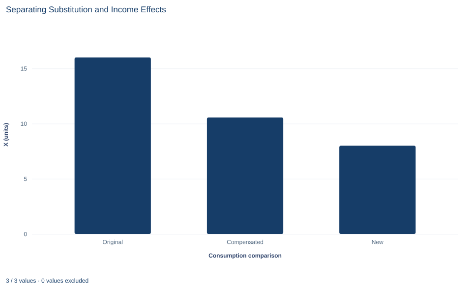

# Lab 07 · Separating Substitution and Income Effects

**Hicks compensation and the decomposition of a price effect**

## Start with the supplied workbook

1. Download [substitution_income.xlsx](substitution_income.xlsx) and the [Python lab](lab.py). The workbook holds the two price scenarios used throughout this chapter.
2. Import `substitution_income.xlsx` into OpenEconometrics and keep that file name as the dataset name. The `Data` sheet holds one row per price scenario; the `Dictionary` sheet explains each column and its unit.
3. Open the complete `lab.py` in a new Python document and run the whole file. It reads the imported scenarios and displays a table of nine decomposition quantities, a bar chart of the original, compensated and new quantity of X, and a final table that repeats the nine quantities.

For ordinary Python, keep `lab.py` and the workbook in the same folder and run the script there, or call `from lab import run_lab` and then `run_lab(data_path="/path/to/substitution_income.xlsx")`. The workbook has no blank cells. To try a different price change, edit a copy of the loaded table so the distributed workbook stays unchanged.

In Lab 06, doubling the price of good X from 3 to 6 cut the consumer's purchase of X from 16 units to 8. That fall of 8 units mixes two different forces. X is now dearer relative to Y, so the consumer would buy less of it even if no worse off. And the same income of 120 now buys less, so the consumer is poorer and buys less of every normal good. How much of the 8-unit fall belongs to each?

The answer requires a hypothetical third bundle: what the consumer would choose at the new prices if handed just enough extra income to stay as well off as before. This lab builds that bundle and splits the total change into a **substitution effect** and an **income effect**.

The workbook contains **two synthetic price scenarios** for the same hypothetical consumer, in a hypothetical currency. The first row is the situation before the price change, the second after it. Both are model inputs, not observed purchases. The [LaTeX table](table.tex) collects the reported numbers.

## 1. Read the two scenarios

| Column | What it records | Unit | Old row | New row |
|---|---|---|---:|---:|
| `px` | Price $p_x$ of good X | currency per unit of X | 3 | 6 |
| `py` | Price $p_y$ of good Y | currency per unit of Y | 2 | 2 |
| `income` | Budget $m$ for the two goods | currency | 120 | 120 |
| `alpha` | Preference weight $\alpha$ on X in Cobb–Douglas utility | pure number | 0.4 | 0.4 |

Only $p_x$ differs between the rows. The rows have no labels in the workbook; the lab treats the first as "old" and the second as "new." Preferences are $U(x,y)=x^{0.4}y^{0.6}$ in both, so the Lab 06 demands apply: $x^*=\alpha m/p_x$ and $y^*=(1-\alpha)m/p_y$.

The original bundle is $A=(16,\,36)$ and the new bundle is $B=(8,\,36)$. The total effect on X is $8-16=-8$ units.

## 2. Define the compensated bundle

Picture the original indifference curve, the set of bundles giving the same utility as $A$. The new prices make the budget line steeper, with slope $-p_x/p_y=-3$ instead of $-1.5$. Slide a line with the new slope until it just touches the original indifference curve. The point of contact, $C$, is the cheapest way to reach the original utility at the new prices.

The decomposition then reads

$$
\underbrace{x_B-x_A}_{\text{total}}=\underbrace{(x_C-x_A)}_{\text{substitution}}+\underbrace{(x_B-x_C)}_{\text{income}} .
$$

Moving from $A$ to $C$ stays on one indifference curve and responds only to the changed price ratio: that is the substitution effect. Moving from $C$ to $B$ keeps the new price ratio and removes the extra income: that is the income effect.

This construction is **Hicks compensation**, which holds utility fixed. It differs from **Slutsky compensation**, which gives just enough income to buy the original bundle $A$ at the new prices. The two agree to first order for small price changes but not for a doubling. The lab uses Hicks compensation throughout.

The identity above always holds, because $x_C$ is added and subtracted. Finding that the two effects sum to the total therefore checks nothing about the economics. The substantive check is that $C$ really gives the original utility.

**Pause before running.** Predict the sign of each effect and say which one you expect to be larger.

## 3. Compute the compensating income

The income needed to reach utility $u$ at prices $(p_x,p_y)$ is the **expenditure function**. For Cobb–Douglas preferences it is

$$
e(p_x,p_y,u)=u\left(\frac{p_x}{\alpha}\right)^{\alpha}\left(\frac{p_y}{1-\alpha}\right)^{1-\alpha}.
$$

Hold $u$ at its original level and $p_y$ fixed. Then only $p_x^{\alpha}$ changes, and the compensated income is the original income scaled by the price ratio raised to $\alpha$:

$$
m^c=m\left(\frac{p_x^{new}}{p_x^{old}}\right)^{\alpha}=120\times2^{0.4}=120\times1.3195=158.34 .
$$

The exponent is the budget share of X. A good that took the whole budget would need full compensation, doubling income; a good with a share near zero would need almost none.

At the new prices with income $m^c$, the consumer spends 40% on X:

$$
x_C=\frac{\alpha m^c}{p_x^{new}}=\frac{0.4\times158.34}{6}=10.56 \text{ units}.
$$

## 4. Split the total change

With $x_A=16$, $x_C=10.56$ and $x_B=8$:

- **Substitution effect:** $x_C-x_A=10.56-16=-5.44$ units. Holding utility fixed, the consumer moves away from the good that became relatively dearer.
- **Income effect:** $x_B-x_C=8-10.56=-2.56$ units. Removing the 38.34 of compensating income lowers X because X is normal.
- **Total:** $-5.44+(-2.56)=-8$ units.

Both effects are negative, for different reasons. The own-price substitution effect is never positive: along a fixed, strictly convex indifference curve, a steeper budget line touches at a point with less X. The income effect is negative only because X is a normal good. For an inferior good it would be positive and would partly offset substitution; if it were large enough, demand could even slope upward, the Giffen case.

## 5. Run the decomposition

The complete file computes all nine quantities. The key steps are:

```python
raw = load_data()  # reader defined in the complete lab.py
old, new = raw.iloc[0], raw.iloc[1]
x_old = old.alpha * old.income / old.px
x_new = new.alpha * new.income / new.px
compensated_income = old.income * (new.px / old.px) ** old.alpha
x_comp = old.alpha * compensated_income / new.px
display(oe.DataFrame({
    "substitution": [x_comp - x_old],
    "income": [x_new - x_comp],
    "total": [x_new - x_old],
}))
```

The snippet displays the three effects in units of X: −5.44, −2.56 and −8. The lab's full table reads:

| Reported quantity | Value | Unit |
|---|---:|---|
| X before the price change, $x_A$ | 16 | units of X |
| X after the price change, $x_B$ | 8 | units of X |
| Hicks compensated income, $m^c$ | 158.34 | currency |
| X at the compensated bundle, $x_C$ | 10.56 | units of X |
| Hicks substitution effect | −5.44 | units of X |
| Income effect | −2.56 | units of X |
| Total effect | −8 | units of X |
| Utility at $A$ | 26.03 | utility index |
| Utility at $C$ | 26.03 | utility index |

Read the first four rows as the three bundles and the income that defines $C$. The next three rows are differences between them. The last two rows confirm that compensation worked.

That confirmation is the check worth running yourself:

```python
def utility(x, y, alpha=old.alpha):
    return x**alpha * y ** (1 - alpha)

y_old = (1 - old.alpha) * old.income / old.py
y_comp = (1 - old.alpha) * compensated_income / new.py
print(utility(x_old, y_old), utility(x_comp, y_comp))
```

Both values are 26.027 and agree to within $10^{-14}$. The utility number has no unit and no meaning on its own; Cobb–Douglas utility is an ordinal ranking, so only the equality of the two values matters.

## 6. Read the bar chart



The chart has three bars, in units of X: the original choice (16), the Hicks-compensated choice (10.56) and the new choice (8). The drop from the first bar to the second is the substitution effect; the drop from the second to the third is the income effect. The middle bar is the hypothetical one: no consumer ever buys it unless someone actually pays the compensation. The chart shows only X; the compensated bundle also contains more Y than either real bundle, which the chart does not display.

## A case from the literature

The decomposition matters most when the two effects pull in opposite directions. Under Cobb–Douglas preferences both effects lower the demand for a good whose price rises. For an inferior good the income effect works the other way, and if it outweighs the substitution effect, demand slopes upward: the good is a Giffen good.

Jensen and Miller (2008) reported what they describe as the first real-world evidence of Giffen behavior. They subsidized the prices of dietary staples for extremely poor households in two provinces of China and found strong evidence of Giffen behavior for rice in Hunan and weaker evidence for wheat in Gansu. The households acted as though they maximized utility subject to subsistence concerns, and their elasticity of demand depended significantly, and nonlinearly, on how poor they were. In this lab's terms, Giffen behavior means that for these households the income effect of a change in the price of the staple was larger than, and opposite to, the substitution effect.

The lab cannot produce that result: its preferences rule out inferior goods, and it estimates nothing. Turning a money measure such as the lab's compensating income into an estimate requires an estimated demand curve. Hausman and Newey (1995) derived exact consumer surplus and deadweight loss from nonparametric demand estimates, developed tests of whether compensated demand slopes downward, and applied the methods to gasoline demand. For a mathematical theory of individual demand functions, see Hicks and Allen (1934).

## 7. Decide what the decomposition supports

The decomposition is exact for this model, but its pieces depend on choices that should be reported. Hicks and Slutsky compensation give different splits of the same total for a large price change. The signs here follow from Cobb–Douglas preferences, under which X is normal with income elasticity one. With other preferences the income effect could be larger, smaller or of opposite sign.

Compensated income is a thought experiment, not a transfer anyone received. The 38.34 gap between $m^c$ and actual income measures how much worse off the price rise leaves this consumer in money terms at the new prices. It is not a policy recommendation, and it is not the only money measure: evaluating the loss at the old prices gives a different number. Nothing here is estimated from purchases, so the lab demonstrates the logic of the decomposition, not the size of any real consumer's response.

## 8. Report the decomposition in full

A complete statement for the worked example reads: "For a Cobb–Douglas consumer with income 120 who spends 40% of income on X, doubling the price of X from 3 to 6 lowers X from 16 to 8 units. Hicks compensation of 158.34, which keeps the original utility attainable at the new prices, would leave the consumer buying 10.56 units. The substitution effect is therefore −5.44 units and the income effect −2.56 units, which together give the total of −8."

The statement names the compensation concept, the prices, the compensating income and each effect in units of X.

## Student exercises

1. Redo the decomposition with Slutsky compensation, which gives just enough income to buy the original bundle at the new prices. Report the compensating income, the compensated X and both effects, and compare them with the Hicks values.
2. Decompose the change in Y using the Hicks-compensated bundle. Report the substitution and income effects on Y and explain how they connect to Lab 06's finding that Y did not move.
3. Compute the income that, at the old prices, would leave the consumer exactly as well off as after the price rise. Compare the resulting money loss with the 38.34 implied by $m^c$, and explain why the two differ.
4. Repeat both the Hicks and the Slutsky decompositions for a 10% price rise, from 3 to 3.3. Compare the gap between the two substitution effects with the gap for the doubling, and relate the result to the first-order equivalence in Section 2.
5. Suppose X were inferior, with the same substitution effect of −5.44 but an income effect of +2.00. Compute the total effect and say whether demand still slopes downward. How large would the income effect have to be for X to be a Giffen good here?
6. Rewrite this sentence so that it is accurate for the lab: "When the price doubled, people bought 5.44 fewer units because they switched goods and 2.56 fewer because they were poorer."

## Further reading

- Hausman, J. A., and Newey, W. K. (1995). Nonparametric estimation of exact consumers surplus and deadweight loss. *Econometrica*, 63(6), 1445. https://doi.org/10.2307/2171777
- Hicks, J. R., and Allen, R. G. D. (1934). A reconsideration of the theory of value. Part II. A mathematical theory of individual demand functions. *Economica*, 1(2), 196. https://doi.org/10.2307/2548749
- Jensen, R. T., and Miller, N. H. (2008). Giffen behavior and subsistence consumption. *American Economic Review*, 98(4), 1553–1577. https://doi.org/10.1257/aer.98.4.1553
