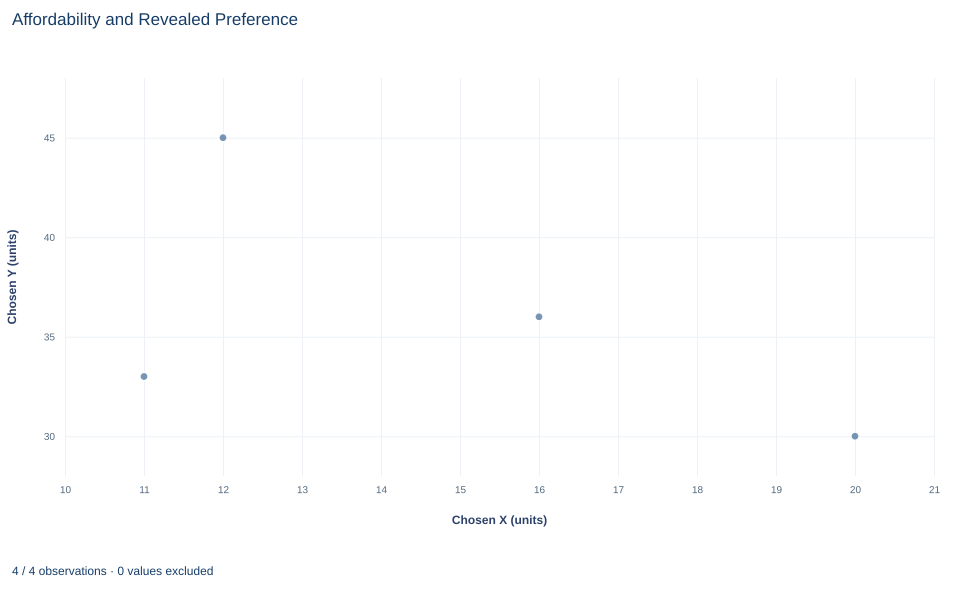

# Lab 08 · Affordability and Revealed Preference

**What choices made under different budgets reveal about preferences**

## Start with the supplied workbook

1. Download [revealed_preference.xlsx](revealed_preference.xlsx) and the [Python lab](lab.py). The workbook holds the four choices used throughout this chapter.
2. Import `revealed_preference.xlsx` into OpenEconometrics and keep that file name as the dataset name. The `Data` sheet holds one row per choice occasion; the `Dictionary` sheet explains each column and its unit.
3. Open the complete `lab.py` in a new Python document and run the whole file. It reads the imported choices and displays a table of four counts and checks, a scatter plot of the chosen bundles, and a final table that repeats the four reported numbers.

For ordinary Python, keep `lab.py` and the workbook in the same folder and run the script there, or call `from lab import run_lab` and then `run_lab(data_path="/path/to/revealed_preference.xlsx")`. The workbook has no blank cells. To test an altered choice, edit a copy of the loaded table so the distributed workbook stays unchanged.

Labs 05–07 started from a utility function and derived the choices it implies. Revealed preference runs the argument the other way. Suppose all we have are four purchases, each made at known prices with a known budget. Without assuming any utility function, can we say that one bundle is preferred to another? And can the four purchases contradict each other, so that no stable set of preferences could have produced them?

The key idea is affordability. If a consumer bought bundle A on an occasion when bundle B was also affordable, then A was chosen over B, and A is **revealed preferred** to B. Everything in this lab follows from careful bookkeeping of which bundle was affordable at which prices.

The workbook contains **four synthetic choices** by one hypothetical consumer, with prices and budgets in a hypothetical currency. They were constructed for teaching to be consistent with a single, stable preference; the lab asks whether the revealed-preference conditions can detect any inconsistency. The [LaTeX table](table.tex) collects the reported numbers.

## 1. Read the four choices

| Column | What it records | Unit |
|---|---|---|
| `choice_id` | Label for the choice occasion, 1 to 4 | identifier |
| `px` | Price of good X on that occasion | currency per unit of X |
| `py` | Price of good Y on that occasion | currency per unit of Y |
| `income` | Budget available on that occasion | currency |
| `x` | Quantity of X chosen | units of X |
| `y` | Quantity of Y chosen | units of Y |

Each row combines a budget, $(p^i, m_i)$, with the bundle the consumer chose under it, $x^i=(x_i, y_i)$. The price of Y is 2 on every occasion; the price of X rises from 2 to 5 across the four rows, and budgets range from 100 to 150.

| Choice | Prices $(p_x, p_y)$ | Budget | Chosen bundle $(x, y)$ |
|---:|---|---:|---|
| 1 | (2, 2) | 100 | (20, 30) |
| 2 | (3, 2) | 120 | (16, 36) |
| 3 | (4, 2) | 110 | (11, 33) |
| 4 | (5, 2) | 150 | (12, 45) |

Every chosen bundle costs exactly its budget at its own prices. For choice 1, $2\times20+2\times30=100$. A bundle that left money unspent would itself tell us something: a consumer who prefers more to less would not leave income unused.

## 2. Define direct revealed preference

Write $p^i\cdot x^j=p_{x,i}\,x_j+p_{y,i}\,y_j$ for the cost of bundle $j$ at the prices of occasion $i$. Then

$$
p^i\cdot x^j\le m_i \;\Longrightarrow\; x^i \,R^D\, x^j ,
$$

read "bundle $i$ is directly revealed preferred to bundle $j$." Bundle $j$ fit within budget $i$, and the consumer chose bundle $i$ anyway.

The prices that value the alternative are those of the occasion on which the choice was made. To ask whether choice 1 reveals anything about bundle 3, cost bundle 3 at choice 1's prices, $2\times11+2\times33=88$, and compare with choice 1's budget of 100. Bundle 3 was affordable, so $x^1R^Dx^3$. Costing bundle 3 at its own prices instead gives 110, which says only that bundle 3 was affordable when it was chosen, which we already knew.

The direction matters. $x^1R^Dx^3$ is a statement about occasion 1. Whether bundle 1 was affordable on occasion 3 is a separate question, answered with occasion 3's prices.

**Pause before running.** For the pair "choice 2 versus bundle 1," which prices and which budget decide whether bundle 1 was affordable?

## 3. State the consistency condition

If preferences are stable and the consumer maximizes them, two distinct bundles cannot each be chosen while the other was cheaper. Suppose $x^iR^Dx^j$, and suppose also that bundle $i$ was strictly affordable on occasion $j$:

$$
p^j\cdot x^i<m_j .
$$

Then on occasion $j$ the consumer could have bought bundle $i$ and still had money left over to buy more of something. A consumer who prefers more to less, and who rated $i$ at least as highly as $j$, would not have chosen $j$. The lab counts every ordered pair $(i,j)$ that shows this pattern as a violation.

This is the two-bundle core of the revealed-preference axioms. The standard **weak axiom (WARP)** is slightly stricter: for distinct bundles it also rules out a reverse cost exactly equal to the budget. The lab tests only the strict version, with a tolerance of $10^{-10}$ currency units to absorb floating-point noise in the comparisons. The **generalized axiom (GARP)** goes further and follows chains, such as $x^1R^Dx^2$ and $x^2R^Dx^3$, to build an indirect relation before checking for contradictions. The lab does not compute those chains.

## 4. Build the cost matrix

All the comparisons come from one table: the cost of every bundle at every occasion's prices.

```python
raw = load_data()  # reader defined in the complete lab.py
prices = raw[["px", "py"]].to_numpy()
bundles = raw[["x", "y"]].to_numpy()
cost = prices @ bundles.T  # row i: prices of occasion i; column j: bundle j
display(oe.DataFrame(cost, index=raw.choice_id, columns=raw.choice_id))
```

The output, with each row's budget added for comparison:

| Prices of occasion | Budget | Bundle 1 | Bundle 2 | Bundle 3 | Bundle 4 |
|---|---:|---:|---:|---:|---:|
| 1 | 100 | **100** | 104 | 88 | 114 |
| 2 | 120 | 120 | **120** | 99 | 126 |
| 3 | 110 | 140 | 136 | **110** | 138 |
| 4 | 150 | 160 | 152 | 121 | **150** |

Read across a row. The diagonal entries, in bold, are each chosen bundle at its own prices and equal the budget. Any other entry at or below the row's budget marks a bundle that was affordable but not chosen. In row 1 only bundle 3 qualifies. In row 2, bundle 3 costs 99 and bundle 1 costs exactly 120, the whole budget. A bundle that exactly exhausts the budget counts as affordable, so choice 2 reveals bundle 2 preferred to bundle 1. In row 3 every other bundle costs more than the budget of 110, so choice 3 reveals nothing about them.

## 5. Count comparisons and violations

The lab turns the matrix into two Boolean tables, one for affordability and one for strict reverse affordability, and counts the pairs that satisfy both:

```python
import numpy as np

budget = raw.income.to_numpy()
tolerance = 1e-10
affordable = (cost <= budget[:, None] + tolerance) & ~np.eye(len(raw), dtype=bool)
reverse_strict = cost.T < budget[None, :] - tolerance
print(int(affordable.sum()), int((affordable & reverse_strict).sum()))
```

The entry `cost.T[i, j]` is bundle $i$ costed at occasion $j$'s prices, compared with budget $j$: exactly the reverse question from Section 3. The two numbers printed are the direct comparisons and the violations. The lab's reported table reads:

| Reported quantity | Value |
|---|---:|
| Choice occasions | 4 |
| Ordered pairs with $x^iR^Dx^j$ | 4 |
| Strict two-bundle violations | 0 |
| Largest gap between bundle cost and budget | 0 currency |

There are twelve ordered pairs of distinct choices, and four of them reveal a direct preference. For each of those four, the reverse cost is above the reverse budget, so no pair contradicts another. The last row confirms that every choice spends its whole budget, which the consistency argument assumes.

## 6. Read the scatter plot



The chart plots each chosen bundle as one point, with units of X on the horizontal axis and units of Y on the vertical axis: (20, 30), (16, 36), (11, 33) and (12, 45). The points are not labeled by choice and the budget lines are not drawn.

The plot alone can support one kind of comparison: dominance. The point (11, 33) lies below and to the left of (16, 36) and (12, 45), so it has less of both goods than either, and any consumer who prefers more to less ranks it lower. Every other comparison needs prices. Whether (20, 30) beats (16, 36) cannot be read from positions; it depends on whether one was affordable when the other was chosen, which is the information in the cost matrix. Sketching each occasion's budget line on the plot is the quickest way to see the matrix geometrically.

## A case from the literature

Revealed-preference tests on real purchases face a problem this lab avoids: measured choices contain errors, and a count of violations says nothing about how serious they are. Echenique, Lee and Shum (2011) proposed the money pump index, the amount of money one could extract from a consumer whose choices violate the revealed-preference axioms, as a measure of the severity of a violation. The index also serves as a statistical test of the hypothesis that a consumer is rational when behavior is observed with error. Applied to a panel data set of food expenditures, the data showed many violations of the axioms, but for most of them the index was small, and the hypothesis of consumer rationality could not be rejected.

That is the reverse of this lab's situation, with four constructed choices, no violations and no measurement error. The study shows why a violation count needs a measure of size, and why a tolerance has to reflect the precision of the data. The approach rests on older foundations. Samuelson (1938) argued that even the most modern consumer theory of his day still showed vestigial traces of the utility concept. Houthakker (1950) generalized Samuelson's hypothesis so that it implies integrability, meaning that preferences can be described by a utility function of the customary type, while keeping to the revealed-preference method. Varian (1982) set out a nonparametric approach to demand analysis.

## 7. Decide what the test supports

Zero violations means these four choices contain no direct contradiction. It does not show that the consumer maximizes a stable utility function, because a pattern of later choices could still contradict these. It does not identify the preferences either: many different utility functions can generate exactly these four bundles at these budgets.

The test is also partial by construction. It checks pairs, not chains, so it is not a GARP certificate. It uses a strict reverse inequality, so it would not flag an exact tie that the standard WARP forbids. And it treats the recorded quantities and prices as exact. With measured purchase data, small recording errors could create or hide violations, and the tolerance would need to reflect the measurement precision, not floating-point noise.

## 8. Report the result in full

A complete statement for the worked example reads: "For four synthetic choices by one consumer, each spending its full budget, four of the twelve ordered pairs show one chosen bundle directly revealed preferred to another. None of those pairs is contradicted by a strictly affordable reverse comparison, so the choices pass the strict two-bundle revealed-preference check with tolerance $10^{-10}$. The check does not examine indirect chains, does not apply WARP's tie condition and does not identify the consumer's preferences."

## Student exercises

1. For each of the four pairs with $x^iR^Dx^j$, compute the reverse cost $p^j\cdot x^i$ and its margin over budget $m_j$. Which pair comes closest to a violation, and by how many currency units?
2. On a copy of the data, change choice 2's bundle to (30, 15), which still costs 120 at its own prices. Rerun the cost matrix and the counts. Report the number of direct comparisons and strict violations, and say how many violations the standard WARP would report and why the counts differ.
3. List every indirect relation you can build from the four direct relations by chaining them. Do any chains produce a contradiction? State what this implies for GARP on these data.
4. Compute the share of each budget spent on X. What does the pattern suggest about a Cobb–Douglas description of this consumer, and why does it still not prove that the consumer has those preferences?
5. After using the direct relations, any chains and the dominance argument from Section 6, which pairs of bundles remain unranked? For one such pair, describe a budget under which a single new choice would rank them.
6. Rewrite this sentence so that it matches what the lab shows: "The consumer passed the revealed preference test, which proves that they maximize a utility function and tells us what it is."

## Further reading

- Echenique, F., Lee, S., and Shum, M. (2011). The money pump as a measure of revealed preference violations. *Journal of Political Economy*, 119(6), 1201–1223. https://doi.org/10.1086/665011
- Houthakker, H. S. (1950). Revealed preference and the utility function. *Economica*, 17(66), 159. https://doi.org/10.2307/2549382
- Samuelson, P. A. (1938). A note on the pure theory of consumer's behaviour. *Economica*, 5(17), 61. https://doi.org/10.2307/2548836
- Varian, H. R. (1982). The nonparametric approach to demand analysis. *Econometrica*, 50(4), 945–973. https://doi.org/10.2307/1912771
