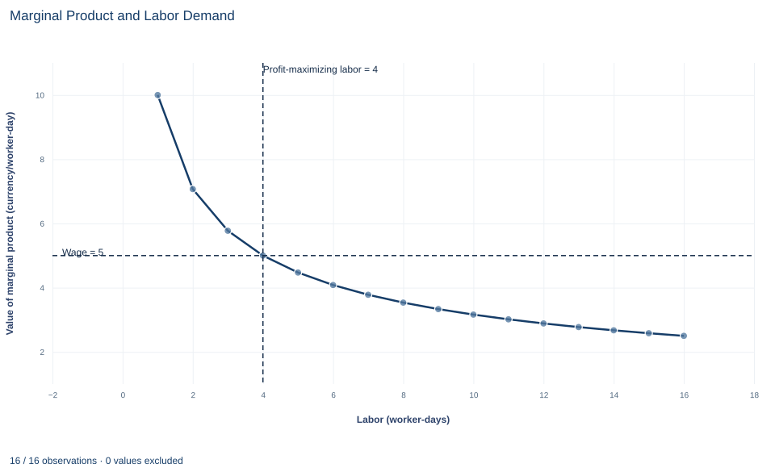

# Lab 09 · Marginal Product and Labor Demand

**Diminishing marginal product and the short-run hiring rule**

## Start with the supplied workbook

1. Download [production_input.xlsx](production_input.xlsx) and the [Python lab](lab.py). The workbook holds the 100 points on the production schedule used throughout this chapter.
2. Import `production_input.xlsx` into OpenEconometrics and keep that file name as the dataset name. The `Data` sheet holds one row per labor input level; the `Dictionary` sheet explains each column and its unit.
3. Open the complete `lab.py` in a new Python document and run the whole file. It reads the imported schedule and displays a table of seven reported quantities, a line chart of the value of marginal product against labor with the wage marked, and a final table that repeats the reported quantities.

For ordinary Python, keep `lab.py` and the workbook in the same folder and run the script there, or call `from lab import run_lab` and then `run_lab(data_path="/path/to/production_input.xlsx")`. The workbook has no blank cells. To try another wage or price, work on a copy of the loaded table so the distributed workbook stays unchanged.

A small firm has a fixed amount of equipment and decides each day how much labor to use. Its output sells for 2 currency units per unit, labor costs 5 per worker-day, and the equipment carries a fixed cost of 10 per day. The first worker-day produces 10 units, but each additional worker-day adds less than the one before, because everyone shares the same equipment. How much labor should the firm use, and does the fixed cost change the answer?

The workbook contains **100 points on a synthetic production schedule**: labor from 1 to 100 worker-days and the daily output each level produces. The schedule is stipulated by a formula, not measured at a real firm, and the lab combines it with the stated price, wage and fixed cost. The [LaTeX table](table.tex) collects the reported numbers.

## 1. Read the production schedule

| Column | What it records | Unit |
|---|---|---|
| `labor` | Labor used in one day, $L$, in whole steps from 1 to 100 | worker-days per day |
| `output` | Output produced with that labor and the fixed equipment, $q=10\sqrt{L}$ | units per day |

Each row is one possible daily plan, not one worker. Row 4, for example, says that 4 worker-days produce 20 units in a day. The price of 2, wage of 5 and fixed cost of 10 are not in the workbook; they are set in `analyze`.

The schedule is the **short-run production function**

$$
q(L)=10\sqrt{L},
$$

short run because equipment is fixed. Output rises with labor at every point, but more slowly as labor grows: going from 1 to 4 worker-days doubles output from 10 to 20, and going from 4 to 16 doubles it again, to 40.

## 2. Define average and marginal product

The **average product** of labor is output per unit of labor, $AP_L=q/L=10/\sqrt{L}$ units per worker-day. The **marginal product** is the extra output from a small increase in labor, holding equipment fixed:

$$
MP_L=\frac{dq}{dL}=\frac{5}{\sqrt{L}}\quad\text{units per worker-day}.
$$

Both fall as $L$ rises. Marginal product falls because each added worker-day has less equipment to work with; that is **diminishing marginal product**, and its sign is confirmed by $dMP_L/dL=-2.5L^{-3/2}<0$. Marginal product lies below average product everywhere on this schedule, which is why the average keeps falling: each new worker-day adds less than the current average and pulls it down.

On a grid of whole worker-days, the extra output from the $L$-th worker-day is the difference $q(L)-q(L-1)$. Going from 3 to 4 worker-days adds $20-17.32=2.68$ units, and going from 4 to 5 adds $22.36-20=2.36$. The derivative at $L=4$, 2.5, lies between them. The discrete difference is what a firm hiring in whole days actually gets.

## 3. Derive the hiring rule

Profit per day is revenue minus labor cost minus fixed cost:

$$
\pi(L)=p\,q(L)-wL-F=2\times10\sqrt{L}-5L-10 .
$$

One more worker-day adds $p\cdot MP_L$ to revenue, the **value of the marginal product** (VMP), and adds $w$ to cost. While VMP exceeds the wage, hiring more raises profit; once it falls below, hiring more lowers profit. At an interior maximum,

$$
p\cdot MP_L=w\quad\Longleftrightarrow\quad 2\times\frac{5}{\sqrt{L}}=5\quad\Longleftrightarrow\quad \sqrt{L}=2\quad\Longleftrightarrow\quad L^*=4 .
$$

Check the units: price in currency per unit times marginal product in units per worker-day gives currency per worker-day, the unit of the wage. The second derivative, $\pi''(L)=-5L^{-3/2}$, is negative, so this point is a maximum rather than a minimum. At $L^*=4$ the firm produces $q=20$ units, marginal product is 2.5 units per worker-day, and profit is $2\times20-5\times4-10=40-20-10=10$ currency per day.

The same logic works on the grid. The 4th worker-day adds 2.68 units worth $2\times2.68=5.36$, more than the wage of 5, so it is worth hiring. The 5th adds 2.36 units worth 4.72, less than 5, so it is not. Here the grid and the continuous rule agree because $L^*=4$ is a whole number.

**Pause before running.** Before looking at the output, decide whether a fixed cost of 20 instead of 10 would change $L^*$, and what it would do to profit.

## 4. Separate the fixed cost from the hiring decision

The fixed cost $F$ enters profit as a constant. It shifts the whole profit curve down by the same amount at every $L$ and drops out of the derivative, so it cannot move the hiring rule. A firm that has already committed to its equipment hires to the point where VMP equals the wage, whatever the equipment cost.

The fixed cost matters for a different question: whether operating is better than not operating. In the short run, if the fixed cost must be paid regardless, the firm should operate whenever revenue covers labor cost, because shutting down would lose the whole fixed cost. If the cost could be avoided by closing, operating also has to cover it. That choice depends on which costs are avoidable over the relevant horizon, not on the marginal hiring condition.

## 5. Run the schedule

The complete file computes the analytic optimum and evaluates profit at every point on the schedule. A version that also shows marginal product, the extra output from each whole worker-day and the value of the marginal product is:

```python
raw = load_data()  # reader defined in the complete lab.py
price, wage, fixed_cost = 2.0, 5.0, 10.0
plan = raw.assign(
    marginal_product=5 / raw.labor**0.5,
    extra_output=raw.output.diff(),
    profit=price * raw.output - wage * raw.labor - fixed_cost,
)
plan["value_marginal_product"] = price * plan.marginal_product
display(plan.head(6))
```

The first six points on the schedule, rounded:

| Labor (worker-days) | Output (units/day) | Marginal product (units/worker-day) | Extra output from the last worker-day (units) | Profit (currency/day) | VMP (currency/worker-day) |
|---:|---:|---:|---:|---:|---:|
| 1 | 10.00 | 5.00 | — | 5.00 | 10.00 |
| 2 | 14.14 | 3.54 | 4.14 | 8.28 | 7.07 |
| 3 | 17.32 | 2.89 | 3.18 | 9.64 | 5.77 |
| 4 | 20.00 | 2.50 | 2.68 | 10.00 | 5.00 |
| 5 | 22.36 | 2.24 | 2.36 | 9.72 | 4.47 |
| 6 | 24.49 | 2.04 | 2.13 | 8.99 | 4.08 |

Read down the VMP column and compare it with the wage of 5. It passes through 5 exactly at $L=4$, where the profit column peaks. The first row of extra output is blank because there is no previous level to subtract. To confirm that the best point on the whole schedule matches the formula:

```python
best = plan.loc[plan.profit.idxmax()]
print(best.labor, best.profit, (price * 5 / wage) ** 2)
```

It prints 4, 10 and 4: the grid maximum and the analytic optimum coincide. The lab's reported table reads:

| Reported quantity | Value | Unit |
|---|---:|---|
| Output price | 2 | currency per unit |
| Wage | 5 | currency per worker-day |
| Optimal labor | 4 | worker-days |
| Optimal output | 20 | units per day |
| Marginal product at the optimum | 2.5 | units per worker-day |
| Profit after fixed cost | 10 | currency per day |
| Largest profit on the schedule | 10 | currency per day |

## 6. Read the labor demand chart



The curve is the value of marginal product, $p\cdot MP_L = 2\cdot 5/\sqrt{L} = 10/\sqrt{L}$, in currency per worker-day, for the first 16 worker-days of the schedule. The dashed horizontal line is the wage of 5 and the dashed vertical line is the profit-maximizing labor input of 4. The curve starts at 10 for one worker-day, crosses the wage exactly at $L=4$ and falls to 2.5 at 16 worker-days.

Read the chart as the firm's hiring rule. Left of the crossing, an extra worker-day adds more revenue than the 5 it costs, so hiring more raises profit; right of it, each extra worker-day adds less than 5, so profit falls. That is why profit in the table peaks at 10 with four worker-days. The curve itself is the firm's labor demand: at a wage of $w$, the firm hires where $10/\sqrt{L}=w$, so a lower wage moves the crossing to the right. The chart stops at 16 worker-days because nothing new happens beyond it; the schedule's profit falls to −310 at 100 worker-days.

## A case from the literature

If firms hire by this lab's rule in competitive labor markets, workers who are paid more should also add more to output. Hellerstein, Neumark and Troske (1999) examined that link. Using a new data set that matched individual workers to their employers, they estimated the marginal productivity differentials among different types of workers from plant-level production functions and compared them with estimated relative wages. The higher pay of prime-aged workers (35 to 54) and older workers (55 and over) was reflected in higher point estimates of their relative marginal products. For the most part, however, the lower relative earnings of women were not reflected in lower relative marginal products. The authors present the comparison as new evidence on productivity-based and other explanations of how wages are set.

The study compares groups of workers across plants, not one firm's hiring decision, but its central quantity is the lab's: the marginal product, not the average product, is what is compared with pay. Measuring marginal products from data is hard, because firms choose their inputs knowing their own productivity. Marschak and Andrews (1944) placed the theory of production in a system of random simultaneous equations. Olley and Pakes (1996) estimated a production function for the telecommunications equipment industry with an algorithm that corrects for the simultaneity between productivity and input demand and for selection through plant exit, and it produced markedly different estimates from traditional procedures. The lab sidesteps all of this because its production schedule is known exactly.

## 7. Decide what the model supports

The hiring rule assumes a price-taking firm, a known and deterministic technology, divisible labor and a single variable input. It does not account for indivisible workers beyond whole worker-days, hiring and firing costs, uncertain output prices or the possibility that the wage rises as the firm hires more. A firm with market power in its output market would value marginal product at marginal revenue rather than price, and would hire less.

The production schedule is stipulated, so the lab does not estimate a production function or test diminishing returns. It shows what the hiring rule implies once the technology and prices are known.

## 8. State the hiring decision in full

A complete statement for the worked example reads: "With daily output $q=10\sqrt{L}$ from fixed equipment, an output price of 2 and a wage of 5 per worker-day, the firm maximizes daily profit by using 4 worker-days, where the value of the marginal product, $2\times2.5=5$, equals the wage. It produces 20 units and earns 10 currency per day after a fixed cost of 10. The fixed cost lowers profit but does not affect how much labor the firm hires."

## Student exercises

1. Let the wage fall to 4. Find the continuous optimum $L^*$, its output and profit, and the best whole number of worker-days on the schedule. Explain any difference between the two.
2. Derive the firm's labor demand $L^*(w)$ for a general wage at a price of 2. Then show how the curve shifts if the output price rises to 3, and give the new $L^*$ at a wage of 5.
3. Find the largest labor input on the schedule at which profit is still non-negative, and the exact continuous value where profit equals zero.
4. Suppose the fixed cost rises to 20, then to 25. For each, give $L^*$ and profit, and say whether the firm should operate in the short run if the fixed cost is unavoidable and if it is avoidable.
5. At the optimum, compute labor's share of revenue, $wL/(pq)$, and the ratio $MP_L/AP_L$. Explain why the two coincide for this production function.
6. Suppose the firm had market power, so that one more unit of output added 1.5 to revenue rather than the price of 2. Find the labor that equates marginal revenue product with the wage, and explain why it is lower.

## Further reading

- Hellerstein, J. K., Neumark, D., and Troske, K. R. (1999). Wages, productivity, and worker characteristics: Evidence from plant-level production functions and wage equations. *Journal of Labor Economics*, 17(3), 409–446. https://doi.org/10.1086/209926
- Marschak, J., and Andrews, W. H. (1944). Random simultaneous equations and the theory of production. *Econometrica*, 12(3/4), 143. https://doi.org/10.2307/1905432
- Olley, G. S., and Pakes, A. (1996). The dynamics of productivity in the telecommunications equipment industry. *Econometrica*, 64(6), 1263. https://doi.org/10.2307/2171831
