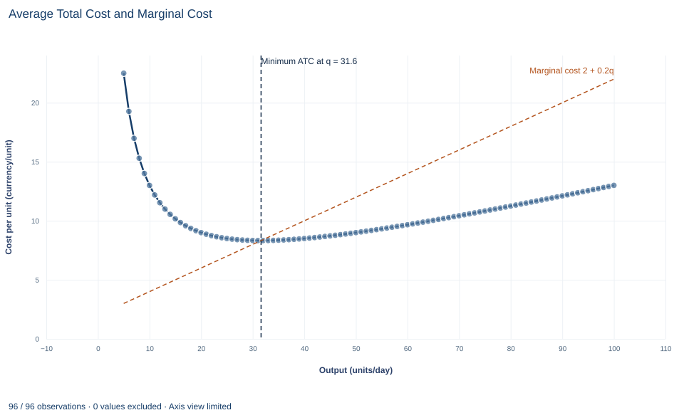

# Lab 10 · Total, Average and Marginal Cost

**Why marginal cost crosses average total cost at its minimum**

## Start with the supplied workbook

1. Download [cost_curves.xlsx](cost_curves.xlsx) and the [Python lab](lab.py). The workbook holds the 100 points on the cost schedule used throughout this chapter.
2. Import `cost_curves.xlsx` into OpenEconometrics and keep that file name as the dataset name. The `Data` sheet holds one row per output level; the `Dictionary` sheet explains each column and its unit.
3. Open the complete `lab.py` in a new Python document and run the whole file. It reads the imported schedule and displays a table of seven reported quantities, a line chart of average total cost with the marginal cost line, and a final table that repeats the reported quantities.

For ordinary Python, keep `lab.py` and the workbook in the same folder and run the script there, or call `from lab import run_lab` and then `run_lab(data_path="/path/to/cost_curves.xlsx")`. The workbook has no blank cells. To try a different cost schedule, work on a copy of the loaded table so the distributed workbook stays unchanged.

A firm's daily cost rises from 102.10 currency units when it makes one unit to 1,300 when it makes 100. Spread over output, that is 102.10 per unit at one unit and 13 per unit at 100. Somewhere in between, cost per unit is lowest. Where is that point, and why is it exactly where the cost of one more unit equals the cost per unit?

Three cost measures answer different questions. **Total cost** asks what a day's production costs. **Average cost** asks what each unit costs on average. **Marginal cost** asks what one more unit adds. Confusing them is the most common error in reading cost data, and this lab keeps them apart.

The workbook contains **100 points on a synthetic cost schedule**: output from 1 to 100 units per day and the total daily cost of each. The schedule is stipulated by a formula, not measured at a real firm. The [LaTeX table](table.tex) collects the reported numbers.

## 1. Read the cost schedule

| Column | What it records | Unit |
|---|---|---|
| `quantity` | Output produced in one day, $q$, in whole units from 1 to 100 | units per day |
| `total_cost` | Total cost of producing that output, $C(q)=100+2q+0.1q^2$ | currency per day |

Each row is one feasible output level, not one unit sold. The dictionary gives the formula. It has three parts:

$$
C(q)=\underbrace{100}_{\text{fixed cost}}+\underbrace{2q+0.1q^2}_{\text{variable cost}} .
$$

The **fixed cost**, 100 per day, is paid whatever the output, for example rent on equipment. The **variable cost** grows with output; its quadratic term means each extra unit costs a little more than the last, as a fixed plant becomes crowded. Output of zero is not on the schedule, and no average can be computed there because it would divide by zero.

## 2. Define the average and marginal measures

Dividing each part by output gives three averages, in currency per unit:

$$
AFC=\frac{100}{q},\qquad AVC=2+0.1q,\qquad ATC=AFC+AVC=\frac{100}{q}+2+0.1q .
$$

Average fixed cost falls without limit as the fixed 100 is spread over more units. Average variable cost rises steadily. Average total cost combines a falling part and a rising part, so it first falls and then rises.

**Marginal cost** is the derivative of total cost, the cost of a small increase in output:

$$
MC=\frac{dC}{dq}=2+0.2q\quad\text{currency per unit}.
$$

The fixed cost has no derivative, so it does not appear in marginal cost. Marginal cost describes the next unit, not the average of all units already produced.

On a grid of whole units, the cost of the $q$-th unit is the step $C(q)-C(q-1)$. For this quadratic schedule that step equals $1.9+0.2q$, always 0.1 below the derivative at $q$. At 10 units the step is $130.0-126.1=3.9$, while the derivative is 4.

## 3. Show why marginal cost crosses average cost at the minimum

Differentiate average total cost with the quotient rule:

$$
\frac{d\,ATC}{dq}=\frac{d}{dq}\left(\frac{C(q)}{q}\right)=\frac{q\,C'(q)-C(q)}{q^2}=\frac{MC-ATC}{q}.
$$

Because $q>0$, the sign of the slope of ATC is the sign of $MC-ATC$. When the next unit costs less than the current average, adding it pulls the average down. When it costs more, adding it pulls the average up. The average can stop falling and start rising only where the two are equal. This is the same arithmetic as a class average: a new score below the average lowers it, and one above raises it.

At the lowest point of ATC, therefore, $MC=ATC$. Solving directly,

$$
\frac{d\,ATC}{dq}=-\frac{100}{q^2}+0.1=0\quad\Longrightarrow\quad q^*=\sqrt{\frac{100}{0.1}}=\sqrt{1000}=31.62\ \text{units per day}.
$$

Substituting, $ATC(q^*)=100/31.62+2+0.1\times31.62=3.162+2+3.162=8.3246$ and $MC(q^*)=2+0.2\times31.62=8.3246$. The two agree, as the argument requires. The second derivative of ATC, $200/q^3$, is positive, so this is a minimum.

**Pause before running.** Calculate ATC and MC at 50 units, and decide from their order whether ATC is rising or falling there.

## 4. Separate the continuous minimum from the grid minimum

The schedule only contains whole units, and 31.62 is not one of them. The lowest ATC in the workbook is at 32 units, where it equals $266.4/32=8.325$. That is slightly above the continuous minimum of 8.3246, as any grid value must be.

Do not describe 32 as the solution of the derivative condition. It is the best whole-unit output on this schedule, found by comparing table entries. The continuous minimum comes from the formula. The two agree closely here because ATC is very flat near its minimum, so a small change in output barely changes cost per unit.

## 5. Run the schedule

The complete file computes ATC for every row, finds its smallest value and evaluates the formulas. A version that shows all the curves is:

```python
raw = load_data()  # reader defined in the complete lab.py
q = raw.quantity
fixed_cost = 100.0
curves = oe.DataFrame({
    "quantity": q,
    "ATC": raw.total_cost / q,
    "AFC": fixed_cost / q,
    "AVC": (raw.total_cost - fixed_cost) / q,
    "MC": 2 + 0.2 * q,
    "step_cost": raw.total_cost.diff(),
})
display(curves[curves.quantity.isin([1, 10, 20, 32, 50, 100])])
```

The selected rows, in currency per unit:

| Output (units/day) | ATC | AFC | AVC | MC (derivative) | Cost of the last whole unit |
|---:|---:|---:|---:|---:|---:|
| 1 | 102.10 | 100.00 | 2.10 | 2.20 | — |
| 10 | 13.00 | 10.00 | 3.00 | 4.00 | 3.90 |
| 20 | 9.00 | 5.00 | 4.00 | 6.00 | 5.90 |
| 32 | 8.325 | 3.125 | 5.20 | 8.40 | 8.30 |
| 50 | 9.00 | 2.00 | 7.00 | 12.00 | 11.90 |
| 100 | 13.00 | 1.00 | 12.00 | 22.00 | 21.90 |

Read across a row. AFC plus AVC always equals ATC. Above 32 units MC exceeds ATC and ATC is rising; below it MC is less than ATC and ATC is falling. The same ATC can occur at two outputs, 9 at both 20 and 50 units, for different reasons: at 20 the fixed cost is still spread thinly, and at 50 rising marginal cost has taken over. The first row has no step cost because the schedule starts at one unit. To locate the minimum:

```python
row = curves.loc[curves.ATC.idxmin()]
q_star = (fixed_cost / 0.1) ** 0.5
print(row.quantity, row.ATC, q_star, fixed_cost / q_star + 2 + 0.1 * q_star)
```

It prints 32, 8.325, 31.62 and 8.3246: the grid minimum and the continuous minimum side by side. The lab's reported table reads:

| Reported quantity | Value | Unit |
|---|---:|---|
| Fixed cost | 100 | currency per day |
| Output minimizing ATC (continuous) | 31.62 | units per day |
| Minimum ATC | 8.3246 | currency per unit |
| MC at that output | 8.3246 | currency per unit |
| Whole-unit output with the lowest ATC | 32 | units per day |
| ATC at 50 units | 9 | currency per unit |
| MC at 50 units | 12 | currency per unit |

The two values at 50 units are computed from the formulas, not read from the workbook rows.

## 6. Read the average and marginal cost chart



The points are average total cost from the workbook, in currency per unit, for 5 to 100 units per day. The first four outputs are left out because ATC there is between 27 and 102 and would squeeze everything else against the bottom of the chart; the table has them. The dashed orange line is marginal cost, $2+0.2q$, rising from 3 at 5 units to 22 at 100 units. It is not an extra assumption: each one-unit step in the workbook's total cost equals this line at the midpoint of the step, and `lab.py` checks that. The dashed vertical line marks $q=\sqrt{1000}\approx 31.6$.

ATC falls steeply at first, as the fixed cost of 100 is spread, reaches its minimum of about 8.32 at 31.6 units and then rises gently to 13 at 100 units. Marginal cost is below ATC to the left of the vertical line, so each extra unit pulls the average down, and above it to the right, so each extra unit pulls the average up. The two meet exactly at the minimum, which is the result derived in Section 3.

## A case from the literature

Christensen and Greene (1976) measured the shape of a real average cost curve for U.S. firms producing electric power. Using cross-section data for 1955 and 1970, they estimated a translog cost function, fitted to data rather than stipulated as this lab's formula is. In 1955 significant economies of scale were available to nearly all firms, so those firms were on the falling part of the average cost curve. By 1970 the bulk of U.S. generation came from firms operating in the essentially flat area of the curve. The authors concluded that a small number of extremely large firms is not required for efficient production, and that policies designed to promote competition in generation cannot be faulted for sacrificing economies of scale.

Their curve compares firms of different sizes, so it shows how cost per unit changes with the scale of the firm. This lab's curve belongs to one fixed plant. The arithmetic of section 3 applies to both: average cost falls wherever marginal cost lies below it. The flat area is also a reminder of section 4. Where average cost barely changes over a range of outputs, the exact minimum matters less than knowing which outputs come close to it. The study turns the lab's question around: the lab knows the formula and locates the minimum, while the study observes firms and asks where they sit. See also Viner (1932) on cost curves and supply curves, and the econometric survey of production and cost functions by Walters (1963).

## 7. Decide what the schedule supports

These curves describe one stipulated technology and set of input prices. They say what each output costs, not which output the firm should choose; that requires the price or demand the firm faces. A low minimum ATC does not show that the firm can sell at a price above it. The schedule also assumes that fixed and variable costs are cleanly separated, that cost is known with certainty and that output can be any whole number from 1 to 100.

Because the schedule comes from a formula, the lab does not estimate a cost function or test the shape of real costs. It shows how the three measures relate once the cost schedule is known.

## 8. State the cost result in full

A complete statement for the worked example reads: "For daily cost $C(q)=100+2q+0.1q^2$, average total cost is lowest at $q=\sqrt{1000}=31.62$ units per day, where it equals 8.3246 currency per unit and marginal cost equals the same 8.3246. Among whole-unit outputs on the schedule, 32 units gives the lowest average cost, 8.325. At 50 units, average total cost is 9 and marginal cost is 12, so average cost is rising there."

## Student exercises

1. Use the slope formula from Section 3 to compute how fast ATC changes per extra unit at 20 units and at 50 units. Check each answer against the change in ATC from that row to the next row of the workbook.
2. From the workbook, compute the step $C(51)-C(50)$ and average it with the step into 50 units shown in the table. Compare both steps and their average with the derivative MC of 12, and explain why the average matches it exactly for this schedule.
3. Compute ATC at 31 and at 33 units. Use these values to explain why the grid chooses 32 even though the continuous minimum is 31.62.
4. Suppose the fixed cost rose from 100 to 160 with variable cost unchanged. Find the new output that minimizes ATC, the minimum ATC and MC at that output. Does the marginal cost curve move?
5. Where is average variable cost lowest, and what does marginal cost equal there? Relate your answer to the argument in Section 3 applied to AVC instead of ATC.
6. Rewrite this sentence so that it is correct: "Marginal cost at 50 units is 12, so producing 50 units costs 12 per unit."

## Further reading

- Christensen, L. R., and Greene, W. H. (1976). Economies of scale in U.S. electric power generation. *Journal of Political Economy*, 84(4, Part 1), 655–676. https://doi.org/10.1086/260470
- Viner, J. (1932). Cost curves and supply curves. *Zeitschrift für Nationalökonomie*, 3(1), 23–46. https://doi.org/10.1007/bf01316299
- Walters, A. A. (1963). Production and cost functions: An econometric survey. *Econometrica*, 31(1/2), 1. https://doi.org/10.2307/1910949
