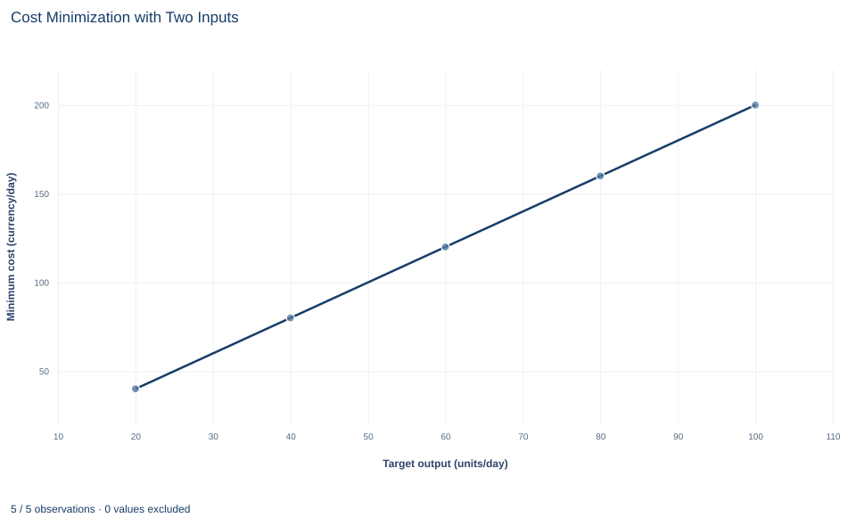

# Lab 11 · Cost Minimization with Two Inputs

**Isoquants, isocost lines and conditional input demands**

## Start with the supplied workbook

1. Download [conditional_inputs.xlsx](conditional_inputs.xlsx) and the [Python lab](lab.py). The workbook holds the six fixed scenarios used throughout this chapter.
2. Import `conditional_inputs.xlsx` into OpenEconometrics and keep that file name as the dataset name. The `Data` sheet holds one row per scenario: a required output and the two input prices. The `Dictionary` sheet explains each column and its unit; no cell is blank.
3. Open the complete `lab.py` in a new Python document and run the whole file. It solves every scenario and displays a table of eight solution values, a line chart of minimum cost against target output and the reported numbers.

For ordinary Python, keep `lab.py` and the workbook in the same folder and run the script there, or call `from lab import run_lab` and then `run_lab(data_path="/path/to/conditional_inputs.xlsx")`. To try a new scenario, add a row to a copy of the loaded table so the distributed workbook stays unchanged.

A workshop has promised to deliver 60 units of output a day. It can do that with many workers and little equipment or with few workers and a lot of equipment. Labor costs 4 currency units per unit and capital rents for 1. Which combination is cheapest, and what does it cost? Then the wage rises to 9 while the promise stays at 60. Does the workshop pay more for the same plan, or change the plan?

At the original prices the cheapest plan uses 15 units of labor and 60 units of capital, for a minimum cost of 120 currency units a day. After the wage rise it uses 10 units of labor and 90 units of capital, for 180 a day.

The workbook contains **six synthetic scenarios**, not records of real firms. Five hold the wage at 4 and the rental rate at 1 and step the target output from 20 to 100 units a day. The sixth repeats the 60-unit target with a wage of 9. Each row is a point at which the same model is solved; nothing is sampled, so there is no sampling uncertainty. Prices are in a hypothetical currency. The [LaTeX table](table.tex) collects the reported numbers.

## 1. State the problem the firm is solving

Cost minimization takes the output target $q$ as fixed; the only decision is how to produce it. The firm chooses labor $L$ and capital $K$ to

$$
\min_{L>0,\;K>0}\; wL+rK
\quad\text{subject to}\quad 2\sqrt{LK}=q,
$$

where $q$ is required output in units per day, $L$ and $K$ are the amounts of labor and capital services used per day, $w$ is the wage in currency per unit of labor, and $r$ is the rental rate in currency per unit of capital. The three workbook columns `output`, `wage` and `rental` supply $q$, $w$ and $r$ for each scenario.

This is not profit maximization, which also chooses $q$ by comparing revenue with cost and so needs an output price; this workbook has none. The solutions, written $L^c(w,r,q)$ and $K^c(w,r,q)$, are **conditional** input demands: conditional on the output target. The resulting cost function $C(w,r,q)$ feeds a later output decision, which the next lab takes for a price-taking firm.

## 2. Read the technology through its isoquants

The production function $q=2\sqrt{LK}$ says how much output a bundle of inputs produces. An **isoquant** collects every bundle that produces the same output. Squaring the constraint gives

$$
LK=\frac{q^2}{4},
$$

so the 60-unit isoquant is $LK=900$, a curve bowed toward the origin through $(15,60)$, $(20,45)$, $(10,90)$ and every other pair whose product is 900.

The slope of an isoquant says how much capital can be released when one more unit of labor is added at fixed output. Along it $dq=MP_L\,dL+MP_K\,dK=0$, so $-dK/dL=MP_L/MP_K$, the **marginal rate of technical substitution**. For this technology,

$$
MP_L=\frac{\partial q}{\partial L}=\sqrt{K/L},\qquad
MP_K=\frac{\partial q}{\partial K}=\sqrt{L/K},\qquad
MRTS=\frac{MP_L}{MP_K}=\frac{K}{L}.
$$

At $(15,60)$, $MP_L=\sqrt{4}=2$ units of output per unit of labor and $MP_K=\sqrt{1/4}=0.5$ units of output per unit of capital, so $MRTS=4$: at the margin, one more unit of labor replaces four units of capital. Moving toward more labor lowers $K/L$, so the MRTS falls. This diminishing MRTS makes the isoquant convex, and convexity makes the tangency in Section 4 a minimum rather than a maximum.

Both inputs are essential: if either is zero, output is zero, so the solution is interior. The technology also has **constant returns to scale**: $2\sqrt{kL\cdot kK}=k\cdot 2\sqrt{LK}$, so scaling both inputs by $k$ scales output by $k$.

## 3. Read the input prices through isocost lines

An **isocost line** collects bundles with the same total cost $C$:

$$
wL+rK=C
\quad\Longleftrightarrow\quad
K=\frac{C}{r}-\frac{w}{r}\,L.
$$

Its slope is $-w/r$. At the base prices $w/r=4/1=4$: one more unit of labor costs as much as four more units of capital. The ratio's unit, (currency per unit of labor) divided by (currency per unit of capital), is units of capital per unit of labor, the unit of the MRTS, so the two compare directly. A higher $C$ shifts the line outward; the firm wants the lowest line that still touches the required isoquant.

## 4. Derive the tangency condition and the conditional demands

Suppose the firm sits on the isoquant where $MRTS>w/r$. One more unit of labor lets it release $MRTS$ units of capital, saving $r\cdot MRTS$ in rental at an extra cost of only $w$. Because $r\cdot MRTS>w$, the swap lowers cost at unchanged output, so that bundle was not the cheapest. The reverse swap works whenever $MRTS<w/r$. The only bundle with no cost-saving swap satisfies

$$
\frac{K}{L}=MRTS=\frac{w}{r},
\qquad\text{equivalently}\qquad
\frac{MP_L}{w}=\frac{MP_K}{r}.
$$

The second form says the last currency unit spent on each input buys the same extra output.

Now solve. Tangency gives $K=(w/r)L$. Substituting into $LK=q^2/4$ gives $(w/r)L^2=q^2/4$, and taking the positive root,

$$
L^c=\frac q2\sqrt{\frac rw},\qquad
K^c=\frac wr\,L^c=\frac q2\sqrt{\frac wr},\qquad
C(w,r,q)=wL^c+rK^c=q\sqrt{wr}.
$$

Worked at the base scenario, $q=60$, $w=4$, $r=1$:

- labor: $L^c=30\sqrt{1/4}=15$ units per day;
- capital: $K^c=30\sqrt{4}=60$ units per day;
- output check: $2\sqrt{15\times 60}=2\sqrt{900}=60$;
- tangency check: $K/L=60/15=4=w/r$;
- cost: $4\times 15+1\times 60=120$ currency per day.

The Lagrangian $wL+rK+\lambda(q-2\sqrt{LK})$ gives the same answer: its first-order conditions $w=\lambda\,MP_L$ and $r=\lambda\,MP_K$ divide to the tangency condition. The multiplier $\lambda=w/MP_L=4/2=2$ is the cost of one more unit of output, the firm's marginal cost at these prices.

## 5. Solve every scenario

**Pause before running.** Predict the capital–labor ratio $K/L$ for the five scenarios at a wage of 4 and for the scenario at a wage of 9.

The code applies the two conditional-demand formulas to every row and then prices the chosen bundle:

```python
raw = load_data()  # reader defined in the complete lab.py
plan = raw.assign(
    labor=raw.output / 2 * (raw.rental / raw.wage) ** 0.5,
    capital=raw.output / 2 * (raw.wage / raw.rental) ** 0.5,
)
plan["cost"] = plan.wage * plan.labor + plan.rental * plan.capital
plan["capital_per_labor"] = plan.capital / plan.labor
display(plan)
```

The displayed table reads:

| Scenario | Target output (units/day) | Wage (currency/unit of labor) | Rental (currency/unit of capital) | Labor (units/day) | Capital (units/day) | Minimum cost (currency/day) | Capital per unit of labor |
|---|---:|---:|---:|---:|---:|---:|---:|
| 1 | 20 | 4 | 1 | 5 | 20 | 40 | 4 |
| 2 | 40 | 4 | 1 | 10 | 40 | 80 | 4 |
| 3 (base) | 60 | 4 | 1 | 15 | 60 | 120 | 4 |
| 4 | 80 | 4 | 1 | 20 | 80 | 160 | 4 |
| 5 | 100 | 4 | 1 | 25 | 100 | 200 | 4 |
| 6 (high wage) | 60 | 9 | 1 | 10 | 90 | 180 | 9 |

Read the last column first: it equals $w/r$ in every row, 4 at the base prices and 9 at the high wage. Then read down the base-price rows. Doubling the target from 20 to 40 doubles labor, capital and cost, and every base-price row costs 2 currency units per unit of output. That is constant returns at work: $C=q\sqrt{wr}$ is proportional to $q$, and $\sqrt{4\times1}=2$ is the marginal cost of Section 4.

The lab checks both defining conditions on every row, and you can repeat the check:

```python
produced = 2 * (plan.labor * plan.capital) ** 0.5
print((produced - plan.output).abs().max(), (plan.capital_per_labor - plan.wage / plan.rental).abs().max())
```

It prints `0.0 0.0`: the largest gap between produced and required output, and the largest gap between $K/L$ and $w/r$, are both zero.

## 6. Follow the wage increase

Scenarios 3 and 6 differ only in the wage. Labor falls from 15 to 10, a third less, and capital rises by half, from 60 to 90. The new bundle is on the same isoquant, since $10\times 90=900$, but at a point where the isoquant is steeper, $K/L=9$, matching the new price ratio.

This movement along a fixed isoquant is the **substitution effect** of an input-price change; with output held fixed there is no scale effect. Minimum cost rises from 120 to 180, or 50%, while the wage rose by 125%. With $r=1$, cost grows with $\sqrt{w}$, and $\sqrt{9/4}=1.5$. Cost rises by less than the wage because labor is only part of the bill and because the firm moves away from the dearer input. Marginal cost rises from 2 to $\sqrt{9\times 1}=3$ per unit, which would matter to a firm that also chose its output.

Do not read 180 as "the old plan at the new wage." It is the minimum over all bundles on the 60-unit isoquant at the new prices, so it already includes the saving from substitution.

## 7. Read the chart



The chart plots the five base-price scenarios only. Target output runs along the horizontal axis from 20 to 100 units a day, and minimum cost runs up the vertical axis from 40 to 200 currency a day. The points lie on one straight line with slope 2 currency per unit: each extra 20 units of output adds 40 to minimum cost. Extended to the left, the line would pass through the origin, because this model has no fixed cost.

The high-wage scenario is not plotted; it would sit at $(60,180)$ on a steeper line with slope 3. The chart is a cost curve, not an isoquant diagram, so the labor and capital behind each point are found only in the table of Section 5.

## A case from the literature

The technology $q=2\sqrt{LK}$ is a Cobb–Douglas function, and the cost function of Section 4 describes the same technology through the cheapest way to reach each output. Diewert (1971) showed how this equivalence between production and cost functions yields input demand equations that can be estimated. A central number in such estimates is the elasticity of substitution between capital and labor; capital–labor substitution is the subject of Arrow et al. (1961). Here it equals one: in Section 6 the wage–rental ratio rises from 4 to 9, and the capital–labor ratio rises in the same proportion.

Raval (2019) asked whether US manufacturing plants substitute that readily. In plant data he found several facts inconsistent with a Cobb–Douglas production function, including large and persistent variation in capital shares. He then estimated the elasticity from variation in local wages, using several instruments for those wages for identification, and obtained estimates between 0.3 and 0.5 across all plants. Oberfield and Raval (2021) combined substitution within plants with reallocation across plants and put the aggregate elasticity for US manufacturing at 0.5 to 0.7.

An elasticity below one would change the numbers in Section 6, not the tangency logic. After the wage rise the plant would still move along its isoquant toward capital, but its capital–labor ratio would rise proportionally less than the price ratio. The lab's wage change is stipulated, so it needs no identification argument; wage differences between real plants do.

## 8. Decide what the solution supports

The tangency calculation relies on interior substitution. It assumes divisible inputs, positive input prices that the firm takes as given, a known technology with convex isoquants, and no fixed cost or capacity limit.

With fixed proportions, isoquants have kinks and no tangency exists. If capital cannot be adjusted quickly, for example because equipment is leased for a year, the firm cannot move from $(15,60)$ to $(10,90)$ when the wage rises, and its short-run cost exceeds the minimum shown here. Indivisible machines or a minimum staffing rule would also change the answer.

The scenarios are stipulated points on a model's schedules: they show what this technology and these prices imply, not any actual workshop's costs or best output.

## 9. Write the conclusion in full

A complete statement reads: "For the technology $q=2\sqrt{LK}$, the least-cost way to produce 60 units a day at a wage of 4 and a rental rate of 1 uses 15 units of labor and 60 units of capital, at a minimum cost of 120 currency units a day; there the capital–labor ratio, 4, equals the input-price ratio. When the wage rises to 9 with output held at 60, the cost-minimizing bundle becomes 10 units of labor and 90 of capital, and minimum cost rises to 180. At the base prices minimum cost is 2 per unit of output for every target from 20 to 100, as constant returns imply."

It names the output target, both prices and the technology before any input quantity.

## Student exercises

1. Verify the high-wage scenario by hand: show that the bundle $(10,90)$ produces 60 units and satisfies the tangency condition at $w=9$, $r=1$. Compute $MP_L$ and $MP_K$ at that bundle and state the unit of each.
2. Suppose the workshop kept the base bundle of 15 units of labor and 60 units of capital after the wage rose to 9. Compute its daily cost and compare it with the minimum of 180. What does the difference measure?
3. Compute labor's share of minimum cost, $wL^c/C$, in the base and the high-wage scenarios. Explain why the share does not change even though the input mix does.
4. On a copy of the data, add a scenario with output 60, wage 4 and rental 4. Predict the capital–labor ratio first, then compute labor, capital and minimum cost with the code from Section 5.
5. Differentiate $C(w,r,q)=q\sqrt{wr}$ with respect to $w$ and evaluate the derivative at the base scenario. Compare the result with conditional labor demand, and explain in words why the two should agree.
6. Suppose instead that output required inputs in fixed proportions, $q=\min\{4L,K\}$. Find the cost-minimizing bundle and its cost for 60 units at a wage of 4 and at a wage of 9, both with rental 1. Compare the cost increase with the one in Section 6 and explain the difference.

## Further reading

- Arrow, K. J., Chenery, H. B., Minhas, B. S., and Solow, R. M. (1961). Capital-labor substitution and economic efficiency. *The Review of Economics and Statistics*, 43(3), 225–250. https://doi.org/10.2307/1927286
- Diewert, W. E. (1971). An application of the Shephard duality theorem: A generalized Leontief production function. *Journal of Political Economy*, 79(3), 481–507. https://doi.org/10.1086/259764
- Oberfield, E., and Raval, D. (2021). Micro data and macro technology. *Econometrica*, 89(2), 703–732. https://doi.org/10.3982/ecta12807
- Raval, D. R. (2019). The micro elasticity of substitution and non-neutral technology. *The RAND Journal of Economics*, 50(1), 147–167. https://doi.org/10.1111/1756-2171.12265
