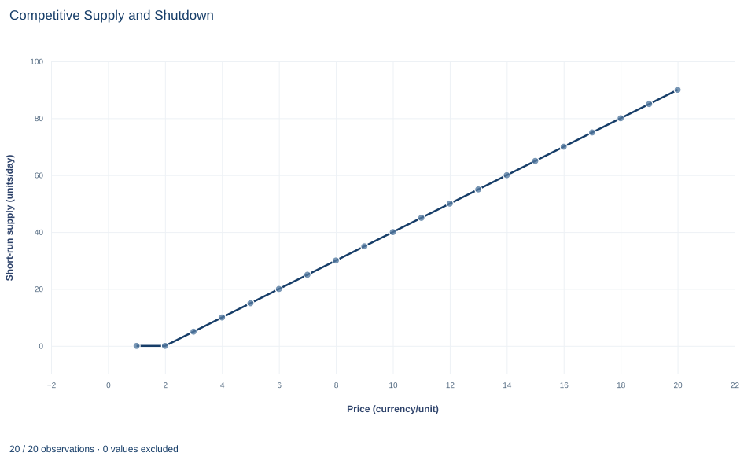

# Lab 12 · Competitive Supply and Shutdown

**Price equals marginal cost, the shutdown price and short-run supply**

## Start with the supplied workbook

1. Download [competitive_supply.xlsx](competitive_supply.xlsx) and the [Python lab](lab.py). The workbook holds the twenty fixed price scenarios used throughout this chapter.
2. Import `competitive_supply.xlsx` into OpenEconometrics and keep that file name as the dataset name. The `Data` sheet holds one row per output price, together with the firm's three cost parameters. The `Dictionary` sheet explains each column and its unit; no cell is blank.
3. Open the complete `lab.py` in a new Python document and run the whole file. It computes the firm's output and profit at every price and displays a table of five solution values, a line chart of the short-run supply schedule and the reported numbers.

For ordinary Python, keep `lab.py` and the workbook in the same folder and run the script there, or call `from lab import run_lab` and then `run_lab(data_path="/path/to/competitive_supply.xlsx")`. To try different costs, change a copy of the loaded table so the distributed workbook stays unchanged.

A small producer sells in a market where it cannot influence the price. It has already committed to a daily fixed cost of 100 currency units, for example a lease it must pay whether it opens or not. At a price of 12 per unit the decision is easy: it produces 50 units a day and earns a profit of 150. At a price of 5 it loses money whatever it does. Should it close? Closing still leaves the 100 to pay, so the real question is whether producing makes the loss smaller or larger. At a price of 1 the answer flips again, and the firm produces nothing.

The workbook contains **twenty synthetic price scenarios**, prices 1 through 20 currency units per unit of output. Every row carries the same cost parameters: a fixed cost of 100 per day, a linear variable-cost coefficient of 2 and a quadratic coefficient of 0.1. Each row is a point on one firm's supply schedule, computed from the model rather than observed, so there is no sampling uncertainty. The [LaTeX table](table.tex) collects the reported numbers.

## 1. Separate fixed cost from variable cost

The columns `fixed_cost`, `linear_cost` and `quadratic_cost` define the firm's daily cost of producing $q$ units per day:

$$
C(q)=\underbrace{100}_{F}+\underbrace{2q+0.1q^2}_{VC(q)}.
$$

$F$ is fixed: it is the same at every output, including zero, because in this short run it cannot be avoided. $VC(q)$ is variable: it is zero at zero output and rises with output. The linear term charges 2 currency units for every unit produced. The quadratic term makes each additional unit more expensive than the last, as when a fixed workshop becomes crowded. Its coefficient, 0.1, is in currency per day per (unit per day) squared, so that $0.1q^2$ is in currency per day like every other term.

From $C(q)$ follow four per-unit measures, each in currency per unit:

$$
MC(q)=2+0.2q,\qquad AVC(q)=\frac{VC(q)}{q}=2+0.1q,\qquad AFC(q)=\frac{100}{q},\qquad ATC(q)=AVC(q)+AFC(q).
$$

Marginal cost is the derivative $dC/dq$. The fixed cost has no derivative term, so it does not enter $MC$.

## 2. Choose output where price equals marginal cost

A price taker earns $P$ on every unit regardless of how many it sells. Daily profit is

$$
\pi(q)=Pq-100-2q-0.1q^2.
$$

Differentiate: $d\pi/dq=P-2-0.2q$. While $P>MC(q)$, one more unit adds more to revenue than to cost, so output should rise; while $P<MC(q)$, the last unit loses money and output should fall. The best positive output therefore satisfies

$$
P=MC(q)=2+0.2q\quad\Longrightarrow\quad q=\frac{P-2}{0.2}=5(P-2).
$$

The second derivative, $d^2\pi/dq^2=-0.2$, is negative at every output, so profit is a hill and this point is its top rather than a valley. That check matters: with a cost curve whose marginal cost falls over some range, $P=MC$ can also pick out a profit minimum. Here rising marginal cost rules that out.

Worked at $P=12$: $q=5\times10=50$ units per day. Revenue is $12\times50=600$. Variable cost is $2\times50+0.1\times2500=350$, total cost is $450$, and profit is $600-450=150$ currency per day.

## 3. Compare with shutting down

The first-order condition finds the best positive output, but zero output is also available. Shutting down earns no revenue, avoids all variable cost and still pays the fixed cost, so shutdown profit is $-100$ at every price.

Producing $q>0$ beats shutting down when

$$
Pq-VC(q)-100>-100
\quad\Longleftrightarrow\quad
Pq>VC(q)
\quad\Longleftrightarrow\quad
P>AVC(q).
$$

The fixed cost appears on both sides and cancels. Because it must be paid either way, it cannot affect the choice between producing and closing. What matters is whether revenue covers the costs that producing adds.

Here $AVC(q)=2+0.1q$ is never below 2 and approaches 2 as output shrinks toward zero. So the **shutdown price** is 2 currency per unit. Above it, the output $5(P-2)$ covers its variable cost with something left over. Substituting $P=2+0.2q$ shows that the surplus over variable cost is exactly $0.1q^2$, which is positive for any positive $q$. At or below 2, no positive output covers its variable cost.

This answers the opening question. At $P=5$ the firm produces 15 units, earns revenue of 75 and pays variable cost of 52.5. The 22.5 left over goes toward the fixed cost, so the day's profit is $-77.5$. Shutting down would mean $-100$. The firm loses money either way, but it loses 22.5 less by operating.

## 4. Assemble the supply rule

Combining the two steps gives the firm's short-run supply schedule:

$$
q^s(P)=\max\left\{0,\;\frac{P-2}{0.2}\right\}.
$$

Above the shutdown price, supply is the rising part of the marginal-cost curve read sideways: each extra currency unit of price calls forth 5 more units a day, because $dq^s/dP=1/0.2=5$. At or below 2, supply is zero. The `max` makes the rule well defined for every price, including those where the unconstrained formula would give a negative output; at $P=1$ it would give $-5$, which is not a possible plan.

## 5. Compute the schedule

**Pause before running.** Find $q$ at price 12, and decide whether the firm operates at price 2.

The code applies the supply rule to every row, then computes revenue, variable cost and profit:

```python
raw = load_data()  # reader defined in the complete lab.py
schedule = raw.assign(
    quantity=((raw.price - raw.linear_cost) / (2 * raw.quadratic_cost)).clip(lower=0)
)
schedule["revenue"] = schedule.price * schedule.quantity
schedule["variable_cost"] = schedule.linear_cost * schedule.quantity + schedule.quadratic_cost * schedule.quantity**2
schedule["profit"] = schedule.revenue - schedule.variable_cost - schedule.fixed_cost
selected = schedule.price.isin([1, 2, 3, 5, 12, 20])
display(schedule.loc[selected, ["price", "quantity", "revenue", "variable_cost", "profit"]].round(2))
```

The selected rows read:

| Price (currency/unit) | Output (units/day) | Revenue (currency/day) | Variable cost (currency/day) | Profit (currency/day) |
|---:|---:|---:|---:|---:|
| 1 | 0 | 0 | 0 | −100 |
| 2 | 0 | 0 | 0 | −100 |
| 3 | 5 | 15 | 12.5 | −97.5 |
| 5 | 15 | 75 | 52.5 | −77.5 |
| 12 | 50 | 600 | 350 | 150 |
| 20 | 90 | 1,800 | 990 | 710 |

Read the output column first. It is zero at prices 1 and 2 and then rises by 5 units for each unit of price. Then compare revenue with variable cost: from price 3 upward revenue exceeds variable cost in every row, which is the condition for operating. Profit, which also subtracts the fixed 100, is negative at low prices and positive at high ones. The rows with negative profit and positive output are the scenarios in which the firm operates at a loss because operating loses less.

## 6. Read the costs behind the price-12 decision

At the chosen output, the three per-unit cost measures summarize the decision. The next block evaluates them at price 12:

```python
row = schedule.loc[schedule.price == 12].iloc[0]
q = row.quantity
mc = row.linear_cost + 2 * row.quadratic_cost * q
avc = row.linear_cost + row.quadratic_cost * q
atc = avc + row.fixed_cost / q
print(round(mc, 2), round(avc, 2), round(atc, 2))
```

It prints `12.0 7.0 9.0`. Marginal cost equals the price, 12, as the output rule requires. Average variable cost, 7, is below the price, so operating beats shutting down. Average total cost, 9, is also below the price, so profit is positive: $(12-9)\times50=150$, the same figure as before, now written as margin per unit times units.

Keep these three comparisons distinct. $P=MC$ chooses how much to produce. $P$ against $AVC$ decides whether to produce at all in the short run. $P$ against $ATC$ only says whether the firm is making a profit, and in the short run that does not change what it should do.

## 7. Read the chart



The chart plots the twenty scenarios with price on the horizontal axis and the chosen output on the vertical axis, from 0 to 90 units a day. The line runs flat along zero for prices 1 and 2, kinks at the shutdown price of 2, and then rises in a straight line with slope 5 units per currency unit, reaching 90 at price 20. Supply diagrams usually put price on the vertical axis; this chart swaps the axes, so its slope is the reciprocal of the marginal-cost slope, 0.2.

The chart does not show profit. The points between the shutdown price and the price at which profit turns positive look no different from the others, even though the firm is losing money there. Use the table to see where profit changes sign.

## A case from the literature

Section 3 compares price with average variable cost because the fixed cost is owed whether the firm opens or not; the relation between cost curves and supply curves is the subject of Viner (1932). Moel and Tufano (2002) studied real shutdown decisions in the annual opening and closing choices of 285 developed North American gold mines from 1988 to 1997. Whether a mine was open was related to the level and volatility of the gold price, to interest rates and to the mine's fixed costs, variable costs and reserves. The authors also found strong evidence of hysteresis, consistent with costs of opening and closing, and found that closures were related to the profitability of the firm's other mines and businesses.

Hysteresis is what this lab's one-period rule leaves out. Dixit (1989) analyzed entry and exit when the output price follows a random walk and showed that the exit trigger lies below variable cost minus the interest on the exit cost, so an active firm may keep operating at some prices below its variable cost. Output can also be less flexible than this lab assumes: Anderson et al. (2018) found that oil production from existing Texas wells did not respond to oil prices, while drilling did.

The rule $P>AVC$ is exact for this lab's firm, which can close at no cost and vary output freely within one period. The studies show what real producers add: costs of switching, uncertain future prices and capacity that cannot be adjusted at once.

## 8. Decide what the schedule supports

The rule rests on four assumptions: the firm takes price as given, variable cost is convex so marginal cost rises, output can be varied continuously, and the fixed cost is unavoidable during the period considered. Under them the supply schedule is exact for this cost function.

It is a short-run rule. Over a longer horizon the lease can be canceled, the fixed cost becomes avoidable, and the firm should stay only if price covers average total cost. Positive profit at high prices can attract entry, which would lower the market price if technology and market conditions permit. A single firm's short-run supply curve therefore says nothing about long-run industry equilibrium, and these stipulated scenarios say nothing about any real producer's costs.

## 9. Write the conclusion in full

A complete statement for the worked example reads: "For a price-taking firm with daily cost $100+2q+0.1q^2$, where the 100 is unavoidable in the short run, output is chosen where price equals marginal cost, $q=5(P-2)$, as long as the price exceeds the minimum average variable cost of 2 currency units per unit; below that the firm shuts down. At a price of 12 the firm supplies 50 units a day and earns a profit of 150. At a price of 1 it produces nothing and its profit is $-100$, the fixed cost. Between these, there are prices at which the firm operates at a loss because revenue more than covers variable cost."

The statement gives the cost function and the time horizon before any quantity, and it keeps the operating decision separate from the sign of profit.

## Student exercises

1. Using the supply rule, compute output, revenue, variable cost and profit at prices 8 and 9. Between which two whole-number prices does profit change sign?
2. Find the price at which profit is exactly zero by minimizing average total cost. Show that marginal cost equals average total cost at that output, and explain what this price would mean if the fixed cost became avoidable.
3. At price 1, compute the profit the firm would earn if it produced 5 units anyway. Use average variable cost to explain why every positive output is worse than shutting down at that price.
4. On a copy of the data, raise `fixed_cost` from 100 to 200 in every row. Predict how the supply schedule and the profit at price 12 change before rerunning the code from Section 5, then check.
5. Suppose 40 identical firms with this cost function serve the market. Write the market supply schedule and compute market output at price 12.
6. A report says: "At a price of 6 the firm is losing money, so it should close." Compute the firm's profit from operating and from shutting down at that price, and rewrite the sentence so it states the correct decision and the reason.

## Further reading

- Anderson, S. T., Kellogg, R., and Salant, S. W. (2018). Hotelling under pressure. *Journal of Political Economy*, 126(3), 984–1026. https://doi.org/10.1086/697203
- Dixit, A. (1989). Entry and exit decisions under uncertainty. *Journal of Political Economy*, 97(3), 620–638. https://doi.org/10.1086/261619
- Moel, A., and Tufano, P. (2002). When are real options exercised? An empirical study of mine closings. *Review of Financial Studies*, 15(1), 35–64. https://doi.org/10.1093/rfs/15.1.35
- Viner, J. (1932). Cost curves and supply curves. *Zeitschrift für Nationalökonomie*, 3(1), 23–46. https://doi.org/10.1007/bf01316299
