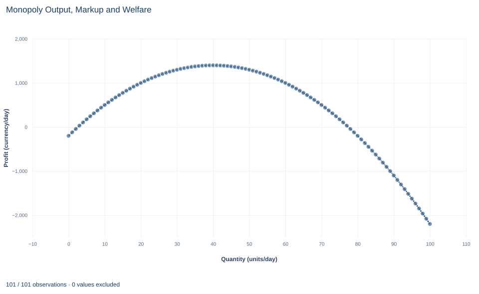

# Lab 13 · Monopoly Output, Markup and Welfare

**Marginal revenue, the monopoly markup and deadweight loss**

## Start with the supplied workbook

1. Download [monopoly_welfare.xlsx](monopoly_welfare.xlsx) and the [Python lab](lab.py). The workbook holds the 101 fixed points on the market demand schedule used throughout this chapter.
2. Import `monopoly_welfare.xlsx` into OpenEconometrics and keep that file name as the dataset name. The `Data` sheet holds one row per market quantity, with the price buyers would pay for it and the firm's two cost figures. The `Dictionary` sheet explains each column and its unit; no cell is blank.
3. Open the complete `lab.py` in a new Python document and run the whole file. It solves the monopolist's problem and displays a table of eight solution values, a line chart of profit at every quantity and the reported numbers.

For ordinary Python, keep `lab.py` and the workbook in the same folder and run the script there, or call `from lab import run_lab` and then `run_lab(data_path="/path/to/monopoly_welfare.xlsx")`. To try different costs, change a copy of the loaded table so the distributed workbook stays unchanged.

A single seller supplies a whole market. Buyers would take 80 units a day if the price were 20, which is what each unit costs the seller to make. The seller instead sells 40 units at a price of 60 and earns a daily profit of 1,400. Consumers pay more and buy less, and 40 units that buyers value above their cost are never produced. How much of that is a transfer from buyers to the seller, and how much is a loss that nobody gets?

The workbook contains **101 synthetic points on one demand schedule**, for quantities 0 to 100 units a day. Each row is a candidate market quantity, not an observed sale. Price follows the inverse demand $P=100-Q$; marginal cost is 20 and the fixed cost is 200 in every row. Prices are in a hypothetical currency per unit and costs in currency per day. The [LaTeX table](table.tex) collects the reported numbers.

## 1. Read the demand schedule

The columns describe one market:

- `quantity` is total market output $Q$ in units per day;
- `price` is the highest price at which buyers would take that quantity, the inverse demand $P(Q)=100-Q$, in currency per unit;
- `marginal_cost` is the cost of one more unit, constant at 20 currency per unit;
- `fixed_cost` is a daily cost of 200 that does not change with output.

Read across the rows and the price falls by exactly 1 for each extra unit. That slope matters. A monopolist is the whole market, so it cannot sell more without moving down this schedule. A price taker, by contrast, faces a flat demand at the market price.

## 2. See why marginal revenue lies below price

Total revenue is price times quantity:

$$
TR(Q)=P(Q)\,Q=(100-Q)Q=100Q-Q^2.
$$

Marginal revenue is its derivative,

$$
MR(Q)=\frac{dTR}{dQ}=P(Q)+Q\,\frac{dP}{dQ}=100-2Q.
$$

The middle form shows the two effects of selling one more unit. The new unit brings in its price $P$. But to sell it the price must fall by 1 on every unit, and the $Q$ units already being sold lose that amount. Marginal revenue therefore equals price minus $Q$ currency units, and it is below price at every positive quantity.

Check with two workbook rows. At $Q=20$ revenue is $80\times20=1600$; at $Q=21$ it is $79\times21=1659$. The extra unit adds 59, which is its price of 79 less the 1-unit price cut on the 20 units already sold. The derivative $100-2\times20=60$ is the same idea measured at a point rather than across a whole unit.

## 3. Choose output where marginal revenue equals marginal cost

Profit is revenue minus variable and fixed cost:

$$
\pi(Q)=100Q-Q^2-20Q-200.
$$

Setting the derivative to zero gives $MR=MC$:

$$
100-2Q=20\quad\Longrightarrow\quad Q_M=40,\qquad P_M=100-40=60.
$$

If $MR>MC$, one more unit adds more revenue than cost, so output should rise; if $MR<MC$ it should fall. The second derivative, $-2$, is negative, so this point is the top of the profit hill. The price comes from the demand curve at the chosen quantity, not from the $MR=MC$ condition itself: the firm picks a quantity, and buyers' willingness to pay sets the price.

Profit at the optimum is $(60-20)\times40-200=1600-200=1400$ currency per day. The fixed cost lowers profit by 200 at every quantity, so it does not move the location of the peak. It matters for whether the firm wants to be in the market at all, not for how much it sells once there.

Setting price equal to marginal cost would ignore the revenue lost on the units already sold, and at $Q=80$ marginal revenue is $100-160=-60$: the last units would lower revenue by more than they cost to make.

## 4. Solve the monopoly problem

**Pause before running.** Find monopoly output, then the price buyers pay for it.

The first block evaluates revenue and profit at every point on the schedule and picks the best one:

```python
raw = load_data()  # reader defined in the complete lab.py
market = raw.assign(revenue=raw.price * raw.quantity)
market["profit"] = market.revenue - market.marginal_cost * market.quantity - market.fixed_cost
best = market.loc[market.profit.idxmax()]
print(best.quantity, best.price, best.profit)
display(market.loc[market.quantity.isin([0, 20, 40, 60, 80, 100]), ["quantity", "price", "revenue", "profit"]])
```

It prints `40 60 1400` and displays:

| Quantity (units/day) | Price (currency/unit) | Revenue (currency/day) | Profit (currency/day) |
|---:|---:|---:|---:|
| 0 | 100 | 0 | −200 |
| 20 | 80 | 1,600 | 1,000 |
| 40 | 60 | 2,400 | 1,400 |
| 60 | 40 | 2,400 | 1,000 |
| 80 | 20 | 1,600 | −200 |
| 100 | 0 | 0 | −2,200 |

The search over the schedule agrees with the calculus: profit peaks at 40 units. Notice that revenue is the same at 40 and 60 units while profit is not, because the extra 20 units cost 20 each to make. Profit at 80 units is $-200$: there price equals marginal cost, every unit just covers its own cost, and only the fixed cost remains.

The second block applies the closed-form solution and the welfare formulas of Section 5:

```python
a = raw.price.iloc[0]                         # price at zero quantity
slope = raw.price.iloc[0] - raw.price.iloc[1]  # price fall per extra unit
c = raw.marginal_cost.iloc[0]
f = raw.fixed_cost.iloc[0]
q_m = (a - c) / (2 * slope)
p_m = a - slope * q_m
q_c = (a - c) / slope
print(q_m, p_m, q_c)
print((p_m - c) * q_m - f, 0.5 * (a - p_m) * q_m, (p_m - c) * q_m, 0.5 * (q_c - q_m) * (p_m - c), round((p_m - c) / p_m, 3))
```

The first line prints `40.0 60.0 80.0`: monopoly quantity, monopoly price and the competitive quantity. The second prints `1400.0 800.0 1600.0 800.0 0.667`: profit, consumer surplus, variable producer surplus, deadweight loss and the markup fraction.

## 5. Separate transfers from the deadweight loss

The **competitive benchmark** asks what would happen if output expanded until price equals marginal cost: $100-Q=20$, so $Q_C=80$. It is an output-allocation comparison with the same demand and the same costs, not a claim that free entry would produce it.

Three areas describe the monopoly outcome, each in currency per day:

- **Consumer surplus** is buyers' willingness to pay above the price, the triangle under demand and above 60 from 0 to 40 units: $\tfrac12(100-60)\times40=800$.
- **Variable producer surplus** is revenue above variable cost, the rectangle between 60 and 20 over 40 units: $(60-20)\times40=1600$. Subtracting the fixed cost gives profit, $1600-200=1400$.
- **Deadweight loss** is the value of the trades that do not happen. Units 41 to 80 are worth more to buyers than their cost of 20, yet they are not produced. The lost value is the triangle between demand and marginal cost over those units:

$$
DWL=\tfrac12(Q_C-Q_M)(P_M-MC)=\tfrac12(80-40)(60-20)=800.
$$

The rectangle of 1,600 is not a social loss. Under the competitive benchmark, buyers of the first 40 units would have paid 20 rather than 60; under monopoly that difference goes to the seller instead. Moving money from buyers to the seller changes who gains, not how much is gained in total. Counting all of monopoly revenue, or all of profit, as a loss to society would confuse that transfer with the loss from trades that never happen. Only the triangle measures surplus that no one receives.

## 6. Read the markup

The **markup fraction** $(P_M-MC)/P_M=(60-20)/60\approx0.667$ says that two thirds of the monopoly price is a margin above marginal cost. A competitive firm's markup fraction is zero, because its price equals marginal cost.

This fraction, also called the Lerner index, is tied to how strongly buyers respond to price. Rearranging $MR=MC$ with $MR=P(1+1/\varepsilon)$, where $\varepsilon$ is the price elasticity of demand, gives $(P-MC)/P=-1/\varepsilon$. A monopolist facing very responsive buyers has little room to mark up; one facing unresponsive buyers has more. Because marginal cost is positive, a monopolist always chooses a point where demand is elastic, $\varepsilon<-1$. The markup is a fraction of price, not of cost.

## 7. Read the chart



The chart plots the monopolist's profit against quantity, using all 101 points on the schedule. Profit starts at $-200$ at zero output, rises to its single peak of 1,400 at 40 units, falls back to $-200$ at 80 units and reaches $-2{,}200$ at 100 units. The curve is a symmetric hill around 40, because profit is a quadratic in $Q$.

Read two points against the welfare discussion. The peak marks the monopoly choice. The point at 80 units, where profit equals minus the fixed cost, is the competitive benchmark: from the firm's side, the units between 40 and 80 lower its profit, even though from society's side they are worth producing. The chart shows profit only; consumer surplus and deadweight loss are not drawn.

## A case from the literature

Sections 5 and 6 measure two things: the deadweight loss on units never produced, and the markup of price over marginal cost as a gauge of monopoly power, whose concept and measurement Lerner (1934) examined. Both have been estimated for whole economies.

De Loecker et al. (2020) used firm-level data on the US economy since 1955. They estimated that aggregate markups began rising in 1980, from 21% above marginal cost to 61% at the time of the study, driven mainly by the upper tail of the distribution while the median was unchanged. Baqaee and Farhi (2020) developed formulas for the social cost of distortions such as markups in an economy of linked industries. Applied to US firm-level markups, their estimates imply that removing the misallocation caused by large and dispersed markups would raise aggregate total factor productivity by about 15%, two orders of magnitude above a famous earlier estimate of 0.1% for the cost of monopoly. They caution that the data are imperfect and need substantial imputation.

Posner (1975) questioned treating profit as a pure transfer. He assumed that competition to obtain a monopoly turns expected monopoly profits into social costs, and his tentative estimates suggested that regulation was probably a larger source of social costs than private monopoly.

Both points go beyond this lab. When markups differ across firms, resources are misallocated between markets, which one market's triangle cannot show. And the split in Section 5 holds only if nothing is spent winning or defending the monopoly.

## 8. Decide what the model supports

The calculation assumes a single price for all buyers, a known linear demand, constant marginal cost and a fixed cost of 200 that is common to both outcomes being compared. It is a static, partial-equilibrium model: one market, one period, no effects on other markets.

Several real features would change the comparison. A seller able to charge different prices to different buyers could sell more units and convert more consumer surplus into profit. Profit can finance innovation, which a static model ignores. Entry by rivals, or the threat of it, can push price toward cost. Producer surplus here excludes the separately stated fixed cost, so the welfare totals compare variable surplus. The scenarios are stipulated points on a model's schedule, not measurements of any real market.

## 9. Write the conclusion in full

A complete statement for the worked example reads: "With inverse demand $P=100-Q$, constant marginal cost 20 and a fixed cost of 200 per day, a single-price monopolist maximizes profit where marginal revenue equals marginal cost, selling 40 units a day at a price of 60 and earning a profit of 1,400. Consumers keep a surplus of 800. Expanding output to the competitive benchmark of 80 units would add trades worth 800 more than their cost, which is the deadweight loss of monopoly. The monopolist's price is two thirds margin over marginal cost; the 1,600 of variable producer surplus is a transfer from buyers, not a social loss."

The statement gives demand, costs and the pricing rule before any number, and it keeps transfers and the deadweight loss apart.

## Student exercises

1. Using the `revenue` column, compute the change in revenue from 39 to 40 units and from 40 to 41 units. Compare both with marginal cost and explain why the firm stops at 40.
2. Compute the price elasticity of demand at the monopoly point, $\varepsilon=(dQ/dP)(P/Q)$. Verify that the markup fraction equals $-1/\varepsilon$.
3. Compute consumer surplus and total variable surplus at the competitive benchmark. Show that the competitive consumer surplus splits exactly into monopoly consumer surplus, the transfer rectangle and the deadweight loss.
4. On a copy of the data, raise `fixed_cost` from 200 to 1,800. Predict monopoly output, price and profit before rerunning the code from Section 4. What would you advise the firm if the fixed cost could be avoided by leaving the market?
5. On another copy, raise `marginal_cost` from 20 to 30. Compute the new monopoly quantity, price, profit and deadweight loss. By how much does the price rise for the 10-unit rise in marginal cost?
6. A commentator writes: "The monopolist's profit of 1,400 is what monopoly costs society." Explain what is wrong with the claim and rewrite it with the correct welfare figure.

## Further reading

- Baqaee, D. R., and Farhi, E. (2020). Productivity and misallocation in general equilibrium. *The Quarterly Journal of Economics*, 135(1), 105–163. https://doi.org/10.1093/qje/qjz030
- De Loecker, J., Eeckhout, J., and Unger, G. (2020). The rise of market power and the macroeconomic implications. *The Quarterly Journal of Economics*, 135(2), 561–644. https://doi.org/10.1093/qje/qjz041
- Lerner, A. P. (1934). The concept of monopoly and the measurement of monopoly power. *The Review of Economic Studies*, 1(3), 157–175. https://doi.org/10.2307/2967480
- Posner, R. A. (1975). The social costs of monopoly and regulation. *Journal of Political Economy*, 83(4), 807–827. https://doi.org/10.1086/260357
