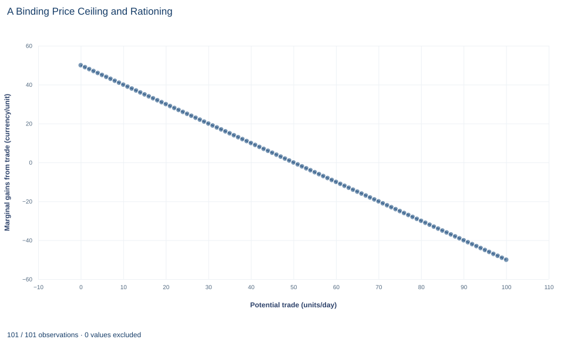

# Lab 14 · A Binding Price Ceiling and Rationing

**Shortage, the short-side rule and lost gains from trade**

## Start with the supplied workbook

1. Download [price_ceiling.xlsx](price_ceiling.xlsx) and the [Python lab](lab.py). The workbook holds the 101 fixed points on the demand and supply schedules used throughout this chapter.
2. Import `price_ceiling.xlsx` into OpenEconometrics and keep that file name as the dataset name. The `Data` sheet holds one row per potential quantity, with the price buyers would pay for that unit and the price sellers would need to supply it. The `Dictionary` sheet explains each column and its unit; no cell is blank.
3. Open the complete `lab.py` in a new Python document and run the whole file. It applies a legal maximum price of 25 and displays a table of nine solution values, a line chart of the marginal gain from each potential unit of trade and the reported numbers.

For ordinary Python, keep `lab.py` and the workbook in the same folder and run the script there, or call `from lab import run_lab` and then `run_lab(data_path="/path/to/price_ceiling.xlsx")`. To try a different ceiling, change the `ceiling` value in the code below rather than editing the workbook.

Left alone, this market clears at a price of 35 with 50 units a day changing hands. A regulator then caps the price at 25. Buyers now want 70 units, but sellers offer only 30. Those 30 units are cheaper for whoever gets them, yet 20 units that used to be traded are no longer traded, even though buyers value each of them above its cost. How can a lower legal price make the market as a whole worse off, and who gains and who loses?

The workbook contains **101 synthetic points on two straight-line schedules**, for quantities 0 to 100 units a day. Each row is a potential unit of trade, not an observed transaction. The ceiling price of 25 is set in the lab code rather than stored in the workbook. Prices are in a hypothetical currency per unit and surplus in currency per day. The [LaTeX table](table.tex) collects the reported numbers.

## 1. Read the two schedules

The three columns describe one market:

- `quantity` is a potential quantity $q$ in units per day;
- `demand_price` is buyers' willingness to pay for the $q$-th unit, the inverse demand $P_D(q)=60-0.5q$;
- `supply_price` is the lowest price at which sellers would supply the $q$-th unit, the inverse supply $P_S(q)=10+0.5q$, which is their marginal cost.

Both prices are in currency per unit. Inverting each schedule gives the quantities at a given price $P$: buyers want $Q_D(P)=(60-P)/0.5=2(60-P)$ units and sellers offer $Q_S(P)=(P-10)/0.5=2(P-10)$ units.

The unregulated market clears where the two schedules meet: $60-0.5q=10+0.5q$, so $q^*=50$ and $P^*=35$. Row 50 of the workbook shows exactly this: both columns equal 35.

## 2. Measure the gains from trade

Each unit traded creates a gain equal to the gap between what the buyer would pay and what it costs the seller to supply:

$$
g(q)=P_D(q)-P_S(q)=(60-0.5q)-(10+0.5q)=50-q.
$$

Adding up these gains over the units actually traded gives **total surplus**,

$$
TS(Q)=\int_0^Q (50-q)\,dq=50Q-\tfrac12Q^2,
$$

in currency per day. The gain is positive for every unit up to 50 and negative beyond it, so total surplus is largest when exactly 50 units trade: $TS(50)=2500-1250=1250$. That is the benchmark against which the ceiling is judged.

The price splits each unit's gain between the two sides. **Consumer surplus** is willingness to pay above the price paid, and **producer surplus** is the price received above the supply price. A price change moves gains from one side to the other; only a change in which units are traded changes the total.

## 3. See why a ceiling below 35 binds

A ceiling is a legal maximum. If it is above 35, the market price of 35 is still allowed and nothing changes. If it is below 35, it **binds**: the price cannot rise to clear the market.

At $P_c=25$:

$$
Q_D(25)=2(60-25)=70,\qquad Q_S(25)=2(25-10)=30.
$$

Buyers want 70 units a day and sellers offer 30. The **shortage** is $70-30=40$ units: a gap between desired quantities at the controlled price. It is not a quantity traded, and it is not a measure of welfare.

How much actually trades? No seller can be forced to supply a unit whose cost exceeds 25, and no buyer can be forced to buy. So trade is limited by whichever side wants less, the **short side**: $Q_{\text{trade}}=\min\{Q_D,Q_S\}=30$. Under a binding ceiling the short side is always supply.

## 4. Compute the quantities

**Pause before running.** What quantity trades at the ceiling of 25?

The first block reads the quantities straight off the two schedules:

```python
raw = load_data()  # reader defined in the complete lab.py
ceiling = 25.0     # legal maximum price, currency/unit
demanded = raw.loc[raw.demand_price >= ceiling, "quantity"].max()
supplied = raw.loc[raw.supply_price <= ceiling, "quantity"].max()
traded = min(demanded, supplied)
print(demanded, supplied, demanded - supplied, traded)
```

It prints `70 30 40 30`:

| Quantity at the ceiling | Units per day |
|---|---:|
| Demanded | 70 |
| Supplied | 30 |
| Shortage | 40 |
| Traded | 30 |

The first two lines find the last unit that buyers still value at 25 or more and the last unit that sellers will supply for 25 or less. Because both schedules are straight lines sampled at every whole unit, those rows land exactly on 70 and 30.

## 5. Decide who gets the scarce units

Seventy units are wanted and thirty are available, so some rule must decide which buyers get them. The consumer surplus depends on that rule, not only on the price.

The lab uses **efficient rationing**: the 30 units go to the buyers who value them most, the first 30 units on the demand schedule. This is a benchmark, the best case for consumers given the shortage. Under it,

$$
CS=\int_0^{30}(60-0.5q-25)\,dq=35\times30-0.25\times30^2=825,
$$

$$
PS=\int_0^{30}(25-10-0.5q)\,dq=15\times30-0.25\times30^2=225.
$$

The second block computes the same areas from the workbook rows:

```python
def area(heights):
    """Area under a straight-line schedule sampled at every whole unit."""
    h = heights.to_numpy()
    return float(((h[1:] + h[:-1]) / 2).sum())

within = raw.loc[raw.quantity <= traded]
consumer_surplus = area(within.demand_price - ceiling)
producer_surplus = area(ceiling - within.supply_price)
gains = raw.loc[raw.demand_price >= raw.supply_price]
max_total = area(gains.demand_price - gains.supply_price)
print(consumer_surplus, producer_surplus, consumer_surplus + producer_surplus, max_total - consumer_surplus - producer_surplus)
```

The trapezoid rule is exact here because each schedule is a straight line between whole units. It prints `825.0 225.0 1050.0 200.0`:

| Measure under the ceiling | Currency per day |
|---|---:|
| Consumer surplus (efficient rationing) | 825 |
| Producer surplus | 225 |
| Total surplus | 1,050 |
| Lost gains from trade | 200 |

Read the producer line first: sellers receive less per unit and sell fewer units, so they are unambiguously worse off. The consumer line is conditional. It assumes the units reach the highest-value buyers at no cost. Allocation by a queue, a lottery or personal connections would put some units in the hands of buyers who value them less, and consumer surplus would be lower than 825.

## 6. Find the lost gains

The ceiling cuts trade from 50 to 30 units. Units 31 to 50 each have a positive gain $50-q$, so losing them destroys surplus that no one receives:

$$
DWL=\int_{30}^{50}(50-q)\,dq=\tfrac12(50-30)\times(50-30)=200.
$$

The triangle has a base of 20 units and a height equal to the gain on the 30th unit, $50-30=20$ currency per unit. Equivalently, $1250-1050=200$.

This is how a lower legal price reduces total gains from trade. The lower price by itself only moves money from sellers to buyers on the units that still trade. The loss comes from the units that no longer trade at all, because at 25 sellers no longer cover their supply price on them. Keep the two effects separate: the transfer is a redistribution, and the 200 is a loss.

## 7. Read the chart



The chart plots $g(q)=P_D(q)-P_S(q)$ for every workbook row, with potential quantity on the horizontal axis and the gain per unit, in currency per unit, on the vertical axis. It is a straight line falling from 50 at zero quantity, through zero at 50 units, to $-50$ at 100 units.

Total surplus is the area under this line from zero to the quantity traded. The area up to 50 is the 1,250 maximum; the area up to 30 is the 1,050 under the ceiling; the sliver between 30 and 50 is the 200 lost. Beyond 50 the line is negative: those units would cost more to supply than buyers value them. The chart cannot show how the surplus is split between buyers and sellers, because it plots only the gap between the two schedules, not the price.

## A case from the literature

Rent control is a much-studied price ceiling. Diamond et al. (2019) used a 1994 law change in San Francisco that created quasi-experimental variation in which buildings came under rent control, with new data tracking where individuals moved. Rent control reduced renters' mobility by 20 percent and lowered displacement from the city. Landlords whose buildings were covered reduced their supply of rental housing by 15 percent, by selling to owner-occupants and redeveloping buildings. The authors conclude that the lost supply likely drove up market rents in the long run, undermining the goals of the law.

That supply response resembles the fall from 50 to 30 units in Section 4, over a longer horizon in which owners can withdraw units. The protected tenants are the buyers who obtain the scarce units in Section 5, where the lab assumes efficient rationing. Glaeser and Luttmer (2003) questioned that assumption: if a shortage allocates goods at random among those who want them, the welfare cost of misallocation may exceed the cost of undersupply. Comparing the consumption patterns of demographic subgroups in rent-controlled and free-market places, they found that in New York City an economically and statistically significant fraction of apartments appeared to be misallocated. Barzel (1974) offers a theory of rationing by waiting, the queue that Section 8 lists as a further loss.

Both findings point the same way: with imperfect rationing, or supply that shrinks further over time, the 200 of lost gains in this lab understates the cost of the ceiling.

## 8. Decide what the calculation supports

The numbers rest on several assumptions: the ceiling is fully enforced, every unit supplied is traded, rationing gives the units to the highest-value buyers, and there are no search costs, black markets or quality changes. The demand and supply schedules are also assumed not to change when the ceiling is imposed.

Each assumption can fail. Queuing and searching use up buyers' time, which is a further loss. A black market can let some units trade above the ceiling. Sellers can reduce quality or maintenance to cut their cost toward 25. Any of these changes both the size and the distribution of the losses. A lower posted price does not show that every buyer benefits, or that every buyer who wants the good can get it. These are stipulated schedules, not a measured market.

## 9. Write the conclusion in full

A complete statement for the worked example reads: "With inverse demand $60-0.5q$ and inverse supply $10+0.5q$, the market clears at 50 units a day and a price of 35. A ceiling of 25 binds: buyers want 70 units, sellers offer 30, and the shortage is 40 units. Only 30 units trade. If those units go to the buyers who value them most, consumer surplus is 825 and producer surplus 225 per day, so total surplus falls from 1,250 to 1,050 and the ceiling destroys 200 of gains from trade. The consumer figure is an upper bound that depends on efficient rationing."

The statement names the schedules, the trade rule and the rationing assumption before giving the welfare numbers.

## Student exercises

1. Compute consumer surplus and producer surplus at the unregulated equilibrium. Check that they add up to 1,250.
2. Compare each side's surplus under the ceiling with your answer to Exercise 1. Split the change in consumer surplus into a transfer on the 30 units still traded and a loss on the units no longer traded.
3. Suppose instead the 30 units are allocated by lottery among the 70 buyers who want them at 25, each with the same chance. Compute expected consumer surplus and the resulting total surplus, and explain why it is lower than under efficient rationing.
4. Change `ceiling` to 30 and rerun both code blocks. Report the shortage, the traded quantity and the lost gains. Then try a ceiling of 40 and explain why the first block's traded quantity is wrong for that case.
5. Suppose each buyer who obtains a unit under the ceiling of 25 spends time queuing worth 5 currency units. Recompute consumer surplus, total surplus and the loss relative to 1,250.
6. Rewrite this sentence so it is correct: "Because the ceiling lowers the price from 35 to 25, buyers save 10 on each of the 50 units they used to buy."

## Further reading

- Barzel, Y. (1974). A theory of rationing by waiting. *The Journal of Law and Economics*, 17(1), 73–95. https://doi.org/10.1086/466785
- Diamond, R., McQuade, T., and Qian, F. (2019). The effects of rent control expansion on tenants, landlords, and inequality: Evidence from San Francisco. *American Economic Review*, 109(9), 3365–3394. https://doi.org/10.1257/aer.20181289
- Glaeser, E. L., and Luttmer, E. F. P. (2003). The misallocation of housing under rent control. *American Economic Review*, 93(4), 1027–1046. https://doi.org/10.1257/000282803769206188
