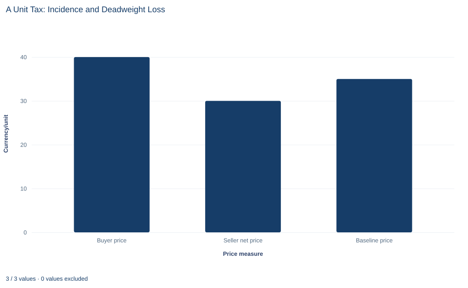

# Lab 15 · A Unit Tax: Incidence and Deadweight Loss

**The tax wedge, economic incidence and the excess burden of a tax**

## Start with the supplied workbook

1. Download [tax_incidence.xlsx](tax_incidence.xlsx) and the [Python lab](lab.py). The workbook holds the 101 fixed points on the demand and supply schedules used throughout this chapter.
2. Import `tax_incidence.xlsx` into OpenEconometrics and keep that file name as the dataset name. The `Data` sheet holds one row per potential quantity, with the price buyers would pay for that unit and the price sellers would need to supply it. The `Dictionary` sheet explains each column and its unit; no cell is blank.
3. Open the complete `lab.py` in a new Python document and run the whole file. It applies a tax of 10 per unit and displays a table of ten solution values, a bar chart comparing the buyer price, the seller's net price and the untaxed price, and the reported numbers.

For ordinary Python, keep `lab.py` and the workbook in the same folder and run the script there, or call `from lab import run_lab` and then `run_lab(data_path="/path/to/tax_incidence.xlsx")`. To try a different tax, change the `tax` value in the code below rather than editing the workbook.

Without a tax, this market clears at a price of 35, with 50 units a day traded. The government then charges 10 currency units on every unit sold and requires sellers to send the money in. Sellers write the checks, so it is tempting to say sellers pay the tax. Yet after the market adjusts, buyers pay 40 instead of 35 and sellers keep 30 instead of 35. Each side is 5 worse off per unit. Who really bears the tax, and what does the tax cost beyond the 400 a day that the government collects?

The workbook contains **101 synthetic points on two straight-line schedules**, for quantities 0 to 100 units a day. Each row is a potential unit of trade, not an observed transaction. The tax of 10 per unit is set in the lab code rather than stored in the workbook. Prices are in a hypothetical currency per unit and surplus in currency per day. The [LaTeX table](table.tex) collects the reported numbers.

## 1. Read the two schedules

The three columns describe one market:

- `quantity` is a potential quantity $q$ in units per day;
- `demand_price` is buyers' willingness to pay for the $q$-th unit, the inverse demand $P_D(q)=60-0.5q$;
- `supply_price` is the lowest price at which sellers would supply the $q$-th unit, the inverse supply $P_S(q)=10+0.5q$, which is their marginal cost.

Without a tax, the market clears where $60-0.5q=10+0.5q$, at $q^*=50$ and $P^*=35$. Row 50 of the workbook shows both columns equal to 35. Total surplus at that point is the area between the two schedules up to 50 units, $\tfrac12\times(60-10)\times50=1250$ currency per day.

## 2. Distinguish legal and economic incidence

**Statutory incidence** is about who is legally required to send the money to the government; here, the sellers. **Economic incidence** is about whose prices change. It compares the price buyers pay and the price sellers keep after the tax with the untaxed price of 35.

The two need not agree. A seller who remits 10 per unit but can raise the price by 10 has passed the whole tax on; a seller who cannot raise the price at all bears it fully. How much of the tax each side bears depends on how buyers and sellers respond to price, not on whose name is on the tax form.

## 3. Find the wedge

A unit tax drives a **wedge** between two prices. Buyers pay $P_B$. Sellers keep $P_S$ after sending $t$ to the government. So

$$
P_B-P_S=t.
$$

At the traded quantity $Q_t$, buyers must be willing to pay $P_B$ for the last unit and sellers must be willing to supply it for $P_S$. Both conditions sit on the original schedules: $P_B=60-0.5Q_t$ and $P_S=10+0.5Q_t$. Substituting into the wedge,

$$
(60-0.5Q_t)-(10+0.5Q_t)=t
\quad\Longrightarrow\quad
50-Q_t=t
\quad\Longrightarrow\quad
Q_t=50-t.
$$

With $t=10$: $Q_t=40$, $P_B=60-20=40$ and $P_S=10+20=30$. Check the wedge: $40-30=10$. In words, the taxed quantity is the unit at which the gap between willingness to pay and supply price has shrunk to exactly the tax. Units beyond it cannot generate enough gain to pay the tax and still leave both sides willing to trade.

Notice what the wedge equation does not contain: any statement of which side hands the money over.

## 4. Compute the taxed market

**Pause before running.** Verify the wedge at the taxed quantity: what are the buyer price and the seller's net price?

The first block finds the taxed and the untaxed points by reading the gap between the two schedules row by row:

```python
raw = load_data()  # reader defined in the complete lab.py
tax = 10.0         # per-unit tax, currency/unit
gap = raw.demand_price - raw.supply_price
taxed = raw.loc[gap == tax].iloc[0]
untaxed = raw.loc[gap == 0].iloc[0]
quantity, buyer_price, seller_price = taxed.quantity, taxed.demand_price, taxed.supply_price
print(quantity, buyer_price, seller_price, untaxed.demand_price)
print(buyer_price - untaxed.demand_price, untaxed.supply_price - seller_price, tax * quantity)
```

It prints `40.0 40.0 30.0 35.0` and then `5.0 5.0 400.0`:

| Quantity | Value |
|---|---:|
| Taxed quantity (units/day) | 40 |
| Buyer price (currency/unit) | 40 |
| Seller net price (currency/unit) | 30 |
| Untaxed price (currency/unit) | 35 |
| Buyer burden per unit (currency/unit) | 5 |
| Seller burden per unit (currency/unit) | 5 |
| Tax revenue (currency/day) | 400 |

The search works because both schedules are straight lines sampled at every whole unit, and the gap $50-q$ equals 10 exactly at row 40. The two burdens add to the tax, $5+5=10$, as they must: every currency unit of the wedge comes out of someone's price.

## 5. Explain the even split

Why does each side bear exactly half? Write the schedules with general slopes, $P_D=a-b_Dq$ and $P_S=c+b_Sq$. The tax lowers quantity by $t/(b_D+b_S)$, and moving back along each schedule by that amount changes each price in proportion to that schedule's slope:

$$
\Delta P_B=\frac{b_D}{b_D+b_S}\,t,\qquad \Delta P_S=-\frac{b_S}{b_D+b_S}\,t.
$$

Here $b_D=b_S=0.5$, so each share is one half and each price moves by 5. In general the side whose schedule is steeper, the side that responds less to price, bears more of the tax. In elasticity form, the buyers' share is $\varepsilon_S/(\varepsilon_S-\varepsilon_D)$, where $\varepsilon_S>0$ is the price elasticity of supply and $\varepsilon_D<0$ that of demand at the untaxed point.

So the half-and-half result is a consequence of the equal slopes in this example. It is not a general rule, and it would not survive a change in either schedule.

## 6. Account for surplus, including the government

With a tax there are three recipients of the gains from trade, and the accounting must include all three:

- **Consumer surplus**, willingness to pay above 40 on units 1 to 40: $\tfrac12(60-40)\times40=400$.
- **Producer surplus**, the net price of 30 above the supply price on the same units: $\tfrac12(30-10)\times40=400$.
- **Tax revenue**, $10\times40=400$, which the government can spend or return.

The second block computes these areas and the loss:

```python
top, floor = raw.demand_price.iloc[0], raw.supply_price.iloc[0]
consumer_surplus = 0.5 * (top - buyer_price) * quantity
producer_surplus = 0.5 * (seller_price - floor) * quantity
revenue = tax * quantity
untaxed_total = 0.5 * (top - floor) * untaxed.quantity
print(consumer_surplus, producer_surplus, revenue, untaxed_total - consumer_surplus - producer_surplus - revenue)
```

It prints `400.0 400.0 400.0 50.0`: consumer surplus, producer surplus, revenue and deadweight loss, all in currency per day. The triangle formulas are exact because both schedules are straight lines.

The three shares add to 1,200, which is 50 less than the untaxed 1,250. That 50 is the **deadweight loss**: the gains on units 41 to 50, which were worth trading without the tax but cannot cover it. Geometrically it is a triangle with base $50-40=10$ units and height equal to the tax:

$$
DWL=\tfrac12\,t\,(Q^*-Q_t)=\tfrac12\times10\times10=50.
$$

Revenue must stay in the accounting. The 400 is not destroyed; it moves from buyers and sellers to the government. Leaving it out would count a transfer as if it were a resource cost and greatly overstate the loss. The deadweight loss is the part of buyers' and sellers' losses that nobody receives.

## 7. Read the chart



The bar chart shows three prices in currency per unit: the buyer price of 40, the seller's net price of 30 and the untaxed price of 35. The vertical axis starts at zero, so the bars can be compared by height. The distance between the first two bars is the tax wedge, 10. The untaxed price sits exactly halfway between them, which is the even split of Section 5 drawn as a picture: buyers pay 5 more, sellers keep 5 less.

The chart shows prices only. It does not show quantities, and so it shows neither the revenue rectangle nor the deadweight-loss triangle; those come from the table and the surplus calculation.

## A case from the literature

Sections 2 and 8 separate who remits a tax from who bears it: in simple competitive models the remitting side does not matter. Weyl and Fabinger (2013) extend that principle and others, including the determinants of pass-through, from perfect competition to a general model of imperfect competition.

Kopczuk et al. (2016) tested the principle with state diesel taxes, whose remitting party varies across states and over time. Moving collection upstream from retailers substantially raised the pass-through of diesel taxes to consumers, and tax revenue rose when wholesalers rather than retailers remitted the tax. The authors conclude that evasion is the likely explanation: when opportunities to evade differ across the parties, the point of collection changes the economic incidence.

Chetty et al. (2009) found a second route to the same failure. In a grocery-store field experiment, posting tax-inclusive price tags reduced demand by 8 percent, and increases in taxes included in posted prices reduced alcohol consumption more than increases in taxes applied at the register. Their welfare formulas imply that when consumers underreact to taxes that are not salient, economic incidence depends on statutory incidence.

The lab's even split of the 10-per-unit tax follows from equal slopes, full enforcement and buyers who respond to the whole tax-inclusive price. The two empirical studies estimate responses in real markets, and each shows a way in which relaxing one of those assumptions makes the remitting side matter.

## 8. Decide what the calculation supports

The calculation assumes the tax is fully enforced and costs nothing to administer, a currency unit of revenue is valued the same as a currency unit of private surplus, the schedules do not move when the tax is introduced, and there are no externalities or income effects. Both sides trade the same quantity, and the market is competitive on both sides.

Under those assumptions the incidence and the deadweight loss are exact for these schedules. Real taxes add collection and compliance costs, can be evaded, and can be levied in markets with market power, where pass-through follows different rules. The equal split here comes from equal slopes. Which side remits the tax does not, by itself, identify who bears it. These are stipulated schedules, not a measured market.

## 9. Write the conclusion in full

A complete statement for the worked example reads: "With inverse demand $60-0.5q$ and inverse supply $10+0.5q$, a tax of 10 per unit remitted by sellers reduces trade from 50 to 40 units a day. Buyers pay 40 instead of 35 and sellers keep 30 instead of 35, so each side bears 5 per unit, an even split that follows from the equal slopes of the two schedules. The tax raises 400 a day; consumer and producer surplus are each 400 after the tax, and the deadweight loss is 50 a day, the value of the ten units no longer traded."

The statement gives the schedules, the tax and the remitting side before reporting the burden, and it counts revenue as a transfer rather than a loss.

## Student exercises

1. Compute the price elasticities of demand and supply at the untaxed point. Use them to check the buyers' share of the tax with the elasticity formula in Section 5.
2. Change `tax` to 20 and rerun both code blocks. Compare revenue and deadweight loss with the 10-unit tax, and explain why the deadweight loss grows faster than the revenue.
3. On a copy of the data, replace `supply_price` with $10+1.5q$ and rerun both code blocks with the 10-unit tax (load your copy in place of `load_data()`). Report the new burdens per unit and explain which side bears more and why.
4. Suppose buyers, not sellers, had to remit the 10-unit tax. Write the demand schedule as sellers would face it, find the new equilibrium, and compare the price buyers hand over in total and the price sellers keep with the results in Section 4.
5. Compute consumer and producer surplus without the tax. For each side, split the fall in surplus into the part paid to the government and the part that is a deadweight loss.
6. Rewrite this sentence so it is correct: "The tax raised 400, so it cost buyers and sellers 400."

## Further reading

- Chetty, R., Looney, A., and Kroft, K. (2009). Salience and taxation: Theory and evidence. *American Economic Review*, 99(4), 1145–1177. https://doi.org/10.1257/aer.99.4.1145
- Kopczuk, W., Marion, J., Muehlegger, E., and Slemrod, J. (2016). Does tax-collection invariance hold? Evasion and the pass-through of state diesel taxes. *American Economic Journal: Economic Policy*, 8(2), 251–286. https://doi.org/10.1257/pol.20140271
- Weyl, E. G., and Fabinger, M. (2013). Pass-through as an economic tool: Principles of incidence under imperfect competition. *Journal of Political Economy*, 121(3), 528–583. https://doi.org/10.1086/670401
