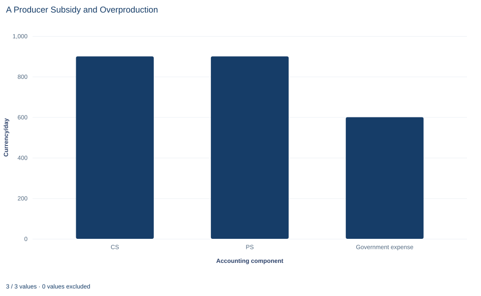

# Lab 16 · A Producer Subsidy and Overproduction

**Subsidy wedges, who gains, and why the market's total surplus falls**

## Start with the supplied workbook

1. Download [subsidy_welfare.xlsx](subsidy_welfare.xlsx) and the [Python lab](lab.py). The workbook holds the demand and supply schedules used throughout this chapter.
2. Import `subsidy_welfare.xlsx` into OpenEconometrics and keep that file name as the dataset name. The `Data` sheet holds one row per quantity, from 0 to 100 units a day, with the buyers' and sellers' prices at that quantity; the `Dictionary` sheet explains each column and its unit.
3. Open the complete `lab.py` in a new Python document and run the whole file. It reads the imported schedules and displays the welfare accounting table, a bar chart of the three surplus components and the reported numbers.

For ordinary Python, keep `lab.py` and the workbook in the same folder and run the script there, or call `from lab import run_lab` and then `run_lab(data_path="/path/to/subsidy_welfare.xlsx")`. If you want to try another subsidy or another supply curve, work on a copy of the loaded table so the distributed workbook stays unchanged. The [LaTeX table](table.tex) collects the reported numbers.

Suppose the government pays sellers 10 currency units for every unit they sell. Buyers pay less, sellers receive more, and the market trades more: daily quantity rises from 50 to 60 units, and consumer and producer surplus both reach 900 currency units a day. It is tempting to call that a success for everyone.

But the government's bill is 600 a day, and someone pays it. Once that bill is counted, net total surplus is 1,200 a day, which is 50 less than the 1,250 the same market produces with no subsidy. This lab traces where those 50 go and why buyers and sellers can both gain while society loses.

The workbook contains **101 points on two stipulated linear schedules**, one for each whole quantity from 0 to 100 units a day. They are a model rather than a sample: every number follows from two equations, and prices are in a hypothetical currency.

## 1. Read the two schedules

Each row of `Data` is one point on the schedules: a quantity and the two prices that go with it.

| Column | What it records | Unit |
|---|---|---|
| `quantity` | Units traded per day, 0, 1, …, 100 | units/day |
| `demand_price` | Inverse demand $P_D(Q)=60-0.5Q$: the most buyers will pay for the $Q$-th unit | currency/unit |
| `supply_price` | Inverse supply $P_S(Q)=10+0.5Q$: the least sellers will accept for the $Q$-th unit | currency/unit |

Read the demand price as buyers' **marginal benefit**, the value of one more unit, and the supply price as sellers' **marginal cost** of producing it. At $Q=20$, for example, the row shows 50 and 20: the twentieth unit is worth 30 more to its buyer than it costs to make.

Without any policy the market clears where the two schedules cross:

$$
60-0.5Q=10+0.5Q\quad\Longrightarrow\quad Q^*=50,\qquad P^*=35.
$$

Every unit up to the fiftieth is worth more than it costs and every later unit is not, so 50 is also the **efficient quantity**. Total surplus is the triangle between the schedules from 0 to 50, with height $60-10=50$ at $Q=0$:

$$
TS^*=\tfrac12\times 50\times 50=1{,}250 \text{ currency/day}.
$$

That is the benchmark for everything below. Quantity is in units per day and prices in currency per unit, so every surplus is in currency per day.

**Pause before running.** If sellers receive 10 per unit from the government on top of what buyers pay, which row of `Data` shows a supply price exactly 10 above the demand price? Predict the new quantity and both prices before reading on.

## 2. Add the subsidy wedge

A unit subsidy $s$ paid to sellers separates two prices that were equal before. Buyers pay $P_B$. Sellers receive $P_B$ from the buyer plus $s$ from the government, so their receipt is

$$
P_{\text{seller}}=P_B+s.
$$

The market still clears at one quantity, with buyers on the demand schedule at $P_B$ and sellers on the supply schedule at $P_B+s$:

$$
\underbrace{10+0.5Q}_{\text{seller receipt}}=\underbrace{60-0.5Q}_{\text{buyer price}}+s
\quad\Longrightarrow\quad Q_s=50+s.
$$

With $s=10$ the subsidized quantity is 60. The buyer price is $60-0.5\times60=30$ and the seller receipt is $10+0.5\times60=40$; the gap between them is exactly the subsidy.

Equivalently, the subsidy shifts the supply schedule down by 10 when it is drawn against the buyer's price. With other slopes the numbers change but the rule does not: find the quantity at which supply price minus demand price equals $s$.

## 3. See who receives the subsidy

The price changes measure who gains from the government's 10 per unit. The buyer price falls from 35 to 30, and the seller receipt rises from 35 to 40. Each side captures 5 of the 10.

The equal split comes from the equal slopes. Write inverse demand as $a-bQ$ and inverse supply as $c+dQ$. Then the subsidy raises quantity by $s/(b+d)$, and

$$
\Delta P_B=-\frac{b}{b+d}\,s,\qquad \Delta P_{\text{seller}}=+\frac{d}{b+d}\,s.
$$

Here $b=d=0.5$, so each share is one half. In general, the side whose quantity responds less to price captures more of the subsidy.

The legal recipient does not decide this split. Paying the 10 to buyers instead would create the same wedge and the same outcome; this is the tax-incidence argument of the previous lab run in reverse.

## 4. Run the welfare accounting

The step below finds the schedule point with the right wedge, computes each surplus area, and then runs the lab's own `analyze` function for comparison.

```python
raw = load_data()  # reader defined in the complete lab.py
start = raw.loc[raw.quantity == 0].iloc[0]  # choke price 60 and supply intercept 10
subsidy = 10.0
gap = raw.supply_price - raw.demand_price  # marginal cost minus marginal benefit
point = raw.loc[(gap - subsidy).abs() < 1e-9].iloc[0]

quantity = point.quantity
buyer_price, seller_receipt = point.demand_price, point.supply_price
consumer_surplus = 0.5 * (start.demand_price - buyer_price) * quantity
producer_surplus = 0.5 * (seller_receipt - start.supply_price) * quantity
government_expense = subsidy * quantity
net_total_surplus = consumer_surplus + producer_surplus - government_expense
print(quantity, buyer_price, seller_receipt, consumer_surplus, producer_surplus,
      government_expense, net_total_surplus)

summary, native, panels, checks, models = analyze(raw)
display(native)  # the lab's own accounting table
```

Both routes give the same numbers:

| Quantity | Value | Unit |
|---|---:|---|
| Unit subsidy paid to sellers | 10 | currency/unit |
| Buyer price | 30 | currency/unit |
| Seller receipt (buyer price + subsidy) | 40 | currency/unit |
| Subsidized quantity | 60 | units/day |
| Consumer surplus | 900 | currency/day |
| Producer surplus | 900 | currency/day |
| Government expense | 600 | currency/day |
| Net total surplus | 1,200 | currency/day |
| Deadweight loss | 50 | currency/day |

The first four rows are the market outcome; the next three are areas. Consumer surplus is the triangle below demand and above the buyer price, $\tfrac12(60-30)\times60$. Producer surplus is the triangle above supply and below the receipt, $\tfrac12(40-10)\times60$. Government expense is the rectangle $10\times60$. The last two rows combine these areas.

## 5. Subtract the government's spending

Net total surplus counts everyone affected by the policy, including the taxpayers who fund it:

$$
TS_s=CS_s+PS_s-sQ_s=900+900-600=1{,}200.
$$

Why subtract the 600? The subsidy moves money from taxpayers to market participants, where it shows up as lower prices for buyers and higher receipts for sellers. Counting those gains while ignoring where the money came from would treat a transfer as newly created value. The accounting values a currency unit equally in every pocket, so a transfer by itself neither adds to nor subtracts from total surplus.

The opposite mistake calls the whole 600 a loss. Most of it reappears inside the consumer and producer surplus; only the part that pays for output nobody values is lost.

## 6. Locate the deadweight loss

The benchmark market produces 1,250 and the subsidized market 1,200. The missing 50 is the **deadweight loss** of the subsidy:

$$
DWL=TS^*-TS_s=1{,}250-1{,}200=50.
$$

It has a precise location: the ten extra units from 50 to 60 a day. For each of them, marginal cost exceeds marginal benefit. At $Q=50$ the two schedules are equal at 35. At $Q=60$ marginal cost is 40 and marginal benefit is 30, a gap of 10, exactly the subsidy. Between those quantities the gap grows in a straight line, so the loss is a triangle:

$$
DWL=\tfrac12\,s\,(Q_s-Q^*)=\tfrac12\times10\times(60-50)=50.
$$

The totals and the triangle agree, and the lab's checks confirm the accounting. The triangle explains the title: the subsidy destroys no value on the first 50 units, but it pays for 10 units that cost more to produce than buyers are willing to pay. That is what overproduction means here.

## 7. Read the bar chart



The three bars, in currency per day, are consumer surplus (900), producer surplus (900) and government expense (600). They are the inputs to the welfare sum, not its result: read the third bar with a minus sign even though it is drawn upward, so net total surplus is $900+900-600=1{,}200$.

The deadweight loss of 50 has no bar; it is the gap between the benchmark of 1,250 and that net figure. The equal heights of the first two bars reflect the equal slopes of the schedules, not a general property of subsidies.

## A case from the literature

Fuel subsidies lower the price that buyers pay, as the subsidy in this lab does, and their costs have been estimated worldwide. Davis (2017) quantified the costs of global gasoline and diesel subsidies using data and estimates from the World Bank and the International Monetary Fund. Under his preferred assumptions about supply and demand elasticities, the subsidies cause a conventional deadweight loss of about 26 billion dollars a year, the counterpart of the overproduction triangle in Section 6. They also cause 44 billion dollars a year in external costs from carbon dioxide emissions, local pollutants, traffic congestion and accidents. That second figure is what this lab's no-externality assumption rules out: when the extra units harm third parties, the loss from overproduction exceeds the triangle.

Who keeps a subsidy is also an empirical question, a variant of the one in Section 3. Kirwan (2009) studied US agricultural subsidies, for which economic theory predicts that farmland owners bear the entire incidence. Using a set of policy quasi-experiments, he found that farmers who rent the land they cultivate capture 75 percent of the subsidy and landowners 25 percent, and that the landowners' share rises with local measures of competitiveness in the farmland rental market.

Finally, the lab values the government's 600 a day at face value. Browning (1976) estimated the marginal cost of public funds for US labor income taxes at 1.09 to 1.16 per dollar of revenue. If raising 600 costs more than 600, the subsidy's net loss exceeds 50.

## 8. Decide what the model supports

In a market with no external effects, a production subsidy creates overproduction and a deadweight loss even though buyers and sellers both gain. That conclusion rests on stated assumptions:

- **No externality.** Demand measures the whole benefit of each unit. If production also benefited third parties, some extra output could be worth producing and a subsidy could raise total surplus.
- **Public funds valued one for one.** Raising 600 in taxes is assumed to cost exactly 600. Real taxes distort other choices, which would make the welfare loss larger.
- **No administration cost and fixed curves.** The subsidy is paid without cost, and neither schedule shifts in response to it.
- **Continuous quantities.** The triangles treat quantity as divisible, although the workbook lists whole units.

The schedules are stipulated for teaching, so the numbers illustrate a mechanism rather than measure any real subsidy program.

## 9. Write the conclusion in full

A complete statement reads: "On stipulated linear schedules, a subsidy of 10 currency units per unit paid to sellers raises traded quantity from 50 to 60 units a day. Buyers pay 30 and sellers receive 40, so each side captures half of the subsidy. Consumer and producer surplus are each 900 currency units a day, but the subsidy costs taxpayers 600 a day, leaving net total surplus of 1,200, which is 50 below the 1,250 of the unsubsidized market. The loss comes from the ten extra units whose cost exceeds their value, and the result assumes no external benefit and public funds valued one for one." It names who gains and the fiscal cost before stating the net result.

## Student exercises

1. Repeat the analysis for a subsidy of 6 per unit. Find the schedule row with the right wedge, then compute the buyer price, seller receipt, consumer surplus, producer surplus, government expense, net total surplus and deadweight loss.
2. Compute consumer and producer surplus in the unsubsidized market, then the change in each caused by the 10 subsidy. Show that the two gains plus the deadweight loss add up exactly to government expense, and explain why they must.
3. Compute the deadweight loss for subsidies of 5, 10 and 20 per unit. Describe the pattern and explain it using the triangle in Section 6.
4. On a copy of the data, replace the supply schedule with $10+1.5Q$. Solve the market with no subsidy and with a subsidy of 10, and state what share of the subsidy buyers and sellers each capture. Relate the result to the formula in Section 3.
5. Suppose each unit produced also gives third parties a constant external benefit of 10. Find the efficient quantity and the welfare effect of the 10 subsidy. Then repeat with an external benefit of 4, and compare the subsidy with no policy.
6. Rewrite this sentence so that it matches the analysis: "The subsidy is good for everyone, because buyers pay less and sellers earn more."

## Further reading

- Browning, E. K. (1976). The marginal cost of public funds. *Journal of Political Economy*, 84(2), 283–298. https://doi.org/10.1086/260432
- Davis, L. W. (2017). The environmental cost of global fuel subsidies. *The Energy Journal*, 38(1_suppl), 7–28. https://doi.org/10.5547/01956574.38.si1.ldav
- Kirwan, B. E. (2009). The incidence of U.S. agricultural subsidies on farmland rental rates. *Journal of Political Economy*, 117(1), 138–164. https://doi.org/10.1086/598688
