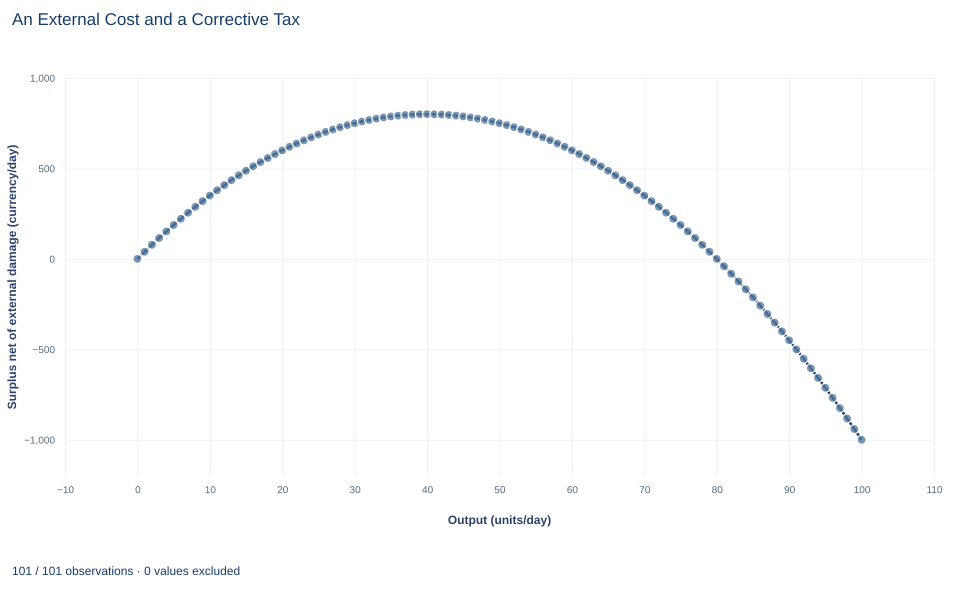

# Lab 17 · An External Cost and a Corrective Tax

**Social marginal cost, efficient output and a tax set at marginal damage**

## Start with the supplied workbook

1. Download [external_cost.xlsx](external_cost.xlsx) and the [Python lab](lab.py). The workbook holds the benefit and cost schedules used throughout this chapter.
2. Import `external_cost.xlsx` into OpenEconometrics and keep that file name as the dataset name. The `Data` sheet holds one row per output level, from 0 to 100 units a day, with the marginal benefit, the producers' marginal cost and the marginal damage to others at that level; the `Dictionary` sheet explains each column and its unit.
3. Open the complete `lab.py` in a new Python document and run the whole file. It reads the imported schedules and displays the welfare comparison table, a line chart of surplus net of external damage at every output level and the reported numbers.

For ordinary Python, keep `lab.py` and the workbook in the same folder and run the script there, or call `from lab import run_lab` and then `run_lab(data_path="/path/to/external_cost.xlsx")`. If you want to try a different damage schedule, work on a copy of the loaded table so the distributed workbook stays unchanged. The [LaTeX table](table.tex) collects the reported numbers.

Buyers and producers in a market settle on a price and a quantity, but every unit produced also causes 10 currency units of damage to people who are not part of the trade. Left alone, the market produces 50 units a day and imposes 500 a day of damage that no price reflects. Is 50 the right amount of output once that damage counts? And if not, what tax would bring output to the right level?

In this lab, counting the damage lowers the efficient output to 40 units a day. A tax of 10 per unit gets the market there, and welfare net of damage rises from 750 to 800 a day. The lab also shows why the right tax is 10 rather than 500, and why the tax payments themselves are not a second cost.

The workbook contains **101 points on stipulated linear schedules**, one for each whole output level from 0 to 100 units a day. They are a model rather than a sample, with prices and damage in a hypothetical currency.

## 1. Read the three schedules

Each row of `Data` is one point on the schedules.

| Column | What it records | Unit |
|---|---|---|
| `quantity` | Output traded per day, 0, 1, …, 100 | units/day |
| `demand_price` | Buyers' marginal benefit, $MB(Q)=60-0.5Q$ | currency/unit |
| `private_mc` | Producers' own marginal cost, $PMC(Q)=10+0.5Q$ | currency/unit |
| `external_mc` | Marginal damage to third parties from one more unit, 10 at every output level | currency/unit |

The first two schedules describe the people inside the trade: what buyers would pay for one more unit and what it costs producers to make it. The fourth column describes people outside it, such as neighbors exposed to emissions, who bear 10 currency units of harm for every unit produced. Nobody pays them, so that harm is **external** to the market price.

Adding the cost borne by producers and the cost borne by others gives the **social marginal cost**:

$$
MSC(Q)=PMC(Q)+MED=10+0.5Q+10=20+0.5Q.
$$

Each term is in currency per unit, so they can be added directly.

**Pause before running.** Which marginal cost should be compared with marginal benefit to decide whether one more unit is worth producing?

## 2. Find what the market does on its own

Buyers and producers compare only their own benefit and cost. Producers expand output as long as the price covers private marginal cost, and buyers purchase as long as marginal benefit covers the price. The market clears where

$$
60-0.5Q=10+0.5Q\quad\Longrightarrow\quad Q_{\text{private}}=50,\qquad P=35.
$$

At 50 units, the fiftieth unit is worth 35 to its buyer and costs its producer 35. But its full cost is $MSC(50)=45$, because it also causes 10 of damage. The last unit produced is worth 10 less than it costs society.

## 3. Find the efficient output

Producing one more unit raises welfare if its marginal benefit exceeds its full marginal cost, and lowers welfare otherwise. Welfare is therefore highest where the two are equal:

$$
MB(Q)=MSC(Q):\qquad 60-0.5Q=20+0.5Q\quad\Longrightarrow\quad Q^{S}=40.
$$

At 40 units, marginal benefit is $60-0.5\times40=40$, private marginal cost is 30 and marginal damage is 10, so $40=30+10$. Every unit up to the fortieth adds more benefit than cost; every unit beyond it adds more cost than benefit.

## 4. Measure welfare with the damage included

Welfare at output $Q$ adds up, unit by unit, what each unit is worth minus everything it costs:

$$
W(Q)=\int_0^Q\big(MB(q)-MSC(q)\big)\,dq=\int_0^Q(40-q)\,dq=40Q-\tfrac12Q^2.
$$

This is total surplus of buyers and producers minus total external damage, in currency per day. At the two output levels:

$$
W(50)=2{,}000-1{,}250=750,\qquad W(40)=1{,}600-800=800.
$$

The gain from moving to the efficient output is 50 a day. It has a precise location: the ten units from 40 to 50. For each of them, social marginal cost exceeds marginal benefit, by 0 at $Q=40$ and by $45-35=10$ at $Q=50$. The loss is the triangle $\tfrac12\times10\times10=50$.

Total external damage at the private output is $10\times50=500$ a day. That number is large, but it is not the welfare loss. Most of the damage comes from units that are worth producing even after the damage is counted. Only the damage on units that should not be produced, net of the benefit they bring, is lost.

## 5. Run the comparison

The step below builds social marginal cost from the workbook, finds both crossing points, and adds up net benefit unit by unit with the trapezoid rule, which is exact for straight-line schedules. It then runs the lab's own `analyze` function.

```python
raw = load_data()  # reader defined in the complete lab.py
social_mc = raw.private_mc + raw.external_mc
net_benefit = raw.demand_price - social_mc  # MB minus MSC, currency/unit
private_q = raw.loc[(raw.demand_price - raw.private_mc).abs() < 1e-9, "quantity"].iloc[0]
social_q = raw.loc[net_benefit.abs() < 1e-9, "quantity"].iloc[0]

step_area = (net_benefit + net_benefit.shift(-1)) / 2  # area of each one-unit strip
def welfare(q):
    return step_area[raw.quantity < q].sum()

print(private_q, social_q, welfare(private_q), welfare(social_q))

summary, native, panels, checks, models = analyze(raw)
display(native)  # the lab's own comparison table
```

It prints 50, 40, 750 and 800, and the lab's table reads:

| Quantity | Value | Unit |
|---|---:|---|
| Private market output | 50 | units/day |
| Efficient output | 40 | units/day |
| Corrective tax per unit | 10 | currency/unit |
| Welfare net of damage at private output | 750 | currency/day |
| Welfare net of damage at efficient output | 800 | currency/day |
| Welfare gain from the correction | 50 | currency/day |
| Total external damage at private output | 500 | currency/day |

Read the first two rows as the comparison of output levels, and the next four as one welfare measure, $W(Q)$, evaluated at both. The last row is a total, not a marginal, and belongs to a different question: how much harm the unregulated market causes, rather than how much welfare a correction recovers.

## 6. Price the damage with a corrective tax

A unit tax $t$ collected from producers drives a wedge between the price buyers pay and the price producers keep. The market clears where buyers' marginal benefit exceeds producers' marginal cost by exactly the tax:

$$
\underbrace{60-0.5Q}_{\text{buyer price}}-\underbrace{(10+0.5Q)}_{\text{producer net price}}=t\quad\Longrightarrow\quad Q_t=50-t.
$$

Setting $t=10$, the marginal damage at the efficient output, gives $Q_t=40$. The tax makes producers act as if they bore the damage themselves, so the private decision now compares marginal benefit with social marginal cost. This is a **corrective** or Pigouvian tax.

Two misreadings are common. First, the tax is a per-unit price, not a bill for the total damage. A tax of 500 per unit, the damage at the private output, would exceed the gap between the schedules at every quantity. Second, tax revenue is a transfer from producers and buyers to the government. In welfare it cancels: the payers lose it and the government gains it. Only the actual damage is a cost to society, and $W(Q)$ already subtracts it. Subtracting the revenue as well would count the correction mechanism as a second harm.

## 7. Read the welfare curve



The line plots $W(Q)=40Q-\tfrac12Q^2$ for every output level in the workbook, from 0 to 100 units a day, in currency per day. It rises from zero, peaks at 800 at 40 units and then falls. At the private output of 50 it is 750, slightly below the peak, which is why the welfare gain is small relative to total damage. Further out it keeps falling, and by 100 units net welfare is $-1{,}000$: output there destroys more value than it creates.

The curve is flat near its peak. That is a general feature of an optimum: small output errors near $Q^S$ cost little, and the loss grows with the square of the distance from it.

## A case from the literature

The gasoline tax is a real application of Section 6. Parry and Small (2005) built a framework for the second-best optimal gasoline tax that counts unpriced pollution, congestion and accident externalities and the tax's interaction with the wider fiscal system, with the gasoline tax substituting for a distorting tax on labor income. With their central parameter values, the optimal tax is 1.01 dollars a gallon for the United States and 1.34 for the United Kingdom, where the actual tax of 2.80 was more than twice the estimate. Congestion is the largest external cost in both countries. Like the lab, the study turns damage into a tax per unit of the good; unlike the lab, it combines several externalities with another distorting tax, and its answers are moderately sensitive to the parameter assumptions.

Two further studies bear on the lab's assumptions. Muller and Mendelsohn (2009) estimated source-specific marginal damages of air pollution and calculated that trading ratios based on them would save 310 to 940 million dollars a year in the sulfur dioxide allowance trading program for power plants, so marginal damage is not one number for every source. Andersson (2019) found that after Sweden introduced a carbon tax and a value-added tax on transport fuel, transport emissions of carbon dioxide fell almost 11 percent relative to a synthetic control built from comparable OECD countries, and that the carbon-tax elasticity of gasoline demand was three times the price elasticity. Sandmo (1975) treats optimal taxation in the presence of externalities.

## 8. Decide what the model supports

The calculation shows that, when an external cost is constant and known, efficient output falls below the private output and a tax equal to marginal damage restores it. That result rests on stated assumptions:

- **Marginal damage is constant, known and stated in money.** The value of 10 per unit is stipulated; the lab makes no claim about the cost of any real emissions.
- **No other distortion.** There is no market power, no other tax and no second externality.
- **Costless enforcement.** Collecting the tax takes no resources, and producers cannot avoid it.
- **Fixed schedules.** Neither the benefit nor the cost schedule shifts in response to the policy.

A real corrective tax needs evidence about marginal damage at the target output and about how buyers and producers respond. Total damage at the original output is not the right per-unit tax.

## 9. Write the conclusion in full

A complete statement reads: "On stipulated linear schedules with a constant external damage of 10 currency units per unit, the unregulated market produces 50 units a day while the efficient output, where marginal benefit equals social marginal cost, is 40. A corrective tax of 10 per unit, equal to marginal damage at the efficient output, implements 40 units and raises welfare net of damage from 750 to 800 currency units a day. Total damage at the private output is 500 a day, but the recoverable welfare loss is 50, and tax revenue is a transfer rather than a second cost."

It separates the marginal condition, the policy instrument, the welfare gain and the total damage, which answer different questions.

## Student exercises

1. Suppose marginal external damage were 16 per unit instead of 10. Find social marginal cost, the efficient output, the corrective tax, welfare at the private and efficient outputs, and the welfare gain.
2. With the tax of 10 in place, compute the buyer price, the producer net price, consumer surplus, producer surplus, tax revenue and total external damage. Show how they combine to give welfare of 800.
3. A colleague proposes a tax of 500 per unit because that is the total damage at the private output. Explain the error in units, then find the output and the welfare a 500 tax would produce on these schedules.
4. An analyst reports welfare under the tax as consumer surplus plus producer surplus minus tax revenue minus damage. Compute that number and explain what it double counts.
5. On a copy of the data, replace `external_mc` with $0.25Q$, so that damage per unit rises with output. Find the efficient output and the corrective tax, then compare tax revenue with total damage at that output. What does the comparison show about the base case?
6. Rewrite this sentence so that it matches the analysis: "The tax cut output and raised the price buyers pay, so it made society poorer."

## Further reading

- Andersson, J. J. (2019). Carbon taxes and CO2 emissions: Sweden as a case study. *American Economic Journal: Economic Policy*, 11(4), 1–30. https://doi.org/10.1257/pol.20170144
- Muller, N. Z., and Mendelsohn, R. (2009). Efficient pollution regulation: Getting the prices right. *American Economic Review*, 99(5), 1714–1739. https://doi.org/10.1257/aer.99.5.1714
- Parry, I. W. H., and Small, K. A. (2005). Does Britain or the United States have the right gasoline tax? *American Economic Review*, 95(4), 1276–1289. https://doi.org/10.1257/0002828054825510
- Sandmo, A. (1975). Optimal taxation in the presence of externalities. *The Swedish Journal of Economics*, 77(1), 86. https://doi.org/10.2307/3439329
