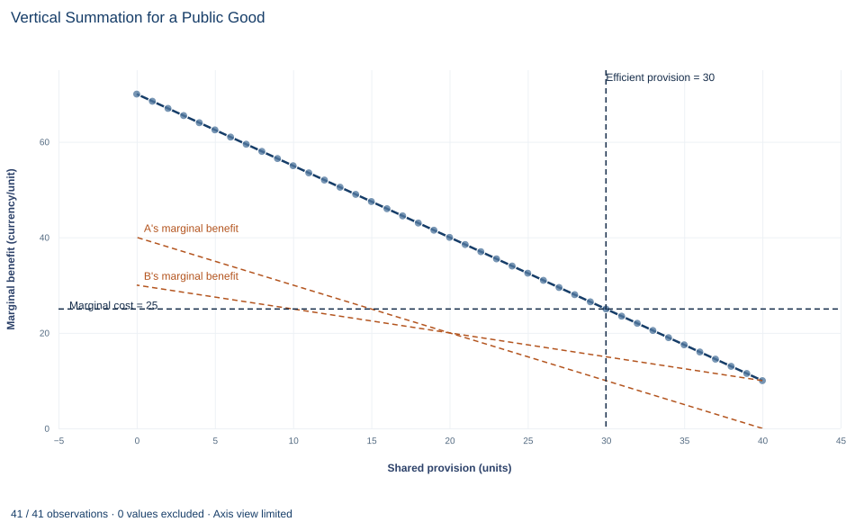

# Lab 18 · Vertical Summation for a Public Good

**Nonrival benefits, the Samuelson condition and the limits of an efficiency rule**

## Start with the supplied workbook

1. Download [public_good.xlsx](public_good.xlsx) and the [Python lab](lab.py). The workbook holds the two people's marginal-benefit schedules and the provision cost used throughout this chapter.
2. Import `public_good.xlsx` into OpenEconometrics and keep that file name as the dataset name. The `Data` sheet holds one row per level of shared provision, from 0 to 40 units, with each person's marginal benefit and the marginal cost at that level; the `Dictionary` sheet explains each column and its unit.
3. Open the complete `lab.py` in a new Python document and run the whole file. It reads the imported schedules and displays the efficiency table, a line chart of the two marginal benefit schedules, their vertical sum and the marginal cost, and the reported numbers.

For ordinary Python, keep `lab.py` and the workbook in the same folder and run the script there, or call `from lab import run_lab` and then `run_lab(data_path="/path/to/public_good.xlsx")`. If you want to try a different cost or benefit schedule, work on a copy of the loaded table so the distributed workbook stays unchanged. The [LaTeX table](table.tex) collects the reported numbers.

Two neighbors, A and B, share a good that neither can use up: a streetlight, a cleared path, a flood barrier. Each extra unit costs 25 currency units to provide. At the efficient level of 30 units, A values one more unit at 10 and B at 15. Neither would pay 25 alone, yet providing the thirtieth unit is exactly worth its cost. How can both statements be true?

The answer is that a nonrival good is consumed by both people at once, so its marginal benefits must be added at the same quantity. This lab builds that sum from the workbook, finds the efficient quantity of 30, measures the net surplus of 675 currency units it creates and then asks what the efficiency rule does not tell us: who pays, and whether anyone would volunteer to.

The workbook contains **41 points on stipulated schedules**, one for each whole provision level from 0 to 40 units. They are a model rather than a sample, with benefits and costs in a hypothetical currency.

## 1. Read the schedules

Each row of `Data` is one level of shared provision and the values attached to it.

| Column | What it records | Unit |
|---|---|---|
| `quantity` | Shared provision level $Q$, 0, 1, …, 40; both people consume the same $Q$ | units |
| `mb_a` | Person A's marginal benefit, $MB_A(Q)=40-Q$: what A would pay for one more unit | currency/unit |
| `mb_b` | Person B's marginal benefit, $MB_B(Q)=30-0.5Q$ | currency/unit |
| `mc` | Marginal cost of providing one more unit, 25 at every level | currency/unit |

Both benefit schedules slope down: the first units matter most, and each further unit adds less. A's benefit starts higher and falls faster; it reaches zero at 40 units, where the workbook ends. B's benefit is still 10 at that level.

Provision is a stock, not a flow, so total benefits and costs below are in currency, not currency per day.

## 2. Add the benefits at the same quantity

A good is **nonrival** when one person's use does not reduce what is available to another. If 30 units of lighting are installed, A enjoys 30 units and so does B. An extra unit therefore benefits both people at once, and its value to society is the sum of what it is worth to each:

$$
MB_{\text{sum}}(Q)=MB_A(Q)+MB_B(Q)=(40-Q)+(30-0.5Q)=70-1.5Q.
$$

This is **vertical summation**: at a given quantity, add the heights of the two benefit curves. At $Q=10$, for example, A values one more unit at 30 and B at 25, so the unit is worth 55 to the two of them together. The slope of the sum, $-1.5$, is the sum of the two slopes.

A private good works the other way. If A and B each bought their own units of an ordinary good at a common price, the market demand would add the *quantities* each wants at that price, which is **horizontal summation**. Adding quantities would be wrong here, because the two neighbors are not consuming separate units.

**Pause before running.** Why must the benefits be added at the same $Q$, rather than at the same price?

## 3. Find the efficient provision

One more unit of provision is worth providing when the combined benefit to everyone who consumes it exceeds its cost. The efficient level equates the two, the **Samuelson condition**:

$$
MB_A(Q)+MB_B(Q)=MC:\qquad 70-1.5Q=25\quad\Longrightarrow\quad Q^*=30.
$$

At 30 units, A's marginal benefit is $40-30=10$ and B's is $30-0.5\times30=15$. They add to 25, exactly the marginal cost. Below 30, the sum exceeds 25 and another unit would raise surplus; above 30, the sum falls short and the last unit costs more than it is worth.

Notice that each individual marginal benefit is below marginal cost at the optimum. That is not a contradiction. The efficiency rule compares cost with the benefit to everyone who shares the good, and no single person's valuation needs to cover the cost.

## 4. Measure the net surplus

Net surplus adds up, unit by unit, the combined benefit minus the cost:

$$
NS(Q^*)=\int_0^{30}\big(70-1.5q-25\big)\,dq=45\times30-0.75\times30^2=1{,}350-675=675.
$$

It is the triangle between the summed benefit line and the cost line, with height $70-25=45$ at $Q=0$ and base 30: $\tfrac12\times45\times30=675$ currency. Each unit up to the thirtieth contributes a positive strip; the strip shrinks to zero at the thirtieth unit.

## 5. Run the calculation

The step below adds the two benefit columns row by row, finds the row where the sum equals marginal cost and adds up the one-unit strips of net benefit with the trapezoid rule, which is exact for straight lines. It then runs the lab's own `analyze` function.

```python
raw = load_data()  # reader defined in the complete lab.py
summed_mb = raw.mb_a + raw.mb_b  # vertical summation at each shared quantity
gap = summed_mb - raw.mc         # combined benefit minus cost of one more unit
efficient = raw.loc[gap.abs() < 1e-9].iloc[0]
print(efficient.quantity, efficient.mb_a, efficient.mb_b, efficient.mc)

strip = (gap + gap.shift(-1)) / 2  # area of each one-unit strip
net_surplus = strip[raw.quantity < efficient.quantity].sum()
print(net_surplus)

summary, native, panels, checks, models = analyze(raw)
display(native)  # the lab's own efficiency table
```

It prints the row at 30 units with benefits 10 and 15 against a cost of 25, then a net surplus of 675. The lab's table reads:

| Quantity | Value | Unit |
|---|---:|---|
| Efficient shared provision | 30 | units |
| A's marginal benefit at 30 units | 10 | currency/unit |
| B's marginal benefit at 30 units | 15 | currency/unit |
| Summed marginal benefit at 30 units | 25 | currency/unit |
| Marginal cost of provision | 25 | currency/unit |
| Net total surplus | 675 | currency |

The middle four rows are the Samuelson condition written out: two individual valuations, their sum and the cost they must match. The lab's checks confirm that the sum equals the cost and that both individual benefits are positive at the chosen level, so neither person is being counted at a quantity they no longer value.

## 6. Ask who pays, and who will volunteer

The efficiency rule fixes the quantity, not the financing. One way to finance it is to charge each person a **personalized price** per unit equal to their own marginal benefit at the efficient level. Because those prices add up to marginal cost, the payments cover the cost of every unit, and at those prices each person would ask for exactly 30 units. This is the idea behind Lindahl pricing.

The difficulty is information. The schedules here are stipulated; in practice nobody can see them. If each person's payment depends on the valuation they report, each has a reason to understate it. Because the good is also usually **nonexcludable**, a person who reports a low value, or contributes nothing, still enjoys whatever the other person pays for. This is the **free-rider problem**. When people decide alone how much to contribute, each one weighs only their own benefit against the full cost, and provision falls short of 30.

The calculation in this lab assumes that problem away. It shows what the efficient quantity is, not how a town or a pair of neighbors could reach it.

## 7. Read the chart



The two dashed orange lines are the individual schedules from the workbook: A's marginal benefit falls from 40 to 0 and B's from 30 to 10 over 0 to 40 units. The solid line with points is their vertical sum $MB_A+MB_B$, from 70 at zero provision to 10 at 40 units. Vertical summation means adding the heights at the same quantity, because both people use the same units; at 20 units, for example, A values one more unit at 20 and B at 20, so together they value it at 40.

The dashed horizontal line is the marginal cost of 25 and the dashed vertical line marks the efficient provision of 30 units, where the summed benefit crosses the cost line. At 30 units, A's marginal benefit is 10 and B's is 15: neither alone would pay 25 for another unit, yet together they value it at exactly 25. The area between the summed line and the cost line, out to 30 units, is the net surplus of 675. Each individual line crosses 25 well to the left of 30 (A at 15 units, B at 10), which is why private provision falls short.

## A case from the literature

Section 3 finds the efficient level from the Samuelson condition, the rule associated with the pure theory of public expenditure (Samuelson, 1954). Section 6 then warns that voluntary contributions fall short of it. Experiments have studied that shortfall.

Isaac and Walker (1988) examined free riding in the voluntary provision of public goods experimentally, varying the number of members in a group and the marginal return an individual receives from contributions to the public good. Their results strongly support the hypothesis that larger groups provide the good less efficiently when the larger size comes with a lower marginal return, but not an effect of group size alone. Fehr and Gächter (2000) showed that many cooperators are willing to punish free riders even when punishment is costly and brings them no material benefit, and that free riders are punished more heavily the further they fall below the cooperators' contributions. This suggests that punishment opportunities reduce free riding, a conjecture the paper also tests.

The experiments connect to this lab through the marginal return. At the efficient level, A values the thirtieth unit at 10 and B at 15, both below its cost of 25, so neither gains enough alone to pay for it even though the pair does. The lab computes what is efficient under incentives of this shape; the experiments study how people actually respond to them. Groves and Ledyard (1977), as their title says, propose a solution to the free-rider problem in the optimal allocation of public goods.

## 8. Decide what the model supports

The calculation shows that, for a nonrival good, efficient provision equates the sum of individual marginal benefits to marginal cost, and that it can be efficient to provide units no single person would pay for. That conclusion depends on stated assumptions:

- **Nonrival consumption.** Both people enjoy the full provision level.
- **Comparable money values.** A currency unit of benefit counts the same for A and B, so the sum ignores how benefits and payments are distributed.
- **Exactly two beneficiaries and a constant marginal cost.** More beneficiaries would add more curves to the sum.
- **Positive individual benefits.** The sum is evaluated where both marginal benefits are positive; beyond 40 units the formula for A would subtract a negative value.

The efficiency condition is not a mechanism. It does not reveal true valuations, collect contributions or settle a fair division of the cost; those require separate institutional analysis.

## 9. Write the conclusion in full

A complete statement reads: "For two people sharing a nonrival good on stipulated schedules, the summed marginal benefit is 70 − 1.5Q currency per unit. With a constant marginal provision cost of 25, the efficient shared provision is 30 units, where A's marginal benefit of 10 and B's of 15 add up to 25. Provision at that level yields net surplus of 675 currency units. The calculation assumes the valuations are known; it does not show that voluntary contributions, or any particular cost-sharing rule, would deliver 30 units."

It reports the condition, the quantity, the individual valuations and the surplus, and it marks where the efficiency claim ends.

## Student exercises

1. Charge each person a personalized price per unit equal to their marginal benefit at the efficient level. Compute each person's total payment, gross benefit from 30 units and net surplus, and check that the two net surpluses add up to the lab's total.
2. A student adds the quantities each person would want if a unit cost 25, as one would for a private good. Compute that answer and explain why it is wrong for this good.
3. Suppose each person decides alone how many units to pay for at the full cost of 25. How many would A provide, and would B add any? Compute the net surplus at that level and the loss relative to efficient provision.
4. The provision cost falls to 16 per unit. Find the new efficient quantity, each person's marginal benefit there and the net surplus.
5. Using the workbook, compute summed marginal benefit minus marginal cost at 20 units and at 35 units. Explain what each sign says about whether provision should rise or fall.
6. Rewrite this sentence so that it matches the analysis: "The efficient level is 30 units, so if both neighbors are asked to contribute, they will fund 30 units."

## Further reading

- Fehr, E., and Gächter, S. (2000). Cooperation and punishment in public goods experiments. *American Economic Review*, 90(4), 980–994. https://doi.org/10.1257/aer.90.4.980
- Groves, T., and Ledyard, J. (1977). Optimal allocation of public goods: A solution to the "free rider" problem. *Econometrica*, 45(4), 783–809. https://doi.org/10.2307/1912672
- Isaac, R. M., and Walker, J. M. (1988). Group size effects in public goods provision: The voluntary contributions mechanism. *The Quarterly Journal of Economics*, 103(1), 179–199. https://doi.org/10.2307/1882648
- Samuelson, P. A. (1954). The pure theory of public expenditure. *The Review of Economics and Statistics*, 36(4), 387–389. https://doi.org/10.2307/1925895
