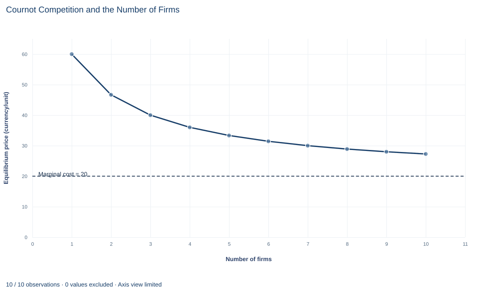

# Lab 19 · Cournot Competition and the Number of Firms

**Best responses, symmetric equilibrium and the path from monopoly toward competition**

## Start with the supplied workbook

1. Download [cournot_competition.xlsx](cournot_competition.xlsx) and the [Python lab](lab.py). The workbook holds the industry scenarios used throughout this chapter.
2. Import `cournot_competition.xlsx` into OpenEconometrics and keep that file name as the dataset name. The `Data` sheet holds one row per industry size, from one to ten identical firms, with the demand and cost parameters of that scenario; the `Dictionary` sheet explains each column and its unit.
3. Open the complete `lab.py` in a new Python document and run the whole file. It reads the imported scenarios and displays the equilibrium summary table, a line chart of the equilibrium price against the number of firms, with the marginal cost marked, and the reported numbers.

For ordinary Python, keep `lab.py` and the workbook in the same folder and run the script there, or call `from lab import run_lab` and then `run_lab(data_path="/path/to/cournot_competition.xlsx")`. If you want to try more firms or another cost, work on a copy of the loaded table so the distributed workbook stays unchanged. The [LaTeX table](table.tex) collects the reported numbers.

A monopolist facing the demand in this lab sells 40 units at a price of 60, three times its marginal cost of 20. Add one rival, and each firm sells 26.67 units at a price of 46.67. With ten firms the price is 27.27. Competition clearly lowers the price, but why does it fall so gradually, and why do two firms that never coordinate still price well above cost?

This lab answers with the Cournot model, in which firms choose quantities and each one takes its rivals' output as given. It derives one firm's best response, solves for the symmetric equilibrium and then follows output, price and profit as the industry grows from one firm to ten.

The workbook contains **10 stipulated industry scenarios**, one for each number of firms from 1 to 10. Every scenario uses the same demand and cost; only the number of firms changes. They are model inputs, not observed industries, and prices are in a hypothetical currency.

## 1. Read the scenarios

| Column | What it records | Unit |
|---|---|---|
| `firms` | Number of identical firms $n$ in the scenario, 1 to 10 | count |
| `intercept` | Inverse-demand intercept $a$: the price at which buyers would take nothing, 100 | currency/unit |
| `slope` | Inverse-demand slope $b$: how much the price falls per extra unit sold, 1 | currency/unit² |
| `mc` | Constant marginal cost $c$, the same for every firm, 20 | currency/unit |

So the market price in every scenario is $P=a-bQ=100-Q$, where $Q$ is the total output of all firms. The slope's unit, currency per unit per unit, says that one more unit of total output lowers the price by one currency unit per unit.

## 2. Set up one firm's decision

Write firm $i$'s output as $q_i$ and the combined output of all other firms as $Q_{-i}$. The price depends on both, so firm $i$'s profit is

$$
\pi_i=\big(a-b(q_i+Q_{-i})-c\big)\,q_i .
$$

The bracket is the margin on each unit, price minus marginal cost, and $q_i$ is the number of units. In the Cournot model each firm chooses $q_i$ taking $Q_{-i}$ as fixed. It knows that its own output moves the price, but it treats its rivals' output as given when it considers a change.

That is the strategic element. A competitive firm treats the price as given. A Cournot firm knows that selling one more unit lowers the price it gets on all of its units, not only on the extra one.

## 3. Derive the best response

Differentiate profit with respect to $q_i$, holding $Q_{-i}$ fixed, and set the result to zero:

$$
\frac{\partial\pi_i}{\partial q_i}=a-c-bQ_{-i}-2bq_i=0
\quad\Longrightarrow\quad
q_i^{BR}=\frac{a-c-bQ_{-i}}{2b}.
$$

The $2b$ comes from the two effects of one more unit: it earns the current margin, and it lowers the price by $b$ on all $q_i$ units already sold. The second derivative is $-2b<0$, so this is a maximum.

With the lab's numbers, $q_i^{BR}=(80-Q_{-i})/2=40-Q_{-i}/2$. If the rivals produce nothing, the firm produces the monopoly output of 40. Each extra unit the rivals produce lowers the firm's best output by half a unit. Quantities are **strategic substitutes**: when rivals expand, a firm's best reply is to contract.

**Pause before running.** Using the best response with one rival, derive each firm's output in the duopoly before reading the next section.

## 4. Impose symmetry and solve

In a **Nash equilibrium** each firm's output is a best response to the others'. With identical firms the equilibrium is symmetric, so all firms produce the same $q$, and $Q_{-i}=(n-1)q$. Symmetry is imposed only after the best response is derived; imposing it earlier would ignore that each firm takes its rivals' output as given. Substituting into the first-order condition:

$$
a-c-b(n-1)q-2bq=0
\quad\Longrightarrow\quad
q^*=\frac{a-c}{b(n+1)},\qquad Q^*=nq^*=\frac{n}{n+1}\cdot\frac{a-c}{b},\qquad P^*=\frac{a+nc}{n+1}.
$$

For the duopoly, $n=2$:

$$
q^*=\frac{80}{3}=26.67,\qquad Q^*=53.33,\qquad P^*=\frac{100+40}{3}=46.67,\qquad \pi^*=(46.67-20)\times26.67=711.11.
$$

Check it against the best response: if the rival produces 26.67, the firm's best output is $40-26.67/2=26.67$. Neither firm can raise its profit by changing output alone, which is what equilibrium means here. Both firms price above marginal cost without any agreement, because each one holds back output to protect the price on its own units.

## 5. Run the scenarios

The step below applies the symmetric solution to every row of the workbook, computes price and profit, and checks the first-order condition in each scenario. It then runs the lab's own `analyze` function.

```python
raw = load_data()  # reader defined in the complete lab.py
per_firm = (raw.intercept - raw.mc) / (raw.slope * (raw.firms + 1))
total = raw.firms * per_firm
price = raw.intercept - raw.slope * total
profit = (price - raw.mc) * per_firm
foc = raw.intercept - raw.mc - raw.slope * (total + per_firm)  # zero at a best response

scenarios = oe.DataFrame({
    "firms": raw.firms, "output_per_firm": per_firm, "total_output": total,
    "price": price, "profit_per_firm": profit, "first_order_condition": foc,
})
display(scenarios.round(2))

summary, native, panels, checks, models = analyze(raw)
display(native)  # the lab's own summary table
```

The first-order condition is zero in every row. Selected scenarios:

| Firms | Output per firm (units) | Total output (units) | Price (currency/unit) | Profit per firm (currency) |
|---:|---:|---:|---:|---:|
| 1 | 40.00 | 40.00 | 60.00 | 1,600.00 |
| 2 | 26.67 | 53.33 | 46.67 | 711.11 |
| 5 | 13.33 | 66.67 | 33.33 | 177.78 |
| 10 | 7.27 | 72.73 | 27.27 | 52.89 |

The lab's summary reports the duopoly row, the monopoly quantity of 40, the ten-firm quantity and price, and a competitive-limit quantity of 80. Two decimals are enough here; the exact values are fractions such as $80/3$.

## 6. Follow the market as firms are added

Read the table down each column.

- **One firm reproduces monopoly.** With $n=1$ the formula gives $q^*=(a-c)/2b=40$ and $P^*=60$, the output where monopoly marginal revenue $100-2Q$ equals marginal cost. That is a useful consistency check on the derivation.
- **Each firm produces less, the industry produces more.** Output per firm falls from 40 to 7.27, while total output rises from 40 to 72.73. A new rival takes some sales from every incumbent, and the incumbents respond by contracting, but by less than the entrant adds.
- **Price falls toward marginal cost.** The markup over marginal cost is $P^*-c=(a-c)/(n+1)$, which shrinks as $1/(n+1)$: 40 with one firm, 26.67 with two and 7.27 with ten.
- **The competitive limit.** As $n$ grows without bound, $n/(n+1)\to1$, so total output approaches $(a-c)/b=80$, the quantity at which price equals marginal cost. Ten firms reach $10/11$ of it.

## 7. Read the price chart



The line plots the equilibrium price for each of the ten scenarios, in currency per unit. It starts at 60 for a monopoly and falls steeply at first: the second firm lowers the price by 13.33. Each later firm lowers it by less, and by the tenth scenario the curve is nearly flat at 27.27, still above the marginal cost of 20.

The chart joins the ten scenarios with straight segments, but the number of firms is a whole number, so only the values at 1, 2, …, 10 firms are equilibria. The vertical axis starts at zero and the dashed horizontal line is the marginal cost of 20, the price that perfect competition would reach. The gap between the curve and that line is the markup: 40 for a monopoly, 26.67 for a duopoly and 7.27 with ten firms. It shrinks as firms are added but never closes for a finite number of firms.

## A case from the literature

Section 6 follows the market as firms are added. Bresnahan and Reiss (1991) asked the same question of real markets. They proposed an empirical framework for measuring the effects of entry in concentrated markets, built on how the number of producers varies with demand and competition, and applied it to geographically isolated monopolies, duopolies and oligopolies in five retail and professional industries. Competitive conduct changed quickly as incumbents were added: in markets with five or fewer incumbents, almost all of the variation occurred with the entry of the second or third firm, and once a market had three to five firms the next entrant had little effect.

The lab's Cournot path shares the large early change but not the flattening. Its markup over marginal cost falls as $1/(n+1)$, from 40 with one firm to 26.67 with two, and still nearly halves between five firms (13.33) and ten (7.27). The comparison is loose: the study infers conduct from market size and firm numbers, not from stipulated demand and cost.

Two papers bear on the model's assumptions. Genesove and Mullin (1998) used direct measures of marginal cost and conduct in the sugar industry from 1890 to 1914 as benchmarks for the common method of inferring conduct and cost from demand under static oligopoly behavior, and found the method largely validated. Kreps and Scheinkman (1983) show, as their title states, that quantity precommitment and Bertrand competition yield Cournot outcomes, and Novshek (1980) studies Cournot equilibrium with free entry rather than a fixed number.

## 8. Decide what the model supports

Within its assumptions, the Cournot model shows that more firms mean lower prices and higher total output, and that the price converges to marginal cost only gradually. Those assumptions matter:

- **Identical firms with constant marginal cost**, no fixed cost and no capacity limit.
- **A homogeneous product** sold at one market price.
- **Simultaneous, one-shot quantity choices**, with no collusion.
- **An exogenous number of firms.** The scenarios set $n$; nothing in the model explains how many firms would enter given entry costs.

Asymmetric costs, capacity constraints, repeated interaction that sustains collusion, or entry decisions can all change the outcome. And the results depend on firms competing in quantities. Firms that compete by setting prices for an identical product face different incentives, so the Cournot path should not be transferred automatically to price competition.

## 9. Write the conclusion in full

A complete statement reads: "In stipulated scenarios with inverse demand $P=100-Q$ and identical firms with marginal cost 20 that choose quantities simultaneously, a monopolist sells 40 units at 60. With two firms, each produces 26.67 units, total output is 53.33 and the price is 46.67, so each firm earns 711.11. With ten firms total output is 72.73 and the price 27.27. Output per firm falls and total output rises toward the competitive quantity of 80, but the markup over cost shrinks only in proportion to $1/(n+1)$."

It states the model, the strategic assumption and the numbers for a few industry sizes, and it describes the rate at which competition works.

## Student exercises

1. Derive the three-firm equilibrium by hand from the best response and confirm it against the three-firm row. Then compute industry profit with one, two and three firms and explain the pattern.
2. Suppose the two duopolists agree to split the monopoly output equally. Compute each firm's profit under the agreement. Then use the best response to find what one firm would produce, and earn, if it broke the agreement while the other kept it. What does the comparison imply for the agreement?
3. On a copy of the data, extend the scenarios beyond ten firms. How many firms are needed before the price is within 5 currency units of marginal cost?
4. Consumer surplus with linear demand is $\tfrac12 bQ^2$. Compute consumer surplus, total profit and the deadweight loss relative to the competitive outcome for two firms and for ten firms.
5. Suppose the two firms set prices instead of quantities for this identical product, and buyers purchase from whichever firm is cheaper. What price would you expect, and how does it compare with the Cournot duopoly price?
6. Rewrite this sentence so that it matches the analysis: "The duopoly price of 46.67 is far above marginal cost, so the two firms must be colluding."

## Further reading

- Bresnahan, T. F., and Reiss, P. C. (1991). Entry and competition in concentrated markets. *Journal of Political Economy*, 99(5), 977–1009. https://doi.org/10.1086/261786
- Genesove, D., and Mullin, W. P. (1998). Testing static oligopoly models: Conduct and cost in the sugar industry, 1890–1914. *The RAND Journal of Economics*, 29(2), 355. https://doi.org/10.2307/2555893
- Kreps, D. M., and Scheinkman, J. A. (1983). Quantity precommitment and Bertrand competition yield Cournot outcomes. *The Bell Journal of Economics*, 14(2), 326. https://doi.org/10.2307/3003636
- Novshek, W. (1980). Cournot equilibrium with free entry. *The Review of Economic Studies*, 47(3), 473–486. https://doi.org/10.2307/2297299
