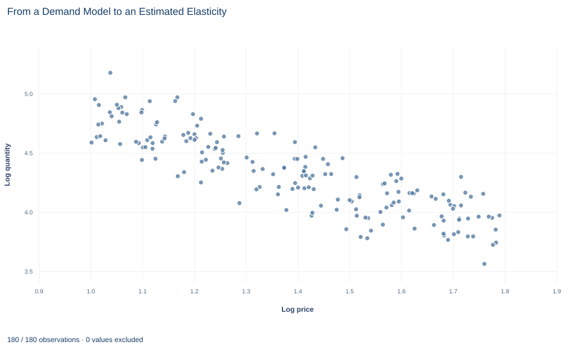

# Lab 20 · From a Demand Model to an Estimated Elasticity

**Log-log demand, elasticity estimates, and why a good fit is not identification**

## Start with the supplied workbook

1. Download [estimated_demand.xlsx](estimated_demand.xlsx) and the [Python lab](lab.py). The workbook holds the fixed market records used throughout this chapter.
2. Import `estimated_demand.xlsx` into OpenEconometrics and keep that file name as the dataset name. The `Data` sheet holds one row per market, with its price, income level and quantity purchased; the `Dictionary` sheet explains each column and its unit.
3. Open the complete `lab.py` in a new Python document and run the whole file. It reads the imported markets, fits the log-log demand regression and displays the full regression output, a scatter plot of log quantity against log price and the reported numbers.

For ordinary Python, keep `lab.py` and the workbook in the same folder and run the script there, or call `from lab import run_lab` and then `run_lab(data_path="/path/to/estimated_demand.xlsx")`. The lab reads the supplied records each time; it does not draw a new sample. If you want to try a transformation, work on a copy of the loaded table so the distributed workbook stays unchanged. The [LaTeX table](table.tex) collects the reported numbers.

The earlier labs in this course started from a demand curve and asked what it implied. Here the direction is reversed: the demand curve is unknown, and the task is to estimate it from market records. A regression of log quantity on log price and log income across 180 markets gives a price coefficient of −1.224 and an R² of 0.83. A 10% higher price is then associated with 11.01% lower quantity, holding income fixed.

Three questions decide what that number is worth. What does a log-log coefficient measure? How precisely is it estimated? And what makes it a *demand* elasticity rather than any price-quantity association? The regression output cannot answer the third.

The workbook contains **180 original synthetic markets**, one row per market. They are teaching records generated for this lab, not data on real markets, and prices are in a hypothetical currency.

## 1. Read the market records

| Column | What it records | Unit |
|---|---|---|
| `market_id` | Label distinguishing the markets, 1 to 180 | identifier |
| `price` | Price in the market, set independently of the market's demand disturbance | currency/unit |
| `income` | Income level of the market, recorded as an index | index (see note) |
| `quantity` | Quantity purchased in the market | units/day |

All 180 rows are complete: no cell is blank. Prices run from 2.72 to 5.99, the income index from 54.73 to 99.32 and quantity from 35.26 to 177.15 units a day. Every value is strictly positive, which matters because the model takes logarithms.

Two labels in the dictionary need care. It describes `income` as an "income index" but lists its unit as currency; the column is an index with no stated currency scale. Because the model uses its logarithm, rescaling the index would change only the intercept, not the elasticities. It also calls `quantity` "observed demand"; strictly, it is the quantity purchased at the market's price, one point on that market's demand curve, not the curve itself.

The identifier carries no economic content and is not a regressor.

## 2. Write demand in logs

The model is

$$
\log Q_i=\beta_0+\beta_P\log P_i+\beta_I\log I_i+u_i,
$$

where $Q_i$ is quantity purchased in market $i$, $P_i$ the price, $I_i$ the income index and $u_i$ a disturbance collecting everything else that shifts demand in that market. All logarithms are natural logarithms.

Exponentiating shows the demand curve this assumes:

$$
Q_i=e^{\beta_0}\,P_i^{\beta_P}\,I_i^{\beta_I}\,e^{u_i}.
$$

This is a **constant-elasticity** demand curve. The price elasticity of demand is the percentage change in quantity per percentage change in price, $\dfrac{\partial Q/Q}{\partial P/P}=\dfrac{\partial\log Q}{\partial\log P}$. Differentiating the log equation gives exactly $\beta_P$, at every price and income level. Likewise $\beta_I$ is the income elasticity.

Three consequences follow. The coefficients are unit-free, so measuring price in cents instead of currency units would leave $\beta_P$ unchanged. Each coefficient holds the other regressor fixed: $\beta_P$ compares markets with the same income. And the model describes the conditional mean of *log* quantity, so the elasticity is a statement about proportional changes along that fitted relationship.

**Pause before running.** Before fitting anything, write in one sentence what a price coefficient of about −1.2 would mean, including what is held fixed.

## 3. Fit the regression

The complete file fits the model with `oe.ols`, using HC3 standard errors:

```python
raw = load_data()  # reader defined in the complete lab.py
data = oe.DataFrame(raw.assign(
    log_price=raw.price.map(math.log),
    log_income=raw.income.map(math.log),
    log_quantity=raw.quantity.map(math.log),
))
result = oe.ols(data=data, y="log_quantity", x=["log_price", "log_income"],
                covariance="HC3", missing="raise", device="cpu")
display(result)
```

`missing="raise"` makes the fit stop rather than silently drop rows; here none are missing and all 180 markets are used. The coefficient table reads:

| Term | Estimate | HC3 std. error | t | 95% interval |
|---|---:|---:|---:|---|
| Intercept | 3.793 | 0.224 | 16.90 | 3.350 to 4.235 |
| Log price (price elasticity) | −1.224 | 0.0411 | −29.79 | −1.305 to −1.143 |
| Log income (income elasticity) | 0.521 | 0.0530 | 9.84 | 0.417 to 0.626 |

Markets: 180. Residual degrees of freedom: 177. R²: 0.832. Residual standard deviation: 0.135 log points.

Read the price row first. Among markets with the same income, a 1% higher price is associated with about 1.22% lower quantity purchased. Because the magnitude exceeds one, demand is **price elastic** in this fitted model: quantity responds more than proportionally to price. The income row says that a 1% higher income index goes with about 0.52% higher quantity at a given price, so the good is normal, with quantity rising less than proportionally with income.

The intercept is predicted log quantity at a price of 1 and an index of 1, far outside the data; it sets the level of the curve and has no direct interpretation.

## 4. Translate the elasticity into a price change

"A 1% price rise lowers quantity by 1.22%" is a local statement. For a larger change, use the curve itself. Multiplying the price by $(1+\Delta P/P)$ multiplies quantity by $(1+\Delta P/P)^{\beta_P}$, so

$$
\%\Delta Q=100\left[(1+\Delta P/P)^{\beta_P}-1\right].
$$

```python
price = next(c for c in result.coefficients if c.term == "log_price")
exact_10 = 100 * (1.1 ** price.estimate - 1)  # exact, along the constant-elasticity curve
approx_10 = 10 * price.estimate               # elasticity times percentage change
print(round(exact_10, 2), round(approx_10, 2))
```

It prints −11.01 and −12.24. The exact calculation, which the lab reports, gives an 11.01% fall in quantity for a 10% price rise, holding income and the disturbance fixed. Multiplying the elasticity by 10 overstates the fall, because the approximation treats the curve as a straight line in percentages when it is a power function. For a 1% change the two agree closely; by 10% they differ by more than a percentage point.

## 5. Read the precision and the fit

The HC3 standard error of the price elasticity is 0.0411, so the 95% interval runs from −1.305 to −1.143. Under the model and its sampling assumptions, the data constrain the elasticity tightly. The interval describes uncertainty about the coefficient across possible samples, not variation in elasticity across markets; the model assumes one elasticity for all of them.

HC3 is a heteroskedasticity-robust covariance estimator that also adjusts for high-leverage rows. It changes the standard errors, intervals and tests. It does not change a single coefficient, and it does nothing about whether price is related to the disturbance.

The R² of 0.832 says that price and income together account for about 83% of the variation in log quantity across these 180 markets, and the residual standard deviation of 0.135 log points describes the remaining scatter. Both describe fit. Neither says whether $\beta_P$ is a demand elasticity.

## 6. Separate identification from fit

In real markets, prices and quantities are determined together by demand and supply. A market with unusually strong demand, a large $u_i$, tends to have both a higher price and a higher quantity. Then price is correlated with the disturbance, and the regression coefficient mixes the downward slope of demand with the upward slope of supply. It can be far from the demand elasticity, even with a high R² and a tiny standard error. This is the **simultaneity** problem.

What makes $\beta_P$ interpretable here is a design fact, not a statistic: the synthetic prices and incomes were generated independently of the demand disturbance. Each market's price is like an experimental assignment, so differences in price trace out movements along a single demand curve. The regression then estimates the demand elasticity consistently, and the precision in Section 5 is meaningful.

With real data, that assumption needs an argument: an experiment, an instrument that shifts supply but not demand, or another identification design. No covariance option, larger sample or better fit supplies it.

## 7. Read the scatter plot



Each point is one market. The horizontal axis is log price, from about 1.0 to 1.79 (prices 2.72 to 5.99); the vertical axis is log quantity, from about 3.56 to 5.18. The cloud slopes clearly downward: markets with higher prices purchase less.

On log scales, a straight-line relation has a constant elasticity, which is the shape the model assumes. The vertical spread at any given price reflects two things the chart does not separate: differences in income across markets and the demand disturbance. Because income is not held fixed, the chart shows a simple association; its slope matches the estimated partial elasticity only to the extent that income is unrelated to price. No fitted line is drawn.

## A case from the literature

The problem in Section 6 is old. Working (1927) asked what statistical "demand curves" show; among the points the paper takes up are that whether a fitted curve approximates a demand or a supply curve depends on the relative variability of demand and supply, and that the slope of the fitted curve may not correspond to the true demand curve.

Angrist, Graddy and Imbens (2000) confronted the problem with market data. Where prices are set by the intersection of supply and demand, they note, standard identification requires instruments that shift one curve but not the other. They estimated the demand for fresh whiting at the Fulton fish market, using weather conditions at sea, which they describe as strong and credible instruments. The paper also asks what a linear instrumental variables estimator identifies once linearity and additive disturbances are dropped: a weighted average of the derivative of the relationship of interest, not one fixed slope.

Both points apply here. In this lab, prices are generated independently of the disturbance, so least squares already traces out demand; in the fish market an instrument has to do the work that this design does. And the lab imposes one constant elasticity. If the true response varied along the curve, a linear instrumental variables estimate would, by the paper's result, be a weighted average of it. Berry (1994) carried the approach to cross sections of oligopoly markets with differentiated products, allowing prices to be correlated with unobserved demand factors and estimating with instrumental variables.

## 8. Decide what the evidence supports

The estimate supports a clear statement about these synthetic markets: holding income fixed, the fitted price elasticity is about −1.22, precisely estimated, and a 10% price increase predicts about an 11% fall in quantity. That rests on several conditions:

- **Exogeneity by construction.** Price and income are independent of the disturbance because the records were generated that way.
- **Constant elasticity.** The log-log form imposes one elasticity at every price and income; it would mislead if the true response changed along the curve.
- **Independent markets.** HC3 inference addresses heteroskedasticity and leverage with independent rows, not dependence across markets.
- **Within the observed range.** Predictions for prices far outside 2.72 to 5.99 extrapolate the functional form.

An empirical study would need an identification design before its estimate could carry this interpretation.

## 9. Write the conclusion in full

A complete statement reads: "In 180 synthetic markets with prices and incomes generated independently of demand disturbances, a log-log regression gives a price elasticity of demand of −1.224 (HC3 standard error 0.041; 95% interval −1.305 to −1.143) and an income elasticity of 0.521, holding the other variable fixed. Along the fitted constant-elasticity curve, a 10% price increase predicts an 11.01% fall in quantity purchased. The elasticity is interpretable as a demand response because of how prices were assigned, not because the model explains 83% of the variation in log quantity."

## Student exercises

1. Use the estimated price elasticity to compute the exact and the approximate percentage change in quantity for a 20% price cut. Explain why the approximation errs in the direction it does.
2. Compute the percentage change in revenue (price times quantity) that the model predicts for a 10% price increase, holding income fixed. Explain the sign using the size of the elasticity.
3. Test whether demand is unit elastic. Estimate $\beta_P+1$ with `result.lincom({"log_price": 1}, constant=1.0)` and report its estimate, standard error, t statistic and 95% interval. State what the result implies.
4. Compute the predicted percentage change in quantity for a 10% increase in the income index, holding price fixed, and classify the good by its income elasticity.
5. Refit the model with log price as the only regressor. Compare the price coefficient and R² with the full model, explain why the coefficient moves as much or as little as it does in these data, and describe data in which dropping income would change it a lot.
6. Rewrite this sentence so that it matches the analysis: "The model explains 83% of the variation, so raising the price by 10% will cut sales by 12.24% in any market."

## Further reading

- Angrist, J. D., Graddy, K., and Imbens, G. W. (2000). The interpretation of instrumental variables estimators in simultaneous equations models with an application to the demand for fish. *Review of Economic Studies*, 67(3), 499–527. https://doi.org/10.1111/1467-937x.00141
- Berry, S. T. (1994). Estimating discrete-choice models of product differentiation. *The RAND Journal of Economics*, 25(2), 242–262. https://doi.org/10.2307/2555829
- Working, E. J. (1927). What do statistical "demand curves" show? *The Quarterly Journal of Economics*, 41(2), 212. https://doi.org/10.2307/1883501
