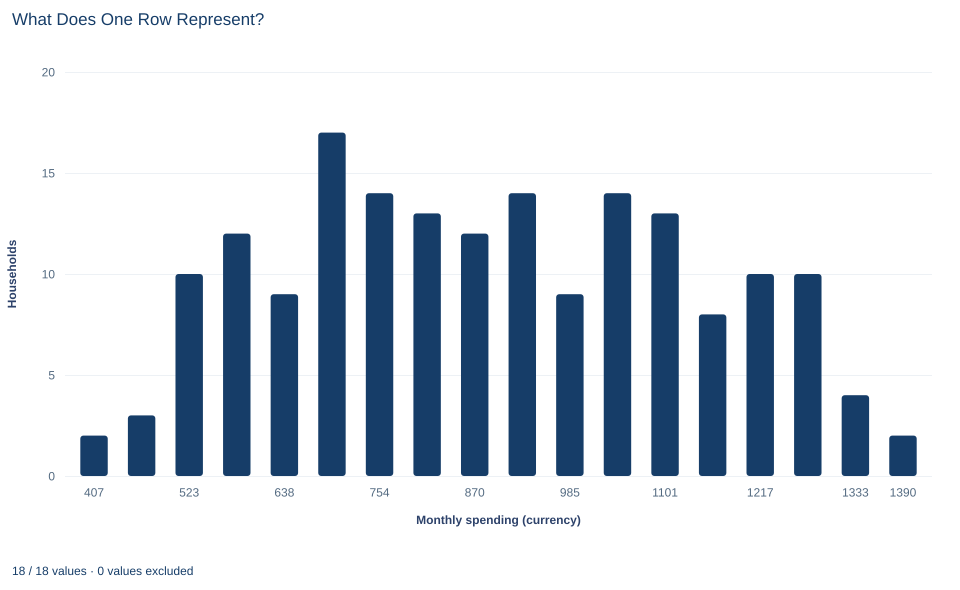

# Lab 01 · What Does One Row Represent?

**Observational units, variable types and missing values**

## Start with the supplied workbook

1. Download [household_measurements.xlsx](household_measurements.xlsx) and the [Python lab](lab.py). The workbook holds the fixed records used throughout this chapter.
2. Import `household_measurements.xlsx` into OpenEconometrics and keep that file name as the dataset name. The `Data` sheet holds one row per household; the `Dictionary` sheet explains each column, its unit and its blank cells.
3. Open the complete `lab.py` in a new Python document and run the whole file. It reads the imported dataset and displays the summary table, a histogram and the reported numbers.

For ordinary Python, keep `lab.py` and the workbook in the same folder and run the script there, or call `from lab import run_lab` and then `run_lab(data_path="/path/to/household_measurements.xlsx")`. Leave blank cells blank. If you want to try a transformation, work on a copy of the loaded table so the distributed workbook stays unchanged.

A table of household spending looks ready for an average. Before calculating anything, ask two simpler questions. What does one row represent? And what does an empty cell mean? The answers decide the denominator of every number you will report, and two analysts who answer them differently can compute different "average spending" from the same file without either making an arithmetic mistake.

This lab uses **180 original synthetic households** with spending in a hypothetical currency. They are teaching records, not a survey of real people. The [LaTeX table](table.tex) collects the reported numbers.

## 1. Name the observational unit

Each row of `Data` describes one household. It is not one person and not one purchase. The household is the **observational unit**: the thing about which each row records measurements.

That choice is not cosmetic. An average over rows is an average over households, so every household counts once, whether one person or six people live in it. If the question were about people, a six-person household would need six times the weight of a one-person household. If the question were about purchases, the file would need one row per purchase, which it does not have.

So the first sentence of any summary should name the unit: "per household," "per person" or "per purchase." Writing "average spending" without that word leaves the reader to guess the denominator.

## 2. Classify every column

The four columns measure different kinds of things, and the kind decides which calculations make sense.

| Column | What it records | Kind of variable | Meaningful summaries |
|---|---|---|---|
| `household_id` | A label that distinguishes rows | Identifier | Count, uniqueness |
| `region` | North or South | Nominal category | Counts and shares by group |
| `household_size` | People living in the household | Count | Mean, spread, range |
| `monthly_spending` | Reported spending per month | Measured quantity, hypothetical currency/month | Mean, spread, range |

The identifier is stored as an integer, but its arithmetic is empty. The IDs here run from 1 to 180, so their mean is 90.5, a number that describes how the rows were labeled and nothing about any household. Relabeling the rows would change that mean without changing a single household.

Region is a category. Coding North as 0 and South as 1 would let software compute a "mean region," but the result would only restate the share of South households; the codes carry no distance. Household size and spending are numbers whose differences mean something: one more person, or one more currency unit per month.

## 3. Keep missing values visible

Four households have a blank `monthly_spending` cell. They are households 9, 39, 69 and 99, and all four are in the South. Their size and region are recorded; only the spending report is missing.

A blank and a zero are different statements. A zero would say "this household spent nothing this month," which is an observed value and belongs in every average. A blank says "we do not know what this household spent." Replacing blanks with zeros would invent four observations of no spending, enlarge the denominator from 176 to 180 and pull the mean down.

The workbook therefore keeps the blanks, and the lab selects the analysis sample explicitly:

- **Raw households:** 180 rows in the file.
- **Observed spending:** 176 households with a recorded report.
- **Missing spending:** 4 households, still part of the raw data.

These three counts must reconcile, 176 + 4 = 180, and the lab checks that they do. Every spending summary below uses the 176 observed households. That is a choice about the sample, and it should be reported as one.

## 4. Run the summary

The complete file loads the workbook with `load_data()` and keeps only rows with a recorded spending value. The descriptive step is:

```python
import openecon as oe

raw = load_data()  # reader defined in the complete lab.py
observed = raw.dropna(subset=["monthly_spending"])
summary = oe.describe(
    observed, ["household_size", "monthly_spending"], stats=["n", "mean", "std_dev", "min", "max"]
)
display(summary)
```

The output table reads:

| Variable | n | Mean | Standard deviation | Minimum | Maximum |
|---|---:|---:|---:|---:|---:|
| `household_size` (people) | 176 | 3.51 | 1.68 | 1 | 6 |
| `monthly_spending` (currency/month) | 176 | 888.99 | 245.69 | 377.93 | 1,419.42 |

Start with the `n` column. Both rows use 176 households, including household size, which is complete for all 180. The summary describes the retained sample, so every statistic in it shares one denominator. The standard deviation divides by n − 1, the usual sample convention.

Then read each number in its unit. A typical observed household spends about 889 currency units a month, and household spending varies across households by roughly 246 units around that mean. Households range from one to six people.

## 5. Choose the denominator for "spending per person"

A natural follow-up asks how much is spent per person. There are two reasonable calculations, and they answer different questions.

$$
\overline{C/H}=\frac{1}{176}\sum_{i\,\in\,\text{observed}}\frac{C_i}{H_i},
\qquad
\frac{\sum_i C_i}{\sum_i H_i}.
$$

Here $C_i$ is household $i$'s monthly spending and $H_i$ its size. The first expression divides each household's spending by its size and then averages those 176 ratios. Every household counts once, so it answers: "In a typical household, how much is spent per member?" The lab reports this value:

```python
per_household = observed.monthly_spending.mean()
per_member = (observed.monthly_spending / observed.household_size).mean()
print(round(per_household, 3), round(per_member, 3))
```

It prints 888.985 currency per household per month and **299.558** currency per member per month.

The second expression pools all spending and divides by all people in the observed households. Every person counts once, so a six-person household carries six times the weight of a single-person household. It answers a different question: "Across all people in these households, how much is spent per person?" Because the two calculations weight households differently, they generally give different numbers, and neither should be labeled simply "spending per person" without saying which weighting it uses.

## 6. Read the histogram



The histogram counts households, not people, in each spending band. Its bars add up to 176, the retained sample. Most households spend between about 500 and 1,350 currency units a month, spread fairly evenly across that range, and no single household sits far from the rest. A histogram of household totals cannot show spending per person; that would need the ratio from Section 5, plotted as a separate variable.

## A case from the literature

Lanjouw and Ravallion (1995) met the denominator question of Section 5 in research on poverty. A widely held view said that larger families in developing countries tend to be poorer, and that view had influenced research and policy. They argued that economies of size in consumption caution against it. In data for Pakistan, the correlation between poverty and household size vanished when the size elasticity of the cost of living was set at about 0.6, while some measures of child nutritional status pointed to an elasticity of one. An elasticity of one amounts to dividing spending by the number of members, as the per-member ratio in Section 5 does; a smaller elasticity lets a large household need less per person. Whether large households look poorer therefore depends on a choice made before any average is taken.

Missing reports raise a parallel problem. Lillard et al. (1986) noted that over a quarter of respondents in widely used microdata sets refused to answer some income questions, and that the Census Bureau filled the gaps with values from demographically similar donors. Because that procedure assumes that income does not affect whether people report, they argued that it most likely understates average incomes. Rubin (1976) set out the conditions under which the process that causes missing data can be ignored.

This lab keeps its four blanks visible instead of filling them, and its households are synthetic and unweighted. The studies show why the choices matter, not what real households spend.

## 7. Decide what the summary supports

The reported means describe the 176 households with a recorded spending value. They do not tell us what the four missing households spent. All four blanks are in the South, so if missing reports were related to spending, an observed-case mean could differ from the mean that complete records would give. Whether that matters depends on why the reports are missing, which the data alone cannot reveal.

These records are also treated as independent, equally weighted households. A real household survey usually has sampling weights, clustered selection and nonresponse adjustments, and it would need an estimator and an uncertainty calculation that respect that design. The calculations here are descriptive: they summarize a fixed set of synthetic households and make no claim about a wider population.

## 8. Write the descriptive statement in full

A complete statement for the worked example reads: "Of 180 synthetic households, 176 reported monthly spending and 4 did not; all four missing reports are from the South. Among the 176 reporting households, mean spending is 888.99 currency units per household per month (standard deviation 245.69). Averaging each household's spending per member gives 299.56 currency units per member per month, with each household weighted equally."

The statement names the unit, the sample, the treatment of blanks and the weighting before giving any number. That is the habit this lab builds.

## Student exercises

1. Reconcile the three counts reported by the lab. For each number in Section 4, say whether its denominator is 180 or 176.
2. Compute the pooled spending per person, $\sum C_i/\sum H_i$, for the 176 observed households. Compare it with 299.558 and explain why weighting people rather than households moves the result in that direction.
3. Calculate the mean household size for all 180 households and for the 176 observed households. Why are the two so close here, and when could they differ substantially?
4. A colleague reports "mean region = 0.5." Explain what that number can and cannot mean, and propose a better summary of the `region` column.
5. On a copy of the data, replace the four blanks with zero and recompute the spending mean and its count. Describe what the new number claims about those four households.
6. Rewrite the sentence "Average spending is 889" so that it names the unit, the sample and the treatment of missing values.

## Further reading

- Lanjouw, P., and Ravallion, M. (1995). Poverty and household size. *The Economic Journal*, 105(433), 1415. https://doi.org/10.2307/2235108
- Lillard, L., Smith, J. P., and Welch, F. (1986). What do we really know about wages? The importance of nonreporting and Census imputation. *Journal of Political Economy*, 94(3, Part 1), 489–506. https://doi.org/10.1086/261386
- Rubin, D. B. (1976). Inference and missing data. *Biometrika*, 63(3), 581–592. https://doi.org/10.1093/biomet/63.3.581
- Stevens, S. S. (1946). On the theory of scales of measurement. *Science*, 103(2684), 677–680. https://doi.org/10.1126/science.103.2684.677
