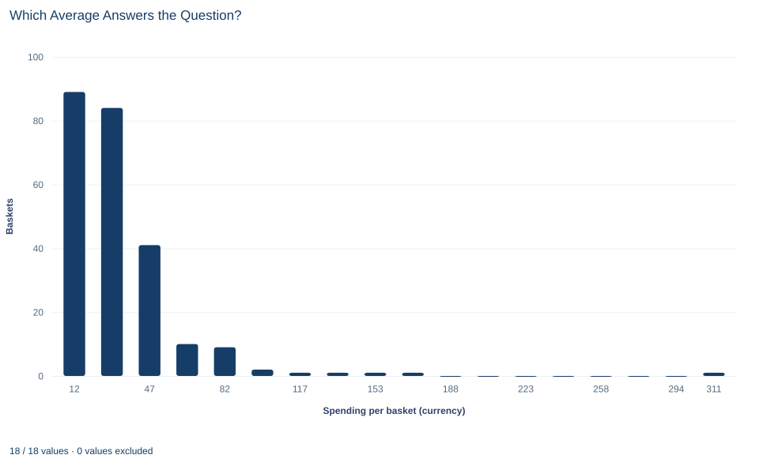

# Lab 02 · Which Average Answers the Question?

**Arithmetic mean, median and geometric mean of right-skewed basket spending**

## Start with the supplied workbook

1. Download [shop_spending.xlsx](shop_spending.xlsx) and the [Python lab](lab.py). The workbook holds the fixed baskets used throughout this chapter.
2. Import `shop_spending.xlsx` into OpenEconometrics and keep that file name as the dataset name. The `Data` sheet holds one row per shopping basket; the `Dictionary` sheet explains the two columns and their units.
3. Open the complete `lab.py` in a new Python document and run the whole file. It reads the imported dataset and displays a summary table with quartiles, a histogram of basket spending and the table of reported centers.

For ordinary Python, keep `lab.py` and the workbook in the same folder and run the script there, or call `from lab import run_lab` and then `run_lab(data_path="/path/to/shop_spending.xlsx")`. If you want to try a transformation, such as adding a fee to every basket, work on a copy of the loaded table so the distributed workbook stays unchanged.

Two people at the same shop ask for "the average basket." The accountant wants a number that, multiplied by the number of baskets, gives the till total. The store manager wants to know what a basket near the middle of the line looks like. From the same file the first answer is 32.44 currency units and the second is 24.69. Neither is wrong. They answer different questions, and the gap between them says something about the data.

This lab uses **240 original synthetic shopping baskets**, each with its total spending in a hypothetical currency. They are teaching records, not sales from a real shop. Every basket has a recorded value, so every summary uses all 240 rows. The [LaTeX table](table.tex) collects the reported numbers.

## 1. Name the unit and the question

Each row of `Data` is one basket: everything bought at a single checkout. It is not one customer, because the file has no customer identifier and one customer could have paid for several baskets. Every center in this lab is therefore a center **per basket**.

| Column | What it records | Kind of variable |
|---|---|---|
| `basket_id` | A label from 1 to 240 that distinguishes baskets | Identifier |
| `spending` | Total spent in that basket, in hypothetical currency units | Positive measured amount |

Write down the question before computing anything. "How much revenue does a basket bring in, on average?" is about totals. "How much does a middle-of-the-line basket cost?" is about position in the ordered list. "What is the typical basket when 10 versus 20 counts as the same step as 20 versus 40?" is about ratios. Each leads to a different center.

## 2. The arithmetic mean keeps the total

The arithmetic mean of $n$ baskets with spending $x_1,\dots,x_n$ is

$$
\bar x=\frac{1}{n}\sum_{i=1}^{n}x_i .
$$

Rearranged, $n\bar x=\sum_i x_i$: the mean times the number of baskets is exactly the till total. This is the property the accountant needs, and no other center in this lab has it.

It also makes the mean a planning number. If the shop expected 1,000 baskets next week with the same mix, the mean predicts revenue of about 32,439 currency units. The median would predict about 24,691, falling short by roughly 7,748. Every basket enters the sum with its full magnitude, so large baskets pull the mean upward in proportion to their size. That is not a flaw: large baskets really do bring in more revenue.

## 3. The median finds the middle by rank

Sort the values and write them $x_{(1)}\le x_{(2)}\le\dots\le x_{(240)}$. With an even number of baskets there is no single middle value, so the median averages the two in the middle:

$$
m=\frac{x_{(n/2)}+x_{(n/2+1)}}{2}=\frac{x_{(120)}+x_{(121)}}{2}.
$$

Half of the baskets lie at or below $m$ and half at or above it. The median depends on ranks, not on how far the extreme values sit from the middle. If the largest basket were 3,200 instead of 320, it would still be in position 240, and positions 120 and 121 would not move. That insensitivity helps when describing a typical basket and is useless for revenue: a median multiplied by 240 is not the total of anything.

## 4. The geometric mean averages on a log scale

The geometric mean takes natural logarithms, averages them and returns to currency units:

$$
g=\exp\!\left(\frac{1}{n}\sum_{i=1}^{n}\log x_i\right).
$$

On the log scale, equal steps are equal ratios, so $g$ is the center when differences are judged proportionally. The formula needs every value to be strictly positive. That holds here: the smallest basket, number 109, spent 2.80 currency units. A file with zero-spending baskets would need a different, reported treatment.

For positive numbers the geometric mean never exceeds the arithmetic mean, with equality only when all values are equal. Logs compress large values much more than small ones, so a long right tail pulls $g$ up far less than it pulls $\bar x$. Two misreadings are common: exponentiating the mean log does not recover the arithmetic mean, and $240g$ is not the till total.

**Pause before running.** The mean is 32.44 and the median 24.69. Predict where the geometric mean will fall, and explain how a long right tail of large baskets affects each of the three centers.

## 5. Run the summary

After running `lab.py`, the summary step is:

```python
import openecon as oe

raw = load_data()  # reader defined in the complete lab.py
summary = oe.describe(raw, ["spending"], stats=["n", "mean", "std_dev", "p25", "p50", "p75", "max"])
display(summary)
```

The output, rounded to two decimals, reads:

| Variable | Baskets | Mean | Standard deviation | 25th percentile | Median | 75th percentile | Maximum |
|---|---:|---:|---:|---:|---:|---:|---:|
| `spending` (currency/basket) | 240 | 32.44 | 30.58 | 15.28 | 24.69 | 39.96 | 320.00 |

Check the count first: all 240 baskets are used. Then compare the mean with the median. The mean is 7.75 units higher, which says the large baskets are farther above the middle than the small baskets are below it.

The quartiles show the same asymmetry without the mean. From the 25th percentile to the median is 9.41 units; from the median to the 75th percentile is 15.27. The maximum is about eight times the 75th percentile, and the standard deviation is nearly as large as the mean, a common sign that positive data stretch to the right. Software packages interpolate percentiles differently; this summary averages two neighboring values when a percentile falls between them, so its median matches the formula in Section 3, but another package may report slightly different quartiles.

The three centers and the sensitivity calculation can be computed directly:

```python
import math

spending = raw.spending
arithmetic = spending.mean()
middle = spending.median()
geometric = math.exp(spending.apply(math.log).mean())
without_largest = spending.drop(spending.idxmax()).mean()
print(round(arithmetic, 3), round(middle, 3), round(geometric, 3), round(without_largest, 3))
```

| Quantity | Value (currency/basket) |
|---|---:|
| Arithmetic mean | 32.44 |
| Median | 24.69 |
| Geometric mean | 24.59 |
| Arithmetic mean without the largest basket | 31.24 |
| Largest basket | 320.00 |
| Change in the mean from removing it | 1.20 |

The order is arithmetic mean, median, geometric mean. The last two differ by about 0.10 units, small next to the 7.75 that separate the median from the mean. The geometric mean and median nearly coincide when log spending is roughly balanced around its middle; that is a feature of this file, not a rule.

## 6. Check how much one basket matters

The largest basket is number 1, at exactly 320.00 currency units. The next largest is 166.88, so this basket sits far beyond the rest. It is still a valid record: nothing in the workbook suggests a typing error, and a large order is a possible basket. The primary analysis keeps it.

A sensitivity calculation asks how much the result depends on it. Removing basket $k$ changes the mean by

$$
\bar x-\bar x_{(-k)}=\frac{x_k-\bar x_{(-k)}}{n},
$$

where $\bar x_{(-k)}$ is the mean of the other $n-1$ baskets. With the lab's numbers, $(320.00-31.24)/240=1.20$, the reported change. The effect is large because the basket is far from the others and the divisor is only 240.

Read the 1.20 as a measure of dependence on one record, not as a correction. The mean without the largest basket answers "What would the average have been if this basket had not happened?" That is not the shop's revenue.

## 7. Read the histogram



The chart divides the range from the smallest basket (2.80) to the largest (320.00) into 18 equal bins, each about 17.6 units wide, and plots the number of baskets in each bin at the bin's midpoint. The bars add up to 240.

The first two bins, centered near 11.6 and 29.2, hold 89 and 84 baskets, so 173 baskets spent less than about 38 units. The counts then fall to 41, 10, 9 and 2. The four bins centered near 117, 135, 153 and 170 hold one basket each, seven empty bins follow, and a single bar at the far right is the 320-unit basket.

That is a right skew: a tall cluster of small and moderate baskets and a long, thin tail of large ones. All three centers fall inside the second bin, the median and geometric mean in its lower part. The chart does not mark them, so locate them from the numbers in Section 5. Different bin choices change the look of a histogram, not the values of the mean and median.

## A case from the literature

The accountant's question comes up wherever skewed spending has to be added up. Duan (1983) addressed a version of it for medical expenditures. He proposed the smearing estimate for one task: estimating the expected response on the original scale after a linear regression has been fitted on a transformed scale. The estimate is consistent under mild conditions, and in an example predicting medical expenditures it could outperform parametric estimates even when the parametric assumption was nearly satisfied. This lab shows why such a step is needed. Averaging on the log scale and transforming back gives the geometric mean, 24.59, not the arithmetic mean, 32.44, that reproduces the till total.

The opposite choice can also be right. Fleming and Wallace (1986) argued that summarizing normalized computer benchmark results with the arithmetic mean leads to mistaken conclusions, and recommended the geometric mean instead. That is a ratio question, like the third question in Section 1. Smith (1988) later examined the controversy over reducing performance to a single number. The leave-one-out calculation in Section 6 asks a question that Hampel (1974) formalized with the influence curve, a tool for studying the local robustness of estimators such as trimmed and Winsorized means.

None of these studies concerns shop baskets, and the lab's baskets are synthetic. Together they show that the right center follows from the question being asked, not from the shape of the data alone.

## 8. Decide what the summary supports

The numbers describe 240 synthetic baskets: how three centers behave for one fixed, right-skewed file and how much one large basket moves the mean. They make no claim about a real shop or next month's sales, and no sampling uncertainty is attached to them. They are also centers per basket; a statement about a "typical customer" would need to know which baskets belong to the same person.

A large value is a reason to look, not a reason to delete. If an investigation showed that basket 1 was a recording error, a corrected value would replace it and every summary would be recomputed and labeled as corrected. Without that evidence, dropping it changes the question being answered. Likewise, switching from the mean to the median because the median is "more robust" does not help the accountant: a robust number that does not add up to revenue is the wrong tool for that job.

## 9. Write the descriptive statement in full

A complete statement for the worked example reads: "Across 240 synthetic shopping baskets with no missing values, mean spending is 32.44 currency units per basket; multiplied by the number of baskets, it gives total revenue. The median basket spent 24.69 units and the geometric mean is 24.59, both well below the mean because a few large baskets form a long right tail. The largest basket, 320.00 units, is kept as a valid record; excluding it would lower the mean to 31.24."

The statement names the unit, the sample, the purpose of each center and the treatment of the extreme value.

## Student exercises

1. Use the mean and the number of baskets to compute total observed spending. Then compute the total without the largest basket and confirm that dividing it by 239 gives the sensitivity mean in Section 5.
2. Sort the spending values and report the two order statistics that the median averages. Explain why the median is so close to both of them.
3. Remove the largest basket and recompute the median. Compare its change with the 1.20 change in the mean, and explain the difference in terms of ranks and magnitudes.
4. Suppose a delivery fee of 2 currency units is added to every basket. Predict how each of the three centers changes, then compute them on a copy of the data. Which center does not rise by exactly 2, and in which direction does it differ?
5. Count the baskets whose spending is below the arithmetic mean. Explain why, in a right-skewed distribution, more than half of the baskets can fall below the mean.
6. A manager proposes reporting revenue per basket as the median "because the outlier distorts the mean." Write a short reply. Then rewrite "the average basket is 32" as two sentences, one for the accountant and one for the store manager.

## Further reading

- Duan, N. (1983). Smearing estimate: A nonparametric retransformation method. *Journal of the American Statistical Association*, 78(383), 605–610. https://doi.org/10.1080/01621459.1983.10478017
- Fleming, P. J., and Wallace, J. J. (1986). How not to lie with statistics: The correct way to summarize benchmark results. *Communications of the ACM*, 29(3), 218–221. https://doi.org/10.1145/5666.5673
- Hampel, F. R. (1974). The influence curve and its role in robust estimation. *Journal of the American Statistical Association*, 69(346), 383–393. https://doi.org/10.1080/01621459.1974.10482962
- Smith, J. E. (1988). Characterizing computer performance with a single number. *Communications of the ACM*, 31(10), 1202–1206. https://doi.org/10.1145/63039.63043
