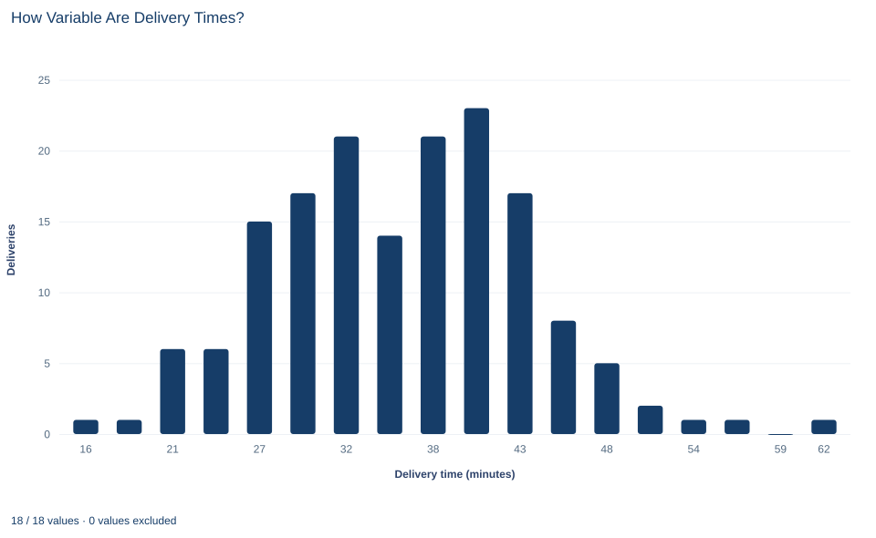

# Lab 03 · How Variable Are Delivery Times?

**Variance, standard deviation, interquartile range and coefficient of variation**

## Start with the supplied workbook

1. Download [delivery_variation.xlsx](delivery_variation.xlsx) and the [Python lab](lab.py). The workbook holds the fixed deliveries used throughout this chapter.
2. Import `delivery_variation.xlsx` into OpenEconometrics and keep that file name as the dataset name. The `Data` sheet holds one row per parcel delivery; the `Dictionary` sheet explains the two columns and their units.
3. Open the complete `lab.py` in a new Python document and run the whole file. It reads the imported dataset and displays a summary table with quartiles, a histogram of delivery times and the table of spread measures.

For ordinary Python, keep `lab.py` and the workbook in the same folder and run the script there, or call `from lab import run_lab` and then `run_lab(data_path="/path/to/delivery_variation.xlsx")`. To try a transformation, such as adding a fixed delay to every delivery, work on a copy of the loaded table so the distributed workbook stays unchanged.

A courier tells customers that deliveries take "about 36 minutes." That is a statement about location. A customer who has to be home to sign for a parcel cares about something else: how often the parcel comes at 25 minutes, or at 50. Two delivery services can share the same mean and still differ greatly in reliability, so a report on delivery times needs a measure of spread beside its average.

This lab uses **160 original synthetic parcel deliveries**, each with its elapsed time in minutes. They are teaching records for one delivery process, not a courier's real logs. Every delivery has a recorded time, so every summary uses all 160 rows. The mean is 35.69 minutes; the lab asks how to describe the variation around it, and what each measure of variation is measured in. The [LaTeX table](table.tex) collects the reported numbers.

## 1. Name the unit and the columns

Each row of `Data` is one delivery. Every spread measure below therefore describes variation **between deliveries**, not between couriers, days or routes, none of which the file records.

| Column | What it records | Kind of variable |
|---|---|---|
| `delivery_id` | A label from 1 to 160 that distinguishes deliveries | Identifier |
| `minutes` | Elapsed time for that delivery, in minutes | Measured duration |

The dictionary calls `minutes` "elapsed delivery time" without saying when the clock starts: at the order, at dispatch or when the courier leaves the depot. A real report would have to say. The recorded times run from 14.62 minutes (delivery 27) to 63.27 minutes (delivery 131).

## 2. Variance and standard deviation

Spread starts with the **deviation** of each delivery from the mean, $x_i-\bar x$. A positive deviation is a slower-than-average delivery, a negative one a faster delivery. Averaging the deviations directly is useless, because they always sum to zero. The sample variance squares them first:

$$
s^2=\frac{1}{n-1}\sum_{i=1}^{n}(x_i-\bar x)^2,\qquad s=\sqrt{s^2}.
$$

Here $x_i$ is delivery $i$'s time, $\bar x$ the mean time, $n=160$ the number of deliveries, $s^2$ the sample variance and $s$ the sample standard deviation.

Take delivery 1 as an example. It took 33.52 minutes, so its deviation is $33.52-35.69=-2.17$ minutes and its squared deviation is about 4.72 minutes squared. Adding the squared deviations of all 160 deliveries gives about 9,938.8 minutes squared, and dividing by 159 gives $s^2=62.51$ minutes squared.

Squaring does two things. It makes every term positive, and it gives large deviations far more weight than small ones: a delivery 10 minutes late adds 100 to the sum, four times as much as one 5 minutes late. It also changes the unit. Minutes squared has no everyday meaning, which is why the standard deviation takes the square root and returns to minutes: $s=7.91$ minutes. Loosely, a typical delivery differs from the mean by several minutes, on the order of 8.

Why divide by $n-1$ rather than $n$? The deviations are measured from $\bar x$, which was itself computed from the same 160 times. Because the deviations must sum to zero, once 159 of them are known the last one is fixed. Only 159 deviations are free to vary, so the sum is divided by 159 degrees of freedom. This is the usual **sample** convention, and the one the lab uses throughout. A **population** variance divides by $n$; the two must not be mixed in one report.

## 3. Interquartile range

The interquartile range (IQR) measures spread by position instead of by squared distance:

$$
\text{IQR}=Q_{0.75}-Q_{0.25},
$$

where $Q_{0.25}$ is the 25th percentile and $Q_{0.75}$ the 75th percentile of the ordered times. Here $Q_{0.25}=29.83$ and $Q_{0.75}=41.12$ minutes, so the IQR is 11.29 minutes: the middle half of the deliveries fall within an interval about 11.3 minutes wide.

The IQR uses two order statistics and ignores how far the fastest and slowest quarters stretch. If the slowest delivery had taken three hours instead of about one, the IQR would not change, while the standard deviation would jump. Neither measure is "right." The standard deviation uses every delivery and is the natural partner of the mean; the IQR describes the bulk of the deliveries and is the natural partner of the median. Percentiles also depend on an interpolation rule, and other software may report slightly different quartiles from the same 160 times.

## 4. Coefficient of variation

The coefficient of variation (CV) expresses the standard deviation as a fraction of the mean:

$$
CV=\frac{s}{\bar x}=\frac{7.91}{35.69}=0.22.
$$

The standard deviation is about 22% of the mean delivery time. Because it is a ratio of two quantities in minutes, the CV has no unit, which makes it useful for comparing variability across processes on very different scales, such as a 36-minute local delivery and a three-day national shipment.

The CV makes sense only when zero on the scale means "none of the quantity" and the mean is positive. Elapsed time qualifies: zero minutes is no time at all. Clock time of day does not. A delivery "at 14:00" measured from midnight has an arbitrary zero, and moving the zero would change the CV without changing anything about the deliveries.

## 5. Change the unit

**Pause before running.** If the times are converted from minutes to hours, will the variance be divided by 60 or by 3,600?

Converting to hours divides every time by 60, so every deviation is also divided by 60. Each squared deviation is divided by $60^2=3{,}600$, and so is their sum and the variance. The standard deviation, the square root, is divided by 60, as are the mean and the IQR. The CV is unchanged because its numerator and denominator are both divided by 60. Dividing the variance by only 60 is a units error: the result would be in "minute-hours," which is not a unit anyone uses.

## 6. Run the summary

After running `lab.py`, the summary step is:

```python
import openecon as oe

raw = load_data()  # reader defined in the complete lab.py
summary = oe.describe(raw, ["minutes"], stats=["n", "mean", "std_dev", "p25", "p50", "p75"])
display(summary)
```

| Variable | Deliveries | Mean | Standard deviation | 25th percentile | Median | 75th percentile |
|---|---:|---:|---:|---:|---:|---:|
| `minutes` | 160 | 35.69 | 7.91 | 29.83 | 35.63 | 41.12 |

All values except the count are in minutes. The count confirms that all 160 deliveries are used. The mean and median are less than a tenth of a minute apart, and the median sits roughly in the middle of the two quartiles (5.79 minutes above the lower, 5.50 below the upper), so the middle of the distribution is close to balanced. The standard deviation divides by $n-1$.

The variance and the unit change can be computed from the deviations:

```python
minutes = raw.minutes
deviations = minutes - minutes.mean()
sample_var = (deviations ** 2).sum() / (len(minutes) - 1)
sample_sd = sample_var ** 0.5
hours = minutes / 60
print(round(deviations.sum(), 9), round(sample_var, 3), round(sample_sd, 4), round(hours.std(), 5))
```

The deviations sum to zero up to rounding, and the remaining values match the lab's table:

| Quantity | Value | Unit |
|---|---:|---|
| Mean | 35.69 | minutes |
| Sample variance | 62.51 | minutes squared |
| Sample standard deviation | 7.906 | minutes |
| Interquartile range | 11.29 | minutes |
| Coefficient of variation | 0.222 | none |
| Sample standard deviation | 0.1318 | hours |

Read every row with its unit. A variance of 62.51 cannot be compared with a mean of 35.69 or an IQR of 11.29, because it is in different units; the standard deviation can. The standard deviation in hours, 0.1318, is the same spread as 7.906 minutes, just written on another scale.

## 7. Read the histogram



The chart divides the range from 14.62 to 63.27 minutes into 18 equal bins, each about 2.7 minutes wide, and plots the number of deliveries in each bin at the bin's midpoint. The bars add up to 160.

The distribution has a single broad hump. The seven bins centered near 27, 29, 32, 35, 38, 40 and 43 minutes hold 15, 17, 21, 14, 21, 23 and 17 deliveries, so 128 of the 160 deliveries took between about 25 and 44 minutes. Counts thin out on both sides: one delivery in each of the two fastest bins, and in the slow tail single deliveries near 54 and 57 minutes, an empty bin and one delivery near 62 minutes. The mean, 35.69 minutes, lies near the middle of the hump.

The standard deviation describes how wide that hump is. The picture can mislead, though: stretching or compressing the horizontal axis makes the same deliveries look more or less variable, while $s$ and the IQR do not change. Read the axis values, not the visual width.

## A case from the literature

Transport economists treat the spread of travel times as something travelers value separately from the average. Small et al. (2005) studied commuters' choices of whether to pay a toll for congestion-free express travel. Combining revealed-preference data on those choices with stated-preference data, and estimating a mixed logit model, they found that motorists place high values on both travel time and its reliability, and that these values differ substantially across motorists. A review by Noland and Polak (2002) describes stated-preference studies that estimated coefficients on various measures of travel time variability. How variability is measured is therefore part of the analysis, not a detail.

This lab supplies the measuring step that such studies need. A standard deviation and an interquartile range each turn 160 times into one number, and they can rank two services differently when their slow tails differ. Even the interquartile range is not unique: Hyndman and Fan (1996) compared the sample quantile definitions implemented in statistical packages and argued for one standard definition, so that different packages give the same answers.

The lab cannot estimate what reliability is worth, which would need choices and prices, and its deliveries are synthetic records from a single process. What it shows is that a reliability claim must name its spread measure, its unit and its convention, just as the studies above had to choose a measure before they could value it.

## 8. Decide what the summary supports

The measures describe variation among 160 synthetic deliveries from one process. The file contains no second process, so it cannot by itself show that one service is more reliable than another; it shows how to measure reliability so that such a comparison could be made. The times are treated as independent deliveries on one elapsed-time scale.

The standard deviation describes individual deliveries. It is not the standard error of the mean, which describes how precisely 160 deliveries pin down the average and is much smaller. Nor do these numbers give the probability that a future delivery exceeds a promised time; that would need a model of the distribution or a direct count, and an argument that future deliveries resemble these.

No single number describes all of a distribution's shape. Two processes with the same standard deviation can have very different slow tails, and the IQR is blind to the tails by design. Report a spread measure that matches the question and show the distribution when the tails matter.

## 9. Write the descriptive statement in full

A complete statement for the worked example reads: "Across 160 synthetic parcel deliveries with no missing times, the mean delivery time is 35.69 minutes. The sample standard deviation is 7.91 minutes (variance 62.51 minutes squared, dividing by n − 1), and the middle half of deliveries lie within an interquartile range of 11.29 minutes. The standard deviation is about 22% of the mean."

The statement gives each spread measure with its unit and convention, so a reader can compare it with the mean and with other reports.

## Student exercises

1. Recompute the variance and standard deviation with denominator $n$ instead of $n-1$. Report both values in minutes squared and minutes, and explain why the difference is small for 160 deliveries.
2. Convert the variance and the IQR to hours. State each result with its unit.
3. On a copy of the data, add 5 minutes to every delivery. Predict, then compute, the new mean, variance, standard deviation, IQR and CV. Explain which summaries change and why.
4. Count the deliveries within one standard deviation of the mean and within two standard deviations. Express each count as a share of 160.
5. Compute the standard error of the mean, $s/\sqrt{n}$. Explain in one or two sentences why it differs from the standard deviation and what question each answers.
6. Rewrite "delivery times are very consistent, with a variance of 62.5" so that it uses an interpretable measure, states its unit and convention, and avoids a judgment the data do not support.

## Further reading

- Hyndman, R. J., and Fan, Y. (1996). Sample quantiles in statistical packages. *The American Statistician*, 50(4), 361–365. https://doi.org/10.1080/00031305.1996.10473566
- Noland, R. B., and Polak, J. W. (2002). Travel time variability: A review of theoretical and empirical issues. *Transport Reviews*, 22(1), 39–54. https://doi.org/10.1080/01441640010022456
- Small, K. A., Winston, C., and Yan, J. (2005). Uncovering the distribution of motorists' preferences for travel time and reliability. *Econometrica*, 73(4), 1367–1382. https://doi.org/10.1111/j.1468-0262.2005.00619.x
