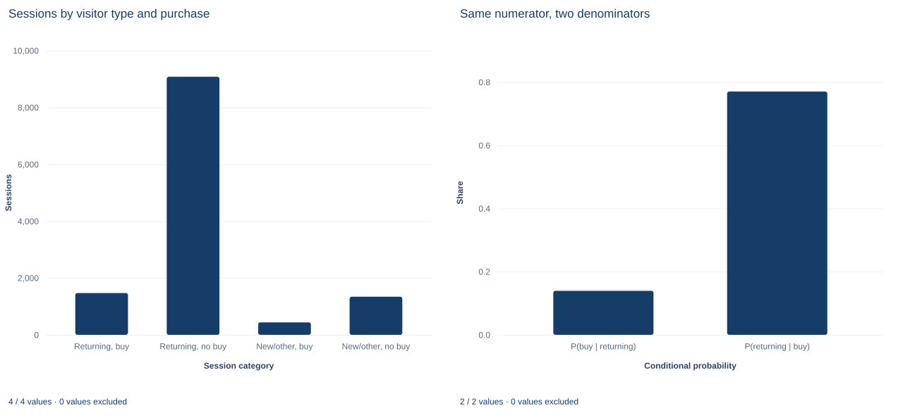

# Lab 04 · Which Denominator Belongs in a Probability?

**Joint, marginal and conditional probabilities from a two-by-two table**

## Start with the supplied workbook

1. Download [shopper_sessions.xlsx](shopper_sessions.xlsx) and the [Python lab](lab.py). The workbook holds the published website sessions used throughout this chapter.
2. Import `shopper_sessions.xlsx` into OpenEconometrics and keep that file name as the dataset name. The `Data` sheet holds one row per browsing session; the `Dictionary` sheet explains the four columns and their coding and gives the source and licence.
3. Open the complete `lab.py` in a new Python document and run the whole file. It reads the imported dataset and displays the returning-by-purchase cross-tabulation, a bar chart of the four session categories and the table of reported probabilities.

For ordinary Python, keep `lab.py` and the workbook in the same folder and run the script there, or call `from lab import run_lab` and then `run_lab(data_path="/path/to/shopper_sessions.xlsx")`. If you want to recode or subset the sessions, work on a copy of the loaded table so the distributed workbook stays unchanged.

An online shop's report says that 77.0% of the sessions ending in a purchase came from returning visitors. A manager concludes: "Returning visitors are our most likely buyers." In this file the opposite holds. Only 13.9% of returning visitors' sessions ended in a purchase, against 24.6% of the other sessions. Both numbers are correct. They count the same sessions, returning visitors who bought, but divide them by different groups, and returning visitors make up such a large share of all sessions that they dominate the buyers even while buying less often.

This lab uses **12,330 browsing sessions** on an online retailer's website, published in the UCI Machine Learning Repository's Online Shoppers Purchasing Intention Dataset. Each session records whether the visitor was classified as returning and whether the session ended in a purchase. No cell is blank. The [LaTeX table](table.tex) collects the reported probabilities.

## Data source and licence

- **Data:** Sakar, C., and Kastro, Y. (2018). *Online Shoppers Purchasing Intention Dataset* [Dataset]. UCI Machine Learning Repository. https://doi.org/10.24432/C5F88Q
- **Article:** Sakar, C. O., Polat, S. O., Katircioglu, M., and Kastro, Y. (2019). Real-time prediction of online shoppers' purchasing intention using multilayer perceptron and LSTM recurrent neural networks. *Neural Computing and Applications*, 31(10), 6893–6908. https://doi.org/10.1007/s00521-018-3523-0
- **Licence:** Creative Commons Attribution 4.0 International (CC BY 4.0), https://creativecommons.org/licenses/by/4.0/. The workbook is an adapted copy; the changes are listed below.
- **Preparation:** all 12,330 sessions of the published file are kept in file order, including 125 rows that repeat another row exactly. `session` numbers them, because the source has no session identifier. `VisitorType` keeps the publisher's three labels; `Weekend` and `Revenue` code the publisher's TRUE/FALSE as 1/0. The other 14 columns are left out.

## 1. Name the unit and the events

Each row of `Data` is one browsing session. The source has no visitor identifier, so a person who came back three times may appear three times. Every probability in this lab is therefore a share **of sessions**, not of people.

| Column | What it records | Coding |
|---|---|---|
| `session` | A label from 1 to 12,330 in the publisher's file order | Identifier |
| `VisitorType` | The retailer's classification of the visitor | `Returning_Visitor`, `New_Visitor` or `Other` |
| `Weekend` | Whether the session took place on a weekend | 1 = yes, 0 = no |
| `Revenue` | Whether the session ended in a purchase | 1 = purchase, 0 = no purchase |

Write $R$ for the event "the session is by a returning visitor" and $P$ for "the session ends in a purchase." The **sample space** is the set of 12,330 sessions, and each event is a subset of it. Turning `VisitorType` into the event $R$ needs a rule for its third label: 85 sessions are labelled `Other`. The lab counts them as not returning, together with the 1,694 `New_Visitor` sessions, and Exercise 1 checks how much that choice matters.

## 2. Count the four cells

Two yes-or-no events split every session into exactly one of four cells. The cross-tabulation counts them:

| | Purchase | No purchase | Total |
|---|---:|---:|---:|
| Returning visitor | 1,470 | 9,081 | 10,551 |
| New or other visitor | 438 | 1,341 | 1,779 |
| Total | 1,908 | 10,422 | 12,330 |

The cells are mutually exclusive and together cover every session: $1{,}470+9{,}081+438+1{,}341=12{,}330$. The row totals give the number of returning and other sessions, and the column totals the number of sessions with and without a purchase.

A **joint probability** divides one cell by all sessions. The share of sessions that are by a returning visitor *and* end in a purchase is

$$
P(R\cap P)=\frac{1{,}470}{12{,}330}=0.119 .
$$

A **marginal probability** divides a row or column total by all sessions: $P(R)=10{,}551/12{,}330=0.856$ and $P(P)=1{,}908/12{,}330=0.155$. Each describes one event while ignoring the other.

## 3. Change the denominator to condition

A **conditional probability** restricts attention to the sessions where one event happened and asks how often the other happened among them:

$$
P(P\mid R)=\frac{P(R\cap P)}{P(R)}=\frac{\text{sessions with both}}{\text{returning sessions}}.
$$

Read the vertical bar as "among." $P(P\mid R)$ is "the share of purchases among returning visitors' sessions." In counts it is $1{,}470/10{,}551=0.139$. The condition, $R$, decides the denominator.

Reversing the condition keeps the numerator and changes the denominator:

$$
P(R\mid P)=\frac{P(R\cap P)}{P(P)}=\frac{1{,}470}{1{,}908}=0.770 .
$$

This is "the share of returning visitors among purchase sessions." Both fractions start from the same 1,470 sessions. The first divides by the 10,551 returning sessions, the second by the 1,908 purchase sessions. They answer different questions: the first is about how returning visitors behave, the second about who the buyers are.

**Pause before running.** For each probability in the reported table, name its denominator, as a count of sessions, before you open the output.

## 4. Why the two conditionals are so far apart

Multiplying each definition by its denominator gives the **multiplication rule**, which can be written two ways:

$$
P(R\cap P)=P(P\mid R)\,P(R)=P(R\mid P)\,P(P).
$$

Dividing one form by the other shows how the reversed conditionals are related:

$$
\frac{P(R\mid P)}{P(P\mid R)}=\frac{P(R)}{P(P)}=\frac{10{,}551}{1{,}908}=5.53 .
$$

The two conditional probabilities differ by exactly the ratio of the two marginal probabilities. Returning sessions are 5.5 times as common as purchase sessions, so the share of returning visitors among buyers is 5.5 times the share of buyers among returning visitors. Nothing about the buyers' behaviour is needed to explain the gap; the margins alone produce it. Rearranging the same identity to compute $P(R\mid P)$ from $P(P\mid R)$ is Bayes' rule, the subject of Lab 05.

## 5. Compare with independence

Two events are **independent** when knowing one does not change the probability of the other: $P(P\mid R)=P(P)$. Substituting into the multiplication rule gives the equivalent product form

$$
P(R\cap P)=P(R)\,P(P).
$$

Independence is a claim about how two events are related, not an identity that always holds. Check it against the table. The product of the marginals is $0.856\times0.155=0.132$, while the observed joint probability is 0.119. The gap is $-0.013$: returning visitors' sessions end in a purchase *less* often (13.9%) than sessions overall (15.5%), and much less often than the other sessions (24.6%).

The same comparison works in counts. If the events were independent, the returning-and-purchase cell would be expected to hold $10{,}551\times1{,}908/12{,}330=1{,}632.7$ sessions. The observed count is 1,470, about 163 fewer. The cross-tabulation output includes this expected table for all four cells.

With sampled data, exact equality would not be expected even for independent events, because counts vary by chance. Deciding whether a gap of this size could plausibly be chance needs a test, which the lab's output also prints but which belongs to Lab 16. Here the gap is a descriptive fact about these 12,330 sessions.

## 6. Run the cross-tabulation

After running `lab.py`, the table step is:

```python
import openecon as oe

raw = load_data()  # reader defined in the complete lab.py
sessions = raw.assign(returning=(raw.VisitorType == "Returning_Visitor").astype(int))
table = oe.crosstab(sessions, "returning", "Revenue", expected=True, exact=False)
display(table)
```

The output holds several tables. The `counts` table is the four-cell table in Section 2, with the rows labelled by `returning` (0, 1) and the columns by `Revenue` (0, 1), plus totals. The `expected` table gives the counts implied by independence. The test, measure and risk tables summarize the strength and significance of the association; set them aside until Lab 16.

The probabilities can be computed directly from two true/false masks:

```python
returning = raw.VisitorType == "Returning_Visitor"
bought = raw.Revenue == 1
total = len(raw)
both = (returning & bought).sum()
probabilities = {
    "P(R)": returning.mean(),
    "P(P)": bought.mean(),
    "P(R and P)": both / total,
    "P(P | R)": both / returning.sum(),
    "P(R | P)": both / bought.sum(),
    "P(P | not R)": (~returning & bought).sum() / (~returning).sum(),
    "P(R) P(P)": returning.mean() * bought.mean(),
}
probabilities["difference"] = probabilities["P(R and P)"] - probabilities["P(R) P(P)"]
print({name: round(float(value), 3) for name, value in probabilities.items()})
```

| Quantity | What it means | Denominator | Value |
|---|---|---:|---:|
| $P(R)$ | Share of sessions by returning visitors | 12,330 sessions | 0.856 |
| $P(P)$ | Share of sessions ending in a purchase | 12,330 sessions | 0.155 |
| $P(R\cap P)$ | Share of sessions by returning visitors that end in a purchase | 12,330 sessions | 0.119 |
| $P(P\mid R)$ | Share of returning visitors' sessions that end in a purchase | 10,551 returning sessions | 0.139 |
| $P(R\mid P)$ | Share of purchase sessions by returning visitors | 1,908 purchase sessions | 0.770 |
| $P(P\mid \neg R)$ | Share of other sessions that end in a purchase | 1,779 other sessions | 0.246 |
| $P(R)P(P)$ | Joint share expected under independence | — | 0.132 |
| Difference | Observed joint share minus independence product | — | −0.013 |

Always read the denominator column first. Three rows divide by all sessions, three divide by a subgroup, and the last two rows are comparisons rather than shares of any group.

## 7. Read the bar chart



The figure has two panels; in the app only the first appears. The left panel, "Sessions by visitor type and purchase," has one bar per cell of the table: returning visitors who bought (1,470), returning visitors who did not (9,081), new or other visitors who bought (438) and new or other visitors who did not (1,341). The four bars add up to 12,330, so each bar height divided by 12,330 is a joint probability.

No single bar is a conditional probability. To read one, choose its denominator by adding two bars. For purchases among returning sessions, add the two returning bars (1,470 + 9,081 = 10,551) and compare the first with that total. For returning visitors among purchases, add the two purchase bars (1,470 + 438 = 1,908) instead. The tallest bar, returning visitors who did not buy, is the most common kind of session by far.

The right panel, "Same numerator, two denominators," draws the two conditionals of Section 3 side by side: $P(\text{buy}\mid\text{returning})=0.139$ and $P(\text{returning}\mid\text{buy})=0.770$. Both bars come from the same 1,470 sessions.

## A case from the literature

Reading the wrong conditional is a recognized hazard well beyond retail. Thompson and Schumann (1987) asked undergraduates to judge the probable guilt of a suspect from written descriptions of evidence that included the incidence rate of a matching characteristic. Presenting that rate as a conditional probability promoted errors favouring the prosecution, and a majority of participants failed to detect the error in one or both of two fallacious arguments. The prosecutor's fallacy is the confusion of Section 3: treating the probability of the evidence given innocence as if it were the probability of innocence given the evidence.

The sessions in this file were collected for a different purpose. Sakar et al. (2019) used them to predict, while a visit is still under way, whether it will end in a purchase. A prediction of that kind is a conditional probability of a purchase given the session's features, $P(P\mid\text{features})$. It is not the share of buyers who have those features, which is the reverse conditional and is dominated by how common each kind of session is.

The two errors share a structure. A number that is large because its denominator group is large ("77% of buyers are returning visitors") is read as if it described the behaviour of that group. Writing out the numerator and the denominator, as Sections 3 and 4 do, is the protection.

## 8. Decide what the table supports

The table shows an association in these 12,330 sessions: returning visitors' sessions end in a purchase less often than other sessions. It does not show that being a returning visitor lowers the chance of buying. Returning visitors may come back to compare prices or check an order, while a new visitor may arrive from an advertisement for a specific product; the file does not record why anyone visited. The visitor type is also the retailer's own classification, and the `Other` label is not explained in the source.

The shares are weighted by sessions. A visitor who comes back often counts many times, and frequent visitors may be both more likely to be classed as returning and less likely to buy on any one visit. A person-level probability would need a visitor identifier, which this file does not have.

Finally, these are descriptive fractions for one fixed file from one retailer. They carry no statement of sampling uncertainty and make no claim about online shopping in general.

## 9. Write the probability statement in full

A complete statement for the worked example reads: "Of 12,330 browsing sessions on one retailer's website, 10,551 were by returning visitors and 1,908 ended in a purchase. Among returning visitors' sessions, 13.9% ended in a purchase (1,470 of 10,551), compared with 24.6% of other sessions (438 of 1,779). Among purchase sessions, 77.0% were by returning visitors (1,470 of 1,908). That share is high because returning visitors account for 85.6% of all sessions, not because they buy more often. The unit is the session, not the visitor."

Each probability is stated with its numerator and denominator, so a reader cannot mistake one conditional for the other.

## Student exercises

1. Compute the share of sessions ending in a purchase separately for `New_Visitor` and `Other`, and compare each with the returning visitors' 0.139 by difference and ratio. Then recode the 85 `Other` sessions as returning and recompute $P(P\mid R)$ and $P(R\mid P)$. Does the choice change the conclusion?
2. Compute $P(R\mid \text{no purchase})$ and $P(\text{no purchase}\mid R)$. Use the identity in Section 4 to explain why these two reversed conditionals are close, while $P(P\mid R)$ and $P(R\mid P)$ are far apart.
3. Compute by hand the expected counts under independence for the other three cells. Check that the four expected counts have the same row and column totals as the observed table, and relate the returning-and-purchase gap in counts (observed minus expected) to the difference of −0.013.
4. Use `Weekend` as the first event instead of visitor type. Compute $P(P\mid\text{weekend})$, $P(\text{weekend}\mid P)$ and $P(\text{weekend})$, and say in one sentence each what the three numbers describe.
5. Suppose a visitor identifier were added and showed that a few very frequent visitors account for many returning sessions without buying. Explain how a visitor-weighted purchase share would be computed and why it could differ from 0.139.
6. Rewrite "77% of our buyers are returning visitors, so returning visitors are our most likely buyers" so that each probability states its numerator and denominator, and explain in one sentence why the conclusion does not follow.

## Further reading

- Sakar, C. O., Polat, S. O., Katircioglu, M., and Kastro, Y. (2019). Real-time prediction of online shoppers' purchasing intention using multilayer perceptron and LSTM recurrent neural networks. *Neural Computing and Applications*, 31(10), 6893–6908. https://doi.org/10.1007/s00521-018-3523-0
- Thompson, W. C., and Schumann, E. L. (1987). Interpretation of statistical evidence in criminal trials: The prosecutor's fallacy and the defense attorney's fallacy. *Law and Human Behavior*, 11(3), 167–187. https://doi.org/10.1007/BF01044641
