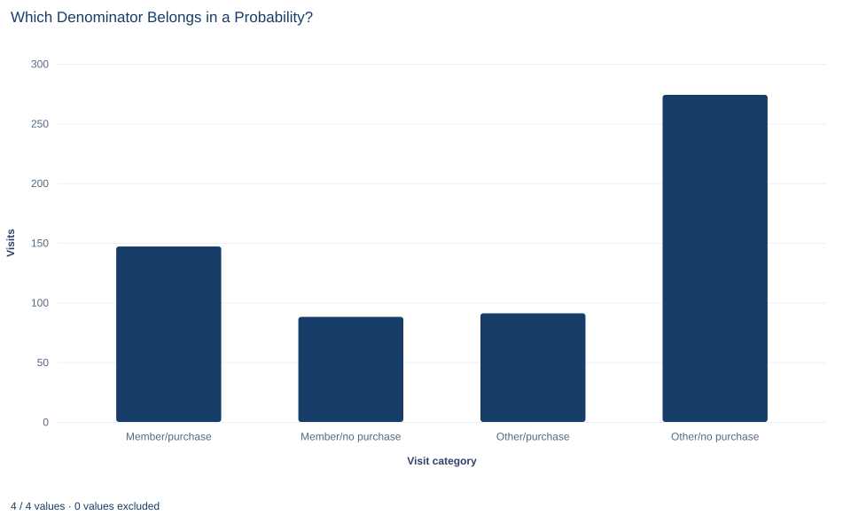

# Lab 04 · Which Denominator Belongs in a Probability?

**Joint, marginal and conditional probabilities from a two-by-two table**

## Start with the supplied workbook

1. Download [customer_events.xlsx](customer_events.xlsx) and the [Python lab](lab.py). The workbook holds the fixed visits used throughout this chapter.
2. Import `customer_events.xlsx` into OpenEconometrics and keep that file name as the dataset name. The `Data` sheet holds one row per customer visit; the `Dictionary` sheet explains the three columns and their 0/1 coding.
3. Open the complete `lab.py` in a new Python document and run the whole file. It reads the imported dataset and displays the membership-by-purchase cross-tabulation, a bar chart of the four visit categories and the table of reported probabilities.

For ordinary Python, keep `lab.py` and the workbook in the same folder and run the script there, or call `from lab import run_lab` and then `run_lab(data_path="/path/to/customer_events.xlsx")`. If you want to recode or subset the visits, work on a copy of the loaded table so the distributed workbook stays unchanged.

A loyalty-program manager reads that 62.6% of member visits end in a purchase. A colleague turns this around: "So about 62% of our buyers are members." In this file the second number is 61.8%, which looks like confirmation. It is not. The two fractions count the same visits, members who bought, but divide them by different groups, and they are close here only because of a coincidence in the table's margins.

This lab uses **600 original synthetic customer visits**. Each visit records two yes-or-no facts: whether the customer held a loyalty membership before the visit, and whether the visit ended in a purchase. They are teaching records, not a real shop's transactions, and no cell is blank. The [LaTeX table](table.tex) collects the reported probabilities.

## 1. Name the unit and the events

Each row of `Data` is one visit. A customer who came back three times appears three times, and the file has no customer identifier to link those rows. Every probability in this lab is therefore a share **of visits**, not of customers.

| Column | What it records | Coding |
|---|---|---|
| `visit_id` | A label from 1 to 600 that distinguishes visits | Identifier |
| `member` | Whether the customer held a loyalty membership before this visit | 1 = member, 0 = not a member |
| `purchase` | Whether this visit ended in a purchase | 1 = purchase, 0 = no purchase |

Write $M$ for the event "the visit is by a member" and $P$ for "the visit ends in a purchase." The **sample space** is the set of 600 visits, and each event is a subset of it. Because membership is recorded before the visit, the time order is clear: membership comes first, the purchase decision second.

## 2. Count the four cells

Two yes-or-no events split every visit into exactly one of four cells. The cross-tabulation counts them:

| | Purchase | No purchase | Total |
|---|---:|---:|---:|
| Member | 147 | 88 | 235 |
| Not a member | 91 | 274 | 365 |
| Total | 238 | 362 | 600 |

The cells are mutually exclusive and together cover every visit: $147+88+91+274=600$. The row totals give the number of member and non-member visits, and the column totals the number of visits with and without a purchase.

A **joint probability** divides one cell by all visits. The share of visits that are by a member *and* end in a purchase is

$$
P(M\cap P)=\frac{147}{600}=0.245 .
$$

A **marginal probability** divides a row or column total by all visits: $P(M)=235/600=0.392$ and $P(P)=238/600=0.397$. Each describes one event while ignoring the other.

## 3. Change the denominator to condition

A **conditional probability** restricts attention to the visits where one event happened and asks how often the other happened among them:

$$
P(P\mid M)=\frac{P(M\cap P)}{P(M)}=\frac{\text{visits with both}}{\text{member visits}}.
$$

Read the vertical bar as "among." $P(P\mid M)$ is "the share of purchases among member visits." In counts it is $147/235=0.626$. The condition, $M$, decides the denominator.

Reversing the condition keeps the numerator and changes the denominator:

$$
P(M\mid P)=\frac{P(M\cap P)}{P(P)}=\frac{147}{238}=0.618 .
$$

This is "the share of members among purchase visits." Both fractions start from the same 147 visits. The first divides by the 235 member visits, the second by the 238 purchase visits. They answer different questions: the first is about how members behave, the second about who the buyers are.

**Pause before running.** For each probability in the reported table, name its denominator, as a count of visits, before you open the output.

## 4. Why the two conditionals are close here

Multiplying each definition by its denominator gives the **multiplication rule**, which can be written two ways:

$$
P(M\cap P)=P(P\mid M)\,P(M)=P(M\mid P)\,P(P).
$$

Dividing one form by the other shows how the reversed conditionals are related:

$$
\frac{P(M\mid P)}{P(P\mid M)}=\frac{P(M)}{P(P)}=\frac{235}{238}=0.987 .
$$

The two conditional probabilities differ by exactly the ratio of the two marginal probabilities. Here membership and purchase happen to be almost equally common, 235 and 238 visits, so the ratio is close to one and the two conditionals are close. That is a property of these margins, not a law. In a shop where members made only a small share of visits but bought often, the share of purchases among members could be high while the share of members among buyers stayed low. Rearranging the same identity to compute $P(M\mid P)$ from $P(P\mid M)$ is Bayes' rule, the subject of Lab 05.

## 5. Compare with independence

Two events are **independent** when knowing one does not change the probability of the other: $P(P\mid M)=P(P)$. Substituting into the multiplication rule gives the equivalent product form

$$
P(M\cap P)=P(M)\,P(P).
$$

Independence is a claim about how two events are related, not an identity that always holds. Check it against the table. The product of the marginals is $(235/600)\times(238/600)=0.155$, while the observed joint probability is 0.245. The gap, 0.090, is large: members bought on 62.6% of their visits, compared with 39.7% of all visits.

The same comparison works in counts. If the events were independent, the member-and-purchase cell would be expected to hold $600\times(235/600)\times(238/600)=235\times238/600=93.2$ visits. The observed count is 147. The cross-tabulation output includes this expected table for all four cells.

With sampled data, exact equality would not be expected even for independent events, because counts vary by chance. Deciding whether a gap of this size could plausibly be chance needs a test, which the lab's output also prints but which belongs to Lab 16. Here the gap is a descriptive fact about these 600 visits.

## 6. Run the cross-tabulation

After running `lab.py`, the table step is:

```python
import openecon as oe

raw = load_data()  # reader defined in the complete lab.py
table = oe.crosstab(raw, "member", "purchase", expected=True, exact=False)
display(table)
```

The output holds several tables. The `counts` table is the four-cell table in Section 2, with the rows labeled by `member` (0, 1) and the columns by `purchase` (0, 1), plus totals. The `expected` table gives the counts implied by independence. The test, measure and risk tables summarize the strength and significance of the association; set them aside until Lab 16.

The probabilities can be computed directly from two true/false masks:

```python
member = raw.member == 1
bought = raw.purchase == 1
visits = len(raw)
both = (member & bought).sum()
probabilities = {
    "P(M)": member.mean(),
    "P(P)": bought.mean(),
    "P(M and P)": both / visits,
    "P(P | M)": both / member.sum(),
    "P(M | P)": both / bought.sum(),
    "P(M) P(P)": member.mean() * bought.mean(),
}
probabilities["difference"] = probabilities["P(M and P)"] - probabilities["P(M) P(P)"]
print({name: round(float(value), 3) for name, value in probabilities.items()})
```

| Quantity | What it means | Denominator | Value |
|---|---|---:|---:|
| $P(M)$ | Share of visits by members | 600 visits | 0.392 |
| $P(P)$ | Share of visits ending in a purchase | 600 visits | 0.397 |
| $P(M\cap P)$ | Share of visits by members that end in a purchase | 600 visits | 0.245 |
| $P(P\mid M)$ | Share of member visits that end in a purchase | 235 member visits | 0.626 |
| $P(M\mid P)$ | Share of purchase visits made by members | 238 purchase visits | 0.618 |
| $P(M)P(P)$ | Joint share expected under independence | — | 0.155 |
| Difference | Observed joint share minus independence product | — | 0.090 |

Always read the denominator column first. Three rows divide by all visits, two divide by a subgroup, and the last two rows are comparisons rather than shares of any group.

## 7. Read the bar chart



The chart has one bar per cell of the table: members who purchased (147), members who did not (88), non-members who purchased (91) and non-members who did not (274). The chart labels non-members as "Other." The four bars add up to 600, so each bar height divided by 600 is a joint probability.

No single bar is a conditional probability. To read one, choose its denominator by adding two bars. For purchases among members, add the two member bars (147 + 88 = 235) and compare the first with that total. For members among purchasers, add the two purchase bars (147 + 91 = 238) instead. The tallest bar, non-members who did not buy, shows that the most common visit is neither a member's nor a purchase.

## A case from the literature

Section 8 warns that a higher purchase share among member visits need not mean that membership causes purchases. Liu (2007) examined the long-term impact of a loyalty program using longitudinal data from a convenience store franchise. Consumers who were already heavy buyers when the program began were the most likely to claim the rewards they qualified for, yet the program did not prompt them to change their purchase behavior. Consumers whose initial patronage was low or moderate, by contrast, gradually bought more and became more loyal to the firm. A comparison that ignored where customers started would mix these groups. Leenheer et al. (2007), as their title states, ask whether loyalty programs enhance behavioral loyalty while accounting for members who select themselves into the program.

Reading the wrong conditional is a recognized hazard well beyond retail. Thompson and Schumann (1987) asked undergraduates to judge the probable guilt of a suspect from written descriptions of evidence that included the incidence rate of a matching characteristic. Presenting that rate as a conditional probability promoted errors favoring the prosecution, and a majority of participants failed to detect the error in one or both of two fallacious arguments.

The lab's 600 visits are synthetic and carry no customer identifier, so they cannot separate who joins from what membership does. These studies show why that separation needs a design and a careful statement of each denominator, not a cross-tabulation alone.

## 8. Decide what the table supports

The table shows an association in these 600 synthetic visits: purchases are more common among member visits than among visits overall. It does not show that membership causes purchases. Customers choose whether to join, and those who join may already be frequent or keen buyers. Membership is recorded before the visit, which settles the time order, but time order alone does not rule out such selection. Estimating the effect of membership would need, for example, a randomized membership offer with a defined follow-up.

The shares are also weighted by visits. A customer who visits often counts more than one who visits once, and frequent visitors may be both more likely to be members and more likely to buy. A customer-level probability would need a customer identifier, which this file does not have.

Finally, these are descriptive fractions for one fixed file. They carry no statement of sampling uncertainty and make no claim about any real loyalty program.

## 9. Write the probability statement in full

A complete statement for the worked example reads: "Of 600 synthetic customer visits, 235 were by loyalty members and 238 ended in a purchase. Among member visits, 62.6% ended in a purchase (147 of 235). Among purchase visits, 61.8% were by members (147 of 238). The two shares are close only because member and purchase visits are almost equally common. The joint share of member purchases, 0.245, is well above the 0.155 expected if membership and purchase were independent; this is an association, not a causal effect of membership."

Each probability is stated with its numerator and denominator, so a reader cannot mistake one conditional for the other.

## Student exercises

1. Compute the share of non-member visits that end in a purchase. Compare it with the share among member visits by their difference and their ratio, and say which group each denominator counts.
2. Compute $P(M\mid \text{no purchase})$ and $P(\text{no purchase}\mid M)$. Use the identity in Section 4 to explain why these two reversed conditionals are much further apart than $P(P\mid M)$ and $P(M\mid P)$.
3. Compute by hand the expected counts under independence for the other three cells. Check that the four expected counts have the same row and column totals as the observed table, and relate the member-and-purchase gap in counts (observed minus expected) to the difference of 0.090.
4. Suppose a customer identifier were added and showed that a few frequent visitors account for many member visits. Explain how a customer-weighted share of members who ever purchase would be computed, and why it could differ from 0.626.
5. Would this table justify offering free membership to raise purchases? Explain why or why not, and outline a study that could answer that question.
6. Rewrite "62% of members buy, so 62% of buyers are members" so that each probability states its numerator and denominator, and explain in one sentence why the reasoning in the original is wrong even though both numbers are close to 62%.

## Further reading

- Leenheer, J., van Heerde, H. J., Bijmolt, T. H. A., and Smidts, A. (2007). Do loyalty programs really enhance behavioral loyalty? An empirical analysis accounting for self-selecting members. *International Journal of Research in Marketing*, 24(1), 31–47. https://doi.org/10.1016/j.ijresmar.2006.10.005
- Liu, Y. (2007). The long-term impact of loyalty programs on consumer purchase behavior and loyalty. *Journal of Marketing*, 71(4), 19–35. https://doi.org/10.1509/jmkg.71.4.019
- Thompson, W. C., and Schumann, E. L. (1987). Interpretation of statistical evidence in criminal trials: The prosecutor's fallacy and the defense attorney's fallacy. *Law and Human Behavior*, 11(3), 167–187. https://doi.org/10.1007/BF01044641
