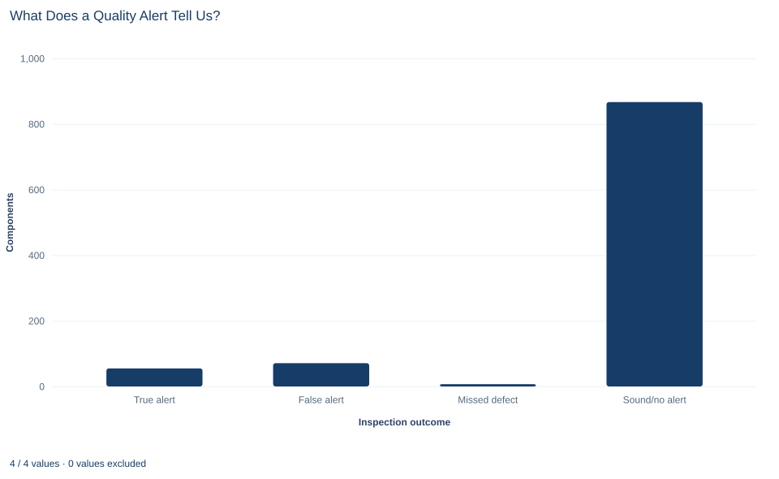

# Lab 05 · What Does a Quality Alert Tell Us?

**Sensitivity, specificity, base rates and Bayes' theorem**

## Start with the supplied workbook

1. Download [quality_alerts.xlsx](quality_alerts.xlsx) and the [Python lab](lab.py). The workbook holds the fixed components used throughout this chapter.
2. Import `quality_alerts.xlsx` into OpenEconometrics and keep that file name as the dataset name. The `Data` sheet holds one row per manufactured component; the `Dictionary` sheet explains the three columns and their 0/1 coding.
3. Open the complete `lab.py` in a new Python document and run the whole file. It reads the imported dataset and displays the defect-by-alert cross-tabulation, a bar chart of the four inspection outcomes and the table of reported probabilities.

For ordinary Python, keep `lab.py` and the workbook in the same folder and run the script there, or call `from lab import run_lab` and then `run_lab(data_path="/path/to/quality_alerts.xlsx")`. If you want to try a different scenario, work on a copy of the loaded table or on the computed rates, so the distributed workbook stays unchanged.

A factory runs an automated alert on every component that leaves the line. Of the 62 defective components in this file, the alert flagged 55. That sounds reassuring, and it is a fair description of how well the alert finds defects. But the inspector standing beside the line faces a different question. A light has just come on for one component: how likely is it that this component is actually defective? The answer depends not only on how well the alert works but also on how rare defects are.

This lab uses **1,000 original synthetic manufactured components**. For each one the workbook records whether the automated alert fired and whether a full inspection found a defect. They are teaching records, not data from a real production line, and no cell is blank. The [LaTeX table](table.tex) collects the reported probabilities.

## 1. Name the unit and the events

Each row of `Data` is one component. Every probability below is a share of components.

| Column | What it records | Coding |
|---|---|---|
| `component_id` | A label from 1 to 1,000 that distinguishes components | Identifier |
| `defect` | Result of a full inspection, treated as the truth | 1 = defective, 0 = sound |
| `alert` | Whether the automated alert fired for this component | 1 = alert, 0 = no alert |

Write $D$ for "the component is defective" and $A$ for "the alert fired," with $\neg D$ and $\neg A$ for their complements. The dictionary describes `defect` as "inspection truth, observed for teaching." That phrase matters. Here every component, alerted or not, was fully inspected, which is what lets us measure how the alert behaves on defective and on sound components. Real factories rarely inspect everything, and Section 8 returns to what that changes.

## 2. Build the confusion matrix

Crossing the truth with the alert sorts every component into one of four outcomes. After running `lab.py`, the cross-tabulation is:

```python
import openecon as oe

raw = load_data()  # reader defined in the complete lab.py
table = oe.crosstab(raw, "defect", "alert", expected=True, exact=False)
display(table)
```

Its `counts` table, with rows for `defect` and columns for `alert`, gives this **confusion matrix**:

| | Alert | No alert | Total |
|---|---:|---:|---:|
| Defective | 55 (true alert) | 7 (missed defect) | 62 |
| Sound | 71 (false alert) | 867 (correct silence) | 938 |
| Total | 126 | 874 | 1,000 |

The four cells partition the file: $55+7+71+867=1{,}000$. The **prevalence** of defects, the base rate, is $P(D)=62/1{,}000=0.062$. The alert fired 126 times. The output also contains expected counts and association tests, which this lab does not use.

## 3. Rates that condition on the truth

Two standard rates describe the alert system. Each takes one row of the matrix as its denominator.

**Sensitivity** is the share of defective components that trigger an alert:

$$
P(A\mid D)=\frac{55}{55+7}=\frac{55}{62}=0.887.
$$

**Specificity** is the share of sound components that do *not* trigger an alert:

$$
P(\neg A\mid \neg D)=\frac{867}{71+867}=\frac{867}{938}=0.924.
$$

Its complement, the **false-alert rate**, is $P(A\mid\neg D)=71/938=0.076$: about 7.6% of sound components set off the alert.

Both rates are properties of the alert when the truth is known. They answer "How does the alert behave on defective parts, and on sound parts?" Neither one answers the inspector's question.

## 4. The reverse question

The inspector sees the alert first and wants the truth. That calls for the other conditional probability, with the alerted components as its denominator. This is the **positive predictive value** (PPV), $P(D\mid A)$: the share of alerted components that are defective.

**Pause before running.** Could most alerts be false even when most defects are detected? Look at the confusion matrix and decide before reading on.

The alert column holds 55 true alerts and 71 false alerts. So

$$
P(D\mid A)=\frac{55}{55+71}=\frac{55}{126}=0.437 .
$$

Fewer than half of the alerted components are defective. The alert catches 88.7% of defects, yet 56% of its alerts are false. The two statements are not in conflict. Sensitivity divides by the 62 defective components; PPV divides by the 126 alerted components, and most of those come from the much larger pool of 938 sound ones.

## 5. Bayes' theorem

Bayes' theorem computes the PPV from sensitivity, the false-alert rate and the prevalence, without looking at the alert column directly:

$$
P(D\mid A)=\frac{P(A\mid D)\,P(D)}{P(A\mid D)\,P(D)+P(A\mid\neg D)\,P(\neg D)} .
$$

Each term has a plain meaning. $P(A\mid D)P(D)$ is the share of all components that are defective *and* alerted, the true-alert route. $P(A\mid\neg D)P(\neg D)$ is the share that are sound and alerted, the false-alert route. The denominator adds the two routes into the alerted group, so it equals $P(A)$. The formula is the multiplication rule from Lab 04 applied twice, then divided.

With the lab's numbers, the true-alert route is $0.887\times0.062=0.055$ and the false-alert route is $0.076\times0.938=0.071$. Then $0.055/(0.055+0.071)=0.437$, the same value as the direct count. The same calculation in counts, sometimes called **natural frequencies**, reads: of 1,000 components, 62 are defective and the alert catches 55 of them; 938 are sound and the alert wrongly flags 71; so 55 of the 126 alerts are real.

The calculation can be checked in Python:

```python
defect = raw.defect == 1
alert = raw.alert == 1
true_alerts = int((defect & alert).sum())
false_alerts = int((~defect & alert).sum())
missed = int((defect & ~alert).sum())
silent_sound = int((~defect & ~alert).sum())
prevalence = defect.mean()
sensitivity = true_alerts / (true_alerts + missed)
specificity = silent_sound / (silent_sound + false_alerts)
direct_ppv = true_alerts / (true_alerts + false_alerts)
bayes_ppv = sensitivity * prevalence / (
    sensitivity * prevalence + (1 - specificity) * (1 - prevalence)
)
print(true_alerts, false_alerts, missed, silent_sound)
print(round(prevalence, 3), round(sensitivity, 4), round(specificity, 4), round(direct_ppv, 4), round(bayes_ppv, 4))
```

| Quantity | Meaning | Denominator | Value |
|---|---|---:|---:|
| Prevalence $P(D)$ | Share of components that are defective | 1,000 components | 0.062 |
| Sensitivity $P(A\mid D)$ | Share of defective components alerted | 62 defective | 0.8871 |
| Specificity $P(\neg A\mid\neg D)$ | Share of sound components not alerted | 938 sound | 0.9243 |
| PPV, direct count | Share of alerted components that are defective | 126 alerted | 0.4365 |
| PPV, Bayes' theorem | Same quantity from the three rates above | — | 0.4365 |

The two PPV rows agree exactly, as they must: Bayes' theorem is a rearrangement of the same four counts.

## 6. Change the base rate

The advantage of the formula is that it separates the alert's behavior (sensitivity and specificity) from the setting (prevalence). That makes it possible to ask what the alert would mean on a line where defects are rarer. The lab's scenario keeps sensitivity and specificity at their observed values and sets prevalence to 1%:

```python
def predictive_value(base_rate, sensitivity, specificity):
    true_route = sensitivity * base_rate
    false_route = (1 - specificity) * (1 - base_rate)
    return true_route / (true_route + false_route)

print(round(predictive_value(prevalence, sensitivity, specificity), 4))
print(round(predictive_value(0.01, sensitivity, specificity), 4))
```

The first line reproduces 0.4365. The second gives **0.1058**: at a 1% defect rate, only about one alert in nine or ten would point to a real defect. The alert has not become worse. There are simply far more sound components producing false alerts for every defective one producing a true alert.

This is a scenario, not an estimate. It assumes the alert's sensitivity and specificity would stay the same on the new line. That can fail, for example if a different product mix produces different kinds of defects that the alert finds more or less easily.

## 7. Read the bar chart



The chart has one bar per cell of the confusion matrix: true alerts (55), false alerts (71), missed defects (7) and sound components with no alert (867). The bars add up to 1,000.

The last bar dwarfs the others, which is exactly the base-rate story: sound components are the overwhelming majority. To read the PPV, compare the first two bars only, because together they make up all 126 alerts; the false-alert bar is the taller of the two. To read sensitivity, compare the true-alert bar with the true-alert and missed-defect bars together. The chart also shows the two kinds of error side by side. A false alert costs an unnecessary inspection; a missed defect ships a faulty part. The counts do not say which matters more; that depends on costs the file does not record.

## A case from the literature

Axelsson (2000) faced the inspector's question in computer security. An intrusion detection system should detect a substantial share of intrusions while keeping false alarms at an acceptable level. Working with the Bayesian detection rate, the probability of an intrusion given an alarm, he showed that under a reasonable set of assumptions the false alarm rate, not the detection rate, limits a system's performance. He attributed this to the base-rate fallacy: a substantial Bayesian detection rate requires a very low false alarm rate, in some cases perhaps an unattainably low one. Reviewing reported performance, he found indications that some types of intrusion detection had far to go before reaching such rates. The 1% scenario of Section 6 makes the same point: the alert behaves as before, yet the share of real alerts falls sharply with the base rate.

Two further studies match the limits in Section 8. Begg and Greenes (1983) noted that sensitivity and specificity are often estimated only from cases whose disease status was later verified, that omitting unverified cases can seriously bias the estimates, and that any adjustment needs assumptions about how cases were selected for verification. Gigerenzer and Hoffrage (1995) showed that Bayesian computations are simpler with frequencies than with probabilities, and found that statistically naive participants given frequencies, the format of Exercise 2, derived up to half of their inferences by Bayesian algorithms.

The lab's components are synthetic and were all inspected, which is what makes its sensitivity and specificity measurable at all.

## 8. Decide what the evidence supports

The probabilities describe the alert's behavior on 1,000 synthetic components that were all fully inspected. Within that file the calculation is exact: the PPV is 0.437, and Bayes' theorem reproduces it.

Several limits apply. First, the full inspection is what makes sensitivity and specificity measurable. If only alerted components were inspected, the 7 missed defects and the 867 correctly silent components would never be checked, and the two rates could not be estimated directly. Second, the PPV belongs to this population of components. Moving it to another line needs that line's prevalence and evidence that the alert behaves the same way there. Third, these are fixed-file descriptions: no sampling uncertainty is attached, and with only 62 defective components, the sensitivity in particular rests on a small group. Finally, the lab evaluates probabilities, not an inspection policy; choosing an alert threshold would also require the costs of each kind of error.

## 9. Write the probability statement in full

A complete statement for the worked example reads: "In 1,000 synthetic components, all fully inspected, 62 were defective (prevalence 6.2%). The automated alert flagged 55 of the 62 defective components (sensitivity 0.887) and stayed silent for 867 of the 938 sound components (specificity 0.924). Of the 126 alerted components, 55 were defective, so the positive predictive value is 0.437. If prevalence fell to 1% with the same sensitivity and specificity, the predictive value would fall to about 0.106."

The statement names the denominator of each rate, so a reader cannot confuse how well the alert finds defects with how much an alert means.

## Student exercises

1. Compute the negative predictive value, $P(\neg D\mid\neg A)$, and the share of non-alerted components that are defective. State the denominator of each and the decision each one informs.
2. Rework the 1% scenario as natural frequencies for 10,000 components: how many are defective, how many of those are alerted, and how many sound components are falsely alerted? Confirm that the result matches 0.1058.
3. Use `predictive_value` to compute the PPV when prevalence is 20%, holding sensitivity and specificity fixed. Explain the direction of the change.
4. Compare two possible upgrades at the observed prevalence: raising specificity to 0.99 with sensitivity unchanged, or raising sensitivity to 0.99 with specificity unchanged. Which raises the PPV more, and why?
5. Suppose the factory inspected only alerted components. List which cells of the confusion matrix would be observed and which would not, and say which of the reported rates could still be computed.
6. A report says: "The alert system is 89% accurate, so an alerted part is 89% likely to be defective." Identify each error and rewrite the sentence correctly.

## Further reading

- Axelsson, S. (2000). The base-rate fallacy and the difficulty of intrusion detection. *ACM Transactions on Information and System Security*, 3(3), 186–205. https://doi.org/10.1145/357830.357849
- Begg, C. B., and Greenes, R. A. (1983). Assessment of diagnostic tests when disease verification is subject to selection bias. *Biometrics*, 39(1), 207. https://doi.org/10.2307/2530820
- Gigerenzer, G., and Hoffrage, U. (1995). How to improve Bayesian reasoning without instruction: Frequency formats. *Psychological Review*, 102(4), 684–704. https://doi.org/10.1037/0033-295X.102.4.684
