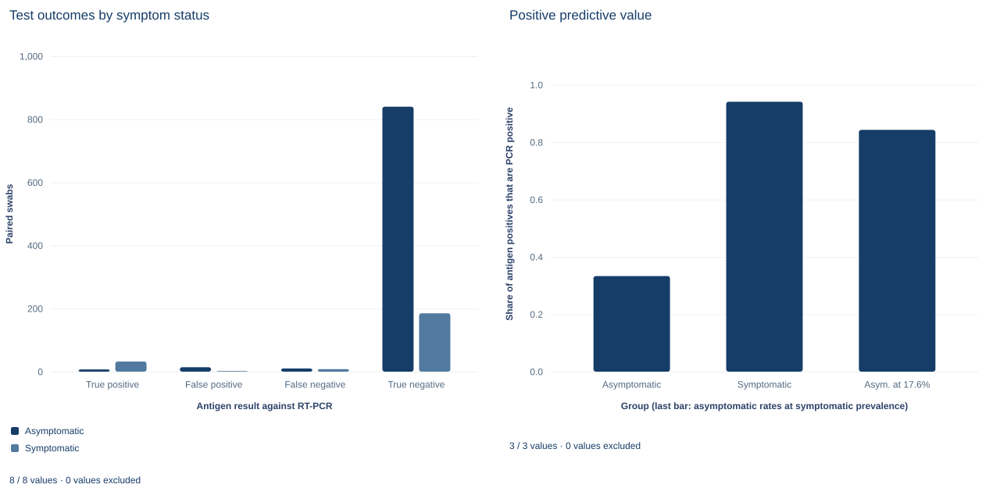

# Lab 05 · What Does a Positive Test Tell Us?

**Sensitivity, specificity, base rates and Bayes' theorem**

## Start with the supplied workbook

1. Download [antigen_tests.xlsx](antigen_tests.xlsx) and the [Python lab](lab.py). The workbook holds the published test results used throughout this chapter.
2. Import `antigen_tests.xlsx` into OpenEconometrics and keep that file name as the dataset name. The `Data` sheet holds one row per paired nasal swab; the `Dictionary` sheet explains the four columns and their 0/1 coding and gives the source and licence.
3. Open the complete `lab.py` in a new Python document and run the whole file. It reads the imported dataset and displays the RT-PCR-by-antigen cross-tabulation, a bar chart of the four test outcomes for people with and without symptoms, and the table of reported probabilities.

For ordinary Python, keep `lab.py` and the workbook in the same folder and run the script there, or call `from lab import run_lab` and then `run_lab(data_path="/path/to/antigen_tests.xlsx")`. If you want to try a different scenario, work on a copy of the loaded table or on the computed rates, so the distributed workbook stays unchanged.

In autumn 2020, two Wisconsin universities tested students, staff and other affiliates for SARS-CoV-2 with a rapid antigen test and, at the same visit, with a laboratory RT-PCR test. Of the 57 swab pairs that RT-PCR found positive, the antigen test also flagged 39. That describes how well the test finds infections. A person who has just received a positive antigen result asks something else: how likely is it that I am actually infected? The answer depends on how well the test works and on how common infection is among the people tested. It changes sharply between people who had symptoms and people who did not.

This lab uses the **1,098 paired nasal swabs** reported in Table 2 of a CDC investigation (Pray et al., 2021). For each pair the workbook records whether the participant reported symptoms, the antigen result and the RT-PCR result. The report publishes counts, not individual records; the workbook expands each count into that many rows, and no cell is blank. The [LaTeX table](table.tex) collects the reported probabilities.

## Data source and licence

- **Data:** Table 2 of Pray, I. W., Ford, L., Cole, D., et al. (2021). Performance of an antigen-based test for asymptomatic and symptomatic SARS-CoV-2 testing at two university campuses — Wisconsin, September–October 2020. *Morbidity and Mortality Weekly Report*, 69(51–52), 1642–1647. https://doi.org/10.15585/mmwr.mm695152a3
- **Licence:** public domain. CDC states that all material in the MMWR series may be used and reprinted without special permission and asks for a citation of the source.
- **Preparation:** each of the eight counts (symptom group × antigen result × RT-PCR result) becomes that many rows, asymptomatic first; `specimen_pair_id` numbers the rows in that order and carries no information. Results are coded 1 for positive and 0 for negative, and `symptomatic` is 1 when the participant reported one or more symptoms at collection. The table was read on the CDC page and its PubMed Central copy, which agree; the CDC page notes that the report was corrected, and the counts used here are those it shows now.

## 1. Name the unit and the events

Each row of `Data` is one **paired nasal swab**: two swabs taken from the same person at the same visit, one tested with the antigen test and one with RT-PCR. Every probability below is a share of swab pairs, not of people. Fifty-seven participants were tested on more than one day, so a few people contribute more than one row.

| Column | What it records | Coding |
|---|---|---|
| `specimen_pair_id` | A label from 1 to 1,098 created when the published table was expanded | Identifier |
| `symptomatic` | Whether the participant reported one or more symptoms at collection | 1 = yes, 0 = no |
| `antigen_positive` | Result of the rapid antigen test | 1 = positive, 0 = negative |
| `pcr_positive` | Result of real-time RT-PCR, the study's reference standard | 1 = positive, 0 = negative |

Write $D$ for "RT-PCR positive" and $A$ for "antigen positive", with $\neg D$ and $\neg A$ for their complements. RT-PCR plays the role of the truth here because every pair received both tests. That is what makes it possible to measure how the antigen test behaves on RT-PCR-positive and on RT-PCR-negative pairs. RT-PCR is a reference standard, not certain truth, and Section 8 returns to what that changes.

## 2. Build the confusion matrix

Crossing the reference result with the antigen result sorts every pair into one of four outcomes. After running `lab.py`, the cross-tabulation is:

```python
import openecon as oe

raw = load_data()  # reader defined in the complete lab.py
table = oe.crosstab(raw, "pcr_positive", "antigen_positive", expected=True, exact=False)
display(table)
```

Its `counts` table, with rows for `pcr_positive` and columns for `antigen_positive`, gives this **confusion matrix** for all 1,098 pairs:

| | Antigen positive | Antigen negative | Total |
|---|---:|---:|---:|
| RT-PCR positive | 39 (true positive) | 18 (false negative) | 57 |
| RT-PCR negative | 16 (false positive) | 1,025 (true negative) | 1,041 |
| Total | 55 | 1,043 | 1,098 |

The four cells partition the file: $39+18+16+1{,}025=1{,}098$. The **prevalence** of RT-PCR positivity, the base rate, is $P(D)=57/1{,}098=0.0519$. The antigen test was positive 55 times. The output also contains expected counts and association tests, which this lab does not use.

## 3. Rates that condition on the truth

Two standard rates describe the test. Each takes one row of the matrix as its denominator.

**Sensitivity** is the share of RT-PCR-positive pairs that the antigen test also calls positive:

$$
P(A\mid D)=\frac{39}{39+18}=\frac{39}{57}=0.684.
$$

**Specificity** is the share of RT-PCR-negative pairs that the antigen test calls negative:

$$
P(\neg A\mid \neg D)=\frac{1{,}025}{16+1{,}025}=\frac{1{,}025}{1{,}041}=0.985.
$$

Its complement, the **false-positive rate**, is $P(A\mid\neg D)=16/1{,}041=0.0154$: about 1.5% of RT-PCR-negative pairs gave a positive antigen result.

Both rates describe the test when the reference result is known. They answer "How does the test behave on infected swabs, and on uninfected ones?" Neither answers the question of the person holding a positive result.

## 4. The reverse question

That person sees the antigen result first and wants the reference result. The probability they need has the antigen-positive pairs as its denominator. This is the **positive predictive value** (PPV), $P(D\mid A)$: the share of antigen-positive pairs that RT-PCR also found positive.

**Pause before running.** In the asymptomatic group, could most positive antigen results be false even though the test's specificity is above 98%? Decide before reading on.

Over all pairs, the antigen-positive column holds 39 true positives and 16 false positives, so

$$
P(D\mid A)=\frac{39}{39+16}=\frac{39}{55}=0.709 .
$$

About seven positive results in ten were confirmed. The test misses about a third of infections (sensitivity 0.684), yet seven of its ten positives are right. These statements do not conflict. Sensitivity divides by the 57 RT-PCR-positive pairs; PPV divides by the 55 antigen-positive pairs, a different group.

## 5. Bayes' theorem

Bayes' theorem computes the PPV from sensitivity, the false-positive rate and the prevalence, without looking at the antigen-positive column directly:

$$
P(D\mid A)=\frac{P(A\mid D)\,P(D)}{P(A\mid D)\,P(D)+P(A\mid\neg D)\,P(\neg D)} .
$$

Each term has a plain meaning. $P(A\mid D)P(D)$ is the share of all pairs that are infected *and* test positive, the true-positive route. $P(A\mid\neg D)P(\neg D)$ is the share that are uninfected and test positive, the false-positive route. The denominator adds the two routes into the positive results, so it equals $P(A)$. The formula is the multiplication rule from Lab 04 applied twice, then divided.

With the overall numbers, the true-positive route is $0.684\times0.0519=0.0355$ and the false-positive route is $0.0154\times0.948=0.0146$. Then $0.0355/(0.0355+0.0146)=0.709$, the same value as the direct count. The same calculation in counts, sometimes called **natural frequencies**, reads: of 1,098 pairs, 57 are RT-PCR positive and the antigen test catches 39 of them; 1,041 are RT-PCR negative and the test wrongly flags 16; so 39 of the 55 positive results are confirmed.

The calculation can be checked in Python:

```python
infected = raw.pcr_positive == 1
positive = raw.antigen_positive == 1
true_pos = int((infected & positive).sum())
false_pos = int((~infected & positive).sum())
missed = int((infected & ~positive).sum())
true_neg = int((~infected & ~positive).sum())
prevalence = infected.mean()
sensitivity = true_pos / (true_pos + missed)
specificity = true_neg / (true_neg + false_pos)
direct_ppv = true_pos / (true_pos + false_pos)
bayes_ppv = sensitivity * prevalence / (
    sensitivity * prevalence + (1 - specificity) * (1 - prevalence)
)
print(true_pos, false_pos, missed, true_neg)
print(round(prevalence, 4), round(sensitivity, 4), round(specificity, 4), round(direct_ppv, 4), round(bayes_ppv, 4))
```

| Quantity | Meaning | Denominator | Value |
|---|---|---:|---:|
| Prevalence $P(D)$ | Share of pairs that are RT-PCR positive | 1,098 pairs | 0.0519 |
| Sensitivity $P(A\mid D)$ | Share of RT-PCR-positive pairs that test positive | 57 RT-PCR positive | 0.6842 |
| Specificity $P(\neg A\mid\neg D)$ | Share of RT-PCR-negative pairs that test negative | 1,041 RT-PCR negative | 0.9846 |
| PPV, direct count | Share of positive results confirmed by RT-PCR | 55 antigen positive | 0.7091 |
| PPV, Bayes' theorem | Same quantity from the three rates above | — | 0.7091 |

The two PPV rows agree, as they must: Bayes' theorem is a rearrangement of the same four counts.

## 6. Split by symptom status

The overall PPV mixes two very different groups. The same calculation within each group gives:

| Group | Pairs | Prevalence | Sensitivity | Specificity | PPV |
|---|---:|---:|---:|---:|---:|
| No symptoms | 871 | 17/871 = 0.0195 | 7/17 = 0.412 | 840/854 = 0.984 | 7/21 = 0.333 |
| One or more symptoms | 227 | 40/227 = 0.176 | 32/40 = 0.800 | 185/187 = 0.989 | 32/34 = 0.941 |

Among people without symptoms, only one positive result in three was confirmed. Among people with symptoms, 32 of 34 were. Two things changed between the rows. Infection was about nine times as common in the symptomatic group, and the test also found infections more reliably there: sensitivity was 0.800 rather than 0.412.

Bayes' theorem can separate the two. Keep the asymptomatic group's sensitivity and specificity and apply them at the symptomatic group's prevalence:

```python
def predictive_value(base_rate, sensitivity, specificity):
    true_route = sensitivity * base_rate
    false_route = (1 - specificity) * (1 - base_rate)
    return true_route / (true_route + false_route)

print(round(predictive_value(17 / 871, 7 / 17, 840 / 854), 4))
print(round(predictive_value(40 / 227, 7 / 17, 840 / 854), 4))
print(round(predictive_value(0.01, 7 / 17, 840 / 854), 4))
```

The first line reproduces the asymptomatic PPV, 0.3333. The second gives **0.8431**: the asymptomatic group's test rates, moved to a group where 17.6% are infected, would already confirm about 84% of positives. Most of the gap between 0.333 and 0.941 is therefore the base rate. The rest, from 0.843 to 0.941, reflects the test's higher sensitivity and specificity among people with symptoms. The third line asks about screening where only 1% are infected: the PPV falls to **0.2024**, about one confirmed positive in five.

These are scenarios, not estimates. Each assumes the test's sensitivity and specificity would stay the same in the new setting, and this very table shows that they do not stay fixed between groups.

## 7. Read the bar chart



The figure has two panels; in the app only the first appears. The left panel, "Test outcomes by symptom status," draws one pair of bars per cell of the confusion matrix: dark for the 871 asymptomatic pairs and light for the 227 symptomatic pairs. True negatives dwarf everything else (840 and 185), which is the base-rate story in one picture: uninfected people are the large majority. To read the asymptomatic PPV, compare the first two dark bars only, because together they hold all 21 asymptomatic positive results: 7 true and 14 false, so the false-positive bar is twice as tall. For the symptomatic group the same two bars read 32 and 2.

The right panel, "Positive predictive value," shows the asymptomatic PPV (0.333), the symptomatic PPV (0.941) and the third bar from Section 6, the asymptomatic test rates at the symptomatic prevalence (0.843). The third bar is a calculation, not an observed group. Neither panel shows uncertainty, and the bars for the 17 infected asymptomatic pairs rest on very few observations.

## A case from the literature

The report behind this file drew a practical conclusion from the same numbers. Pray et al. (2021) recommended considering confirmatory RT-PCR after a positive antigen result in people without symptoms and after a negative result in people with symptoms. They also recorded a detail any analysis of the table should know: eight of the 16 false-positive results came within one hour at one university, in a run of consecutive positives among asymptomatic participants; no user error was found, so the results stayed in the analysis. Exercise 5 asks how much they matter.

Section 6 found that sensitivity changes between groups, and that is a long-known problem. Ransohoff and Feinstein (1978) reviewed why many diagnostic tests proved valueless after optimistic introduction into practice. Unless the study population covers an appropriately broad spectrum of diseased and non-diseased patients, a test may receive falsely high sensitivity and specificity. Leeflang et al. (2013) used 23 meta-analyses to ask whether a test's sensitivity and specificity vary with disease prevalence. Within a review, moving from the lowest to the highest prevalence changed sensitivity or specificity by up to 40 percentage points, and overall, specificity tended to be lower where prevalence was higher. They conclude that the variation is likely the result of mechanisms, such as patient spectrum, that affect prevalence, sensitivity and specificity together.

Two further studies match the limits in Section 8 and the exercises. Begg and Greenes (1983) noted that sensitivity and specificity are often estimated only from cases whose disease status was later verified, that omitting unverified cases can seriously bias the estimates, and that any adjustment needs assumptions about how cases were selected for verification. Every pair in this file received RT-PCR, which is what makes both rates measurable. Gigerenzer and Hoffrage (1995) showed that Bayesian computations are simpler with frequencies than with probabilities, and found that statistically naive participants given frequencies, the format of Exercise 2, derived up to half of their inferences by Bayesian algorithms.

## 8. Decide what the evidence supports

Within this table the calculation is exact: the PPV is 0.333 without symptoms and 0.941 with them, and Bayes' theorem reproduces both.

Several limits apply. First, RT-PCR is the reference, not certain truth. The report's authors note that some antigen-positive, RT-PCR-negative results might be true infections that RT-PCR missed; if so, the false positives are overstated and the PPV understated. Second, the unit is a swab pair. Fifty-seven people were tested more than once, so the 1,098 rows are not 1,098 independent people. Third, the two groups differ in more than prevalence. Sensitivity differs, so the gap between the PPVs cannot be attributed to the base rate alone; Section 6 splits it only under the assumption that test rates could be moved between groups. Fourth, the numbers are small where it matters most: the asymptomatic sensitivity rests on 17 infected pairs, and the report gives a 95% interval of 18.4% to 67.1% for it. Finally, the participants were mostly young adults at two universities using one antigen test. The predictive values belong to this setting; using them elsewhere needs that setting's prevalence and evidence that the test behaves the same way there.

## 9. Write the probability statement in full

A complete statement for the worked example reads: "Among 871 paired nasal swabs from people without symptoms at two Wisconsin universities in autumn 2020, 17 were positive by RT-PCR (prevalence 2.0%). The antigen test detected 7 of the 17 (sensitivity 0.41) and was negative for 840 of the 854 RT-PCR-negative pairs (specificity 0.98). Of its 21 positive results, 7 were confirmed by RT-PCR, a positive predictive value of 0.33. Among 227 pairs from people with symptoms, where prevalence was 17.6%, 32 of 34 positive results were confirmed (0.94). With the asymptomatic test rates, the predictive value would be 0.84 at the symptomatic prevalence and 0.20 at 1% prevalence."

The statement names the group and the denominator of each rate, so a reader cannot confuse how well the test finds infections with how much a positive result means.

## Student exercises

1. Compute the negative predictive value, $P(\neg D\mid\neg A)$, overall and in each symptom group, and the share of negative results that RT-PCR found positive. State the denominator of each and the decision each one informs.
2. Rework the 1% scenario of Section 6 as natural frequencies for 10,000 people, using the asymptomatic sensitivity and specificity: how many are infected, how many of those test positive, and how many uninfected people test positive? Confirm that the result matches 0.2024.
3. Apply the *symptomatic* group's sensitivity and specificity at the *asymptomatic* prevalence. Compare the result with the observed asymptomatic PPV and with the 0.843 of Section 6, and explain what each comparison isolates.
4. At the asymptomatic prevalence, compare two possible improvements: raising specificity to 0.995 with sensitivity unchanged, or raising sensitivity to 0.80 with specificity unchanged. Which raises the PPV more, and why?
5. Suppose the eight false positives recorded within one hour were a testing error and are removed from the asymptomatic group. Recompute that group's specificity and PPV, and explain why eight results move the PPV so much.
6. A headline says: "The antigen test is 98% specific, so a positive result is 98% certain." Identify each error and rewrite the sentence correctly for people without symptoms.

## Further reading

- Begg, C. B., and Greenes, R. A. (1983). Assessment of diagnostic tests when disease verification is subject to selection bias. *Biometrics*, 39(1), 207. https://doi.org/10.2307/2530820
- Gigerenzer, G., and Hoffrage, U. (1995). How to improve Bayesian reasoning without instruction: Frequency formats. *Psychological Review*, 102(4), 684–704. https://doi.org/10.1037/0033-295X.102.4.684
- Leeflang, M. M. G., Rutjes, A. W. S., Reitsma, J. B., Hooft, L., and Bossuyt, P. M. M. (2013). Variation of a test's sensitivity and specificity with disease prevalence. *Canadian Medical Association Journal*, 185(11), E537–E544. https://doi.org/10.1503/cmaj.121286
- Pray, I. W., Ford, L., Cole, D., et al. (2021). Performance of an antigen-based test for asymptomatic and symptomatic SARS-CoV-2 testing at two university campuses — Wisconsin, September–October 2020. *Morbidity and Mortality Weekly Report*, 69(51–52), 1642–1647. https://doi.org/10.15585/mmwr.mm695152a3
- Ransohoff, D. F., and Feinstein, A. R. (1978). Problems of spectrum and bias in evaluating the efficacy of diagnostic tests. *New England Journal of Medicine*, 299(17), 926–930. https://doi.org/10.1056/NEJM197810262991705
