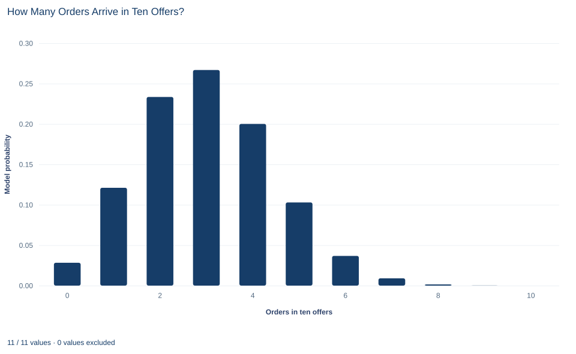

# Lab 06 · How Many Orders Arrive in Ten Offers?

**The binomial model for counts of successes in a fixed number of trials**

## Start with the supplied workbook

1. Download [ten_offer_orders.xlsx](ten_offer_orders.xlsx) and the [Python lab](lab.py). The workbook holds the fixed batches used throughout this chapter.
2. Import `ten_offer_orders.xlsx` into OpenEconometrics and keep that file name as the dataset name. The `Data` sheet holds one row per batch of ten offers; the `Dictionary` sheet explains the two columns.
3. Open the complete `lab.py` in a new Python document and run the whole file. It reads the imported dataset and displays a summary of the observed order counts, a bar chart of the binomial model probabilities and the table comparing model and data.

For ordinary Python, keep `lab.py` and the workbook in the same folder and run the script there, or call `from lab import run_lab` and then `run_lab(data_path="/path/to/ten_offer_orders.xlsx")`. If you want to try another model, such as a different order probability, change the calculation rather than the workbook, so the distributed file stays unchanged.

A sales team sends out offers in batches of ten. Each offer either turns into an order or does not, and each has the same 30% chance of doing so. A manager wants to know how often a batch will bring in at least five orders, because five orders fill a delivery van. A probability model answers that before any batch is sent: **0.150**. The supplied file then shows what happened in practice. In 500 batches, the share with at least five orders is **0.158**.

This lab uses **500 original synthetic batches**, each recording how many of its ten offers led to an order. The batches were simulated from exactly the mechanism the model describes, so the lab can show both how the model's probabilities are built and how a finite set of outcomes scatters around them. They are teaching records, not a real sales log, and no cell is blank. The [LaTeX table](table.tex) collects the reported numbers.

## 1. Name the unit and the trial

This lab has two levels, and keeping them apart avoids most mistakes.

The **trial** is one offer. It has two possible outcomes: an order (a "success") or no order. The **observation** is one batch of ten offers, and each row of `Data` records only the total for its batch.

| Column | What it records | Kind of variable |
|---|---|---|
| `batch_id` | A label from 1 to 500 that distinguishes batches | Identifier |
| `orders` | Number of the batch's ten offers that led to an order | Count, a whole number from 0 to 10 |

The count cannot be negative, cannot exceed ten and cannot be fractional. In the file the smallest count is 0 and the largest is 9; no batch converted all ten offers. Because the workbook keeps only totals, it cannot show which offers in a batch succeeded, only how many.

## 2. The binomial assumptions

Write $X$ for the number of orders in one batch. The binomial model says $X$ is the number of successes in $n$ trials when:

1. the number of trials is fixed in advance, here $n=10$;
2. each trial has two outcomes, order or no order;
3. every trial has the same success probability, here $p=0.3$;
4. the trials are independent: one offer's outcome does not change another's chance.

Each single offer is then a **Bernoulli trial**, and $X$ follows a **binomial distribution** with $n=10$ and $p=0.3$, written $X\sim\text{Binomial}(10,0.3)$.

These assumptions carry the whole model. The supplied batches satisfy them by construction. Real offers might not: a holiday advertisement could raise every offer's chance in the same week, or some customers could be far more likely to order than others. Section 8 returns to what such departures would do.

## 3. The probability of each count

The probability that a batch brings exactly $k$ orders is

$$
P(X=k)=\binom{10}{k}\,p^{k}\,(1-p)^{10-k},\qquad k=0,1,\dots,10 .
$$

Each piece has a job. $p^{k}(1-p)^{10-k}$ is the probability of one particular arrangement with $k$ orders and $10-k$ non-orders, for example the first three offers succeeding and the other seven failing. Independence is what allows these probabilities to be multiplied. The **binomial coefficient** $\binom{10}{k}=\frac{10!}{k!\,(10-k)!}$ counts how many different arrangements give the same total, since the order of successes does not matter for the count.

A worked case: for exactly three orders there are $\binom{10}{3}=120$ arrangements, each with probability $0.3^{3}\times0.7^{7}=0.027\times0.08235$. So

$$
P(X=3)=120\times0.027\times0.08235=0.267 .
$$

Three is the most likely count. At the other end, a batch with no orders at all requires ten failures in a row: $P(X=0)=0.7^{10}=0.028$. The eleven probabilities, one for each possible count, together form the **probability mass function**, and they sum to exactly 1.

## 4. Mean and variance of the count

Like any distribution, the binomial has a mean and a variance. For the binomial they have short formulas:

$$
E[X]=np=10\times0.3=3,\qquad \operatorname{Var}(X)=np(1-p)=10\times0.3\times0.7=2.1 .
$$

The mean is 3 orders per batch and the variance 2.1 orders squared; the standard deviation is $\sqrt{2.1}=1.449$ orders. The mean formula says that, on average, 30% of ten offers succeed. The factor $(1-p)$ in the variance reflects that counts vary most when success and failure are about equally likely, and not at all when $p$ is 0 or 1.

The same values can be recovered from the probability mass function by the general definitions $E[X]=\sum_k k\,P(X=k)$ and $\operatorname{Var}(X)=\sum_k (k-E[X])^2P(X=k)$. Getting the same answer both ways is a useful check that the eleven probabilities were computed correctly.

## 5. Add up a tail

**Pause before running.** Does "at least five orders" include a batch with exactly five orders?

It does. "At least five" means five or more, so the event is $\{X\ge5\}$ and its probability is the sum of six terms:

$$
P(X\ge5)=\sum_{k=5}^{10}\binom{10}{k}0.3^{k}0.7^{10-k}.
$$

"More than five" would start at six and answer a different question. Because the eleven probabilities sum to one, the same tail can be found through its complement, which is often quicker:

$$
P(X\ge5)=1-P(X\le4)=1-(0.0282+0.1211+0.2335+0.2668+0.2001)=1-0.8497=0.1503 .
$$

About 15% of batches should bring at least five orders. The model computes this from the mechanism alone, before any batch is observed.

## 6. Compare the model with the batches

After running `lab.py`, the summary of observed counts is:

```python
import openecon as oe

raw = load_data()  # reader defined in the complete lab.py
summary = oe.describe(raw, ["orders"], stats=["n", "mean", "std_dev", "min", "max"])
display(summary)
```

The model side can be computed from the formula, and the observed tail from the data:

```python
import math

pmf = [math.comb(10, k) * 0.3**k * 0.7 ** (10 - k) for k in range(11)]
model_mean = sum(k * prob for k, prob in enumerate(pmf))
model_variance = sum((k - model_mean) ** 2 * prob for k, prob in enumerate(pmf))
model_tail = sum(pmf[5:])
observed_tail = (raw.orders >= 5).mean()
print(round(sum(pmf), 6), round(model_mean, 3), round(model_variance, 3), round(model_tail, 4), observed_tail)
```

The probabilities sum to 1, and the two sides compare as follows:

| Quantity | Binomial model | 500 observed batches |
|---|---:|---:|
| Mean (orders per batch) | 3.000 | 3.064 |
| Variance (orders squared) | 2.100 | 2.132 |
| Standard deviation (orders) | 1.449 | 1.460 |
| Share of batches with at least five orders | 0.1503 | 0.158 |

Read the two columns as different kinds of number. The model column comes from $n$, $p$ and the formula; it would be the same for any file. The observed column comes from these 500 batches; the sample variance and standard deviation divide by $n-1$, as in Lab 03. A different set of 500 batches simulated from the same mechanism would give slightly different observed values, which is why the columns agree closely without matching exactly.

## 7. Read the bar chart



The chart shows the model, not the data. There is one bar for each possible count from 0 to 10, and its height is the model probability of that count. The bars sum to 1.

The tallest bar is at 3 orders (0.267), with 2 orders (0.233) and 4 orders (0.200) on either side. The distribution is not symmetric: it falls off more slowly to the right, because with $p=0.3$ there is more room above the mean of 3 than below it. The bars for 8, 9 and 10 orders are too short to see; ten orders out of ten has probability $0.3^{10}$, about 6 in a million.

The bars sit on whole numbers with gaps between them. That is the point of a discrete distribution: probability belongs to individual counts, and there is no probability "between" 4 and 5 orders. To read $P(X\ge5)$ from the chart, add the heights of the bars from 5 rightward. The chart does not show the observed batches; Exercise 2 asks you to make that comparison.

## A case from the literature

One of the best-known sets of binomial-like counts records the sexes of children in families. Lindsey and Altham (1998) reanalyzed data collected by Geissler in nineteenth-century Saxony, which give the size of each family and the sex of all its children. If every birth were an independent trial with the same probability of a boy, the number of boys in families of a given size would be binomial. Lindsey and Altham instead fitted three models that allow overdispersion, among them the beta-binomial model of Skellam (1948), in which the success probability varies between sets of trials, and let both the probability and the dispersion change with family size. The beta-binomial and a multiplicative binomial model fitted similarly, and substantially better than a double-binomial model. All the models showed that the probability of a boy and the dispersion were both greater in larger families, with some indication that families whose children were all of one sex needed extra probability.

That is the departure described in Section 8: when the success probability differs between batches, counts spread more widely than $np(1-p)$ allows and extreme counts become more common. The same beta-binomial idea has been applied to consumer purchasing behavior (Chatfield and Goodhardt, 1970). The lab's batches were simulated from the binomial model itself, so they cannot show overdispersion; a real sales log would have to be checked for it before the tail probability of 0.150 was trusted.

## 8. Decide what the evidence supports

Within the stated assumptions, the binomial probabilities are exact: if offers are independent with a constant 30% chance, the probability of at least five orders in ten is 0.150. The 500 batches agree well with the model, which is expected because they were simulated from it.

That agreement is not evidence that real offers behave this way. A close mean, in particular, says little: many different mechanisms produce an average of about 3 orders in 10. If a shared shock lifted or depressed all offers in a batch together, or if response probabilities varied between batches, counts would spread out more than the binomial allows, and extreme batches, with very many or very few orders, would be more common than the model predicts. For a decision that depends on the tail, such as how often a van fills, those departures matter most.

The model also depends on the batch size. With a different number of offers the possible counts, the mean and the variance all change, and the probability of a full van has to be recomputed.

## 9. Write the probability statement in full

A complete statement for the worked example reads: "If each of ten offers independently leads to an order with probability 0.3, the number of orders per batch follows a binomial distribution with mean 3 and variance 2.1. The probability that a batch brings at least five orders, five included, is 0.150. In 500 synthetic batches simulated from this mechanism, the mean was 3.064 orders and 15.8% of batches had at least five orders."

The statement separates the model's probability from the observed share, says which counts the event includes, and names the assumptions behind the model.

## Student exercises

1. Use the probability mass function to compute $P(X=5)$ and $P(X>5)$. Show how the two combine to give $P(X\ge5)$, and explain why confusing "at least" with "more than" changes the answer so much.
2. For each count from 0 to 10, compute the number of batches the model expects among 500, $500\,P(X=k)$, and compare it with the number of batches in the workbook with that count. Which count shows the largest gap?
3. Suppose batches had twenty offers instead of ten, with the same $p=0.3$. Compute the new mean, variance and standard deviation. Does the standard deviation double? Explain.
4. Recompute $P(X\ge5)$ for ten offers when the order probability is 0.35 instead of 0.3. By how much does the tail probability change, compared with the change in the mean?
5. A planner writes: "The chance of five orders in a batch is 15%." Explain what is wrong and rewrite the sentence so that it states the event, the model and its assumptions correctly.
6. Describe one realistic way in which real offers could violate the binomial assumptions. Explain how it would change the spread of the counts and the probability of at least five orders.

## Further reading

- Chatfield, C., and Goodhardt, G. J. (1970). The beta-binomial model for consumer purchasing behaviour. *Applied Statistics*, 19(3), 240. https://doi.org/10.2307/2346328
- Lindsey, J. K., and Altham, P. M. E. (1998). Analysis of the human sex ratio by using overdispersion models. *Journal of the Royal Statistical Society Series C: Applied Statistics*, 47(1), 149–157. https://doi.org/10.1111/1467-9876.00103
- Skellam, J. G. (1948). A probability distribution derived from the binomial distribution by regarding the probability of success as variable between the sets of trials. *Journal of the Royal Statistical Society Series B: Statistical Methodology*, 10(2), 257–261. https://doi.org/10.1111/j.2517-6161.1948.tb00014.x
