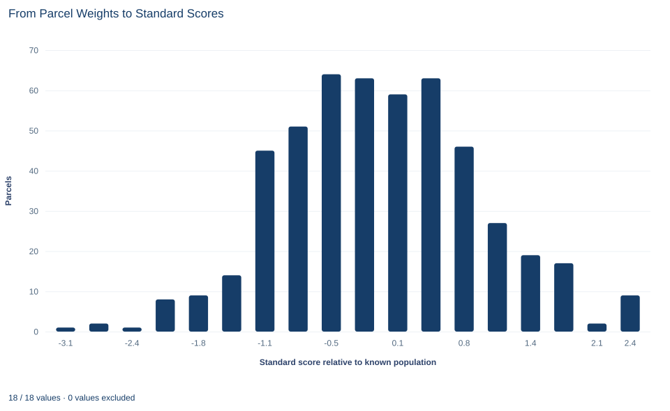

# Lab 07 · From Parcel Weights to Standard Scores

**Standard scores, the normal model and tail probabilities**

## Start with the supplied workbook

1. Download [parcel_weights.xlsx](parcel_weights.xlsx) and the [Python lab](lab.py). The workbook holds the fixed parcel weights used throughout this chapter.
2. Import `parcel_weights.xlsx` into OpenEconometrics and keep that file name as the dataset name. The `Data` sheet holds one row per parcel; the `Dictionary` sheet explains each column and its unit. No cell is blank.
3. Open the complete `lab.py` in a new Python document and run the whole file. It reads the imported dataset and displays a summary of the weights in grams, a histogram of the weights converted to standard scores and the reported numbers.

For ordinary Python, keep `lab.py` and the workbook in the same folder and run the script there, or call `from lab import run_lab` and then `run_lab(data_path="/path/to/parcel_weights.xlsx")`. If you want to try a transformation, work on a copy of the loaded table so the distributed workbook stays unchanged.

A packing line's output is described by a normal model with mean 1,000 grams and standard deviation 12 grams, so a parcel heavier than 1,012 grams is more than one standard deviation above the mean. How often should that happen? The model gives one answer: a probability of about 0.159. The parcels in the workbook give another: 69 of 500, an observed fraction of 0.138.

This lab explains where the first number comes from and why it need not equal the second. The workbook holds **500 original synthetic parcels**, each with one weight in grams, generated for teaching from the stated normal model rather than weighed on a real line. The [LaTeX table](table.tex) collects the reported numbers.

## 1. Separate the model from the sample

The **model** describes the process that produces parcels: a parcel weight $W$ is normal with population mean $\mu = 1000$ grams and population standard deviation $\sigma = 12$ grams. Both are fixed in advance, not computed from the workbook, and would stay the same for a different batch.

The **sample** is the batch of 500 weights actually recorded. Its mean $\bar w$ and standard deviation $s_w$ are computed from the data and change from batch to batch. Here they are 999.67 and 11.51 grams: close to the model values, but not equal to them.

The workbook has two columns:

| Column | What it records | Unit |
|---|---|---|
| `parcel_id` | A label from 1 to 500 that distinguishes parcels | Identifier, no arithmetic meaning |
| `grams` | The weight of that parcel | grams |

Every parcel has a weight, so all 500 rows enter every calculation.

## 2. Convert grams to standard scores

A **standard score**, or z score, measures how far a value lies from a reference mean, counted in reference standard deviations:

$$
Z=\frac{W-\mu}{\sigma}=\frac{W-1000}{12}.
$$

Numerator and denominator are both in grams, so the score has no unit. A score of $+1$ means "one model standard deviation above the model mean"; $-0.5$ means "half a standard deviation below it."

The two extreme parcels in the workbook make a worked example. The heaviest weighs 1,030.77 grams:

$$
z=\frac{1030.77-1000}{12}=\frac{30.77}{12}=2.56.
$$

The lightest weighs 961.11 grams, so its score is $(961.11-1000)/12=-3.24$, a little more than three standard deviations below the mean. Neither number is a probability. Each is a position on a rescaled axis, like a temperature read in Celsius instead of Fahrenheit.

Because the reference values are fixed, the conversion also runs backward: a score $z$ corresponds to a weight of $1000 + 12z$ grams. The threshold in the opening question, 1,012 grams, is the point $z = 1$.

## 3. What standardizing does to a sample

Standardizing is a linear change of scale. Subtracting 1,000 shifts every weight equally, leaving the distances between parcels unchanged; dividing by 12 shrinks every distance by the same factor. So:

$$
\bar z=\frac{\bar w-1000}{12},\qquad s_z=\frac{s_w}{12}.
$$

Here $\bar z$ and $s_z$ are the mean and standard deviation of the 500 scores. The shape of the distribution does not change: a skewed batch stays skewed, and a batch with two peaks keeps both. Standardizing relabels the axis; it does not reshape the data.

**Pause before running.** Should the sample mean of $z$ be exactly zero when the population parameters are known? Write down your answer, and a prediction for the sample standard deviation of $z$, before you read the output.

## 4. Run the summary and the conversion

The complete file reads the workbook with `load_data()`. The key steps are a descriptive summary in grams followed by the conversion to the model scale:

```python
import openecon as oe

raw = load_data()  # reader defined in the complete lab.py
weights = oe.describe(raw, ["grams"], stats=["n", "mean", "std_dev", "min", "max"])
display(weights)

z = (raw.grams - 1000) / 12  # known model mean and standard deviation
print(round(z.mean(), 4), round(z.std(), 4))
```

The results on both scales are:

| Scale | Parcels | Mean | Standard deviation | Minimum | Maximum |
|---|---:|---:|---:|---:|---:|
| Weight (grams) | 500 | 999.67 | 11.51 | 961.11 | 1,030.77 |
| Standard score (model units) | 500 | −0.028 | 0.959 | −3.24 | 2.56 |

The first row describes the batch: these parcels average 999.67 grams and typically differ from that average by about 11.5 grams. The standard deviation divides by $n-1$, the usual sample convention.

The second row answers the pause question. The mean score is −0.028, not zero, because the batch mean is 0.33 grams below 1,000 and $0.33/12 = 0.028$. The standard deviation of the scores is 0.959, not one, because $11.51/12 = 0.959$. The scores would have mean 0 and standard deviation 1 only if the batch reproduced the model's parameters, which a finite sample almost never does. Forcing them to would swap the stated reference for one fitted to this batch.

## 5. From a standard score to a tail probability

Standard scores earn their place through one property of the normal family: if $W$ is normal with mean $\mu$ and standard deviation $\sigma$, then $Z=(W-\mu)/\sigma$ is normal with mean 0 and standard deviation 1. Every normal probability can therefore be read from one curve, the **standard normal**, with cumulative distribution function

$$
\Phi(z)=P(Z\le z).
$$

The probability that a parcel exceeds 1,012 grams becomes

$$
P(W>1012)=P\!\left(Z>\frac{1012-1000}{12}\right)=P(Z>1)=1-\Phi(1).
$$

"Weight above 1,012 grams" and "score above 1" are the same event in two units, so they share a probability. $\Phi$ has no simple closed form, but $\Phi(z)=\tfrac12\bigl[1+\operatorname{erf}(z/\sqrt2)\bigr]$ and $1-\Phi(z)=\tfrac12\operatorname{erfc}(z/\sqrt2)$, and Python's `math` module provides both error functions:

```python
import math

model_above = 0.5 * math.erfc(1 / math.sqrt(2))  # P(Z > 1)
model_within_two = math.erf(2 / math.sqrt(2))  # P(-2 < Z < 2)
print(round(model_above, 4), round(model_within_two, 4))
```

It prints 0.1587 and 0.9545. Under the model, about 15.9% of parcels weigh more than 1,012 grams and about 95.4% lie within two standard deviations of the mean. These describe the process, not this batch, and hold for every normal model: one standard deviation above the mean always leaves 0.1587 in the upper tail.

## 6. Compare the model probability with the observed fraction

Counting the parcels that actually exceed the threshold requires no model at all:

```python
heavy = raw.grams > 1012
print(int(heavy.sum()), heavy.mean())
```

It prints 69 and 0.138. The model expects about $0.1587 \times 500 \approx 79$ heavy parcels in a batch of this size, so the batch has roughly ten fewer than expected, or about two percentage points.

The gap is not an arithmetic error, and on its own it does not show the model is wrong. The model probability is the long-run share of heavy parcels from the process; the observed fraction describes one batch. Even if every parcel came from exactly this model, the count above 1,012 grams would vary from batch to batch, as the number of heads in 500 coin tosses varies around 250. Whether ten fewer is unusual depends on how much that count typically varies, which Exercise 5 asks you to work out.

## 7. Read the histogram



The histogram places each parcel at its model standard score and counts parcels in 18 equal-width bins, each about 0.32 standard deviations (roughly 3.9 grams) wide; the bars add up to 500. They form a single mound centered close to zero, with the four tallest bars, 59 to 64 parcels each, covering scores from about −0.7 to +0.6. The left tail reaches further: four parcels lie more than about 2.3 standard deviations below the mean, while the right tail ends at 2.56. The rightmost bin holds nine parcels, more than its neighbor, an irregularity a single batch can show.

The vertical axis counts parcels, and no normal curve is drawn over the bars. A score of 1 is 1,012 grams, but no bin edge falls exactly there, so the 69 heavy parcels cannot be counted off the chart. A roughly bell-shaped histogram is consistent with the normal model without proving it: many non-normal distributions look similar with 500 parcels, and the far tails hold too few parcels to judge by eye.

## A case from the literature

How often do real measurements follow the normal model closely enough to trust its tails? Micceri (1989) examined 440 large-sample achievement and psychometric measures and found every one significantly non-normal at the 0.01 level. The departures took several forms: tail weights ranging from that of the uniform distribution to that of the double exponential, asymmetry as strong as an exponential distribution's, severe preferences for particular digits, several modes, and modes lying outside the interval between the mean and the median. He concluded that the assumptions behind normal-theory statistics did not appear to hold for these common kinds of data, while noting that his findings also failed to support the distributions used in most earlier robustness research.

These were test scores, not parcel weights, but the lesson carries over to Section 8. The tail probability 0.159 is a property of the normal model, and the tail of a real process may be lighter or heavier. In quality engineering the same concern arises for process capability indices, which Somerville and Montgomery (1996) examined under non-normal distributions. A formal check, such as the test for normality proposed by Shapiro and Wilk (1965), can flag a departure, but passing such a test does not establish that the far tails, where a quality decision often rests, follow the model. The lab's parcels were generated from the normal model, so they cannot show any of these departures.

## 8. Decide what the evidence supports

The calculations support a description of these 500 parcels, the conversion of any weight to the model scale, and the model's tail probabilities if the model is accepted. They do not support the following.

- **A standard score is not a probability or a p value.** The score 1 is a position; 0.1587 is a tail area that also requires the assumption that weights are normal.
- **Standardizing does not create or test normality.** It changes units and leaves the shape untouched.
- **The tail probability is only as good as the model.** A real quality-control decision needs evidence about the distribution's shape, especially its tails, the stability of the process, the calibration of the scale and the independence of consecutive parcels. Synthetic records supply none of it.
- **The parameters here are stipulated, not estimated.** Had $\mu$ and $\sigma$ been estimated from the batch, plugging the estimates into $\Phi$ as if they were known would understate the uncertainty of a prediction.

## 9. Write the conclusion in full

A complete statement for the worked example reads: "Under a normal model with mean 1,000 grams and standard deviation 12 grams, a weight of 1,012 grams is a standard score of 1, and the model probability that a parcel exceeds it is $1-\Phi(1) = 0.159$. In a batch of 500 synthetic parcels, 69 (0.138) weighed more than 1,012 grams. On the model's standard-score scale, the batch has mean −0.028 and standard deviation 0.959. The model probability describes the process and the observed fraction describes this batch; whether their difference exceeds ordinary batch-to-batch variation is a separate question."

## Student exercises

1. Convert 1,006 grams and 979 grams to standard scores on the model scale, and convert a standard score of −1.5 back to grams. Say in words what each score tells you about the parcel.
2. Count the parcels that weigh between 976 and 1,024 grams. Compare the observed fraction with the model probability 0.9545, and report how many parcels fall outside that range on each side.
3. Use the symmetry of the standard normal curve to find the model probability that a parcel weighs less than 988 grams, and the probability that it weighs between 988 and 1,012 grams. Then count the parcels in each range and compare.
4. Standardize the weights with the sample mean and sample standard deviation instead of 1,000 and 12. Which weight in grams now corresponds to a score of 1? How many parcels exceed it, and why does that count differ from 69?
5. Under the model, the number of parcels above 1,012 grams in a batch of 500 is binomial with success probability 0.1587. Compute the standard deviation of that count and state how many standard deviations the observed 69 lies from the expected count. Is the shortfall surprising?
6. A colleague writes: "Parcels with z = 1 have a 16% chance of being overweight, and the bell-shaped histogram proves the weights are normal." Rewrite it so that it separates the standard score, the model probability, the observed fraction and the question of normality, and name two kinds of evidence a real packing line would need before relying on the tail probability.

## Further reading

- Micceri, T. (1989). The unicorn, the normal curve, and other improbable creatures. *Psychological Bulletin*, 105(1), 156–166. https://doi.org/10.1037/0033-2909.105.1.156
- Shapiro, S. S., and Wilk, M. B. (1965). An analysis of variance test for normality (complete samples). *Biometrika*, 52(3-4), 591–611. https://doi.org/10.1093/biomet/52.3-4.591
- Somerville, S. E., and Montgomery, D. C. (1996). Process capability indices and non-normal distributions. *Quality Engineering*, 9(2), 305–316. https://doi.org/10.1080/08982119608919047
